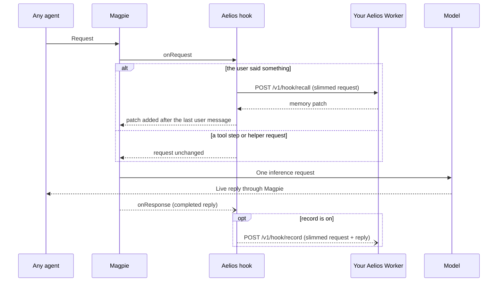

# Aelios plugin for Magpie

[Aelios](https://github.com/wusaki0723/Aelios) is a layered long-term memory
you deploy yourself on Cloudflare: it recalls what fits each turn, keeps what
was said, and tidies it overnight. This plugin brings it to **every agent
behind Magpie**: before each turn, the memory Aelios recalls for it is added
after the user's message; after the reply, and only if you turn `record` on,
the turn is handed to Aelios to remember. Your agents keep whatever models and
subscriptions they use in Magpie; nothing has to point at an Aelios gateway.



The package declares `magpie.hooks: "./aelios.hooks.mjs"`, Magpie's
asynchronous Bun hook entry. It is not gateway middleware and has no OpenCode
provider. It needs **Magpie 0.1.1273 or newer** and Bun; from **Magpie
0.1.2210** the key Magpie writes into your own agents on this computer
(`magpie-key`) counts as yours too.

## Before you start

1. **Deploy Aelios yourself.** Follow the
   [Aelios README](https://github.com/wusaki0723/Aelios#readme). The plugin
   needs an Aelios that has the hook endpoints, `POST /v1/hook/recall` and
   `POST /v1/hook/record`, including the recall endpoint's explicit `record`
   permission added in [commit a57269c](https://github.com/sakisakisa-design/Aelios/commit/a57269c)
   ([Aelios PR #102](https://github.com/wusaki0723/Aelios/pull/102)).
   Deploy that commit or a later version containing it; omitting `record`
   saves no user message or remember-now memory. An older Aelios without these endpoints
   answers 404; the plugin then leaves requests alone and shows *unavailable*.
2. **Add your agents' model names to the assistant's main models** in Aelios
   `/admin` (or use `*`). Aelios only recalls and records for its main
   models; for anything else it answers `off` and the plugin shows
   *unbound*. To keep GPT and Claude in separate spaces, set each assistant's
   main models separately in `/admin`.

## Install and configure

```sh
magpie plugin add @magpie-community/gateway-aelios
```

Then open **Plugins › Aelios** in Magpie. On first use, enter the server URL
and API key and click **Connect and test**. The plugin saves through Magpie,
confirms the saved settings, then opens its local service page with automatic
testing enabled. If saving cannot be confirmed, your edits stay in the form
and the page does not navigate.

Once configured, the page shows the saved URL, a **Change connection** control,
and the recall/record switches (*Recall memory* on, *Record conversations* off
by default). Configured settings do not mean the connection has been verified.
**View matching list / retest** opens the local service page, which tests the
saved connection and shows the server-authorized assistants and their main
model matching rules through read-only `GET /v1/hook/identities`. This list needs
an Aelios version containing that endpoint; older Workers still support recall
and recording, while the page explains that the list is unavailable. The service
page has a button back to settings. Testing
sends empty messages; it creates no dialogue and records nothing.

**Assistant assignment** defaults to **Automatic**, reusing Aelios's main-model
matching rules, choosing the first authorized assistant whose main-model pattern
matches. Unmatched models do not use memory. Existing `identity` or `routes`
are shown as **Custom** and retain their semantics. The collapsed **Advanced
settings** section contains the default/fallback identity, ordered identity
routes, agent filter, API key environment variable and remote-request switch.
You can continue editing those settings there; ordinary saves preserve them.
No hand-written JSON is needed.

The same options can still be set from the command line:

```sh
magpie plugin options aelios '{"serverUrl":"https://<your-aelios>.workers.dev","gatewayTimeoutMs":5000}'
```

Give it your Aelios API key in Magpie's environment as `AELIOS_API_KEY`, or as
`apiKey` in the options. The key is sent as `Authorization: Bearer <key>` to
your `serverUrl` only, never through a redirect.

Set `gatewayTimeoutMs` as above: without it Magpie gives a hook 1 second, and
the plugin then gives Aelios a little under that. The page fills in 5000 when
the setting is absent.

To use a separate assistant space (recommended while you try it out), create
one in Aelios `/admin` and set `"identity": "<its slug>"`.

## Route models to separate identities

Create `gpt-husband` and `claude-husband` identities in Aelios `/admin`, then
configure the plugin:

```json
{
  "serverUrl": "https://<your-aelios>.workers.dev",
  "gatewayTimeoutMs": 5000,
  "record": true,
  "routes": [
    { "models": ["gpt-*"], "identity": "gpt-husband" },
    { "models": ["claude-*"], "identity": "claude-husband" }
  ]
}
```

Routes are checked in order; **the first match wins**, ahead of the top-level
`identity`. Model patterns match the whole name, case insensitively, with `*`
matching any characters. Both the full Magpie model name and the suffix after
its last `/` are tried, so `openai/gpt-5` matches `gpt-*`. Other punctuation
is literal. The request body's model is used if Magpie provides no model.

A route can also select exact Magpie agent ids:
`{"agents":["codex"],"models":["gpt-*"],"identity":"gpt-husband"}`.
When both selectors are present, **both must match**. Agent ids are case
sensitive; `*` has no special meaning in an agent id. The top-level `agents`
option still limits which requests the plugin handles.

With nonempty `routes`, an unmatched request uses only an explicitly configured
top-level `identity`. Without that fallback, both recall and recording are
skipped, preventing accidental use of the server's default identity. Omit
`routes` or use `[]` to preserve the existing behavior: top-level `identity`
is used when set, otherwise Aelios chooses the first assistant available to the key whose main
models match this request's model, falling back to the key's default assistant.

**Separate identities need separate Aelios memory namespaces.** Give these
identities different `namespace` values and avoid shared `readNamespaces` if
they must not recall each other's memories. Routing chooses an identity; it
does not create identities or isolate spaces that Aelios is configured to
share. Each identity's Aelios `models` whitelist must also allow its actual
model names (or `*`), including provider-prefixed names when sent; the plugin's
route patterns do not configure that server whitelist.

Routing also applies to tool continuations and `recall: false`. The original
identity, model, agent, session and slimmed request are saved before recall,
so recording uses the same exchange metadata even if the response context or
route options change. Recording still requires the current `record` permission
and the current origin and top-level agent restrictions. Recall backoff is
separate for each resolved identity.

## What is sent

Recall sends a **slimmed copy** of the request: roles and message text, tool
names, and the session id. Historical tool calls keep only their type and
name; their arguments and input are never sent. It does **not** send system
prompts or instructions, what tools returned (tool results are sent empty),
images, files or audio (replaced by `[image]`, `[file]`, `[audio]`), or thinking.
Only turns where the user said something are recalled; tool steps are not
sent for recall.

**`record` is off by default.** Recall sends `record: false`, so Aelios
searches existing memories without saving the user's words or creating new
memories. This requires an Aelios hook endpoint that honors the `record`
permission; upgrade older hook endpoints before using the plugin.
If you want Aelios to remember your conversations, turn it on:

```sh
magpie plugin options aelios '{"serverUrl":"https://<your-aelios>.workers.dev","gatewayTimeoutMs":5000,"record":true}'
```

With `record` on, after each reply the slimmed request and the completed
reply are sent to Aelios: what you said, what the assistant said, and the
arguments of its tool calls. Tool results are not sent. For coding agents
(Claude Code, Codex, OpenCode, …) Aelios replaces code blocks with `[code]`.
If the current user text looks like it contains a credential (an API key, a
token, a private key, `password=`…), the entire turn skips both recall and
recording, even with `record: false`, so read-only recall cannot upload it.
Historical text that matches the same check is replaced with the fixed marker
`[credential omitted]` in the slimmed copy, preserving the message structure.
A later ordinary user turn can recall and record normally; a credential in
history does not disable memory for the rest of the conversation. The original
request sent to the model is untouched by this sanitization. A credential in
the completed reply's text or tool arguments still skips recording. The new
reply, including speech tool arguments, is otherwise sent unchanged. Each
record is sent once and never retried.

## Things to know

- **Don't double up.** If an agent already uses an Aelios gateway as its
  upstream, it gets memory there; exclude it here with `agents` or every turn
  is recorded twice.
- **Tools.** The plugin adds no tools. For `recall` / `remember` tools, add
  Aelios's `/mcp` endpoint in Magpie's **Library › MCP**.
- **Who it serves.** By default only direct requests on this computer
  (`local`) and Magpie's own key for your agents (`magpie-key`) are handled.
  Other gateway keys (possibly a friend's), remote requests and requests of
  unknown origin are left alone unless you set `allowRemote`.
- **Fails open.** If Aelios is slow, down, refuses the key or is too old, the
  request goes to the model as it came. After a timeout, connection failure,
  5xx, 404 or 401, recall pauses for `recallBackoffMs` before trying again. A
  client that cancels does not count.
- Gemini requests are not supported yet and pass through untouched, as do
  Responses requests that continue server-side state
  (`previous_response_id`, `conversation`).

## Options

| Option | Default | |
|---|---|---|
| `serverUrl` | none | Your Aelios Worker. Without it nothing is sent. HTTPS only (plain HTTP allowed for `localhost`, `127.0.0.1`, `[::1]`); no user, password, query or fragment in the URL. |
| `apiKey` | none | Aelios API key. Without it, the variable named by `apiKeyEnv` is used. Without either, nothing is sent. |
| `apiKeyEnv` | `AELIOS_API_KEY` | Environment variable that holds the key. |
| `identity` | none | Aelios assistant space slug; fallback for unmatched routes. Without routes and when empty, Aelios selects the first available assistant whose main models match this model, falling back to the key's default assistant. |
| `routes` | none | Up to 64 identity routes in priority order. Each needs a valid ASCII identity slug (max 64 characters; Aelios reserved slugs excluded) and nonempty `models` and/or `agents` arrays. Model patterns are nonblank strings up to 200 characters; agents are nonblank exact ids. Nonempty routes without a match or explicit `identity` skip recall and recording. |
| `agents` | all | Only these Magpie agent ids, e.g. `["claude","claude-desktop"]`. Empty means all. Other ids include `qwen` and `kimi`; legacy `claude-code` remains supported as an exact id. |
| `recall` | `true` | Recall before each turn. |
| `record` | `false` | Record each turn after the reply. |
| `allowRemote` | `false` | Also handle other gateway keys, remote and unknown origins (recall and record). |
| `gatewayTimeoutMs` | Magpie's 1000 | How long Magpie waits for the hook, 100–10000 ms. Set it to about 5000. |
| `requestTimeoutMs` | `4000` | Deadline of one recall request to Aelios, 50–9000 ms, kept just under `gatewayTimeoutMs`. Records have their own 10 s. |
| `recallBackoffMs` | `30000` | After a failure, how long recall is paused (0 turns the pause off). |
| `port` | `3481` | Loopback port of the settings page's connection test. Change it only if that port is taken. |

Invalid options make the hook stand aside (*invalid*); the key never appears
in a report or error.

## Status codes

Magpie's Plugins page shows one code per request, never any content:
`ready` (memory added, with its size), `empty` (nothing relevant),
`unbound` (not a main model, or the key has no such assistant),
`unauthorized` (Aelios refused the key, or there is none), `unavailable`
(timeout, 5xx, an Aelios without hook endpoints, or paused after a failure),
`invalid` (bad options or an answer the plugin can't read) and `skipped`
(origin or agent not handled, a tool step, Gemini, server-side Responses
state).

## Development

```sh
bun test ./*.test.mjs      # Aelios faked with fetch; no network, no key
```

The settings page is `page/settings.html` with `page/settings.js`, `page/form.js`,
`page/style.css` and `page/i18n.js`; the connection test is `service.mjs` and
`probe.mjs`. `page.test.mjs` drives the browser script in a small `node:vm`
harness, so the form's validation, the option merge and the save/test paths are
covered without a browser. Magpie frames a page with `allow-scripts` but not
`allow-forms`, so saving is a button click and never a form submit.
