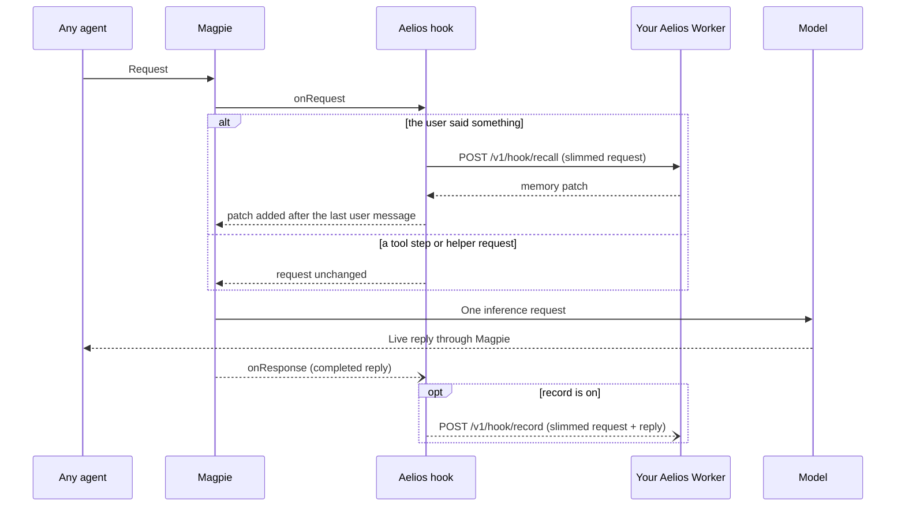

# Aelios plugin for Magpie

[Aelios](https://github.com/wusaki0723/Aelios) is a layered long-term memory
you deploy yourself on Cloudflare: it recalls what fits each turn, keeps what
was said, and tidies it overnight. This plugin brings it to **every agent
behind Magpie**: before each turn, the memory Aelios recalls for it is added
after the user's message; after the reply, and only if you turn `record` on,
the turn is handed to Aelios to remember. Your agents keep whatever models and
subscriptions they use in Magpie; nothing has to point at an Aelios gateway.



The package declares `magpie.hooks: "./aelios.hooks.mjs"`, Magpie's
asynchronous Bun hook entry. It is not gateway middleware and has no OpenCode
provider. It needs **Magpie 0.1.1273 or newer** and Bun; from **Magpie
0.1.2210** the key Magpie writes into your own agents on this computer
(`magpie-key`) counts as yours too.

## Before you start

1. **Deploy Aelios yourself.** Follow the
   [Aelios README](https://github.com/wusaki0723/Aelios#readme). The plugin
   needs an Aelios that has the hook endpoints, `POST /v1/hook/recall` and
   `POST /v1/hook/record`, including the recall endpoint's explicit `record`
   permission added in [commit a57269c](https://github.com/sakisakisa-design/Aelios/commit/a57269c)
   ([Aelios PR #102](https://github.com/wusaki0723/Aelios/pull/102)).
   Deploy that commit or a later version containing it; omitting `record`
   saves no user message or remember-now memory. An older Aelios without these endpoints
   answers 404; the plugin then leaves requests alone and shows *unavailable*.
2. **Add your agents' model names to the assistant's main models** in Aelios
   `/admin` (or use `*`). Aelios only recalls and records for its main
   models; for anything else it answers `off` and the plugin shows
   *unbound*.

## Install and configure

```sh
magpie plugin add @magpie-community/gateway-aelios
magpie plugin options aelios '{"serverUrl":"https://<your-aelios>.workers.dev","gatewayTimeoutMs":5000}'
```

Give it your Aelios API key in Magpie's environment as `AELIOS_API_KEY`, or as
`apiKey` in the options. The key is sent as `Authorization: Bearer <key>` to
your `serverUrl` only, never through a redirect.

Set `gatewayTimeoutMs` as above: without it Magpie gives a hook 1 second, and
the plugin then gives Aelios a little under that.

To use a separate assistant space (recommended while you try it out), create
one in Aelios `/admin` and set `"identity": "<its slug>"`.

## What is sent

Recall sends a **slimmed copy** of the request: roles and message text, the
names of the tools, the arguments of tool calls (Aelios keeps what "speech"
tools such as sending a message said), and the session id. It does **not**
send system prompts or instructions, what tools returned (tool results are
sent empty), images, files or audio (replaced by `[image]`, `[file]`,
`[audio]`), or thinking. A single tool call over 16 KB is sent without its
arguments. Only turns where the user said something are recalled; tool steps
are not sent at all.

**`record` is off by default.** Recall sends `record: false`, so Aelios
searches existing memories without saving the user's words or creating new
memories. This requires an Aelios hook endpoint that honors the `record`
permission; upgrade older hook endpoints before using the plugin.
If you want Aelios to remember your conversations, turn it on:

```sh
magpie plugin options aelios '{"serverUrl":"https://<your-aelios>.workers.dev","gatewayTimeoutMs":5000,"record":true}'
```

With `record` on, after each reply the slimmed request and the completed
reply are sent to Aelios: what you said, what the assistant said, and the
arguments of its tool calls. Tool results are not sent. For coding agents
(Claude Code, Codex, OpenCode, …) Aelios replaces code blocks with `[code]`.
A request whose slimmed conversation looks like it contains a credential
(an API key, a token, a private key, `password=`…) is skipped before either
recall or recording is sent. A credential in the completed reply also skips
recording. Each record is sent once and never retried.

## Things to know

- **Don't double up.** If an agent already uses an Aelios gateway as its
  upstream, it gets memory there; exclude it here with `agents` or every turn
  is recorded twice.
- **Tools.** The plugin adds no tools. For `recall` / `remember` tools, add
  Aelios's `/mcp` endpoint in Magpie's **Library › MCP**.
- **Who it serves.** By default only direct requests on this computer
  (`local`) and Magpie's own key for your agents (`magpie-key`) are handled.
  Other gateway keys (possibly a friend's), remote requests and requests of
  unknown origin are left alone unless you set `allowRemote`.
- **Fails open.** If Aelios is slow, down, refuses the key or is too old, the
  request goes to the model as it came. After a timeout, connection failure,
  5xx, 404 or 401, recall pauses for `recallBackoffMs` before trying again. A
  client that cancels does not count.
- Gemini requests are not supported yet and pass through untouched, as do
  Responses requests that continue server-side state
  (`previous_response_id`, `conversation`).

## Options

| Option | Default | |
|---|---|---|
| `serverUrl` | none | Your Aelios Worker. Without it nothing is sent. HTTPS only (plain HTTP allowed for `localhost`, `127.0.0.1`, `[::1]`); no user, password, query or fragment in the URL. |
| `apiKey` | none | Aelios API key. Without it, the variable named by `apiKeyEnv` is used. Without either, nothing is sent. |
| `apiKeyEnv` | `AELIOS_API_KEY` | Environment variable that holds the key. |
| `identity` | none | Aelios assistant space slug; the key's default assistant if empty. |
| `agents` | all | Only these Magpie agent ids, e.g. `["claude-code","claude-desktop"]`. Empty means all. |
| `recall` | `true` | Recall before each turn. |
| `record` | `false` | Record each turn after the reply. |
| `allowRemote` | `false` | Also handle other gateway keys, remote and unknown origins (recall and record). |
| `gatewayTimeoutMs` | Magpie's 1000 | How long Magpie waits for the hook, 100–10000 ms. Set it to about 5000. |
| `requestTimeoutMs` | `4000` | Deadline of one recall request to Aelios, 50–9000 ms, kept just under `gatewayTimeoutMs`. Records have their own 10 s. |
| `recallBackoffMs` | `30000` | After a failure, how long recall is paused (0 turns the pause off). |

Invalid options make the hook stand aside (*invalid*); the key never appears
in a report or error.

## Status codes

Magpie's Plugins page shows one code per request, never any content:
`ready` (memory added, with its size), `empty` (nothing relevant),
`unbound` (not a main model, or the key has no such assistant),
`unauthorized` (Aelios refused the key, or there is none), `unavailable`
(timeout, 5xx, an Aelios without hook endpoints, or paused after a failure),
`invalid` (bad options or an answer the plugin can't read) and `skipped`
(origin or agent not handled, a tool step, Gemini, server-side Responses
state).

## Development

```sh
bun test ./*.test.mjs      # Aelios faked with fetch; no network, no key
```
