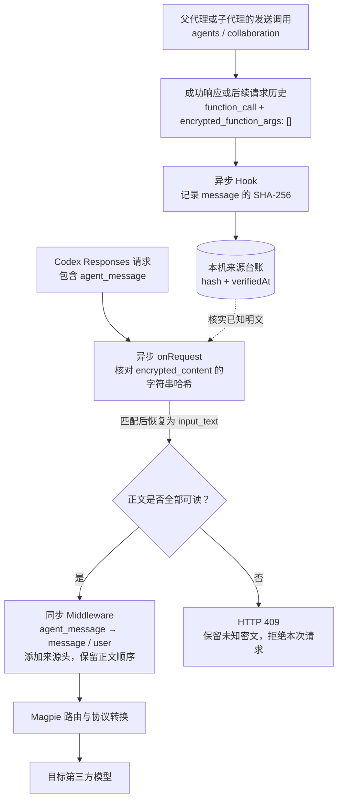

# Magpie Agent Message Compat

[](https://github.com/YHonc/magpie-agent-message-compat/actions/workflows/test.yml)
[](LICENSE)

为通过 [Magpie](https://github.com/yetone/magpie) 使用第三方模型的 Codex MultiAgent V2 会话，补齐子代理消息的格式兼容。当前版本 **0.1.1**，由异步 Gateway Hook 和同步 Gateway Middleware 组成。

## 遇到了什么问题

Codex 的多代理消息使用 `agent_message`。跨模型供应商传递任务时，排查中遇到两个不同的问题：

| 问题 | 表现 | 插件的处理 |
| --- | --- | --- |
| 第三方接口没有处理 `agent_message` | 子代理已启动，却看不到任务；父代理收到空回复或无关内容 | 把可读的代理消息转成普通 `message`，保留正文和发送者、接收者 |
| 原本是明文的任务被装进 `encrypted_content` | 任务正文被当成密文，直接丢弃会丢任务，直接当明文读取又无法区分真正密文 | 先记录原发送调用中明确标为明文的任务哈希；只恢复与记录完全匹配的字符串 |

这两步需要配合：只做格式转换，仍可能拿不到正文；只恢复正文，上游仍可能忽略整个 `agent_message`。是否需要启用，取决于实际路由和 Magpie/Codex 版本，默认匹配表不代表所有列出的模型都已完成多代理验收。

## 解决架构



Magpie 先运行异步请求 Hook，再运行同步 Middleware。源响应的 `onResponse` 通知是异步的，因此 Hook 默认最多等待 **800 ms**，给来源记录写入留出时间。

### 第一步：核实被误标的明文

`provenance.hooks.mjs` 只从满足以下条件的工具调用取证：

- 协议是 Responses，来源由 Magpie 判定为 `local` 或 `magpie-key`；
- 调用类型为 `function_call`，命名空间为 `agents` 或 `collaboration`；
- 工具名为 `spawn_agent`、`followup_task` 或 `send_message`；
- `encrypted_function_args` 明确为 `[]`，参数中有非空字符串 `message`。

记录来自成功响应，或本地后续请求带回的调用历史。插件计算 `message` 的 SHA-256，只把哈希和核实时间写入本机台账。

遇到 `agent_message.content[].encrypted_content` 时，对该字段的**原字符串**计算哈希；只有匹配已记录的明文时，才把字段恢复为 `input_text`。这一步不执行解密，也不通过 Base64 外观或文本内容猜测它是不是明文。

### 第二步：转换代理消息

`compat.middleware.js` 把全部内容均为 `input_text` 的代理消息转换为：

```json
{
  "type": "message",
  "role": "user",
  "content": [
    { "type": "input_text", "text": "[Agent message: /root/worker -> /root]\n" },
    { "type": "input_text", "text": "子代理发来的正文" }
  ]
}
```

各段正文和消息顺序保持不变。这里的 `user` 是兼容传输角色，内容仍来自代理；头部标注保留了来源，但不能提供原生代理角色的隔离语义。使用方需要继续区分人类授权与子代理内容。

仍含未知内容或未核实密文时返回 **409**；全为空白的文本消息返回 **400**。插件不会静默省略无法读取的任务。

## 安装

本目录为社区包 `@magpie-community/middleware-agent-message-compat`，来源版本和文件哈希见 [PROVENANCE.json](PROVENANCE.json)。社区收录并发布后，可通过 `magpie plugin add @magpie-community/middleware-agent-message-compat` 安装；审核期间可使用下面的 GitHub 安装方式。两个来源只需启用一份。

需要支持 `magpie.hooks` 与 `magpie.middleware` 的 Magpie；开发时使用 Magpie **0.1.2964**。本包没有第三方运行时依赖，异步 Hook 使用 Magpie 管理的 Bun 和 Node 兼容标准库。

终端中的 `magpie` 可用时：

```sh
magpie plugin add github:YHonc/magpie-agent-message-compat
```

Windows PowerShell 没有配置 PATH 时：

```powershell
$magpie = Join-Path $env:LOCALAPPDATA 'Programs\magpie\magpie.com'
& $magpie plugin add 'github:YHonc/magpie-agent-message-compat'
```

安装后在 Magpie 插件页面确认插件已开启，并检查 Hook 和 Middleware 是否加载。原有本地副本应先关闭，避免两份插件重复处理。

也可以克隆后从本地目录安装：

```sh
git clone https://github.com/YHonc/magpie-agent-message-compat.git
magpie plugin add ./magpie-agent-message-compat
```

## 配置

在插件页面打开 **Options**，按自己的路由名称设置，例如：

```json
{
  "targets": ["my-provider/gemini-*", "my-provider/claude-*"],
  "gatewayTimeoutMs": 2000,
  "waitForProvenanceMs": 800
}
```

`package.json` 中的 `magpie.options` 是编辑器示例，实际覆盖值以 Magpie 保存的插件选项为准。

| 选项 | 含义 |
| --- | --- |
| `targets` | 需要转换的完整模型路由。支持精确名称或末尾单个 `*`；`[]` 停止目标消息的恢复和转换，但 Hook 仍可记录本地调用证据 |
| `gatewayTimeoutMs` | Magpie 异步 Hook 超时预算，示例为 2000 ms，由宿主执行 |
| `waitForProvenanceMs` | 等待异步来源记录的时间，默认 800 ms，代码限制在 0–1200 ms |
| `ledgerPath` | 可选的台账路径。默认在用户主目录下的 `.config/magpie/agent-message-compat/provenance.json` |
| `provenanceRevision` | 可选的台账缓存版本标识。人工核实并导入历史哈希后，更改此值可重新载入台账 |

默认目标来自开发时的路由名称：

```text
cpa/gemini-*
cpa/claude-*
cpa/glm-*
ora2/claude-*
group/glm-*
group/deepseek-*
```

这些前缀应替换为自己 Magpie 中的路由名称。默认不匹配原生 GPT 路由；不会修改 Codex 工具命名空间、模型目录或 CPA 配置。

### 关闭和移除

在插件页面使用开关，或执行：

```sh
magpie plugin list
magpie plugin off magpie-agent-message-compat
magpie plugin on magpie-agent-message-compat
magpie plugin rm magpie-agent-message-compat
```

插件也可能以安装 spec 或本地路径登记，名称以 `plugin list` 为准。关闭插件不删除来源台账。

## 版本 0.1.1 的变化

0.1.0 的台账保留 6 小时、最多 2048 项。旧对话重新发送历史消息时，这些记录可能已经过期或被淘汰，导致原本核实过的消息再次返回 409。

0.1.1 改为持久保存核实记录，以 `verifiedAt` 记时间，兼容读取旧版 `expires` 记录；保存时合并磁盘已有记录，并提供 `provenanceRevision` 重新载入入口。当前没有自动过期或容量淘汰，台账会随已核实任务增长。

## 409 如何处理

409 表示请求中仍有无法核实的代理消息。常见情况是源响应尚未完成、异步通知漏记，或历史消息产生于安装插件之前。

1. 源响应刚完成时，重试请求，让 Hook 有机会读取已写入的记录。
2. 旧历史没有来源记录时，新发一条任务不会清除旧消息。可以以任务摘要开始新对话；需要保留原对话时，应先核对原发送调用，再导入匹配的哈希并更改 `provenanceRevision`。
3. 真正的密文无法由此插件恢复。不要把未知字符串直接登记为明文。

插件本身不扫描 Codex 对话日志、不导入历史记录，也不读取项目文件。若同时启用会删除 `encrypted_content` 的历史过滤插件，应让本插件先处理，并核对实际执行顺序；已删除的正文无法从哈希还原。

## 测试

需要 Node.js 20 或更高版本：

```sh
npm test
```

当前脚本执行 **12 项模块检查**，覆盖未知密文拒绝、核实后恢复、台账不存原文、远端来源不取证、纯文本转换、非目标路由不变、非空加密标记不取证、消息顺序、异步记录竞态、旧台账读取及导入后的重新载入。测试使用临时目录，不调用模型、不读取个人台账。

模块检查验证转换逻辑。真实 Codex 多代理验收还需在实际路由中确认派发、追加任务和回传，不能仅以 HTTP 200 或模型自述判断。

## 范围与开销

- 插件不调用额外模型，不发送网络请求，也不修改系统提示词。转换会加入消息来源头并改变请求表示，可能影响 token 数量和缓存前缀；没有缓存命中率对照结论。
- SHA-256 台账用于匹配曾观察到的明文，不是密文解码器，也不是独立的发送者身份认证。哈希文件应作为本机数据保存，不要上传到仓库。
- 插件不处理 HTTP/2 `INTERNAL_ERROR`、`stream disconnected before completion`、网络超时、GitHub MCP 认证或上游限流。
- 上游原生支持相应消息后，可关闭插件并在实际路由中重新验证。

## 源码

| 文件 | 职责 |
| --- | --- |
| `common.js` | 目标路由匹配和本地来源判断 |
| `provenance.hooks.mjs` | 明文来源取证、持久台账和误标字段恢复 |
| `compat.middleware.js` | 代理消息转换、400/409 拒绝处理 |
| `test.mjs` | 可离线运行的 12 项检查 |

相关讨论：[Magpie #141](https://github.com/yetone/magpie/issues/141)、[#3183](https://github.com/yetone/magpie/issues/3183)、[#3374](https://github.com/yetone/magpie/issues/3374)、[#4108](https://github.com/yetone/magpie/issues/4108)，[Codex #33551](https://github.com/openai/codex/issues/33551)、[#36586](https://github.com/openai/codex/issues/36586)。这些讨论涉及不同转发分支；是否需要插件应以所用版本和实际请求为准。

## 许可证

[MIT](LICENSE)。
