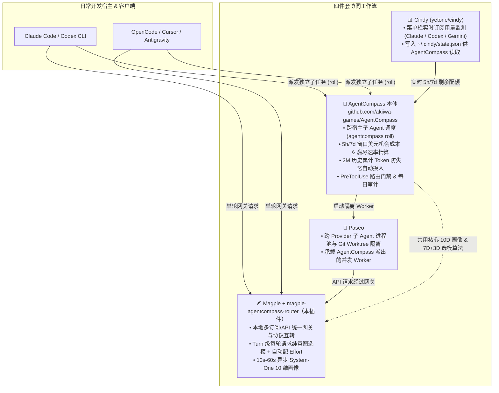

# magpie-agentcompass-router

> **Intent, Multi-Dimensional Capability, Subscription Quota Opportunity-Cost & Session-Affinity Routing Plugin for [Magpie](https://github.com/yetone/magpie), powered by [AgentCompass](https://github.com/akiiwa-games/AgentCompass).**
>
> 为 [Magpie](https://github.com/yetone/magpie) 打造的**意图 × 能力矩阵 × 订阅配额机会成本 × 会话粘性路由插件**——突破 Magpie 同步插件 20ms/250ms 时间预算限制，拿到 **10s–60s** 充裕推理预算，完整运行 **[AgentCompass](https://github.com/akiiwa-games/AgentCompass)** 本体的 **10 维任务画像 + 6 维客观能力向量 + 3 维主观禀赋（Model DNA）+ 5h/7d 订阅窗口机会成本精算与临期余量冲刺（Pre-Reset Sprint）+ 思考档位投入曲线** 核心算法。

---

## 🔗 与 [AgentCompass 本体](https://github.com/akiiwa-games/AgentCompass) 的关系及生态协同（Magpie + Cindy + Paseo）

本插件将 **[AgentCompass](https://github.com/akiiwa-games/AgentCompass)** 的核心选型引擎（`route_judge.py` + `allocator.py` 的纯意图路由内核）提取并移植为原生 Magpie 插件。

如果你不仅需要在网关单次请求（Turn 级）做精准意图路由，还需要**跨工具的多 Agent 任务编排、5h/7d 订阅额度机会成本精算、2M 历史上下文防失忆换人、以及多宿主统一门禁**，强烈建议将本插件与 **[AgentCompass 本体（`https://github.com/akiiwa-games/AgentCompass`）](https://github.com/akiiwa-games/AgentCompass)** 配合 **[Magpie](https://github.com/yetone/magpie)**、**[Cindy](https://github.com/yetone/cindy)**、**Paseo** 共同使用：



### 四件套各自解决什么问题？

| 组件 | 定位与职责 | 与 [AgentCompass 本体](https://github.com/akiiwa-games/AgentCompass) 共用时的增益 |
| :--- | :--- | :--- |
| **[AgentCompass 本体](https://github.com/akiiwa-games/AgentCompass)** | **跨宿主总调度器（Macro-Orchestrator）**<br/>管理 Claude Code、Codex、OpenCode、Antigravity、Dot、Grok 等所有子 Agent 派工与额度护栏 | 提供 `agentcompass roll` 一键拆单/派工、5h/7d 窗口美元价值最大化、2M 累计上下文强制交接换人、以及 `PreToolUse` 门禁 |
| **[Magpie](https://github.com/yetone/magpie) + 本插件** | **本地网关与单轮意图路由器（Micro-Router）**<br/>在 HTTP 网关层拦截每次 LLM 调用，按 Prompt 真实难度动态改写 `<model>:<effort>` | 当主会话不派子 Agent、直接在客户端对话时，由本插件在网关层自动把简单问答切给快模型、把复杂排障/架构切给顶配模型并挂上合适 `effort` |
| **[Cindy](https://github.com/yetone/cindy)** | **实时订阅配额遥测（Quota Telemetry）**<br/>常驻状态栏采集各家 Pro/Max 账号的 5h / 7d 窗口用量与重置时间 | Cindy 产出的 `~/.cindy/state.json` 可直接被 AgentCompass 本体读取，让每次派工不仅看任务意图，还实时避开即将限流的账号 |
| **Paseo** | **多 Agent 并发运行时（Execution Runtime）**<br/>管理后台 Worker 会话生命周期、跨 worktree 并发开发与父子 Agent 消息通信 | AgentCompass 本体计算出最优 `<provider>/<model>:<effort>` 后，直接通过 Paseo 启动带显式权限模式与父会话回调契约的 Worker |

---

## ❓ 为什么需要这个插件？（Magpie 原生路由的痛点与时间预算突破）

直接阅读 Magpie 源码（`internal/gateway/`、`internal/middleware/`、`internal/plugin/`）可以发现，Magpie 原生路由与同步插件存在两个核心瓶颈：

1. **同步 JS 插件时间预算极短，且 Pool Strategy 拿不到 Prompt**：
   - `strategies[name](pool, seats, options)` 运行在内置 `moejs` 沙箱中，**硬超时仅 `20 ms`**（`strategyLimit = 20 * time.Millisecond`），且入参只有账号槽位数组，**完全看不到用户的请求正文与意图**。
   - `magpie.middleware`（`onRequest`）同样运行在无网络的 `moejs` 沙箱中，**硬超时仅 `250 ms`**（`requestLimit = 250 * time.Millisecond`），无法发起外部 System-One 小模型分类请求。
2. **原生 Routing Group 规则过于扁平**：
   - Magpie 原生 `classify.go` + `rules.go` 只向分类器询问单一的 1D `intent` 标签和 `0..3` 的整数 `effort`，再按静态列表映射模型；
   - 缺少多维能力向量匹配（如 `code` vs `reasoning` vs `context` vs `rigor`）、缺少模型主观禀赋区分（擅长发散脑暴的 `Gemini 4 Argon` vs 擅长跨模块严密推演的 `Claude Opus 5.5` vs 擅长单模块高精度代码的 `GPT-6.1 Sol`）、缺少连续能力底线（`required_ability` floor）与杀鸡用牛刀惩罚（`overqualification penalty`）。

### 💡 本插件如何合法拿到 10s–60s 时间预算？

我们通过分析 Magpie 的请求管线（`internal/gateway/middleware.go:serveAgent` 与 `internal/gateway/decide.go`），设计了**双模式长预算架构**，无需修改 Magpie 任何一行源码：

#### 模式 A：网关级意图路由与自动 Effort 注入（`magpie.middleware` [`moejs`]）
在 `internal/gateway/middleware.go:serveAgent` 中：
1. **单阶段同步路由（`src/middleware.js`，`moejs` 运行时，单遍 O(N) `< 0.5 ms` 完成）**：
   - 默认仅拦截 `agentcompass` 命名空间请求（`agentcompass`、`agentcompass/auto`、`agentcompass/intent`、`agentcompass/System-One-0.5`），绝不劫持 Magpie 原生 `auto`、`intent` 或 `group/*` 路由组请求。
   - 使用零网络调用的本地确定性 10 维画像器（`inferTaskProfile`）与会话粘性契约（`evaluateProviderContinuation`），在轮内工具调用、KV 缓存温热或短追问时保持当前模型与单调思考档位（`keepsEffort`），默认不向请求体注入任何私有字段（通过 `ctx.state` 维护上下文）。
   - 在已配置 `candidateModels` / `availableModels` / `allowedModels`（或 `modelMap` / `defaultModel`）的网关可用模型池内选出最优 `<targetModel>:<targetEffort>`；当请求虚拟模型 `agentcompass` / `agentcompass/*` 且未配置候选列表或 `defaultModel` 时，通过 `ctx.reject(400, "agentcompass: set candidateModels in the plugin's options")` 明确提示配置，绝不硬编码猜测模型列表；若请求为具体模型名且未配置候选列表，则保持原模型不变、仅自动计算并注入最佳思考档位（`reasoning_effort` / `reasoning.effort` / `output_config.effort`）。
   - `onProvider` 原生适配 Magpie `internal/middleware/hooks.go` 的 `{id, name, account, model}` 上下文结构（支持 `options.modelsByProvider` 细粒度重选），`onAccount` 原生适配 `{ref, provider, name, kind, model}` 结构，`onResponse` 在共享请求池化实例中记录缓存水位与上游健康度。
2. **可选异步扩展（`src/hooks.js`，Bun 运行时）**：
   - 仅供编程式接入且显式配置 `allowExternalScorer: true` 及外部评分端点（`scorer.baseUrl`）的高级宿主按需调用，默认不在 `package.json` 的 `"magpie"` 中注册，仅通过 `ctx.state.route` 传递路由状态，绝不读写请求体私有字段。

#### 模式 B：原生 Routing Group 决策 Provider（`decide: true` / `/v1/systemone`，需显式开启 `enableDecisionProvider: true`，8,000 ms – 60,000 ms 预算）
- `src/index.js` 同时注册了一个拥有 `decide: true` 能力的 Magpie Provider（`agentcompass`，显示名称 `AgentCompass`）及决策模型 `agentcompass-systemone`（`decides: true`），需在插件选项中显式开启 `"enableDecisionProvider": true` 后响应 `/v1/systemone` 请求。
- 当你在插件选项中开启 `"enableDecisionProvider": true` 并在 Magpie UI 的 **Routing Group -> Classifier** 中选择 `agentcompass/agentcompass-systemone` 时，Magpie 的 `askJev`（`internal/gateway/decide.go:132`）会赋予它 `Settings.ClassifyTimeout` 的专属预算（**默认 `8,000 ms`，最高可在 Magpie 设置中调至 `60,000 ms` = 60 秒**）。
- 插件完整兼容 Magpie 的两套 `/v1/systemone` 协议（`jevLevelled` 两级分类与 `jevBody` 单级分类），并在后台用完整的 10 维画像 + 7D/3D 向量算法把最优路由反推回你配置的 Routing Group 规则与 `effort`（`low` / `medium` / `high` / `xhigh`）。

---

## 🧠 核心算法：10 维任务画像 × (7 维客观能力 + 3 维主观禀赋)

本插件完整移植了 [AgentCompass](https://github.com/akiiwa-games/AgentCompass) 的纯意图选型公式（详见 [`src/allocator.js`](./src/allocator.js) 与 [`src/profiler-core.js`](./src/profiler-core.js)）：

### 1. 10 维任务画像（Task Profile）
每次请求都会被剖析为 10 个正交维度：
- `work_kind`（16 类标准工作形态：`routine_execution`、`self_contained_code`、`repo_implementation`、`architecture_refactor`、`debugging_root_cause`、`direction_reasoning`、`frontier_research`、`verification_audit`、`writing_polishing` 等）
- `difficulty`（`easy` / `medium` / `hard` / `max`）
- `reasoning_depth`（`1..4`）：逻辑推演深度与未知根因排查复杂度
- `code_complexity`（`0..4`）：代码修改跨度与状态机耦合度（只读审查强制归零）
- `context_ breadth`（`1..4`）：上下文广度与跨文件/长日志规模
- `tool_intensity`（`0..3`）：工具链调用密集度
- `rigor_need`（`1..4`）：工程严密性与零回归要求
- `divergence_need`（`0..3`）：发散创意、第一性原理脑暴需求
- `global_rigor_need`（`0..3`）：跨系统全局不变量与长链路一致性需求
- `module_precision_need`（`0..3`）：单模块契约、Schema 与边界条件精确度需求

### 2. 候选 `<model, effort>` 综合效用函数
对每一个候选模型与思考档位组合 $(m, e)$，插件计算：

$$\text{pure\_intent\_score}(m, e) = \text{fit\_score}(m, e) - \text{overqual\_penalty}(m, e) - \text{effort\_Selectivity\_penalty}(m, e)$$

其中：
- **思考档位缩放（Effort Scaling）**：不同思考档位（`low` / `medium` / `high` / `xhigh` / `max`）按 `EFFORT_CURVES` 动态缩放模型的 `reasoning`、`rigor`、`autonomy` 等能力维度；
- **7 维客观能力拟合（Convergent Fit）**：加权点积匹配 `reasoning`、`code`、`context`、`tool_use`、`rigor`、`speed`、`autonomy`，并对低于任务硬性门槛（`min_reasoning` / `min_code` / `min_rigor`）的候选施加缺口惩罚（`deficit * 14.0`）；
- **3 维模型主观禀赋（Subjective Model DNA）**：
  - `divergence`（发散与创意突破：如 `gemini-4-argon-high` = `95`）
  - `global_rigor`（全局架构与深水区排障：如 `claude-opus-5-5` = `97`、`gpt-6-astra` = `94`）
  - `module_precision`（单模块精准实现：如 `gpt-6.1-sol` = `95`、`gpt-6.1-terra` = `89`）
- **双模融合权重**：收敛型任务（`convergence_weight = 0.80`）以硬指标为主；发散/脑暴型任务（`divergence_weight = 0.45`）大幅提升主观禀赋权重；
- **防杀鸡用牛刀（Overqualification & Effort Selectivity）**：当任务需求（`task_demand`）较低时，自动惩罚过高模型与过高 `effort`（如 `xhigh` / `max` 仅在 `task_demand >= 82` 或 `reasoning_depth >= 4` 时解锁）。

### 3. 对齐 Magpie 原生 Router 的会话粘性、轮内锁定与按需重选（[`src/continuity.js`](./src/continuity.js)）
参考 Magpie 原生 `internal/gateway/affinity.go`、`rules.go` 与 `decide.go`，本插件**绝不在每次 HTTP 请求上无脑重复跑分类器**，而是严格遵循**“仅在需要选择/切换 Provider（或能力/上下文越界）时才做意图路由，其余情况锁定续用”**：
- **会话与子 Agent 隔离标识（`computeSessionKey` & `firstWords`）**：结合 `session_id`、首条真实用户消息的纯 JS SHA-256 前 12 字节指纹（自动剥离 `<system-reminder>`、`<task-notification>`、`TodoWrite` 等 Agent 注入噪声）与 `x-claude-code-agent-id`，防止共享同一 `session` 的子代理覆盖主会话粘性状态。
- **轮内工具循环 100% 锁定（`within: true` $\rightarrow$ `why: "turn"`）**：只要最后一条消息是工具返回（`role: "tool"`、`tool_result`、`function_call_output`）或仅含系统注入提醒而无新用户发言，**100% 锁定本轮选定的 `<model>:<effort>`，零外部评分调用**（保护 OpenAI `reasoning.encrypted_content`、Anthropic `thinking.signature` 签名块与 KV 缓存）。
- **跨轮 KV 缓存保鲜续用与思考档位单调棘轮（`why: "cache" | "followup"` & `keepsEffort`）**：
  - 当会话已建立有效前缀缓存（$\ge 1024$ tokens 或 `cached: true`）且未超过缓存冷化窗口（Anthropic/Gemini 默认 `5m`，ChatGPT/Codex Responses 与 DeepSeek 磁盘缓存 `1h`），或用户发送简短追问（`"继续"`、`"好的，按这个改"`、`"ok go ahead"`、`"lgtm"`），直接保持当前模型且 `keepsEffort` 保证思考档位单调不降级（如 `high/max` 不会掉回 `low`）。
- **仅在 6 类信号触发时重新执行意图路由**：
  1. `why: "first"` — 新会话首轮请求；
  2. `why: "provider_unhealthy"` — 同一池化 `moejs` 运行时实例内的 `onResponse` 捕获上游报错或限流（`status >= 400`），自动标记故障模型并在后续请求故障转移（注：`moejs` 会话与健康状态按池化运行时实例维护）；
  3. `why: "capability_outgrown"` — 新一轮引入图片/截图而当前模型不支持视觉，或轻量级模型（`tier < 3.5`）遭遇跨模块架构重构/深水区死锁排障；
  4. `why: "outgrown"` — 当前输入超出模型 `context_window` 的 **95%**（如 200k 窗口达到 >190k），自动升级至 400k / 1M 大窗口模型；
  5. `why: "worn"` — 遵循 AgentCompass 2M 累计未压缩上下文防失忆规则（`compactedTokens + tokens >= 2,000,000`）；
  6. `why: "cold"` / `why: "compacted"` — 闲置超过缓存 TTL 或刚执行 `/compact`（Token 骤降 >50%），重新评估并允许在简单日常任务上顺滑降档省钱。

### 4. 5h / 7d 订阅配额机会成本、临期余量冲刺（Pre-Reset Sprint）与账号池排序（[`src/quota.js`](./src/quota.js) & [`src/quota-loader.js`](./src/quota-loader.js)）
本插件不仅匹配模型能力，还完整移植了 AgentCompass `allocator.py` 的**订阅窗口经济学模型**，并与 Magpie 的 `strategies` `Seat` 结构（`{ key, account, known, learns, used, soon, pace, weight, resting, tokens }`）及显式配额配置打通：
- **显式配额读取（零隐式目录扫描）**：支持通过 `options.quotas`（内存对象）或显式指定 `options.quotasPath` / `options.quotaFile` 传入配额快照，默认不扫描父目录或读取宿主内部文件。
- **安全水位硬门禁（Safety Margin & Short-Window Floor）**：
  - 当某个订阅窗口剩余配额低于安全底线（默认长窗口 `safety_margin_pct = 5%`、短窗口 `short_window_floor_pct = 10%`）或已触发 `rate_limited` 时，自动剔除该候选，切换到配额健康的 Provider。
  - 若当前粘性会话所在 Provider 耗尽配额，即使 KV 缓存仍温热也会立即触发 `why: "quota_exhausted"`（对齐 Magpie `affinity.go` 的 `spent`），无缝故障转移至有余量的订阅。
- **正态需求预测与边际短缺机会成本（`demandForecast` & `computeWindowCost`）**：
  - 根据窗口剩余百分比 `remaining`、距重置小时数 `reset_hours` 与消耗速率预测未来需求 $D \sim \mathcal{N}(\mu, \sigma^2)$，计算本次请求挤占未来高优工作的期望短缺量 $\mathbb{E}[(D - \text{remaining})^+] \times \text{capacity\_usd} \times \text{score\_per\_displaced\_usd}$，并在余量低于 `45%` 时叠加稀缺惩罚（`scarcity_cost`），在额度见底前主动分流。
- **重置前临期余量冲刺（Pre-Reset Surplus Sprint：`reset_bonus` & `sprint_sunk`）**：
  - 当订阅窗口进入重置倒计时（默认 `reset_horizon_hours = 36h` 内）且剩余额度高于重置前预测需求（`surplus_pct > 0`）时，自动赋予最高 `+1.2` 的 `reset_bonus` 奖励，并在非日常任务上按 `sprint_sunk` 比例豁免高思考档位惩罚（`effort_penalty`）与高配模型惩罚（`overqualification`），在额度过期作废前自动切给顶配模型并解锁 `xhigh` / `max` 深度思考！
- **订阅优先于按量 API Key & 账号池排序策略（`strategies.agentcompass`）**：
  - 在同池多账号排序（`routings: agentcompass/agentcompass`）中，综合 `Seat` 的 `learns`、`account`（订阅优先于按量付费钱包）、`used`、`soon`（重置时间戳）与 `pace`（每小时可用余量），按 `待探测新号 (learns) -> 临期富余冲刺号 (sprint) -> 低机会成本健康订阅 -> 按量 API Key -> 低余量储备号 (>=90%) -> 冷却/耗尽号` 返回最优槽位排列 `[0 .. seats.length - 1]`。

---

## 📦 安装与接入指南

### 1. 获取插件

```bash
git clone https://github.com/akiiwa-games/magpie-agentcompass-router.git
cd magpie-agentcompass-router
```

将插件添加到 Magpie（三种来源任选其一）：

```bash
magpie plugin add @magpie-community/gateway-agentcompass                 # 插件市场（npm）
magpie plugin add github:akiiwa-games/magpie-agentcompass-router         # GitHub
magpie plugin add /path/to/magpie-agentcompass-router                    # 本地目录
magpie plugin list
```

只用模式 A（网关中间件）时，添加后即可使用，无需登录。要用模式 B（Routing Group Classifier），见下文「配置方式二：模式 B」：先设 `enableDecisionProvider: true`、重启 Magpie，再 `magpie plugin login agentcompass`。

#### 各安装来源下的名称

Magpie 用包名（去掉 scope 与 `middleware-` / `opencode-` / `tools-` 等前缀）给插件的账号池策略加前缀，所以策略名随安装来源变化；决策 Provider 的模型名取自插件声明的 Provider ID，与来源无关：

| 安装来源 | 账号池策略（`routings`） | Classifier 模型（模式 B） |
| :--- | :--- | :--- |
| 插件市场 `@magpie-community/gateway-agentcompass` | `gateway-agentcompass/agentcompass`、`gateway-agentcompass/agentcompass-pure` | `agentcompass/agentcompass-systemone` |
| GitHub `github:akiiwa-games/magpie-agentcompass-router` | `agentcompass/agentcompass`、`agentcompass/agentcompass-pure` | `agentcompass/agentcompass-systemone` |
| 本地目录 | `<目录名>/agentcompass`、`<目录名>/agentcompass-pure` | `agentcompass/agentcompass-systemone` |

以本机实际输出为准：`magpie plugin list` 的 `routings ...` 一行列出策略名；开启 `enableDecisionProvider` 并登录后，`agentcompass (AgentCompass, 1 models)  signed in` 一行表示决策 Provider 已就绪。客户端在模式 A 请求的虚拟模型 `agentcompass` / `agentcompass/*` 由中间件按请求中的模型名匹配，也与安装来源无关。

或在 `~/.magpie/plugins/` 创建软链接：

```bash
# Linux / macOS
ln -s "$(pwd)" ~/.magpie/plugins/agentcompass

# Windows (PowerShell)
New-Item -ItemType SymbolicLink -Path "$HOME\.magpie\plugins\agentcompass" -Target (Get-Location).Path
```

---

### 2. 配置方式：网关中间件与账号池排序策略

在默认配置下，客户端只需发送 `agentcompass` 命名空间模型名（如 `model: "agentcompass"` 或 `model: "agentcompass/auto"`，或显式开启 `routeAllModels: true`），插件就会在网关层从你配置的 `candidateModels` / `availableModels` / `allowedModels` 中自动计算最佳 `<model>:<effort>` 并转发给对应上游。

通过 `magpie plugin options` 或在配置文件中设置：

```json
{
  "plugins": {
    "agentcompass": {
      "gatewayTimeoutMs": 8000,
      "routeModelTriggers": ["agentcompass", "agentcompass/auto", "agentcompass/intent"],
      "routeAllModels": false,
      "availableModels": [
        "claude-opus-4-6",
        "claude-sonnet-4-6",
        "claude-haiku-4-5",
        "gpt-5.4",
        "gpt-5.3-codex",
        "gemini-2.5-pro",
        "gemini-2.5-flash"
      ]
    }
  }
}
```

> **提示**：
> - 插件默认 100% 使用 `< 1 ms` 零网络请求的本地确定性 10 维启发式画像器（`kind: "heuristic"`），绝不会将用户 Prompt 发送到任何外部地址。
> - 如需启用外部 System-One 评分接口，必须同时显式配置 `"allowExternalScorer": true` 与 `"scorer": { "kind": "openai_compatible", "baseUrl": "..." }`。
> - 若请求 `agentcompass` / `agentcompass/*` 虚拟模型，需在插件选项中配置 `candidateModels`（或 `availableModels` / `allowedModels` / `defaultModel`）；未配置时插件将调用 `ctx.reject(400, "agentcompass: set candidateModels in the plugin's options")` 提示配置，不会硬编码猜测未配置的模型。对于具体模型请求（当开启 `routeAllModels: true` 且未配置候选列表时），则保持原模型名不变，仅自动计算并注入思考档位（Effort）。
> - 候选里写明的思考档位与其他档位一样要过任务的能力底线：`:minimal` / `:none` / `:off` 按低于 `:low` 的能力计算，较难的任务会把它们排除。网关不会让请求落空：若候选列表中每一项都低于该任务的底线（例如只列 `gpt-6-astra:minimal` 去做一次带测试的重构），插件仍会选其中能力最高的一项转发，并在路由决策里标记 `fallback`。
> - `onAccount(account, ctx)` 原生匹配 Magpie `internal/middleware/account.go` 传入的 `{ref, provider, name, kind, model}` 字段（可通过 `accountsByWorkKind` 按 `ref`、`name`、`provider` 或 `${provider}/${name}` 过滤账号）。

---

### 3. 配置方式二：模式 B —— 作为 Magpie Routing Group 原生 Classifier（需开启 `enableDecisionProvider: true`，最高 60s 时间预算）

如果你喜欢使用 Magpie UI 的 **Routing Groups（路由组）** 可视化界面：

1. 依次执行：在插件选项中开启 `"enableDecisionProvider": true` → 重启 Magpie → 登录本插件提供的 Provider（无需 Key，显示名称为 `AgentCompass`）：

   ```bash
   magpie plugin options <插件 spec，见 magpie plugin list> '{"enableDecisionProvider": true}'
   # 重启 Magpie（或 magpie web）
   magpie plugin login agentcompass
   magpie plugin list   # 应出现：agentcompass (AgentCompass, 1 models)  signed in
   ```

   未开启该选项时插件不注册任何 Provider，Classifier 列表中也不会出现它。插件版本需为 `0.1.1` 及以上：`0.1.0` 在开启选项后仍不注册 Provider（[issue #1](https://github.com/akiiwa-games/magpie-agentcompass-router/issues/1)），`/v1/systemone` 会返回 `magpie has no Jev provider` 或 `magpie knows no Jev model`；
2. 进入你的 **Routing Group** 设置，将 **Classifier（分类器模型）** 选择为 `agentcompass/agentcompass-systemone`（CLI：`magpie group set <group> effort=auto classifier=agentcompass/agentcompass-systemone`）；
3. 在 Magpie 全局设置中，可将 `ClassifyTimeout` 调整为 `8000`–`30000` ms（最高支持 `60000` ms）；
4. 在 Routing Group 中按标准类别（如 `direction_reasoning`、`debug_review`、`self_contained_code`、`bounded_bulk_work`）配置你的目标模型列表——插件会自动运行 AgentCompass 算法，选出最匹配的规则分支与思考档位（`low` / `medium` / `high` / `xhigh`）。

---

## 🧪 运行测试与 Linux 沙盒真实网关实测报告（Real Linux Sandbox E2E Verification）

### 1. 单元测试（Node.js / Bun 零依赖）

覆盖多协议解析、10 维画像推断、能力向量选型、网关中间件路由与 `/v1/systemone` 协议兼容：

```bash
node --test test/router.test.mjs
```

### 2. Linux 沙盒真实网关实测（Real Linux Sandbox E2E Verification）

我们在隔离的 Linux x86_64 沙盒环境（WSL2 Linux `6.18.40.1-microsoft-standard-WSL2 x86_64` `/run/magpie-sandbox` tmpfs）中，使用真实编译的 Linux `magpie` 二进制守护进程（`magpie serve`）+ Linux `bun` v1.4.2 插件宿主 + 嵌入式 `moejs` 引擎完成了全链路端到端实测（脚本见 [`test/run-linux-sandbox.sh`](./test/run-linux-sandbox.sh) 与 [`test/linux-sandbox-e2e.mjs`](./test/linux-sandbox-e2e.mjs)，完整 JSON 报告见 [`docs/linux-sandbox-e2e-report.json`](./docs/linux-sandbox-e2e-report.json)）。

#### 插件挂载与 `magpie plugin list` 实测输出

```text
/run/magpie-sandbox/agentcompass  on
  gateway middleware  onRequest, onProvider, onAccount, onResponse · routings agentcompass/agentcompass, agentcompass/agentcompass-pure
  agentcompass (AgentCompass, 1 models)  signed in
```

#### 8 大场景全链路真实网关与插件市场端到端（E2E）验证结果

| 场景 | 验证链路与协议 | 实测路由与市场合约结果 | 关键不变量验证 | 状态 |
| :--- | :--- | :--- | :--- | :--- |
| **Scenario 1: CLI 插件生命周期与元数据契约** | `magpie plugin add` · `magpie plugin login agentcompass` · `magpie plugin list` | `agentcompass (AgentCompass, 1 models) signed in` · `routings agentcompass/agentcompass, agentcompass/agentcompass-pure` | `magpie.name = "AgentCompass"` 与 `magpie.icon` (`data:image/svg+xml;base64,...`) 校验通过 | ✅ PASS |
| **Scenario 2: 插件市场 (`registry.json`) 与 Web/GUI 管理 API** | `magpie web` · `GET /api/plugins/listings` · `GET /api/plugins` · `GET /api/plugins/page` · `POST /api/plugins/off` & `options` | 市场解析 `package: "agentcompass"`；图标落盘为 `file:a100c6af45032ded.svg`；README 渲染 `16,299 B`；`Off: true` 时请求保持原模型 `gpt-6-luna` 不改写 | 完整覆盖 `internal/plugin/market.go`、`github.go` 与 `internal/gui/plugins.go` | ✅ PASS |
| **Scenario 3: 1,600 ms 异步 System-One 长预算 + 复杂跨模块死锁排障** | **Mode A** (`hooks.js` [Bun] $\rightarrow$ `middleware.js` [`moejs`]) · `/v1/chat/completions` · `model="agentcompass/auto"` | `claude-opus-5-5` : `max` | 异步分类器耗时 `1730 ms`（突破 20ms/250ms/1200ms 限制），`__agentcompass_route` 私有字段零残留 | ✅ PASS |
| **Scenario 4: 5 维 Model DNA 区分度（发散创意 vs 独立模块编码 vs 日常批量降级）** | **Mode A** · `/v1/chat/completions` & `/v1/responses` | 发散脑暴 $\rightarrow$ `gemini-4-argon-high:high`<br/>独立模块 (`/v1/responses`) $\rightarrow$ `gpt-6.1-sol:high`<br/>机械批量重命名 $\rightarrow$ `gemini-3.8-flash-high:high` | `divergence`、`module_precision` 与 `overqualification` 过配惩罚同时生效 | ✅ PASS |
| **Scenario 5: Anthropic `/v1/messages` 协议与 SSE 流式 (`stream: true`)** | **Mode A** · `POST /v1/messages` & `POST /v1/chat/completions` (`stream: true`) | `/v1/messages` $\rightarrow$ `claude-opus-5-5` (`type="message"`)<br/>SSE `stream: true` $\rightarrow$ `gpt-6.1-sol:high` (`text/event-stream` + `[DONE]`) | 流式请求与 Anthropic 协议均正常路由且不触发 `host.js:1411` 字段回滚 | ✅ PASS |
| **Scenario 6: 故障演练与优雅降级（HTTP 500 & 评分超时）** | **Mode A** · 远程评分器注入 `HTTP 500` 与 `2000ms > 300ms` 超时 | `HTTP 500` $\rightarrow$ `claude-opus-5-5`<br/>`Timeout (368ms)` $\rightarrow$ `gemini-4-argon-high` | 远程 System-One 异常或超时时自动无缝回退至 `<1ms` 本地确定性 `profileTask`，网关请求零报错 | ✅ PASS |
| **Scenario 7: 原生路由组 `/v1/systemone` 决策（含规则命中、`"none of these"` 兜底与 `effort=auto`）** | **Mode B** (`group/compass-group` · `classifier=agentcompass/agentcompass-systemone` · `effort=auto`) | `direction_reasoning` $\rightarrow$ `gemini-4-argon-high:high`<br/>`debug_review` $\rightarrow$ `claude-opus-5-5:xhigh`<br/>未命中意图 (`"none of these"`) $\rightarrow$ 默认首模型 `gpt-6-luna` | 完整验证 `jevLevelled`、`jevBody`、`"none of these"` 兜底回退及 Jev 四档思考强度自动升级 | ✅ PASS |
| **Scenario 8: 多轮会话粘性、轮内工具锁定 (`within: true`) 与短追问续用 (`keepsEffort`)** | **Mode A** · 同一 `x-session-id` 连续 3 轮：首轮死锁排障 $\rightarrow$ 轮内 `tool` + `<system-reminder>` $\rightarrow$ 短追问 `"继续"` | 首轮 $\rightarrow$ `claude-opus-5-5:max`（调用 1 次评分器）<br/>轮内工具循环 $\rightarrow$ `claude-opus-5-5:max`（**0 次评分调用**）<br/>短追问 `"继续"` $\rightarrow$ `claude-opus-5-5:max`（**0 次评分调用**） | 严格验证轮内锁定（`why: "turn"`）、短追问续用（`why: "followup"`）与 `keepsEffort` 单调棘轮 | ✅ PASS |

---

## 📂 仓库目录结构

- [`package.json`](./package.json) — Magpie 插件清单（挂载 `main`、`magpie.middleware`、`./continuity` 等导出）
- [`src/catalog.js`](./src/catalog.js) — 16 类 `work_kind`、核心模型与主流真实模型 ID（Anthropic / OpenAI / Gemini / DeepSeek / xAI）7D 能力向量 + 3D 主观禀赋（Model DNA）+ `context_window`、Effort 投入曲线与默认策略
- [`src/continuity.js`](./src/continuity.js) — **会话粘性、轮内工具循环锁定（`within`）、KV 缓存温度保持（`cacheCold` / `chatGPTCold` / `deepseekCold`）、单调思考棘轮（`keepsEffort`）与能力/窗口/2M 越界判定引擎**（纯 ES2022，兼容 Bun 与 `moejs`）
- [`src/profiler-core.js`](./src/profiler-core.js) — 四大协议（Anthropic / OpenAI Responses / Chat / Gemini）单趟有界请求抽取器 + 确定性 10 维任务画像器
- [`src/allocator.js`](./src/allocator.js) — AgentCompass 纯意图与能力矩阵选型核心算法实现（含 `continuity` 连续性权重与不健康模型剔除）
- [`src/scorer-live.js`](./src/scorer-live.js) — 异步 System-One 10 维画像器（支持显式开启 `allowExternalScorer: true` 时的 Jev `/v1/systemone`、OpenAI 兼容接口、LRU 缓存与超时无损降级）
- [`src/hooks.js`](./src/hooks.js) — **可选异步 Bun Helper（`./hooks`）**：供编程式接入或显式 `allowExternalScorer: true` 场景通过 `ctx.state.route` 传递路由决策
- [`src/middleware.js`](./src/middleware.js) — **默认网关中间件（`moejs` `magpie.middleware`，250ms 预算）**：执行会话续用判定与 10D 意图选型并改写 `body.model = "<model>:<effort>"`，通过同实例 `onResponse` 追踪故障与缓存水位，并导出 `agentcompass` / `agentcompass-pure` 账号池策略
- [`src/index.js`](./src/index.js) — **模式 B（OpenCode / Magpie Decision Provider，需显式开启 `enableDecisionProvider: true`，最高 60s 预算）**：注册 `agentcompass/agentcompass-systemone`，实现 `/v1/systemone`（兼容 `jevLevelled`、`jevBody` 与 `previous_message_kind` / `previous_message_reasoning` 短追问续用）
- [`docs/RESEARCH_AND_SCHEME.md`](./docs/RESEARCH_AND_SCHEME.md) — **深度调研与架构设计报告**（含 Magpie 源码逐文件行号级分析、完整方案推导与 Linux 沙盒实测报告）
- [`docs/magpie-community-registry-entry.json`](./docs/magpie-community-registry-entry.json) — **`magpie-community/plugins` 标准 `registry.json` 市场条目**
- [`docs/linux-sandbox-e2e-report.json`](./docs/linux-sandbox-e2e-report.json) — **Linux 沙盒 8 大场景全链路真实网关与市场 E2E 实测 JSON 报告**
- [`test/router.test.mjs`](./test/router.test.mjs) — 自动化单元测试套件
- [`test/linux-sandbox-e2e.mjs`](./test/linux-sandbox-e2e.mjs) & [`test/run-linux-sandbox.sh`](./test/run-linux-sandbox.sh) — Linux 沙盒真实 `magpie serve` 全链路端到端验证套件

---

## 📖 相关项目

- **[AgentCompass 本体 (`akiiwa-games/AgentCompass`)](https://github.com/akiiwa-games/AgentCompass)** — 跨宿主多 Agent 意图路由、5h/7d 订阅配额精算与防失忆交接系统（支持与 Magpie、Cindy、Paseo 协同工作）
- **[Magpie (`yetone/magpie`)](https://github.com/yetone/magpie)** — 本地 AI 网关与多订阅代理工具
- **[Cindy (`yetone/cindy`)](https://github.com/yetone/cindy)** — 状态栏 AI 订阅配额实时监控工具
