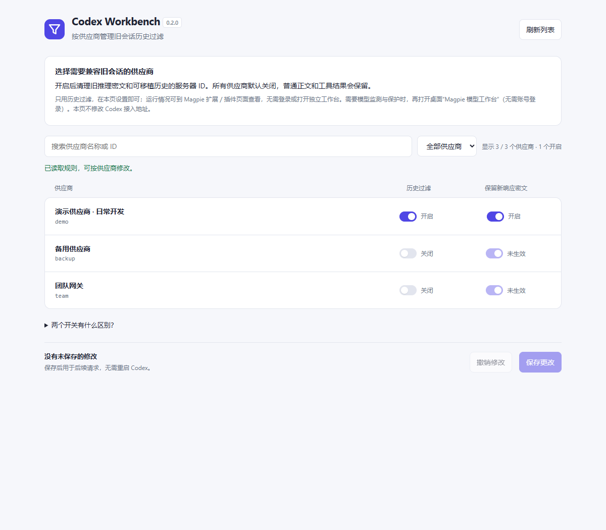
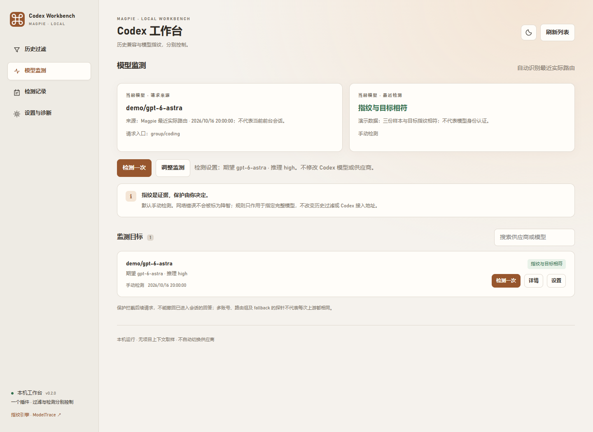
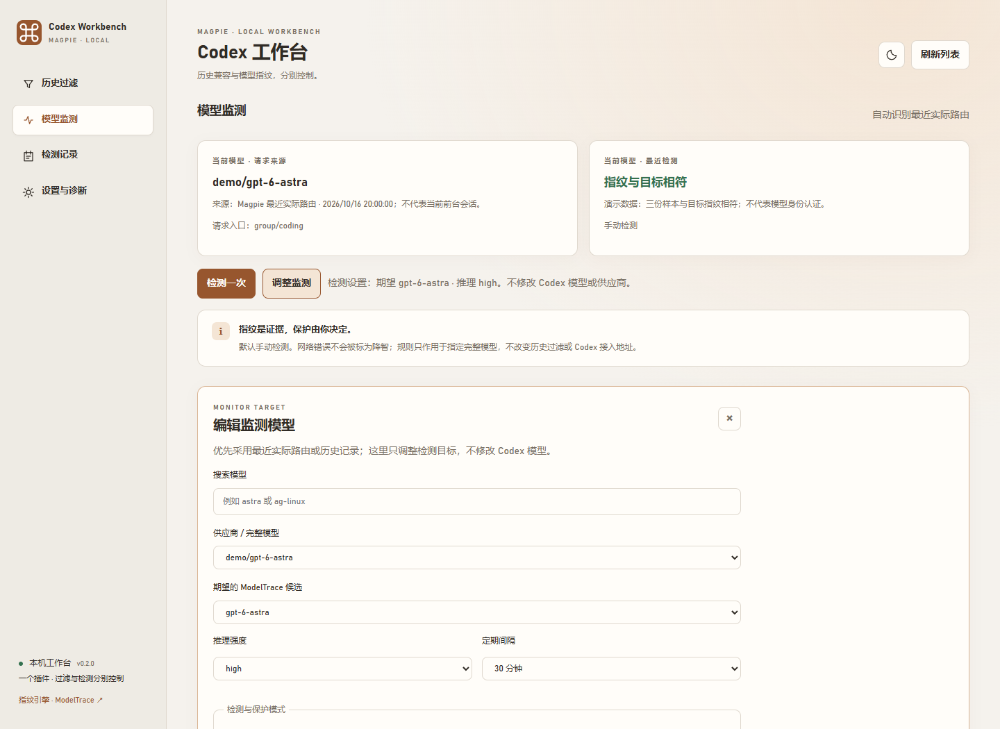
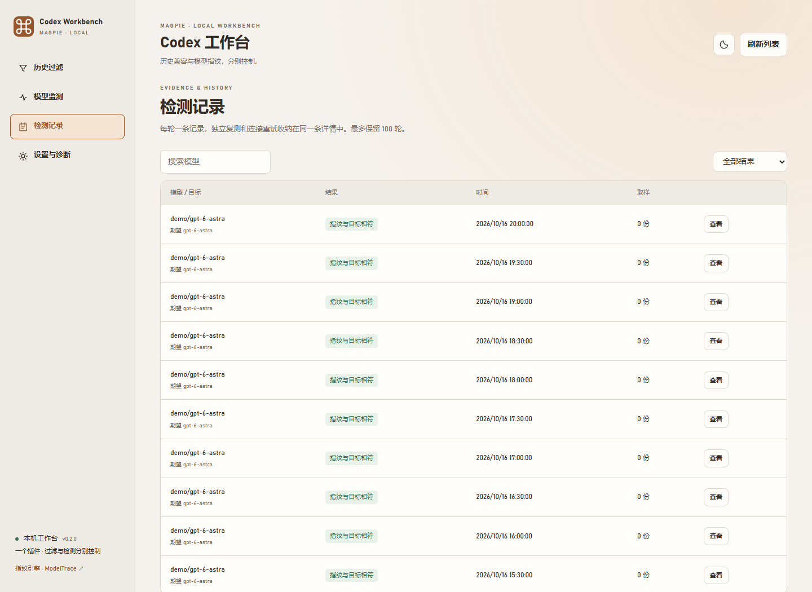
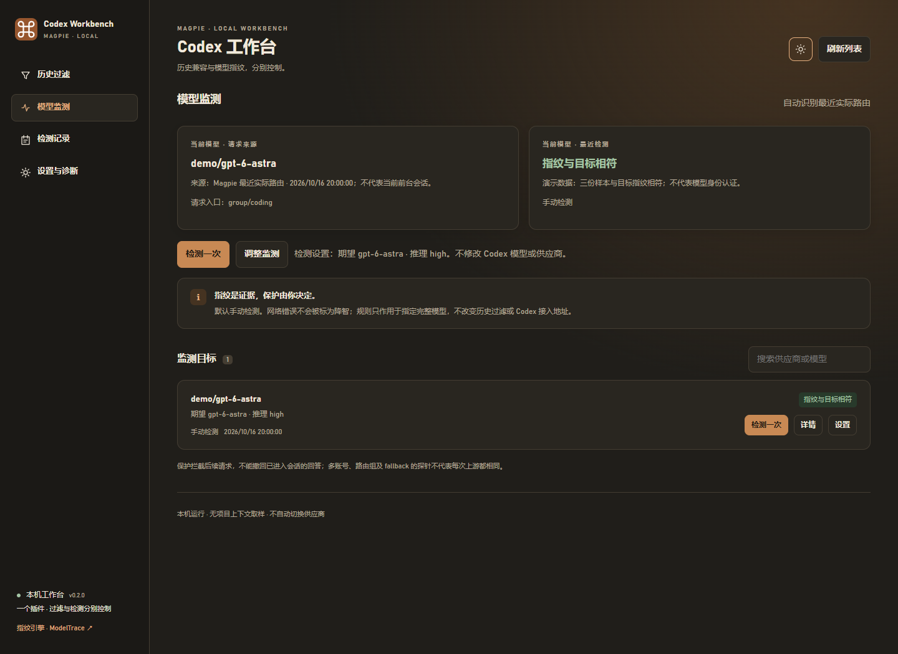

# @magpie-community/middleware-codex-history · Codex Workbench

**一个插件管理历史过滤、可选模型指纹检测和暂停保护。** 本目录为 **v0.2.0** 社区市场包源码；审核合并并完成分发后，从原有 Codex History Filter 安装项更新即可。所有供应商规则和监测功能默认关闭。

[GitHub 独立发行版](https://github.com/unisong/magpie-codex-history-filter/releases/latest) · [反馈问题](https://github.com/unisong/magpie-codex-history-filter/issues) · [维护说明](https://github.com/unisong/magpie-codex-history-filter/blob/main/MAINTAINING.md)

历史过滤沿用 Codex History Filter 的原算法和供应商规则；检测与保护分别控制。新供应商默认直通，没有检测目标时不调用模型，不修改 Codex 的 `base_url`、模型或会话文件。

**只需要历史过滤？直接在 Magpie 的扩展／插件页面查看启用状态和运行情况，并在「Codex Workbench · 历史过滤」原生页面设置供应商开关即可，无需登录或打开独立工作台。只有需要模型监测、检测记录或模型保护时，才需要打开工作台；工作台本身也无需账号登录。**

## 安装与打开

需要支持 server 插件、gateway middleware 和原生插件页面的 Magpie，已在 **0.1.1265** 验证。在 Magpie 的 **Plugins → Discover → Gateway middleware** 中安装 **Codex Workbench**，或运行：

```sh
magpie plugin add @magpie-community/middleware-codex-history
```

市场安装项沿用 `@magpie-community/middleware-codex-history`，从 v0.1.0 更新时保留 Options，无需另装一份。也可以从 [独立 GitHub Release](https://github.com/unisong/magpie-codex-history-filter/releases/tag/v0.2.0) 下载 ZIP 作为本地插件安装，但不要同时启用两种来源。无需另外安装 Node.js；完整工作台使用 Magpie 自带的 Bun 后台。Windows 的本地解压包提供 `Open.bat`，市场安装可直接用 Magpie 的工作台入口。

安装后，**仅使用历史过滤的用户可直接在 Magpie 内完成设置，无需执行下面的工作台打开步骤**。

需要模型监测时，在 Magpie 的 **Codex Workbench · 本机控制台** 入口选择「打开 Codex 工作台」。当前宿主将此动作放在登录方法选择器中，但这里只打开本机页面，不需要验证码、账号或供应商凭据；不要把它当作推理供应商使用。本地解压安装的 Windows 用户也可双击包内 `Open.bat`。

Magpie 侧边栏 **Codex Workbench · 历史过滤** 是原生过滤设置页。它与本地工作台使用同一份插件 Options，不是另一份插件。过滤规则在 Magpie 中执行，不依赖工作台页面保持打开。

### 从两个插件迁移

v0.1.0 是纯历史过滤版；v0.2.0 是合并工作台，沿用原包名和供应商规则。只想使用过滤的用户更新后仍只需原生过滤页，不配置监测目标就不会产生检测请求。需要冻结旧实现可固定在 `@magpie-community/middleware-codex-history@0.1.0`。

先备份 Magpie `plugins.json` 和 `~/.config/magpie-model-workbench/`，不要公开。固定在旧 GitHub 标签的安装项需要改为新标签；建议先复制自己的 Options，再停用旧安装项，将 `providers`、`aliases` 原样复制到合并版 Options，同时保留旧检测插件的其他 Options。旧本地检测目标与记录继续使用原数据目录。最终只启用合并版，避免与旧历史版、市场版或本地版重复过滤。不要修改 Codex 接入地址。

沿用原检测数据目录与 schema，保留目标、暂停状态、预算和最多 100 轮记录，不因迁移额外启动检测。定期目标继续使用原有模式与时间。宿主重载中断的检测会标为未完成，不自动重放。

## 界面预览

以下均为 v0.2.0 当前界面，使用虚构供应商与演示记录，不含真实配置或检测结论。截图中开启的过滤规则是演示设置，新安装默认全部关闭。

**只用过滤：在 Magpie 内设置，无需打开独立工作台。**



**可选模型监测：自动展示最近实际路由，在当前页调整设置。**



<details>
<summary>查看同页调整、检测记录与深色主题</summary>







</details>

## 历史过滤

在 Magpie 中打开 **Codex Workbench · 历史过滤**，搜索供应商、修改开关，点击「保存更改」即可；插件启用状态、调用数和错误可在 Magpie 扩展／插件页面查看。也可选择在独立工作台的「历史过滤」分区设置，但这不是使用过滤功能的前置步骤。两页编辑同一份规则，请避免同时修改同一开关；发现相同规则或别名冲突时会拒绝覆盖。

| 开关 | 作用 | 建议 |
|---|---|---|
| 历史过滤 | 清理旧 reasoning、明确标记的加密内容和可移植历史条目的可选服务器 ID，设置 `store: false` | 只为遇到历史兼容问题的供应商开启 |
| 保留新响应密文 | 保留对新响应 `reasoning.encrypted_content` 的请求；旧历史密文仍会清理 | 开启历史过滤时通常保留 |

正文、工具参数与结果、`call_id` 配对、普通业务 ID 和文件引用保留。`previous_response_id`、`conversation`、`item_reference`、加密压缩历史和 `/responses/compact` 无法安全迁移时会明确拒绝，提示整理文字摘要后新建会话，不静默丢弃上下文。

规则按进入钩子时的 `供应商/模型` 前缀选择；别名只用于选择规则，不改写模型。不同会话可同时使用不同供应商。自动路由组、其他插件与 fallback 后续改写路由时，规则不保证对应最终上游。只覆盖经过 Magpie agent middleware 的 Responses 请求。

过滤实现编译进不依赖后台的单一请求入口。检测后台无法启动时，过滤仍可执行；原始文件及 SHA-256 见 `history/PROVENANCE.json`。保存规则会触发 Magpie 重载宿主，控制台复用地址和浏览器会话并自动重连，无需重启 Codex。检测执行期间，本地控制台会拒绝保存过滤规则，避免主动打断取样；其他原生操作触发宿主重载仍可能中断检测。

## 模型指纹检测

此功能按需使用，不是历史过滤的必要步骤。已开启的定期检测不会因为关闭工作台页面而停止；不再需要时，请将对应目标改为「手动检测」或删除目标。

1. 打开「模型监测」，自动展示 **Magpie 最近实际路由的供应商/完整模型**，无需先添加目标。通过官方只读用量接口识别；旧版缺少接口时读取有大小限制的本机日志末尾。没有实际路由时优先采用最近检测记录，两者都没有才在本页展开手动选择。
2. 点击「检测一次」并确认取样费用。首次检测会保存为手动目标；同名参考候选自动预填，没有同名参考时需在「调整监测」内明确选择，不猜测模型映射。已保存目标继续采用其明确设置的参考和推理强度，界面与确认框均显示。
3. 「调整监测」在当前页内展开，可修改供应商/完整模型、参考、推理强度及模式，不再跳转二级添加页。保存、刷新及自动识别本身都不发起检测。
4. 查看结果与详情，再决定是否使用定期模式。可选 10/30/60/120 分钟，默认 30 分钟，从保存后的下一个间隔开始；Magpie 空闲时也会运行。

最近路由代表网关记录的最新 Codex 业务请求，不代表当前前台会话，也不能保证模型身份；页面显示来源与时间。上游自报的模型名不替换路由目标，辅助请求与检测探针不用于自动选择。记录较旧时仍会明确显示时间。检测不修改 Codex 的模型、供应商或接入地址。

工作台与 CC Switch 版共用暖灰/铜色主题、图标和模型选择优先规则；两版均为「历史过滤 / 模型监测 / 检测记录 / 设置与诊断」四个分区。右上角单个月亮/太阳图标直接切换明暗主题并在浏览器保存，无需打开设置。

| 模式 | 行为 |
|---|---|
| 手动检测 | 点击才取样，不自动暂停；初次使用推荐 |
| 定期观测 | 按间隔取样和记录，不自动暂停 |
| 异常暂停 | 首次强偏离先暂停该完整模型的后续请求，再独立复测；其他模型不受影响 |

请求经过当前本机 Magpie Responses 网关，每份样本只包含公开数字挑战，不发送项目上下文。正常一轮三样本；强偏离后追加三份独立样本。**整轮共享最多 3 次额外网络重试**，最多 9 次请求。余额、权限或模型不可用等永久错误不重试。遵守 Retry-After，等待超过 60 秒停止本轮，每样本最多 180 秒。

默认全部目标共享 **60 次/UTC 日**请求预算，可在设置修改。全天每 30 分钟检测一次通常需要至少 144 次请求，默认预算不足以覆盖全天；预算不足时停止取样。失败、取消的请求也可能计费。详情显示上游报告的 usage，缺失的 Token 用量不估算为零。

### 结果与暂停

- **指纹与目标相符**：三样本有效，汇总最接近期望且权重至少 0.5，没有强单样本冲突或完全重复样本。
- **强偏离**：其他候选汇总权重至少 0.8、期望不超过 0.15、差距至少 0.65，且至少两个单样本也满足条件，触发独立复测。
- **重复检测支持偏离**：两组三样本均强偏离，指向同一替代候选。
- **疑似偏离 / 样本分歧**：有效证据不足以满足上述规则。
- **检测未完成**：403、429、断流、截断、无效回答、数字不足或路由配置变化；不因此新建暂停。

结果与暂停状态分别展示。已暂停模型不因一次通过自动恢复；可明确解除，或放行 15 分钟。失败、取消或中断的复测不悄悄解除已有暂停。限时放行的到期时间也在钩子中校验，不依赖后台定时器。

每轮一条记录，重试和复测收进同一详情；每页 10 条，最多保留 100 轮。可查看挑战、回答和逐样本证据，导出本轮记录。

## 当前限制与架构

Magpie 原生页面只开放主题、有限读取与本插件 Options，没有检测任务的启动/进度/取消接口，页面 CSP 也禁止直接访问本机网络。因此完整控制台使用 **Magpie 内 Bun 后台 + 本机浏览器**，原生页保留过滤设置。不增加模型代理，不要求另装 Node.js 或 Go。退出 Magpie 会停止后台。

ModelTrace 是有限参考库的统计指纹，权重是库内相对排序，不是身份概率，阈值未经过独立校准。协议转换、系统提示、版本变化、多账号和 fallback 会影响结果。路由标头只能确认本机选路信息，不能证明供应商运行了什么，也不保证下一请求使用同一资源。路由组仅支持观测。

暂停阻止后续请求，不能撤回输出、回滚项目或中止已开始的响应。首次未验证、结果过期、网络错误不会自动阻止请求。Magpie 钩子限时 250 毫秒，加载失败、异常或超时可能按宿主机制放行；本工具不是强制安全边界。

生成的 `workbench.middleware.js` 同时包含历史实现与当前暂停规则。后台停止不会主动清除暂停；停用整个插件会同时停止过滤和门禁。只想停用定期检测时，把目标改为手动或删除目标，不要关闭整个插件。改为手动会停用该目标的自动保护，手动检测不会自动切断模型。

## 本地数据与诊断

检测目标、预算、样本、浏览器会话与运行信息保存在 `~/.config/magpie-model-workbench/`。历史过滤仍在 Magpie `plugins.json` 的本插件 Options。控制台只编辑自己的过滤字段，保留其他插件及未知 Options；读取供应商配置时只向页面返回名称和 ID，不返回供应商 Key。

仅监听本机地址，通过一次性链接建立 HttpOnly/SameSite 会话，写入接口有同源检查。可选网关 Key 仅在后台使用，不回显。不要公开整个数据目录、运行中的生成钩子或 Magpie 配置。

「设置与诊断」可导出不含 Key、供应商/模型名、原始样本或个人路径的摘要。完整证据另行导出，分享前自行检查。没有自动上传、云端后台或远程通知。控制台不能读取历史钩子实时命中次数，运行统计请查看 Magpie 插件页。

只用过滤时，也可使用随包提供的 `Diagnose.bat` 或 `node tools/diagnose.mjs --output report.json` 做只读配置诊断（此可选 CLI 需要 Node.js 18+ 或 Bun）；它不调用模型，不修改配置，不能代替 Magpie 运行中插件统计。提交 Issue 前自行检查导出内容，不要上传原始配置或整个日志目录。

## 开发与验证

```sh
npm run build
npm test
bun test packages/codex-history # from the community repository root
python test/magpie-smoke.py --binary /path/to/magpie.exe --bun /path/to/magpie-bun.exe
```

打包前自动生成无内置规则的请求入口。集成测试需要 Python Playwright 和 Chromium，用 `CHROME_PATH` 可指定浏览器；以临时便携配置和模拟上游验证单插件安装、偏离暂停、其他模型放行、两种页面共享规则、宿主重载及后台故障隔离，不调用真实供应商。

社区 dist 使用 `npm pack --ignore-scripts`：提交源码必须已经包含由 `npm run build` 生成的公共入口，不能依赖安装脚本。测试会核对生成入口、原始历史算法和 ModelTrace 的 SHA-256。不能把实际安装中含私密探针凭据或暂停规则的生成文件提交到仓库。此包同时声明独立 middleware、原生 page 和本机 server `main`；`main` 只用于可选工作台，不是上游登录或模型提供方。没有第三方运行时依赖、自动上传或真实供应商默认测试。

## English

Codex Workbench combines the existing opt-in Responses history filter, a native per-provider settings page, and an optional local ModelTrace monitor with per-model pause protection. **Filtering requires no console or sign-in.** Every provider defaults to passthrough; a fresh install has no monitoring targets and makes no probes. Existing filter Options remain valid.

Install or update `@magpie-community/middleware-codex-history` in Magpie. Use **Codex Workbench · History** for filtering; open the local console only for optional monitoring. The console action appears in Magpie's auth-method picker but authenticates no account. The package uses Magpie's Bun server host and an independent import-free middleware; a console/detector startup failure does not bypass history filtering. It never edits Codex configuration.

Explicit checks can spend upstream tokens; periodic/protection modes are opt-in and share a daily request budget. Fingerprints are statistical comparisons against a finite reference bank, not model identity certification. Network failures remain incomplete results. Pauses block subsequent requests only; Magpie may fail open on hook errors/timeouts. Local samples and state stay in `~/.config/magpie-model-workbench/`; exports are not uploaded automatically. The sections above document limits and migration in detail.

## 来源与致谢

- 历史过滤来自 [Codex History Filter](https://github.com/unisong/magpie-codex-history-filter) 与 [Codex Filter Manager](https://github.com/unisong/codex-filter-manager)，原始实现与来源信息保留。
- 评分器、中文随机挑战和参考库来自 [ModelTrace](https://github.com/xqy2006/ModelTrace)，固定提交 `6cd4a8ff0f3f4e49d6d6969dd2fbadfa1569fde2`，SHA-256 与原 MIT 许可见 `vendor/modeltrace/`。
- 接入方式参考 [magpie-intelligence-check](https://github.com/mu-zi-lee/magpie-intelligence-check)，未复制其题库、Go 后台或门禁实现。
- 感谢 [Magpie](https://github.com/yetone/magpie) 与上述项目维护者。[LINUX DO 社区](https://linux.do/)。

MIT，见 `LICENSE`。
