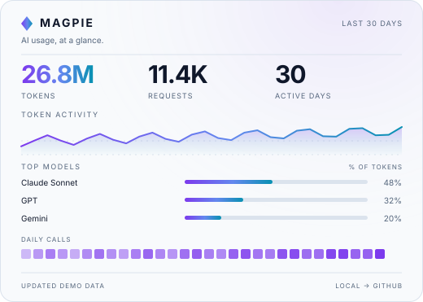

> 社区候选插件，等待维护者审核与发布；独立 GitHub 版本已可安装。

# Magpie GitHub Stats

在 **Magpie 侧栏**配置自己的 AI 用量卡片，每天自动同步到 GitHub Profile。无需独立服务器、数据库或统计平台。

<picture>
  <source media="(prefers-color-scheme: dark)" srcset="examples/magpie-dark.svg">
  
</picture>

上图是明确标为 DEMO DATA 的示例。安装后的预览和同步都使用本机真实统计。

## 安装到 Magpie

在 **Magpie → 插件 → 添加插件** 输入：

```text
github:wolfvoid/magpie-github-stats
```

或使用命令行：

```sh
magpie plugin add github:wolfvoid/magpie-github-stats
```

然后打开侧栏 **GitHub 统计卡片**。设置、预览、立即同步和复制 README 全部在 Magpie 窗口内完成，**无需单独打开浏览器**。仓库提交了编译后的 `dist/`，Magpie 自带的 Bun 可以直接加载，不要求用户构建或安装 Node。

最低声明版本：Magpie 0.1.1340；实际桌面验证版本：macOS Magpie 0.1.4355。建议升级 Magpie。GitHub 非官方发现页的收录取决于 GitHub 索引和 Magpie 缓存；本项目尚未获得社区精选市场审核。

### 一次配置

1. 填写已有的 `owner/repo`；分支留空使用仓库默认分支，文件夹默认 `assets`。
2. 选择授权方式：
   - **推荐：Fine-grained PAT**，仅授权目标仓库，给予 **Contents: read and write**。在插件页输入并保存。macOS 使用钥匙串，Linux 使用 Secret Service，Windows 使用当前用户 DPAPI 加密。
   - 已有 `gh auth login` 的电脑可选择 **GitHub CLI 登录**。插件调用 `gh auth token --hostname github.com`，不会复制该 Token 到配置文件。此方式继承该登录的权限，不会自动缩小为单仓库权限。`gh` 必须在后台任务的 PATH 中。
3. 选择周期、主题和宽度，以及 **DAILY CALLS 视图（月／周）**。可选择 3–5 个模型，开关趋势、热力图、模型排名与估算费用。
4. 开启 **每日自动同步**，保存配置；首次到期任务会立即补同步，也可点 **立即同步**。
5. 点 **复制 HTML**，把代码放进 Profile README。公开展示需使用公开仓库。

插件只管理 `assets/magpie-light.svg` 与 `assets/magpie-dark.svg`（目录可改）。它不会自动修改 README；用户只需嵌入一次。

## 功能与统计口径

- Requests、Tokens、Active Days；最近 7 天、30 天或 All Time。
- Neon Aurora、Minimal、Cyberpunk 三种主题，各有深浅色版本；320–800 px 宽度（页面预设 320/520/640）。
- 最多 5 个模型、Token 趋势、每日请求日历、可选 Estimated Cost。
- **Tokens = input + output，不含 cache_read/cache_write**，与 Magpie 官方 summary 的 `Tokens()` 一致；reasoning 不重复相加。
- Requests 包含该汇总中计入的失败/取消请求。Active Days 按 Magpie 返回的本地日期中 `calls > 0` 的天数统计。
- 同名模型合并跨供应商统计；百分比以全部 Token 为分母，Top N 不一定加起来为 100%。仅公开模型 ID，不公开供应商、账号或自定义备注。
- All Time 使用当前 Magpie 本机 summary 的历史范围。历史被清理后，范围会缩短；它不是无限归档。若 Magpie 对长历史返回周桶，会使用 30 天分段的同一 summary API 取得日统计，避免混用 Requests 页的不同统计范围。
- 趋势显示所选周期最后 7/30 天；DAILY CALLS 可独立选择本月日历或本周一至周日，按本地日期取数。颜色表示每日调用量，同时显示日期与次数；未来日期用横线标记，缺失日期补零，跨月周正确对齐。选择月视图不会因顶部只统计 7 天而漏掉月初数据。
- 费用为 Magpie 给出的 USD 估算，未定价调用会标注排除；并不等于真实账单。默认关闭。

## 自动任务

| 系统 | 调度 | 凭据存储 | 验证状态 |
|---|---|---|---|
| macOS | LaunchAgent | Keychain | 桌面插件、真实 GitHub 上传和 LaunchAgent 已验证 |
| Linux | systemd user timer | `secret-tool` / Secret Service | 配置生成与单元测试覆盖；未在真实 Linux 桌面验证 |
| Windows | Task Scheduler | 当前用户 DPAPI | 配置生成与单元测试覆盖；未在真实 Windows 桌面验证 |

每天本地时间 02:00；登录/启动与每小时检查补同步。同一天成功过且配置未变，自动任务直接跳过。2 点之前不会再次同步昨天已完成的任务；超过一天未成功则补同步。休眠/关机或 Magpie 不可用时保留旧图，恢复后再试。Linux 用户服务通常要求用户已登录；无需为本插件开启系统级服务。

手动同步允许当天重新读取数据。SVG 相同时跳过 GitHub 提交；未改变公开内容时保留图片上的 UPDATED 日期，避免仅因日期变化制造提交。同步检查时间单独显示在本机状态中。

GitHub Contents API 每张图一个提交，两个写入顺序执行；第二张失败时，远端可能短暂呈现不同批次的两张有效图片，下次重试补齐。不会上传空白占位图。网络/5xx 有限重试，SHA 冲突重新读取，限流遵循服务端冷却时间。

**禁用/移除插件之前，先在本页关闭每日同步。** 操作系统任务独立于插件宿主，单纯移除 Magpie 插件不会自动删除任务。也可运行 `node dist/cli.js schedule remove`。移动插件目录、升级运行时后如路径变化，请重新安装调度任务。

## 隐私与本地文件

数据仅来自 `http://127.0.0.1:<port>/v1/magpie/usage`。不读聊天/提示词、不读账本原文件、不请求 `/usage/requests`。原始汇总可能带账号与会话维度；适配器白名单只留下日期、计数和模型 ID，原响应不落盘。

默认本地状态目录：`~/.config/magpie-github-stats`，支持 `XDG_CONFIG_HOME` 或 `MAGPIE_STATS_HOME` / `--home` 覆盖。包含非敏感配置、同步状态、最近成功 SVG 和调度记录；Windows 的 `token.dpapi` 是当前用户加密的密文。目录 0700、配置写入 0600（Windows 另受用户目录 ACL 控制）。

插件服务只绑定 `127.0.0.1`，默认端口 3498。每次进程启动生成页面令牌，API 校验令牌、Host 和 Origin；`Origin: null` 只为 Magpie 沙箱允许，仍须令牌。没有开放 CORS 的 HTML，没有远端脚本、遥测或公网监听。Magpie Web 使用官方 `magpie.service` 代理。

Token 不写入 SVG、README、JSON 配置、URL、命令行参数或日志。凭据库锁定时任务明确报错，不降级为明文存储。Linux 需要桌面 Secret Service 和 `secret-tool`；无桌面环境可给命令行进程提供 `MAGPIE_GITHUB_TOKEN` 环境变量，但自动安装的任务不会把这个值写进任务定义。

## 命令行与开发

命令行是可选工具，日常使用入口是 Magpie 侧栏。

```sh
npm ci
npm test
npm run demo
node dist/cli.js configure --repo USERNAME/USERNAME --credential-source github-cli
node dist/cli.js render --out ./cards
node dist/cli.js sync
node dist/cli.js schedule install
node dist/cli.js readme
node dist/cli.js status
node dist/cli.js schedule remove
npm pack
```

Node.js 22+；Bun 可直接运行 `dist/cli.js`。运行时零 npm 依赖，TypeScript 与 Node 类型声明仅用于开发。

开发隔离配置：`node dist/cli.js serve --home .local/dev --port 3499`。`auth --stdin` 从标准输入读取 PAT，不接受 `--token` 参数。`configure --file config.json` 导入非敏感配置，不能含 Token。

修改本地插件后重建 `npm run build`；在 Magpie 重新加载该插件的宿主后生效。停止自动任务后再移动目录。不要对正在使用的 Magpie 进行重启式测试。

## 测试与发布

`npm test` 覆盖真实接口字段契约、隐私过滤、Token 口径、空数据、超长模型名/XML 注入、主题/宽度、GitHub 去重/冲突/丢失响应/限流、失败保留、锁、跨日调度、Host/Origin/页面令牌和设置 API。CI 在 macOS、Linux、Windows 执行；操作系统调度及凭据库的原生行为仍需对应系统端到端验收。

检索过程与相近插件对照见 [docs/research.md](docs/research.md)。架构与发布事项见 [docs/release.md](docs/release.md)。

MIT License。
