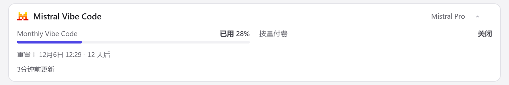

# Mistral Vibe Code for Magpie

[简体中文](README.zh-CN.md)

Use your Mistral Vibe Code subscription from WorkBuddy, Claude Code or Codex through Magpie. This is a community plugin.

## Install and sign in

```sh
magpie plugin add @magpie-community/opencode-mistral-vibe-auth
magpie plugin login mistral-vibe oauth
```

1. Sign in to Mistral Console in your browser and select a workspace with Vibe Code access.
2. In Magpie's usage page, refresh the **Mistral Vibe Code** card to check your plan and monthly quota.
3. Select a `mistral-vibe/<model>` model in your client.

You can also create a Vibe CLI key under **Code → Vibe CLI** in Mistral Console, then add it to Magpie using **Vibe Code API key**. [Mistral Vibe CLI key guide](https://docs.mistral.ai/vibe/code/cli/api-keys-profiles)

## Check your Pro quota

The card shows the plan Mistral identifies for the key. **Mistral Pro** identifies a personal Pro plan. **Monthly Vibe Code** shows usage and reset time. **Pay as you go** shows the overage setting.



*Magpie quota card with example data.*

```sh
magpie quota mistral-vibe --json
```

## How it works

- Browser sign-in uses Mistral Console's PKCE flow and saves the resulting Vibe key in Magpie. Polling follows `Retry-After`, and key exchange retries transient errors.
- Model discovery uses `api.mistral.ai/v1/models`, and requests go to `api.mistral.ai/v1/chat/completions`. The plugin sends conversation and tool data to the configured Mistral API. It converts historical reasoning to Mistral's typed format and preserves the link between tool calls and their results. Magpie handles chat rate limits.
- The plugin reads the monthly Vibe budget, plan and overage status from Mistral. The [dual-wallet proposal (#871)](https://github.com/magpie-community/plugins/pull/871) holds Vibe and API keys in one account and uses `--api` model aliases to select the API budget. This package focuses on browser sign-in and the Vibe key. Both use the same monthly Vibe budget when signed in to the same Vibe account. Enable one package at a time because both use `mistral-vibe`.

## Source and license

Maintained by [hxquan-q](https://github.com/hxquan-q) in the [original project](https://github.com/hxquan-q/magpie-mistral-code). See the [Chinese README](README.zh-CN.md#致谢) for credits. [MIT License](LICENSE).

Run `bun test` from this package directory. Tests use local Mistral stand-ins.
