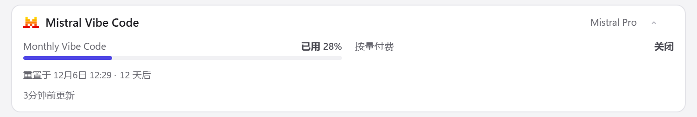

# Mistral Vibe Code for Magpie

[English](README.md)

通过 Magpie 将 **Mistral Vibe Code 订阅额度**接入 WorkBuddy、Claude Code 和 Codex。支持浏览器登录、Vibe CLI Key 和订阅用量查询。

非官方 Magpie 插件 · Provider ID 为 `mistral-vibe`

[快速开始](#快速开始) · [确认 Pro 额度](#确认-pro-额度) · [常见问题](#常见问题) · [开发与配置](#开发与配置)

## 快速开始

安装 Magpie 后，在终端运行以下命令安装插件并发起浏览器登录。

```powershell
magpie plugin add @magpie-community/opencode-mistral-vibe-auth
magpie plugin login mistral-vibe oauth
```

1. 在浏览器登录 Mistral，选择有 Vibe 权益的工作区，等终端提示登录完成。
2. 在 Magpie 的额度页刷新 **Mistral Vibe Code**，查看当前账号的套餐和月度额度。
3. 在客户端的模型选择器中选用 `mistral-vibe/<模型>`。

### 使用 Vibe CLI Key

也可以在 Mistral Console 的 **Code → Vibe CLI** 创建 Key，再到 Magpie 添加账号并选择 **Vibe Code API key**。 [Mistral Vibe CLI Key 文档](https://docs.mistral.ai/vibe/code/cli/api-keys-profiles)

## 确认 Pro 额度

额度页的套餐来自 Mistral Console 对当前 Key 的身份查询。如果配置了多个账号，查看本次请求使用的账号卡片。



*Magpie 额度页的 Mistral Pro 卡片（示例数据）。*

| 账号卡片显示 | 含义 |
| --- | --- |
| **Mistral Pro** | Mistral 已将该 Key 识别为个人 Pro 套餐。查看 **Monthly Vibe Code** 的用量和重置时间。 |
| **Studio API key** | 当前 Key 属于 Mistral Studio API。要接入 Pro 额度，请用有 Vibe 权益的工作区登录，或创建该工作区的 Vibe CLI Key。 |
| **Plan not confirmed** | 当前 Key 的套餐尚待确认。可刷新或在 Mistral Console 核对工作区。 |

**Pay as you go** 显示超额付费状态。`On` 为开启，`Off` 为关闭，`Unknown` 表示状态待确认。**Platform API credits** 供查询平台 API 用量。

```powershell
magpie quota mistral-vibe --json
```

核对单次请求时，选用 `mistral-vibe/<模型>` 发送一条短消息，再在 Mistral 查询该时段的用量。 [Mistral 订阅说明](https://docs.mistral.ai/admin/billing-usage/subscriptions) · [Mistral 用量查询](https://docs.mistral.ai/admin/billing-usage/usage-limits)

## 与社区双预算方案的区别

本插件支持在 Mistral Console 浏览器选工作区，或直接使用 Vibe CLI Key。模型来自 `api.mistral.ai/v1/models`，请求走 `api.mistral.ai/v1/chat/completions`。插件展示套餐、月度 Vibe 用量和按量付费状态，并为 WorkBuddy、Claude Code 和 Codex 整理多轮工具调用历史。

[社区双预算方案 #871](https://github.com/magpie-community/plugins/pull/871) 将 Vibe Key 和 API Key 放在同一账号，并通过 `--api` 模型别名选择 API 预算。两个方案用同一个 Vibe 账号时共享月度 Vibe Code 额度。建议只启用其中一个，两个方案使用相同的供应商 ID `mistral-vibe`。

## 常见问题

| 问题 | 处理方法 |
| --- | --- |
| 发起登录时收到 `429` | 等限流恢复后再发起登录。若已在浏览器完成授权，保持终端运行，插件会按服务端给出的 `Retry-After` 继续轮询。 |
| 换钥收到 `403/9004` | 当前工作区没有 Vibe 权益。重新发起浏览器登录并选择有 Vibe 权益的工作区。 |
| 额度页显示 `Budget unavailable` 或 `No monthly budget` | 前者表示没有可展示的预算，可刷新额度页。后者表示 Mistral 返回的月度额度为零，可到 Console 核对工作区。 |
| 多轮对话收到 `422 extra_forbidden` | 运行 `magpie plugin list`，核对当前启用的插件及其路径。旧会话若仍加载旧代码，可在当前任务结束后重启 Magpie。 |
| 模型列表为空 | 确认账号已登录，再运行 `magpie provider models mistral-vibe`。模型列表由 Mistral API 返回。 |

## 工作原理

- **登录**。通过 PKCE 发起浏览器授权，轮询 Mistral Console 提供的同源地址，完成后换取 Vibe Key，由 Magpie 保存。轮询遵循 `Retry-After`，换钥会重试临时网络错误、`429` 和 `5xx`。
- **用量**。通过 `/vibe/whoami` 识别账号套餐，再用 `billing/budget` 的 Vibe 预算展示月度用量。超额付费状态优先读取预算中的开关，再查询订阅接口。
- **聊天**。确认目标是配置的 `/chat/completions` 后，插件带上账号 Key 发送请求。它会清理宿主私有字段，将历史思考转换为 `thinking` 片段，并保留工具调用和结果的关联。请求按 API 基址和 Key 控制并发及发送间隔，生成接口的 `429` 和 `Retry-After` 交给 Magpie 处理。

生成请求会把提示词、对话历史、工具数据和随请求发送的附件传给配置的 Mistral API。授权和身份查询访问 Mistral Console，公开模型元数据可从 `models.dev` 获取。 [查看插件实现](index.mjs)

## 开发与配置

在本包目录运行本地测试，使用模拟接口覆盖登录、额度查询、多轮工具调用和响应流。

```sh
bun test
```

<details>
<summary>环境变量</summary>

| 变量 | 默认值 | 用途 |
| --- | --- | --- |
| `MISTRAL_VIBE_API_BASE` | `https://api.mistral.ai/v1` | 模型、聊天及计费 API |
| `MISTRAL_VIBE_CONSOLE_API` | `https://console.mistral.ai/api` | 浏览器登录及身份查询 |
| `MISTRAL_VIBE_MAX_CONCURRENCY` | `4` | 每组 API 基址和 Key 的最大在途生成请求数 |
| `MISTRAL_VIBE_MIN_INTERVAL_MS` | `250` | 每组 API 基址和 Key 的最小生成请求间隔，单位为毫秒，设为 `0` 可关闭 |

</details>

## 项目维护

由 [hxquan-q](https://github.com/hxquan-q) 开发并维护。反馈时请附 Magpie 版本、客户端名称和脱敏错误信息，并移除 Key、授权链接和敏感请求内容。 [提交 Issue](https://github.com/hxquan-q/magpie-mistral-code/issues/new)

## 致谢

- 插件实现参考了 [songlairui/magpie-mistral-code](https://github.com/songlairui/magpie-mistral-code)。
- 浏览器登录的轮询退避和工作区提示参考了 [SammySnake-d/magpie-mistral-code](https://github.com/SammySnake-d/magpie-mistral-code)。
- 感谢 [LINUX DO](https://linux.do/) 社区的讨论和反馈。

## 许可证

本项目采用 [MIT 许可证](LICENSE)。
