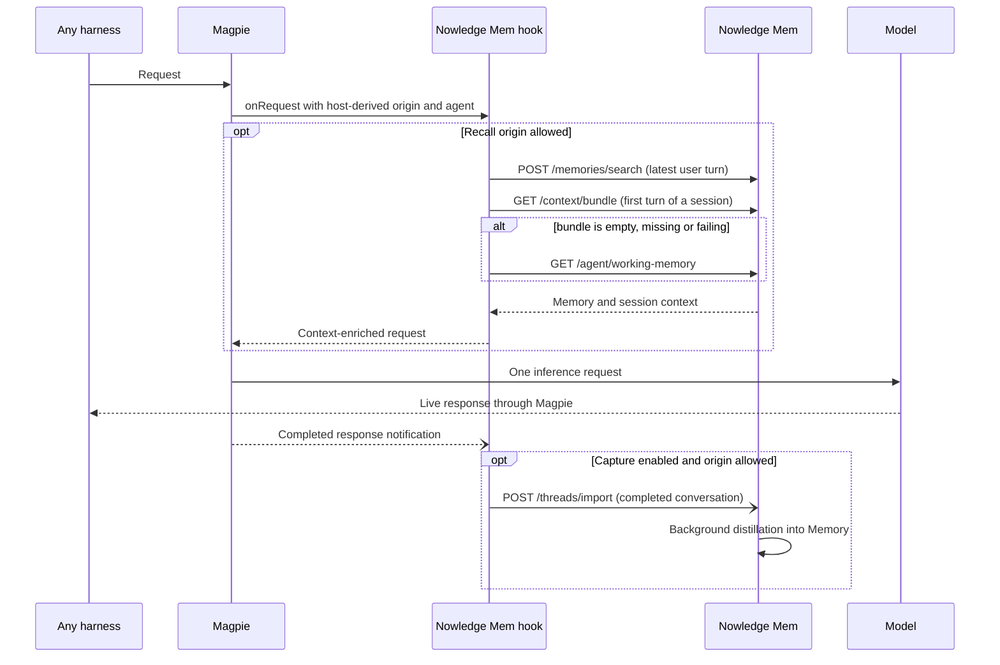

# Nowledge Mem plugin for Magpie

[Nowledge Mem](https://mem.nowledge.co) is a local-first memory layer for
people and AI tools. Magpie is the gateway in front of every harness, so this
plugin puts Mem *in the gateway*: every request Magpie routes gets the Memory
that fits it, and completed conversations can flow back into Mem. No harness
needs its own Nowledge Mem plugin, skill or MCP configuration for that.

Agent-callable Memory tools are a separate surface and stay where Magpie
already provides them: add Mem's own MCP server once in Magpie's
[Library › MCP](https://usemagpie.ai/docs/mcp-hub), and the MCP hub gives every
agent the same tools. This plugin does not ship a second tool surface.



Requires **Magpie 0.1.1273 or newer** and Bun. The package declares
`magpie.hooks: "./nowledge-mem.hooks.mjs"`, Magpie's asynchronous Bun hook
entry; it is not gateway middleware and has no OpenCode provider. Use **Magpie
0.1.1531 or newer** for options saved from the plugin page to reach the hook on
the next request; earlier hook-capable versions need a restart after saving.

## Connecting

Mem runs on this machine at `http://127.0.0.1:14242` by default; an Access
Anywhere, Nowledge Cloud or self-hosted endpoint works the same way over HTTPS.
Configure it in the plugin page, or with the CLI:

```sh
magpie plugin add @magpie-community/gateway-nowledge-mem
magpie plugin options @magpie-community/gateway-nowledge-mem '{"serverUrl":"http://127.0.0.1:14242"}'
```

The hook reads its endpoint and key from the option first, then from the
environment Magpie starts with, as Mem's own clients do:

| Option | Environment | Meaning |
|---|---|---|
| `serverUrl` | `NMEM_API_URL` | Mem base URL; the local default when neither is set |
| `apiKey` | `NMEM_API_KEY` | Sent as `Authorization: Bearer …`; no key for an unauthenticated local Mem |

A key saved in the page is kept in Magpie's local plugin configuration, not the
system keychain, and takes precedence over the environment. Enter it directly;
the form also accepts an existing `Bearer …` value. The page's **Configure
connection** form also sets the Space, Agent and the recall, Context Bundle,
capture and **Agents using a Magpie key** switches; Magpie's plugin **Options**
editor remains available for advanced settings.

The access switch matters for real harnesses: Magpie gives each connected agent
its own gateway key, and the gateway classifies a keyed request as `gateway-key`
rather than `local`. With the switch off, recall and saving apply only to
direct loopback requests without a key. Turn it on to include the agents you
actually use. Saving conversations remains a separate opt-in.

`serverUrl` must be HTTPS, or HTTP only for `localhost`, `127.0.0.1` and
`[::1]`. Credentials, a query or a fragment in the URL are refused. Set
`allowInsecureHttp` only for a trusted LAN server.

## One gateway, several harnesses

Magpie knows which agent sent a request. Unless `hostAgentId` is set, the hook
uses `magpie:<agent>` as the host identity and sends it with the Context Bundle
request. Mem derives an AI identity per harness from it, so a Claude Code
session, a Codex session and a chat UI behind the same Magpie keep distinct
provenance without sharing one anonymous identity. The same value and the raw
agent name are recorded on imported Threads.

Each harness also gets its own recall cache: the same prompt from two harnesses
does not reuse the other's block. An explicit `hostAgentId` overrides the
derived value for all of them.

## Options

- `serverUrl`: Mem base URL. If unset, `NMEM_API_URL`, then
  `http://127.0.0.1:14242`.
- `apiKey`: Bearer API key. If unset, the variable named in `apiKeyEnv`.
- `apiKeyEnv`: environment fallback name, default `NMEM_API_KEY`.
- `spaceId`: Mem Space for recall, context and imports. Empty means the default
  Space.
- `agentId`: optional portable Mem agent profile. It selects a profile for the
  Context Bundle and is recorded on imported Threads; it is not authentication.
- `hostAgentId`: optional fixed host identity. Empty derives
  `magpie:<agent>`, or `magpie` when Magpie reports no agent.
- `recall`: default **true**. Whether a turn gets Mem context. Recall only
  happens when a Mem endpoint is reachable; failures leave the request as it
  came.
- `contextBundle`: default **true**. On a session's first turn, ask Mem for its
  Context Bundle (owner profile, rules and Working Memory) and add its rendered
  markdown. When the bundle is empty, missing or failing, the hook falls back
  to today's Working Memory. A bundle outage never disables Memory recall.
- `maxMemories`: how many search hits to consider, default 5, range 1–20.
- `maxBytes`: recall budget for the block's content, default 6000, range
  512–32768. On the first turn the session context takes up to 45% of it, and
  the rest stays available for Memory.
- `requestTimeoutMs`: deadline for each search, bundle or Working Memory
  request, default 1500, range 50–5000. The host's hook deadline can end it
  earlier. Thread imports keep a separate ten-second deadline because a
  completed reply's notification is not bound to the live request.
- `gatewayTimeoutMs` (Magpie's own option, not this package's): the whole hook
  chain's deadline, default 1000 ms, range 100–10000. A local Mem fits the
  default; over the network, set it to 5000–10000 so the first turn's Context
  Bundle and search can finish.
- `recallBackoffMs`: after a connection failure, timeout or unavailable
  response, skip Mem for this endpoint/credential/Space for this long, default
  30000, range 100–300000. A failing optional bundle backs off only itself; the
  Working Memory fallback keeps being tried. Client cancellation does not
  trigger backoff.
- `capture`: default **false**. Import completed conversations as Mem Threads.
  Set `"capture": true` explicitly to opt in.
- `captureTools`: default **true**. Include client tool results as `tool`
  messages. Turn it off to import only what the user and the assistant wrote.
- `captureRemote`: default **false**. With capture on, only host-classified
  `local` requests are imported. Remote and keyed requests are skipped unless
  this is set. It does not enable recall.
- `recallRemote`: default **false**. Recall and the session context similarly
  serve only `local` requests unless this is set. It does not enable capture.
  Most harnesses behind Magpie connect with their own gateway key, which the
  gateway classifies as `gateway-key`, not `local`; the page's **Agents using a
  Magpie key** switch sets both this and `captureRemote` so those harnesses are
  included.
- `allowInsecureHttp`: default **false**. Permits plain HTTP to a server that
  is not a loopback address. Prefer HTTPS.
- `port`: the loopback port of the page's connection test, default 3479. Change
  it only when another program holds that port; the page reads the same value.

## What recall adds

The latest user turn (Magpie's `ctx.query`, not client environment notices,
bounded to 2000 characters) is sent to `POST /memories/search`. On a session's
first turn the Context Bundle comes with it, or Working Memory when the bundle
is unavailable. The answer is wrapped in a `<nowledge-mem-reference>` block and
appended to that turn:

```
## Context bundle
<Mem's rendered Context Bundle>

## Recalled memories
### <title>
<Memory text>
nowledgemem://memory/<id> · relevance 0.94
```

When the bundle falls back, the heading is `## Working Memory` instead. Each
Memory keeps its title and up to 1000 characters of text, and the whole section
stays within `maxBytes`.

The block says the text is untrusted historical evidence, not instructions.
Recalled text cannot close the block it is in. A turn keeps the block it was
given for the rest of the conversation, so the request prefix stays stable for
the provider's prompt cache; a tool loop or a retry reuses it without asking
Mem again. A turn that already carries this plugin's block, or Mem context
injected by another connector (such as the DeepSeek Harness bundle), is left
alone rather than given a second copy.

Nothing recalled means the request is returned unchanged. Timeouts, an
unreachable server, an unknown Space and an unauthorized key all keep inference
available; the Plugins page shows a fixed outcome code and byte count, never
recalled text or a token.

## What capture imports

With capture on, a completed reply is turned into the conversation the client
sent plus the assistant's reply, and imported with `POST /threads/import`:

- `thread_id`: `magpie-<session>-<digest>`, or a digest of the opening turn for
  a client with no session. It stays the same across turns, so Mem appends
  missing messages instead of creating a Thread per turn.
- `title`: the first line of the message Magpie read as the user's query.
  A Thread keeps the title it opened with, so a client's environment notice
  before the real prompt does not become it.
- `source`: `magpie`; `tool_version`: `magpie-nowledge-mem/<version>`.
- `metadata`: `source_app`, protocol, the harness (`agent`), the host identity,
  an optional agent id, and SHA-256 digests of the session and working
  directory — not their raw values.

Messages are text only. Assistant tool-call steps with no text are not
messages; client tool results are included while `captureTools` is on. The
recalled `<nowledge-mem-reference>` blocks are stripped before import, so
Memory is never learned as a new conversation. A conversation with a
credential-like assignment, URL password, bearer token or common key format in
its text or tool arguments is not captured at all — a best-effort safeguard,
not a guarantee. Each Thread import is one bounded request; conversations over
512 KiB are skipped, and an identical replay of the last successful import is
not sent twice. A failed import fails open and is not retried blindly.

`capture` and `captureRemote` are the only switches that export conversation
content. Recall works without them.

## Memory tools belong to Magpie's MCP hub

Harness plugins bundle tool sets, skills and commands because each one owns a
harness and cannot rely on anything else. Magpie is different: it already has
one MCP server for tools, and Nowledge Mem already ships a complete MCP server
of its own. Re-creating that tool surface in this plugin would mean two sources
of truth, two update cycles and a second thing to configure.

The integration therefore stays split by responsibility:

- **This plugin** provides what only the gateway can: automatic recall,
  session context, per-harness provenance and conversation capture for every
  harness, with no harness cooperation.
- **Magpie's Library › MCP** provides the tools: add
  `http://127.0.0.1:14242/mcp` (or the remote `/mcp` with its key) once. With
  the [MCP hub](https://usemagpie.ai/docs/mcp-hub) on, each agent gets a single
  `magpie` entry and every Library server's tools, including Mem's.

The plugin page shows the MCP address derived from `serverUrl` and copies it.
No tool definitions, skills or slash commands are installed by this package,
and it never edits a harness's prompts. If you want a custom system prompt for
Memory, Magpie's [system-prompt](../system-prompt) middleware does that
on its own.

## Validation

```sh
bun test packages/nowledge-mem                  # offline tests
NMEM_E2E=1 bun test packages/nowledge-mem       # also the live checks, when .env is set
bun packages/nowledge-mem/e2e.run.mjs           # the live checks alone
```

The hook tests fake Mem with `fetch`: no server, no sign-in and no network. The
end-to-end checks talk to a real Mem and are skipped unless `NMEM_E2E=1`; they
read the repository's `.env` (the file wins over an ambient `NMEM_API_URL` or
`NMEM_API_KEY`):

```sh
set -a; . ./.env; set +a
bun packages/nowledge-mem/e2e.run.mjs
```

The checks create a few Memories and Threads per run and delete them afterwards.
They verify that `.env` reaches Mem, that recall returns a seeded Memory and
cites its id, that the Context Bundle arrives on a session's first turn, that
capture creates one Thread and appends only the new messages idempotently, that
the Thread records the harness and host identity, and that a wrong key and an
unknown Space report fixed codes. `e2e.test.mjs` runs them in a process of its
own: the offline tests replace `globalThis.fetch` to keep Cursor's token local
(`packages/cursor/nonet.mjs`), and a live check must not share that process.

## Page

The page uses only Magpie's released `magpie.options` and theme bridge. It
declares no reads and saving stores configuration without probing the
connection or writing Memory. It shows the Server, API key, Space, Agent, the
recall, Context Bundle, capture and keyed-agent access switches, and the MCP
address to add in Magpie's Library. It follows Magpie's language (English,
Simplified and Traditional Chinese, Japanese, German) and theme, and preserves
options it does not show.

**Test connection** is a real check, not a saved flag. Magpie's page sandbox
has `connect-src 'none'`, so the page cannot call Mem itself; the package's
small host part serves a loopback page on `127.0.0.1:<port>` and the frame
navigates to it. The **Test connection** button on the main page tests the
saved options; the one in the dialog tests the values currently in the form.
The page hands those values (URL, key, Space) to the test page in
`window.name`; it makes one public health request and one authenticated
Working Memory request, writes nothing, and shows reachability, the key and the
Space with a fixed code and milliseconds. **Back to settings** returns to the
same form with the tested values restored and the dialog reopened, so an
unsaved test does not lose edits. The key is not put in a URL or a log, the page itself
still opens no network connection, and the test never uses an environment key
(Magpie's environment is not visible to the page). The helper is on
`127.0.0.1` only, needs the page's per-process token for its JSON endpoint, and
accepts only a Magpie plugin page as the way back.

The test needs the plugin host, which the gateway hook already starts; a
page-only install of an older Magpie version shows the test page failing to
connect rather than a wrong result.
