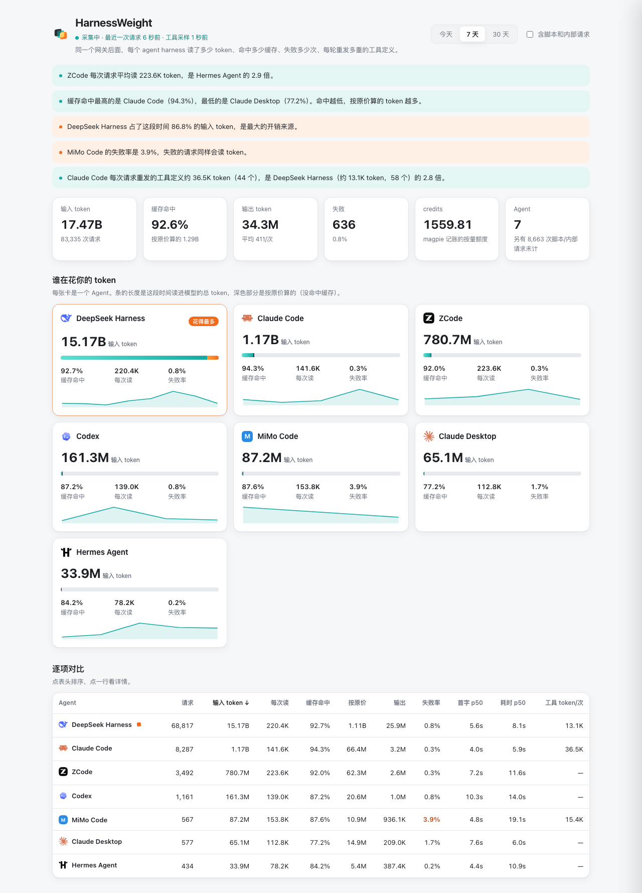
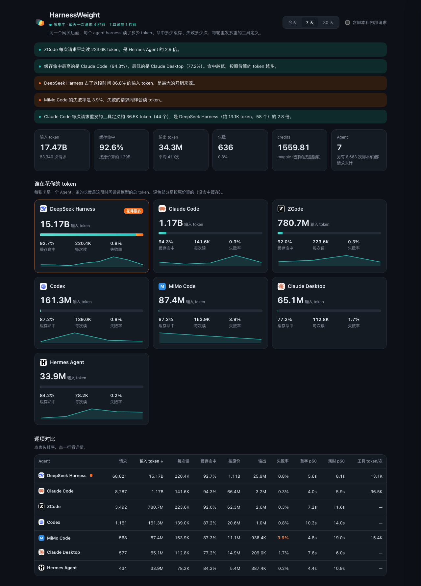

<p align="center">
  <picture>
    <source srcset="brand/assets/lens-dark.svg" media="(prefers-color-scheme: dark)">
    
  </picture>
</p>

<h1 align="center">HarnessWeight</h1>

<p align="center">给网关后面的每个 <b>agent harness</b> 称重：读了多少 token、命中多少缓存、失败多少次、每轮重发多重的工具定义。</p>

<p align="center"><b>中文</b> · <a href="#english">English</a></p>



https://github.com/user-attachments/assets/3798be90-5b2b-411e-b83b-22688fd8a82e

> ▶ 30 秒演示：结论 → Agent 卡片 → 排序 → 详情 → 切 30 天 → 深色。

> 截图是作者本机 7 天的真实用量，在和 magpie 一样的沙箱框架里实拍，没有模拟数据。Agent 名字和图标与 magpie 自己显示的一致。

## 它回答什么问题

你同时用 Claude Code、Codex、zcode、DSH、Cursor……都接在同一个 magpie 网关上。magpie 自带的用量页按**模型**统计；HarnessWeight 按 **agent harness** 统计，回答四个问题：

- **谁在花你的 token**：每个 Agent 读进模型的总 token，其中多少命中缓存、多少按原价。
- **谁每次读得最多**：每次请求的平均输入。上下文越大，越贵。
- **谁最不稳**：失败率、首字延迟和总耗时（p50）。失败的请求同样会读 token。
- **谁的工具清单最重**：Agent 每轮都会把整份工具定义重发一遍，HarnessWeight 在网关上量出它有几个、多大。

页面顶部直接给出几句结论，例如「dsh 占了这段时间 87.9% 的输入 token」「mimocode 的失败率是 10.5%」。

<details>
<summary>深色主题</summary>



</details>

## 安装

```sh
magpie plugin add github:webkubor/harnessweight
# 合并进社区仓后：magpie plugin add @magpie-community/page-harnessweight
```

装好后，magpie 侧栏「插件」里会多一个「HarnessWeight」页。历史数据马上能看到，因为它读的是 magpie 已有的用量记录；工具定义重量从安装后的下一次请求开始采样。

## 工作方式

```
magpie usage.jsonl ─────────────┐
                                ├─► 本地服务 127.0.0.1:3492 ─► 页面
网关 hook（只读）─► tools.jsonl ─┘
```

| 部分 | 文件 | 做什么 |
|---|---|---|
| 网关 hook | `harnessweight.hooks.mjs` | 请求完成后记下 Agent 名、模型、工具的个数、字节数和名字、token。**不改请求，不记对话内容、参数和凭证**；出错也不影响请求。 |
| 用量读取 | `lib/usage.mjs` | 增量读取 magpie 的 `usage.jsonl`，几百 MB 的文件也只读新增部分；内存里保留 31 天。 |
| 本地服务 | `service.mjs` | 只监听 127.0.0.1，提供界面和 `/api/summary`。 |
| 带路页 | `page/` | magpie 的插件页沙箱禁止联网，只能把自己导航到本地服务，顺便带上主题和语言。 |
| 界面 | `app/` | 采集状态、结论、总览、Agent 卡片、可排序的对比表、工具重量、详情抽屉；支持浅色、深色和手机宽度。 |
| 名字与图标 | `lib/brands.mjs`、`app/icons/` | 从网关 `/v1/magpie/usage` 取每个 Agent 的显示名和图标名，和 magpie 侧栏一致；没有图标的显示首字母。 |

### 口径说明

- **输入 token** = 未缓存输入 + 缓存读取 + 缓存写入；**按原价** = 未缓存输入 + 缓存写入。
- **失败**：HTTP 状态为 0、≥400，或记录里带错误。499（客户端主动取消）单独计，不算失败。
- **工具 token** 按 JSON 每 token 约 3.5 字节估算，不是精确计数；各 Agent 口径一致，可以互相比。
- 脚本、SDK 和 magpie 内部请求（curl、python-urllib、magpie 自身探测等）默认不计，勾选「含脚本和内部请求」可以显示。

### 选项

写在 `plugins.json` 里该插件的 `options`：

| 键 | 默认 | 说明 |
|---|---|---|
| `port` | `3492` | 本地服务端口 |
| `usageLog` | `~/.config/magpie/usage.jsonl` | magpie 用量记录的位置 |
| `dataDir` | `~/.config/magpie/harnessweight` | 工具采样存放目录 |
| `agents` | `[]` | 只采样这些 Agent；空表示全部 |
| `gatewayUrl` | `http://127.0.0.1:3425` | 取 Agent 名字和图标用的网关地址 |

## 图标来源

`app/icons/` 是 magpie 为各 Agent 显示的同一套图标，取自社区插件 page-agent-office（MIT），品牌图形来自 [@lobehub/icons](https://github.com/lobehub/lobe-icons)（MIT）。各标志归其所有者，只用来标明对应的 Agent，详见 `app/icons/NOTICE`。

## 隐私与安全

数据只在本机读取，不上传，没有遥测。本地服务只监听 127.0.0.1，并且：每次启动生成随机口令，只写进界面 HTML（该 HTML 不带 CORS 头，其他网页读不到），所有 `/api/` 请求都要带上它；校验 Host（防 DNS 重绑定）和 Origin；只接受 GET。hook 写下的每一行只有名字和数字；测试里专门断言了提示词内容不会落盘。

## 开发

```sh
npm test      # 四种协议的工具解析、用量解析、汇总、增量读取、hook 不落内容
npm run dev   # 直接起服务：http://127.0.0.1:3492/
```

## 品牌

| Token | 色值 | 用法 |
|---|---|---|
| teal | `#17A9A2`（渐变 `#5EE0D2`→`#17A9A2`） | 主色、缓存命中 |
| orange | `#F26B1D`（渐变 `#FFA23A`→`#F26B1D`） | 只标「花得最多」的那一个 |
| yellow | `#FFB547` | 标识的重叠处 |
| graphite | `#2B2F36` | 标识底层、按原价的部分 |

标识是三片镜片叠在一起，代表网关后面的几个 Agent，叠在一起的地方就是对比。源文件和评审页在 [`brand/`](brand/)。

## 状态

v0.4.0。原名 Agent Lens，因与多个同名项目撞车，在 0.4.0 改名为 HarnessWeight；旧的 GitHub 地址会自动跳转，已有的工具采样会自动迁移。

---

<a id="english"></a>

## English

HarnessWeight is a [magpie](https://github.com/yetone/magpie) plugin that compares the AI agents behind your gateway — Claude Code, Codex, zcode, Cursor and others — **by agent** rather than by model: input tokens, cache hit rate, tokens billed at full price, failure rate, latency, and the weight of the tool definitions each agent re-sends on every turn.

```sh
magpie plugin add github:webkubor/harnessweight
```

It reads magpie's own `usage.jsonl`, so history shows up right away, and adds a read-only gateway hook that samples tool-definition sizes. Everything stays on your machine; the hook records names and numbers only, never prompts, arguments or credentials.

MIT © webkubor
