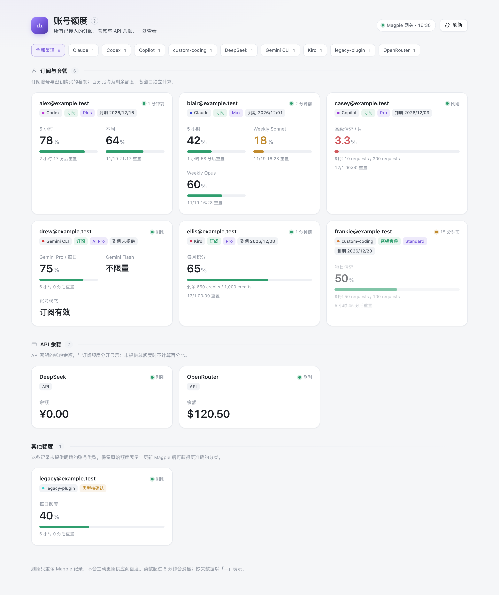

# 账号额度 / Magpie Provider Quota

`@magpie-community/page-provider-quota` 是用于统一查看 Magpie 各供应商账号额度的页面插件。  
`@magpie-community/page-provider-quota` is a Magpie page plugin for viewing account quotas across providers.

统一查看 Magpie 中已接入的订阅、密钥套餐和 API 余额，每个账号一张卡片。  
View connected subscriptions, API key plans and API balances in Magpie, with one card per account.

支持 Kiro、Claude、ChatGPT / Codex、Copilot、Gemini CLI 以及 Magpie 插件返回的其他订阅。  
Supports Kiro, Claude, ChatGPT / Codex, Copilot, Gemini CLI and other subscriptions reported by Magpie plugins.

按各服务实际返回的小时、每日、每周、每月、模型池、积分或请求数展示。  
Displays hourly, daily, weekly, monthly, model-pool, credit or request quotas as reported by each service.

支持 Magpie 桌面侧边栏、服务器 Magpie Web，以及本机独立运行。  
Works in the Magpie desktop sidebar, Magpie Web on a server and as a standalone local page.



## 安装 / Installation

社区包发布后，可通过以下命令安装。  
Once the community package is published, install it with the following command.

```sh
magpie plugin add @magpie-community/page-provider-quota
```

本地开发时，在社区仓库根目录执行以下命令安装源码。  
For local development, install from source by running the following command at the community repository root.

```sh
magpie plugin add ./packages/page-provider-quota
```

在 Magpie 插件列表开启后，点击侧边栏的「账号额度」。  
Enable the plugin in Magpie's plugin list, then select “账号额度” (Provider Quota) in the sidebar.

通过远程浏览器访问服务器 Magpie Web 时，需要 Magpie 提供页面服务代理。  
Accessing Magpie Web on a server from a remote browser requires Magpie's page service proxy.

若页面提示未提供代理，请升级 Magpie 或使用 SSH 转发。  
If the page reports that the proxy is unavailable, upgrade Magpie or use SSH forwarding.

## 接入账号 / Connecting accounts

在 Magpie 的「订阅」中接入所需账号，并在 Magpie 中取得额度读数。  
Connect the accounts you need in Magpie's Subscriptions section and obtain their quota readings in Magpie.

已有账号不需要重复登录。  
Existing accounts do not need to sign in again.

也可以通过 CLI 接入，例如 `magpie accounts add codex`。  
You can also connect accounts through the CLI, for example with `magpie accounts add codex`.

其他订阅只要出现在同一台 Magpie 的额度记录中，就会在下次刷新时自动显示。  
Other subscriptions appear automatically on the next refresh once they are present in the quota records of the same Magpie instance.

无需逐个修改插件，也不需要在本插件中配置密钥。  
You do not need to modify the plugin for each subscription or configure API keys in this plugin.

分类优先使用 Magpie 的 `kind` 字段。  
Classification uses Magpie's `kind` field when available.

- `subscription`：订阅账号，包括任何插件提供的订阅，不依赖供应商白名单。  
  `subscription`: subscription accounts, including subscriptions provided by any plugin, without a provider allowlist.
- `plan`：通过密钥购买的套餐，与订阅同区展示，并标注「密钥套餐」。  
  `plan`: plans purchased for API keys, displayed alongside subscriptions and labeled “密钥套餐” (API key plan).
- `balance`：API 密钥的钱包余额，单独展示，不会因为供应商名称相同而混入订阅。  
  `balance`: API key wallet balances, displayed separately even when they share a provider name with a subscription.

旧版记录未提供类型时，兼容识别 Kiro、Claude、Codex、Copilot 等常见订阅及余额读数。  
For older records without a type, the plugin recognizes common subscription and balance readings, including Kiro, Claude, Codex and Copilot.

无法确认类型的记录放在「其他额度」，保留读数并标注「类型待确认」，不会直接归入 API。  
Records of an unknown type retain their readings under “其他额度” (Other quotas), labeled “类型待确认” (Type unconfirmed), rather than being classified as API balances.

Kiro 的订阅积分属于订阅额度，有金额或积分字段也不会因此被误分为 API。  
Kiro subscription credits are treated as subscription quotas, even when the records contain monetary or credit fields.

同一供应商的订阅、密钥套餐和余额，以及不同远端 Magpie 的账号分别保留。  
Subscriptions, API key plans and balances from the same provider remain separate, as do accounts from different remote Magpie instances.

卡片以账号邮箱为标题，不展示头像。  
Cards use the account email as the title and do not display avatars.

订阅与套餐使用 Magpie 返回的 `until`（当前付费周期结束时间），在套餐标签后展示「到期 YYYY/MM/DD」标签。  
Subscriptions and plans use the `until` value reported by Magpie, which marks the end of the current paid period, to display an “到期 YYYY/MM/DD” (Expires YYYY/MM/DD) label after the plan label.

鼠标悬浮可查看完整时间；供应商未提供日期时显示「到期 未提供」。  
Hover over the label to see the full timestamp; if the provider supplies no date, the label reads “到期 未提供” (Expiry not provided).

额度窗口的重置时间和登录凭证有效期不作为订阅到期时间。  
Quota window reset times and sign-in credential expiration dates are not used as subscription expiration dates.

页面只能显示 Magpie 已接入并返回的额度，不能发现尚未接入的订阅。  
The page can only display quotas for accounts connected to and reported by Magpie; it cannot discover subscriptions that have not been connected.

也不能从第三方中转 API Key 推算其背后的订阅额度。  
It also cannot infer underlying subscription quotas from a third-party relay API key.

Codex 窗口属于 Codex 使用额度，不是 ChatGPT 网页聊天各模型的消息上限。  
Codex windows represent Codex usage quotas, not per-model message limits in ChatGPT web chat.

供应商尚未提供读数的账号显示「暂无额度读数」，不会填入虚构的周期或满额百分比。  
Accounts without provider readings display “暂无额度读数” (No quota readings yet), without invented periods or full-quota percentages.

API 金额余额由 Magpie 的供应商余额探测提供，与订阅和套餐独立显示。  
API monetary balances come from Magpie's provider balance probes and are displayed separately from subscriptions and plans.

若供应商提供 `balance`，直接显示金额；提供 `limit` 和已用积分 `amount` 时，以 `limit - amount` 计算剩余。  
If a provider reports `balance`, the monetary value is displayed directly; if it reports `limit` and used credits as `amount`, the remaining value is calculated as `limit - amount`.

没有总额度时不生成百分比。  
No percentage is generated when the total quota is unknown.

不提供余额接口的供应商需要先在 Magpie 中配置相应的余额探测。  
For providers without a balance endpoint, configure a suitable balance probe in Magpie first.

## 重置卡 / Reset cards

持有重置卡的账号会显示剩余张数和最早过期时间，概览汇总全部重置卡。  
Accounts with reset cards show the remaining count and earliest expiry. The overview totals the cards across accounts.

本机和远端 Magpie 的 Codex 账号都可以点击「使用」，选择重置卡并确认。默认选择最早过期的一张。确认后，网关通过 `POST /v1/magpie/quotas/codex-reset` 使用该卡，操作无法撤销。GLM 等按窗口区分的重置次数可在页面查看，使用时请前往供应商网站。  
For local and remote Magpie Codex accounts, click “Use”, choose a card and confirm. The earliest-expiring card is selected by default. The gateway redeems it through `POST /v1/magpie/quotas/codex-reset`. Redemption is irreversible. For providers such as GLM, the page displays per-window reset counts. Redeem those resets on the provider's website.

使用重置卡需要 Magpie 的完全访问网关密钥。在 Magpie 的「网关 › 网关密钥」中获取密钥，然后配置插件选项 `gatewayKey` 或在确认框中输入。确认框中输入的密钥可暂存在插件服务的内存中，重启服务后会清除。  
Reset cards require a full-access gateway key from Magpie’s “Gateway › Gateway keys”. Set the `gatewayKey` plugin option or enter the key in the confirmation dialog. The dialog can remember the key in service memory until the service restarts.

## 主题 / Theme

页面随 Magpie 窗口实时切换浅色、深色、自定义强调色和字体。独立运行时跟随系统明暗。  
The page follows the Magpie window’s light or dark theme, custom accent color and fonts. In standalone mode it follows the system appearance.

## 单独运行 / Standalone usage

需要 Node.js 20 或更新版本，无第三方依赖。  
Requires Node.js 20 or later, with no third-party dependencies.

在 `packages/page-provider-quota` 目录中执行以下命令。  
Run the following command from `packages/page-provider-quota`.

```sh
npm start
```

打开终端输出的本机地址，默认是 `http://127.0.0.1:3497/`。  
Open the local address printed in the terminal, which defaults to `http://127.0.0.1:3497/`.

`MAGPIE_PROVIDER_QUOTA_PORT` 可以修改独立运行时的端口；插件中通过 `options.port` 修改。  
Use `MAGPIE_PROVIDER_QUOTA_PORT` to change the standalone port, or `options.port` when running as a plugin.

`MAGPIE_CONFIG_DIR` 可以指定 Magpie 配置目录，`MAGPIE_ADDR` 可以指定本机网关。  
Use `MAGPIE_CONFIG_DIR` to specify the Magpie configuration directory and `MAGPIE_ADDR` to specify the local gateway.

## 数据与刷新 / Data and refresh

优先读取本机 `GET /v1/magpie/quotas?kept=1`，保留各账号的额度窗口，页面不展示图片生成（Image generation）条目。  
The plugin first reads the local `GET /v1/magpie/quotas?kept=1` endpoint, preserves each account's quota windows and omits image generation entries from the page.

支持按渠道筛选。  
You can filter by channel.

标题右侧的问号在鼠标悬浮或键盘聚焦时显示接入与自动同步说明。  
Hover over or focus the question mark to the right of the title for account connection and automatic sync instructions.

百分比表示剩余，按 `remaining`、`100 - used` 或 `1 - amount / limit` 计算。  
Percentages represent the remaining quota, using `remaining`, `100 - used` or `1 - amount / limit`.

有计数时同时显示剩余数量及总额。  
When counts are available, both the remaining amount and the total are displayed.

不限量显示「不限量」，文本读数按原文展示。  
Unlimited quotas display “不限量” (Unlimited), and text readings are shown as received.

没有总额的钱包余额不生成百分比。  
Wallet balances without a total do not show a percentage.

供应商返回的多个同周期窗口分别保留。  
Multiple windows with the same period are kept separate as reported by the provider.

网关不可用时读取配置目录的 `quotas.json`，并明确标注快照。  
If the gateway is unavailable, the plugin reads `quotas.json` from the configuration directory and clearly labels the data as a snapshot.

`used`、`remaining` 和计数都缺失时显示「—」，不会当作 100%。  
If `used`, `remaining` and counts are all missing, the page shows “—” instead of assuming 100%.

重置时间已过也不会自行把额度填满。  
Passing a reset time does not automatically refill a quota on the page.

五分钟以前或更新时间未知的读数以较淡颜色显示。  
Readings older than five minutes, or with an unknown update time, appear in a lighter color.

鼠标停在更新时间或额度上可查看详情。  
Hover over an update time or quota to view details.

点击刷新会调用 `POST /v1/magpie/quotas/refresh`，让网关重新查询所有订阅额度、密钥套餐和 API 余额，再读取更新后的额度报告。Magpie 对连续的全量刷新有 30 秒限频。手动刷新失败时，页面保留当前读数并提示更新失败。

Click Refresh to ask the gateway to refresh all subscriptions, key plans and API balances through `POST /v1/magpie/quotas/refresh`, then read the updated quota report. Magpie limits full refreshes to once every 30 seconds. If a manual refresh fails, the page keeps the current readings and displays an error.

自动读取间隔为 60 秒；页面不可见时暂停。  
Automatic reads run every 60 seconds and pause while the page is hidden.

## 隐私与服务 / Privacy and service

服务仅监听 `127.0.0.1`，前端只收到所需的额度字段。  
The service listens only on `127.0.0.1`, and the frontend receives only the required quota fields.

本插件不读取登录凭据、API Key、聊天内容，也不向外部服务上传数据。  
The plugin does not read sign-in credentials, API keys or chat content, and does not upload data to external services.

服务器侧页面使用 Magpie 提供的 `magpie.service` 地址，API 和静态资源均通过相同的服务前缀加载。  
On a server, the page uses the `magpie.service` address supplied by Magpie, loading both the API and static assets through the same service prefix.

无需把插件的回环端口直接开放到公网。  
The plugin's loopback port does not need to be exposed directly to the internet.

## 开发检查 / Development checks

在 `packages/page-provider-quota` 目录中执行测试和打包预览。  
Run the tests and inspect the package contents from `packages/page-provider-quota`.

```sh
npm test
npm pack --dry-run
```

在社区仓库根目录执行插件检查。  
Run the plugin check from the community repository root.

```sh
bun scripts/check.mjs page-provider-quota
```

`assets/light.png` 和 `assets/dark.png` 是使用演示账号生成的桌面界面预览，不含真实账号数据。  
`assets/light.png` and `assets/dark.png` are desktop previews generated with demo accounts and contain no real account data.

测试需要完整源码；发布包不包含测试文件。  
Tests require the full source tree; test files are not included in the published package.

发布包无第三方依赖，由 Magpie 的 Bun 插件宿主运行，无需执行 `npm install`。  
The published package has no third-party dependencies and runs in Magpie's Bun plugin host without requiring `npm install`.

## 来源与参考 / Origin and references

原始项目由 kimbleex 开发，采用 MIT 许可证，详见 [LICENSE](LICENSE)。  
The original project was developed by kimbleex and is distributed under the MIT license; see [LICENSE](LICENSE).

- 原始仓库：[magpie-provider-quota](https://github.com/kimbleex/magpie-provider-quota)。  
  Original repository: [magpie-provider-quota](https://github.com/kimbleex/magpie-provider-quota).
- 官方插件文档：[Magpie 页面插件](https://usemagpie.ai/docs/plugins#pages)。  
  Official plugin documentation: [Magpie page plugins](https://usemagpie.ai/docs/plugins#pages).
- 页面服务模式参考：[page-model-quota](https://github.com/magpie-community/plugins/tree/main/packages/page-model-quota)。  
  Page service implementation reference: [page-model-quota](https://github.com/magpie-community/plugins/tree/main/packages/page-model-quota).
