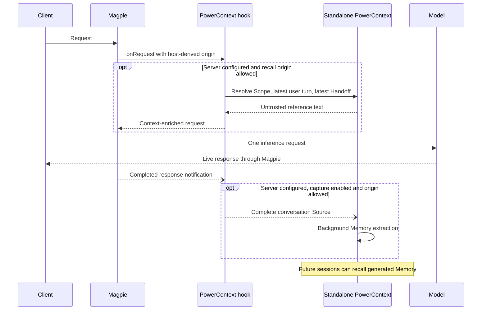

# PowerContext gateway plugin

Recall sends the latest user turn to the PowerContext Server configured explicitly
in plugin Options, even when capture is off, and adds returned Memory/Profile
context to the model request. Optional capture exports full user and assistant
turns, including client tool calls and results, to that same Server. Capture is
off by default. No configured URL means no service requests. Recall and capture
allow only host-classified local requests by default; other callers require
separate `recallRemote` and `captureRemote` opt-ins.

Requires **Magpie 0.1.1273 or newer** and Bun. The package declares
`magpie.hooks: "./powercontext.hooks.mjs"`, the released asynchronous Bun hook
entry. `magpie.gateway` is a synchronous middleware alias and must not be used
for this plugin. See the [host contract](https://github.com/yetone/magpie/blob/v0.1.1273/docs/subsystems/gateway-request-hooks.md).



## Installation and connection

Deploy PowerContext independently using the
[official quickstart](https://powercontext.oceanbase.io/en/docs/get-started/quickstart/).
This plugin does not install Python, download executables, start services, or
manage their lifecycle. Configure Generation, Embedding and the Memory schedule
in the Server when automatic extraction and semantic search are needed.
Gateway clients need no separate PowerContext MCP or skill.

With Magpie 0.1.1273 or newer, install from a local checkout:

```sh
magpie plugin add "/absolute/path/to/packages/powercontext"
magpie plugin options "/absolute/path/to/packages/powercontext" '{"serverUrl":"http://127.0.0.1:8000","scopeId":"YOUR_SCOPE"}'
```

In the plugin page's Connection settings, enter the existing Server address,
Scope ID and service key. Enter the token directly; the form adds `Bearer`
automatically and also accepts an existing `Bearer <token>` value. Leave it empty
when the Server does not require authentication. The key is stored in Magpie's
local plugin configuration, not the system keychain. Do not put credentials in
the URL. The page also configures optional conversation capture. The
native plugin Options editor remains available for advanced settings.

Existing `authorizationEnv` configurations remain supported: when no direct
`authorization` value is saved, the hook reads `Bearer <server token>` from
the named variable in Magpie's startup environment. Clearing the form's key
removes the direct value and restores this fallback.

The package is not published yet. After publication, use the community plugin
installation flow. Installing the plugin does not deploy its external service.

## Behavior and options

- `serverUrl`: standalone Server base URL, **no default**. Set it explicitly
  in Options; without it,
  neither recall nor capture sends anything.
- `authorization`: authorization header, such as `Bearer <server token>`.
  The connection form sets this from the service key and takes precedence over
  the environment variable.
- `authorizationEnv`: optional fallback variable (default `POWERCONTEXT_AUTHORIZATION`).
- `scopeId`: explicit Scope. If absent, resolve an existing Magpie session or
  workspace binding. A missing binding fails open; the plugin does not create
  scopes or grant a model permission to change them.
- `recallRemote`: default **false**. Recall and sticky context replay allow only
  host-classified `local` requests. Remote, named/shared Gateway Key and missing
  or unknown origins make no service requests by default. Enable this option
  only if these callers may send their prompts to the configured Server and
  receive its Scope's Memory/Profile. It does not enable capture. Recall caches
  are isolated by origin and protocol, including when remote recall is allowed.
- `maxBytes`: recall budget, default 8000 bytes.
- `gatewayTimeoutMs`: Magpie's bounded async hook deadline, default 5000 ms.
- `requestTimeoutMs`: deadline for each Scope, context and Handoff request,
  including response body reads; default 1000 ms, range 50–5000 ms. The host's
  cancellation/deadline can end it earlier. A recall normally resolves Scope
  first, then prepares context and a first-turn Handoff in parallel, so its
  service wait can span two such deadlines, bounded by the host deadline.
- `recallBackoffMs`: after a service connection failure, timeout or unavailable
  response, skip service lookup and cache replay for this Server/credential/Scope
  configuration; default 30000 ms, range 100–300000 ms. The next request after
  that interval can try again; continued failure starts another interval.
  Client cancellation does not trigger backoff. A missing/pending Handoff
  (404/503) is normal and does not trigger backoff. Source writes retain their
  separate ten-second deadline and are not retried.
  An optional Handoff connection failure or timeout backs off only Handoff
  lookup for that service/credential/resolved Scope, so healthy Memory recall
  continues. It never disables context preparation or sticky context replay.
- `capture`: enable completed-conversation capture, default **false**. Recall
  works independently. Set `"capture": true` explicitly in Options to opt in.
- `captureRemote`: default **false**. With capture enabled, only host-classified
  `local` requests are captured. Remote, named/shared Gateway Key (even on
  loopback), and missing/unknown origins are skipped. Set `"captureRemote": true`
  only if you intend to capture these other callers too and have their consent.
  This option alone does not enable capture or recall. With capture explicitly
  enabled, it may send Scope-resolution requests and conversation Sources even
  when remote recall is disabled. Forwarded/proxied requests are
  nonlocal even when Magpie trusts the proxy for authentication.
- `idleCaptureMs`: default ten minutes; range 1000–86400000 ms. A later user
  turn confirming a retained answer can trigger capture earlier.
- `allowInsecureHttp`: explicit opt-in for non-loopback HTTP; prefer HTTPS.

`POWERCONTEXT_SERVER_URL` and `POWERCONTEXT_SCOPE_ID` are not read; stale
settings from another integration cannot enable this plugin or override its
Scope. The authorization environment variable remains supported for credentials.
Scope resolution sends the session ID as a binding key and a SHA-256 digest of
the normalized workspace path. Source metadata uses SHA-256 digests for both
session ID and workspace path; it does not contain their raw values. Conversation
content is otherwise complete and can itself contain paths or identifiers.

Chat Completions, Responses, Anthropic Messages and Gemini requests retain their
protocol. Context is escaped and enclosed as untrusted reference text in the
latest user message, preserving prior context blocks for prompt caching. Latest
committed Handoff hints accompany recall when available. Credentials are not
included in model input. Sticky recall has an 8 MiB encoded-byte budget for
all conversations combined, in addition to 256 conversations and 128 turns per
conversation. It counts full escaped reference blocks, Scope IDs and turn keys;
oldest-used whole conversations are evicted first. Evicted turns can be recalled
again, so prompt-prefix retention is best-effort under memory pressure. This is
a cache payload limit, not a bound on the Bun process's total heap.
Timeout, invalid context, unauthorized access and a service outage keep
inference available. With capture off, tool-only continuations and turns that
already contain a reference block do not perform a Scope lookup.

Before staging or saving conversation history, the plugin checks message text
and tool arguments/results for credential-like assignments, JSON fields,
prefixed environment variables (including `PGPASSWORD` and `MYSQL_PWD`) and
common token formats, including URLs with `user:password@` credentials, Stripe
secret/restricted live keys (`sk_live_…`, `rk_live_…`) and Google API keys
(`AIza` followed by 35 key characters). A match skips the whole capture, rather
than redacting parts. This is a best-effort safeguard,
not a guarantee that arbitrary secrets can be identified; capture remains an
explicit opt-in for content permitted on the configured Server. Arbitrary prose
secrets and CLI password flags are not exhaustively detected.

Capture stores the complete conversation available to the request: user and
assistant messages, plus client-owned tool calls and results when supplied by
the client. **Files read by the Agent and command output returned by its tools
are included in those tool results and can be exported to the configured
Server.** Enable capture only for conversations whose content may be stored
there. It excludes injected reference blocks and private authorization.
Responses `previous_response_id` history is recovered only for capture when
observed by this host; missing history does not modify model input or pretend to
be a complete transcript. Failed, truncated and incomplete replies are skipped.

The gateway completion notification and plugin's idle capture timer are
best-effort. Process shutdown can lose pending capture; this is not durable or
exactly-once delivery. Source identifiers/digests provide stable content
identity, but do not establish an exactly-once guarantee. Each Source fragment
is attempted once. An uncertain or failed write is not automatically retried;
remaining fragments stop after a failure, and delivery may be lost or partial.

PowerContext's configured background inference turns Sources into Memory. It
needs its own generation model and credentials; the plugin does not reuse the
client's model authorization. Configure generation through the independent
Server's documented setup.

## Memory tools

This plugin neither declares nor executes memory tools. If an Agent needs
explicit search or remember tools, configure PowerContext's existing MCP server
through the client's Library MCP integration. The client owns tool execution and
subsequent model calls. Automatic recall/capture requires no MCP or skill.

## Validation

Run `bun test packages/powercontext` from the repository root. Tests use fake
HTTP responses and do not install or start PowerContext. Independent real-service
acceptance is maintained outside this repository, with results posted in the PR.
The supported host entry is the released `magpie.hooks` contract in Magpie
0.1.1273 and newer; the package is not a synchronous gateway middleware.

## Configuration page

The PowerContext page uses only the released `magpie.options.get/set` and theme
bridge. Choose **Configure connection** on this page to open a themed configuration
dialog. Magpie's plugin-list **Options** action remains the host's JSON editor;
the released API does not let a plugin replace that action. The dialog stays
inside the plugin page's sandbox. It preserves advanced options when saving changes. Capture is off by
default and requires explicit consent; remote recall and capture remain separate
opt-ins. The form stores configuration, not a verified connection status.

The page and dialogs inherit Magpie's light, dark and system theme through the
official bridge, including surface, text, border and button colors. The official
reverse PowerContext logo is used in dark mode. No separate theme setting or
system preference listener is added by the plugin.

The page follows Magpie's language through its official theme bridge: English,
Simplified Chinese, Traditional Chinese, Japanese and German. Language changes
also update dialogs, validation and status messages without discarding unsaved
form edits. Unsupported languages fall back to English. Brand names, identifiers
and the official documentation URL stay unchanged.

Magpie's sandbox disallows network access and provides no custom hook-read API.
The page retains the request topology, recall-budget grid, request-record area
and a separate Source-to-Memory extraction diagram. These are explicitly labeled
as structural or unavailable, with no simulated request animations or counters.
The budget limit reflects saved maxBytes (8000 by default); usage and grid cells
remain unmeasured, not zero or free space. It does not display live Sources,
Memory or extraction progress. Use the independently deployed PowerContext dashboard
for service records and Memory provenance. Magpie's native plugin diagnostics
report hook outcomes. Saving options does not probe the Server or write Memory.

The package has no installer, CLI executable, background supervisor or standalone
management server. Tests in this repository cover the hook contract; external
service acceptance is run separately in the author's local environment.
