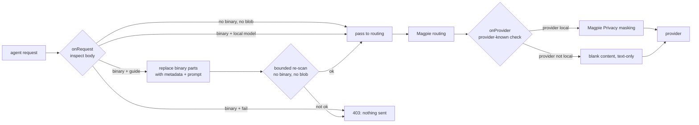
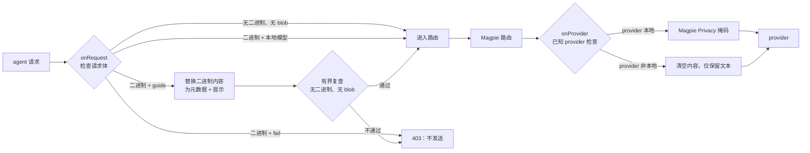

<p align="center">
  <picture>
    <source media="(prefers-color-scheme: dark)" srcset="assets/shypie-icon-dark.svg">
    
  </picture>
</p>

<h1 align="center">ShyPie Privacy Gate</h1>

<p align="center">
  <strong>Structural egress gate for Magpie's gateway</strong><br>
  Withhold or reject what Magpie cannot mask; guide agents toward local extraction.
</p>

<p align="center">
  
  
</p>

---

**ShyPie Privacy Gate** is the Magpie-side half of the
[ShyPie](https://github.com/siml1169/ShyPie) privacy-first workflow for
[DeepSeek Harness](https://github.com/deepseek-ai). It runs as a Magpie
gateway middleware and enforces the **structural** part of the egress path:
images, files, audio, encoded blobs and models outside the allowlist.

It is **not a text masker**. Text masking stays Magpie's Privacy setting. This
plugin makes sure a request that still contains bytes Magpie cannot mask does
not reach a provider by accident.

## Why this exists

Magpie's masking is text-only. Its own documentation says *"Images and file data
are sent as they are. Text inside a screenshot is not masked."* A gateway cannot
mask a PDF page or a screenshot, so it must do one of two things:

- **fail closed** — reject the request, or
- **withhold** — remove the bytes and tell the model to process the file locally.

This plugin implements both. It also catches encoded documents smuggled through
text fields, and it is the same gate for every agent behind the gateway — DSH,
Codex, Cursor, Claude Code and scripts.

## At a glance

| | |
|---|---|
| **Runtime** | Magpie gateway middleware (moejs); plain JavaScript, no imports, no I/O |
| **Hooks** | `onRequest`, `onProvider`, `onUsage` |
| **Protocols** | OpenAI chat, OpenAI Responses, Anthropic Messages, Gemini |
| **Default policy** | `binaryPolicy: fail` — binary part for a non-local model → **403** |
| **Alternative** | `binaryPolicy: guide` — withholds bytes, injects type/media/size metadata + a neutral local-tool prompt |
| **Text masking** | **Not here.** Use Magpie **Settings → Privacy** |
| **Tests** | 72 middleware cases + 3 page/panel checks through the repository harness |

## Install

Install from Magpie's plugin registry:

```sh
magpie plugin add @magpie-community/middleware-privacy-gate

# strictest: block every binary part on every model
magpie plugin options privacy-gate '{}'

magpie plugin        # confirm the middleware is listed and on
```

Make sure Magpie's built-in **JS gateway plugins** plugin is enabled
(**Settings → Plugins → Built-in**, id `middleware`). Without it, no middleware runs.

## Two policies

### `fail` — default

A binary part for a model that is not explicitly local is rejected with a
**403** and a message that names the part type and explains how to extract it
locally. Nothing is sent.

### `guide` — withhold and steer

The request is rewritten into a text-only request:

```text
[A binary attachment was withheld locally and was NOT sent to you
(type image; media image; bytes 481094). Do not claim to have seen it.
First ask how the user/agent can process or read it locally.]
```

No bytes are forwarded. If `guideTools` is configured, those local tool names
are included in the prompt. The middleware cannot run the tools; the agent must
have the matching local MCP/extractor available.

### Local models

Bytes pass unchanged only when **both** allowlists agree:

```yaml
localModels: ["ollama/*", "lmstudio/*"]
localProviders: ["ollama", "lmstudio"]
```

With `localModels` alone, `onRequest` allows the part but `onProvider` blanks the
content because the provider is not local. Set both or neither.

## How it works



The checks are **protocol-position-aware**. Only the protocol's own content
parts are treated as binary parts; keys with names like `signature`, `id`,
`parameters` or `tools` inside tool arguments and message text are ordinary data
and are still scanned.

## Per-agent controls

The middleware is **agent-aware**: Magpie supplies `ctx.agent` to the gateway
hook, so ShyPie can protect some agents and deliberately bypass others.

Open **Settings → Plugins → Installed → ShyPie → Open page** for the full page,
use the **ShyPie protection** card at the bottom of Magpie's **Agents** page for
quick toggles, or right-click an agent and choose **ShyPie protection** to open
the page focused on that agent.

Every agent is protected by default, including new agents. A bypass is explicit:
only ids in `disabledAgents` (or an empty `ctx.agent` when
`protectUnknownAgent: false`) skip the gate. The page warns before a request can
leave without protection; saving its switches updates the same `ctx.options` the
middleware reads, with no restart.

## Configuration

All settings are one JSON object, stored as `ctx.options`:

```sh
magpie plugin options privacy-gate '{
  "binaryPolicy": "guide",
  "allowModels": ["deepseek/*", "copilot/*"],
  "localModels": ["ollama/*", "lmstudio/*"],
  "localProviders": ["ollama", "lmstudio"],
  "disabledAgents": [],
  "protectUnknownAgent": true,
  "guideTools": ["shypie.describe", "shypie.extract", "shypie.ocr"]
}'
```

| Option | Default | Meaning |
|---|---:|---|
| `binaryPolicy` | `fail` | `fail` returns 403; `guide` withholds every binary part and injects metadata + a local-tool prompt. |
| `disabledAgents` | `[]` | Magpie agent ids (or globs) that bypass the gate completely. Empty protects every agent. |
| `protectUnknownAgent` | `true` | Whether a request Magpie cannot name is still gated. |
| `extraAgents` | `[]` | Page-only list of custom agent ids; the middleware ignores it. |
| `allowModels` | `[]` | Model globs. `[]` allows every model. If present but not an array of non-empty short strings, **every request is refused** — a typo never silently removes the allowlist. |
| `localModels` | `[]` | Model globs allowed to receive binary parts in `onRequest`. Pair with `localProviders`. |
| `localProviders` | `[]` | Provider-id globs checked in `onProvider`. Both lists must agree. |
| `guideTools` | `[]` | Tool names included in the guide prompt. Leave empty unless the local extractor is installed. |
| `blobBase64Chars` / `blobHexChars` | `400` | Encoded run at or above this is a blob. A long hash or minified line can be a false positive. |
| `scanChars` | `200000` | Total text-inspection budget. Each field may use at most an eighth (min 1k). Newest conversation content is walked first. |
| `maxNodes` / `maxDepth` | `40000` / `40` | Bounds on every visited value, including primitives and array elements. Overflow blocks. |
| `allowUnknownProtocol` | `false` | Reject bodies whose protocol is not chat/responses/anthropic/gemini. |
| `logMaxLines` / `logEveryRows` | `40` / `50` | Self-cap on log output / one usage line every N rows. |

## What is inspected

| Layer | Action |
|---|---|
| Image/file/audio/document parts for non-local models | 403 (`fail`) or withheld (`guide`) |
| Encoded blobs in text (base64/base64url, hex, data URI, PDF/ZIP magic) | 403 |
| Model outside `allowModels` | 403 |
| Agent in `disabledAgents` | passes unchanged (explicit per-agent bypass) |
| Malformed `allowModels` | every request 403 |
| Body too complex for the inspection budget | 403 |
| Protocol outside the four supported shapes | 403 unless `allowUnknownProtocol: true` |
| Vendor-sealed replay fields | exempt only in their own protocol block |
| Plaintext PII | **passed through** — Magpie Privacy masks it |

## Limits

- **Text masking is Magpie's job.** Free-text PII and secrets in message text or
  tool arguments pass this layer unless Magpie's Privacy masking catches them.
- **The scan is bounded.** The newest content is walked first; each field has a
  share of `scanChars`; beyond the total budget text is not inspected. Structural
  checks still fail closed.
- **A guide prompt is not extraction.** It names local tools but cannot execute
  them. Agents without a configured local extractor will only get advice.
- **Magpie engine timeouts fail open.** Magpie stops a hook at 250 ms and sends
  the request unchanged. This plugin keeps its own work bounded, but cannot turn
  an engine timeout into a rejection. See
  [magpie#5305](https://github.com/yetone/magpie/issues/5305).
- A legitimate rejected request should be handled by extracting locally and
  sending text — not by turning the gate off.

## Companion: ShyPie for DeepSeek Harness

The ingestion half lives in
[`@shypie_privacy/dsh-privacy-gate`](https://github.com/siml1169/ShyPie/tree/main/plugins/dsh-privacy-gate).
It converts attached images and PDFs to local text before they enter the DSH
session log, keeps raw local text in filter mode, and enforces a fail-closed
`llm/stream` egress guard before DSH dispatches a model request. This Magpie gate
covers the structural check for every other agent behind the same gateway.

## Development

```sh
bun test packages/privacy-gate
bun scripts/check.mjs
```

The cases run through `scripts/middleware.mjs`, the same way Magpie's gateway
invokes the hooks. The middleware has no network access, timers, imports or Node
APIs; the test suite also asserts that constraint.

See:

- [Design and threat model](docs/design.md)
- [Operations and verification](docs/operations.md)
- [Brand assets](BRAND.md)

## License

MIT. The ShyPie name and logo belong to the ShyPie project. See [BRAND.md](BRAND.md).

---

<p align="center">
  <picture>
    <source media="(prefers-color-scheme: dark)" srcset="assets/shypie-icon-dark.svg">
    
  </picture>
</p>

<h1 align="center">ShyPie Privacy Gate（中文）</h1>

<p align="center">
  <strong>Magpie 网关的结构性出口检查</strong><br>
  对 Magpie 无法掩码的内容执行扣留或拒绝，并引导 agent 走本地提取。
</p>

---

**ShyPie Privacy Gate** 是 [ShyPie](https://github.com/siml1169/ShyPie)
面向 [DeepSeek Harness](https://github.com/deepseek-ai) 隐私优先工作流的
Magpie 侧组件。它以 Magpie 网关中间件的形式运行，负责出口路径中的
**结构性检查**：图片、文件、音频、编码数据块，以及不在允许列表中的模型。

它**不负责文本掩码**。文本掩码仍然是 Magpie 的 Privacy 设置。这个插件确保
Magpie 无法掩码的字节不会意外到达 provider。

## 为什么需要它

Magpie 的掩码只处理文本。其官方文档明确说明：*"Images and file data are sent
as they are. Text inside a screenshot is not masked."* 网关无法掩码 PDF 页面或
截图，因此只有两种选择：

- **失败关闭**：拒绝请求；或
- **扣留**：移除字节，并要求模型在本地处理文件。

本插件同时实现两种方式。它也会拦截通过文本字段夹带的编码文档，并覆盖网关
后面的所有 agent：DSH、Codex、Cursor、Claude Code 和脚本。

## 一览

| | |
|---|---|
| **运行环境** | Magpie 网关中间件（moejs）；纯 JavaScript，无 import、无 I/O |
| **钩子** | `onRequest`、`onProvider`、`onUsage` |
| **协议** | OpenAI chat、OpenAI Responses、Anthropic Messages、Gemini |
| **默认策略** | `binaryPolicy: fail`：面向非本地模型的二进制内容 → **403** |
| **替代策略** | `binaryPolicy: guide`：扣留字节，注入类型/大小元数据和本地工具提示 |
| **文本掩码** | **不在这里做**；使用 Magpie **Settings → Privacy** |
| **测试** | 62 个测试用例，通过仓库的 `scripts/middleware.mjs` 运行 |

## 安装

从 Magpie 插件注册表安装：

```sh
magpie plugin add @magpie-community/middleware-privacy-gate

# 最严格模式：所有模型的所有二进制内容都被拒绝
magpie plugin options privacy-gate '{}'

magpie plugin        # 确认中间件已列出并启用
```

确认 Magpie 内置的 **JS 网关插件**（id `middleware`）已开启
（**Settings → Plugins → Built-in**）。关闭时不会运行任何中间件。

## 两种策略

### `fail`：默认

当模型未被明确声明为本地时，二进制内容会被拒绝，返回 **403**，并在消息中
说明内容类型以及如何改为本地提取。不会发送任何内容。

### `guide`：扣留并引导

请求会被改写为纯文本请求：

```text
[A binary attachment was withheld locally and was NOT sent to you
(type image; media image; bytes 481094). Do not claim to have seen it.
First ask how the user/agent can process or read it locally.]
```

不会转发任何字节。如果配置了 `guideTools`，这些本地工具名会出现在提示中。
中间件本身不能运行这些工具；agent 必须配置好对应的本地 MCP/提取器。

### 本地模型

只有**两个**允许列表同时匹配时，字节才会原样通过：

```yaml
localModels: ["ollama/*", "lmstudio/*"]
localProviders: ["ollama", "lmstudio"]
```

只配置 `localModels` 时，`onRequest` 会放行，但由于 provider 不是本地，
`onProvider` 会清空内容。两个列表要么都配置，要么都不配置。

## 工作方式



检查是**协议位置感知**的。只有协议规定的内容 part 才会被当作二进制内容；
工具参数和消息文本中名为 `signature`、`id`、`parameters` 或 `tools` 的字段
属于普通数据，仍会被扫描。

## 按 Agent 控制

中间件是 **Agent 感知** 的：Magpie 会把 `ctx.agent` 提供给网关钩子，因此 ShyPie
可以为部分 Agent 开启防护，并明确绕过其他 Agent。

打开 **设置 → 插件 → 已安装 → ShyPie → 打开页面** 使用完整页面；在 Magpie
**Agents** 页面底部的 **ShyPie 防护** 卡片中快速切换；或右键某个 Agent 选择
**ShyPie 防护**，页面会定位到该 Agent。

默认保护所有 Agent，包括新出现的 Agent。绕过必须显式配置：只有
`disabledAgents` 中的 ID（或在 `protectUnknownAgent: false` 时没有
`ctx.agent` 的请求）才会跳过防护。页面会在请求可能失去保护时提示；保存开关
会更新中间件读取的同一份 `ctx.options`，无需重启。

## 配置

所有配置都在一个 JSON 对象中，即 `ctx.options`：

```sh
magpie plugin options privacy-gate '{
  "binaryPolicy": "guide",
  "allowModels": ["deepseek/*", "copilot/*"],
  "localModels": ["ollama/*", "lmstudio/*"],
  "localProviders": ["ollama", "lmstudio"],
  "disabledAgents": [],
  "protectUnknownAgent": true,
  "guideTools": ["shypie.describe", "shypie.extract", "shypie.ocr"]
}'
```

| 选项 | 默认值 | 含义 |
|---|---:|---|
| `binaryPolicy` | `fail` | `fail` 返回 403；`guide` 扣留所有二进制内容，并注入元数据和本地工具提示。 |
| `disabledAgents` | `[]` | 完全绕过防护的 Magpie Agent ID（或 glob）。为空时保护所有 Agent。 |
| `protectUnknownAgent` | `true` | Magpie 无法识别 Agent 时是否仍执行防护。 |
| `extraAgents` | `[]` | 仅页面使用的自定义 Agent ID 列表；中间件忽略。 |
| `allowModels` | `[]` | 模型 glob。`[]` 允许所有模型。如果该选项存在但不是由非空短字符串组成的数组，**所有请求都会被拒绝**，拼写错误不会静默取消允许列表。 |
| `localModels` | `[]` | 允许在 `onRequest` 接收二进制内容的模型 glob；需要与 `localProviders` 配合。 |
| `localProviders` | `[]` | 在 `onProvider` 中检查的 provider-id glob；两个列表必须同时匹配。 |
| `guideTools` | `[]` | guide 提示中包含的本地工具名。未安装本地提取器时保持为空。 |
| `blobBase64Chars` / `blobHexChars` | `400` | 达到或超过该长度的编码串视为 blob。很长的哈希或压缩行可能误报。 |
| `scanChars` | `200000` | 文本检查总预算；每个字段最多使用八分之一（至少 1k）。优先检查最新会话内容。 |
| `maxNodes` / `maxDepth` | `40000` / `40` | 所有访问值的边界，包括原始值和数组元素。超限则阻断。 |
| `allowUnknownProtocol` | `false` | 拒绝协议不是 chat/responses/anthropic/gemini 的请求。 |
| `logMaxLines` / `logEveryRows` | `40` / `50` | 日志输出上限 / 每 N 行一条 usage 日志。 |

## 检查内容

| 层面 | 行为 |
|---|---|
| 面向非本地模型的图片/文件/音频/文档 part | 403（`fail`）或扣留（`guide`） |
| 文本中的编码数据块（base64/base64url、hex、data URI、PDF/ZIP 头） | 403 |
| 模型不在 `allowModels` 中 | 403 |
| Agent 在 `disabledAgents` 中 | 原样通过（显式按 Agent 绕过） |
| `allowModels` 格式错误 | 所有请求 403 |
| 请求体超出检查预算 | 403 |
| 四种支持协议之外的请求 | 403，除非 `allowUnknownProtocol: true` |
| 供应商封装的回放字段 | 只在本协议块内豁免 |
| 明文 PII | **放行**，由 Magpie Privacy 掩码 |

## 限制

- **文本掩码是 Magpie 的职责。** 消息文本或工具参数中的自由文本 PII 和密钥
  不会在这个层被处理，除非 Magpie Privacy 掩码捕获它们。
- **扫描是有边界的。** 优先检查最新内容；每个字段只占 `scanChars` 的一部分；
  超过总预算的文本不会被检查。结构性检查仍然失败关闭。
- **guide 提示不是提取。** 它会列出本地工具名，但不能执行工具。没有配置本地
  提取器的 agent 只会得到建议。
- **Magpie 引擎超时会失败开放。** Magpie 在 250 ms 时停止钩子并原样发送请求。
  本插件会限制自身工作耗时，但无法把引擎超时变成拒绝。参见
  [magpie#5305](https://github.com/yetone/magpie/issues/5305)。
- 合法的被拒请求应在本地提取后发送文本，而不是关闭网关。

## 配套：DeepSeek Harness

本地摄取部分位于
[`@shypie_privacy/dsh-privacy-gate`](https://github.com/siml1169/ShyPie/tree/main/plugins/dsh-privacy-gate)。
它在 DSH 会话日志写入之前，把附件图片和 PDF 转换为本地文本；filter 模式保留
本地原文；并在 DSH 发出模型请求之前执行失败关闭的 `llm/stream` 出口检查。
本 Magpie 网关插件则为同一网关后面的其他 agent 提供结构性检查。

## 开发

```sh
bun test packages/privacy-gate
bun scripts/check.mjs
```

测试通过 `scripts/middleware.mjs` 运行，调用方式与 Magpie 网关一致。中间件没有
网络访问、定时器、import 或 Node API；测试套件也会检查这一约束。

参见：

- [设计与威胁模型](docs/design.md)
- [运维与验证](docs/operations.md)
- [品牌资产](BRAND.md)

## 许可证

MIT。ShyPie 名称和 logo 属于 ShyPie 项目。详见 [BRAND.md](BRAND.md)。

