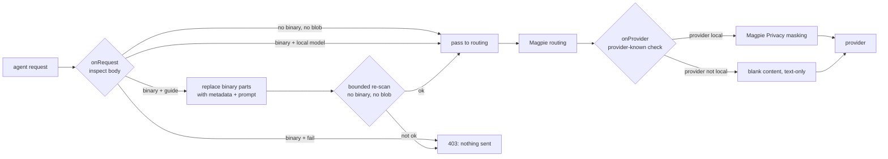

<p align="center">
  <picture>
    <source media="(prefers-color-scheme: dark)" srcset="assets/shypie-icon-dark.svg">
    
  </picture>
</p>

<h1 align="center">ShyPie Privacy Gate</h1>

<p align="center">
  <strong>Structural egress gate for Magpie's gateway</strong><br>
  Withhold or reject what Magpie cannot mask; guide agents toward local extraction.
</p>

<p align="center">
  
  
  
</p>

---

**ShyPie Privacy Gate** is the Magpie-side half of the
[ShyPie](https://github.com/siml1169/ShyPie) privacy-first workflow for
[DeepSeek Harness](https://github.com/deepseek-ai). It runs as a Magpie
gateway middleware and enforces the **structural** part of the egress path:
images, files, audio, encoded blobs and models outside the allowlist.

It is **not a text masker**. Text masking stays Magpie's Privacy setting. This
plugin makes sure a request that still contains bytes Magpie cannot mask does
not reach a provider by accident.

> **Distribution:** version `0.3.0` is merged in-tree. The community npm package
> is not published yet. Install from a checkout until the community publish lands.

## Why this exists

Magpie's masking is text-only. Its own documentation says *"Images and file data
are sent as they are. Text inside a screenshot is not masked."* A gateway cannot
mask a PDF page or a screenshot, so it must do one of two things:

- **fail closed** — reject the request, or
- **withhold** — remove the bytes and tell the model to process the file locally.

This plugin implements both. It also catches encoded documents smuggled through
text fields, and it is the same gate for every agent behind the gateway — DSH,
Codex, Cursor, Claude Code and scripts.

## At a glance

| | |
|---|---|
| **Runtime** | Magpie gateway middleware (moejs); plain JavaScript, no imports, no I/O |
| **Hooks** | `onRequest`, `onProvider`, `onUsage` |
| **Protocols** | OpenAI chat, OpenAI Responses, Anthropic Messages, Gemini |
| **Default policy** | `binaryPolicy: fail` — binary part for a non-local model → **403** |
| **Alternative** | `binaryPolicy: guide` — withholds bytes, injects type/size metadata + a neutral local-tool prompt |
| **Text masking** | **Not here.** Use Magpie **Settings → Privacy** |
| **Tests** | 62 cases through the repository's `scripts/middleware.mjs` |

## Install

The package is merged in-tree at `packages/privacy-gate`. Until the community
npm package is published, install the checkout:

```sh
git clone https://github.com/magpie-community/plugins
magpie plugin add <clone>/packages/privacy-gate

# strictest: block every binary part on every model
magpie plugin options privacy-gate '{}'

magpie plugin        # confirm the middleware is listed and on
```

After the community publish:

```sh
magpie plugin add @magpie-community/middleware-privacy-gate
```

Make sure Magpie's built-in **Gateway middleware** plugin is enabled
(**Settings → Plugins → Built-in**). Without it, no middleware runs.

## Two policies

### `fail` — default

A binary part for a model that is not explicitly local is rejected with a
**403** and a message that names the part type and explains how to extract it
locally. Nothing is sent.

### `guide` — withhold and steer

The request is rewritten into a text-only request:

```text
[A binary attachment was withheld locally and was NOT sent to you
(type image; mime image/png; bytes 481094). Do not claim to have seen it.
First ask how the user/agent can process or read it locally.]
```

No bytes are forwarded. If `guideTools` is configured, those local tool names
are included in the prompt. The middleware cannot run the tools; the agent must
have the matching local MCP/extractor available.

### Local models

Bytes pass unchanged only when **both** allowlists agree:

```yaml
localModels: ["ollama/*", "lmstudio/*"]
localProviders: ["ollama", "lmstudio"]
```

With `localModels` alone, `onRequest` allows the part but `onProvider` blanks the
content because the provider is not local. Set both or neither.

## How it works



The checks are **protocol-position-aware**. Only the protocol's own content
parts are treated as binary parts; keys with names like `signature`, `id`,
`parameters` or `tools` inside tool arguments and message text are ordinary data
and are still scanned.

## Configuration

All settings are one JSON object, stored as `ctx.options`:

```sh
magpie plugin options privacy-gate '{
  "binaryPolicy": "guide",
  "allowModels": ["deepseek/*", "copilot/*"],
  "localModels": ["ollama/*", "lmstudio/*"],
  "localProviders": ["ollama", "lmstudio"],
  "guideTools": ["shypie.describe", "shypie.extract", "shypie.ocr"]
}'
```

| Option | Default | Meaning |
|---|---:|---|
| `binaryPolicy` | `fail` | `fail` returns 403; `guide` withholds every binary part and injects metadata + a local-tool prompt. |
| `allowModels` | `[]` | Model globs. `[]` allows every model. If present but not an array of non-empty short strings, **every request is refused** — a typo never silently removes the allowlist. |
| `localModels` | `[]` | Model globs allowed to receive binary parts in `onRequest`. Pair with `localProviders`. |
| `localProviders` | `[]` | Provider-id globs checked in `onProvider`. Both lists must agree. |
| `guideTools` | `[]` | Tool names included in the guide prompt. Leave empty unless the local extractor is installed. |
| `blobBase64Chars` / `blobHexChars` | `400` | Encoded run at or above this is a blob. A long hash or minified line can be a false positive. |
| `scanChars` | `200000` | Total text-inspection budget. Each field may use at most an eighth (min 1k). Newest conversation content is walked first. |
| `maxNodes` / `maxDepth` | `40000` / `40` | Bounds on every visited value, including primitives and array elements. Overflow blocks. |
| `allowUnknownProtocol` | `false` | Reject bodies whose protocol is not chat/responses/anthropic/gemini. |
| `logMaxLines` / `logEveryRows` | `40` / `50` | Self-cap on log output / one usage line every N rows. |

## What is inspected

| Layer | Action |
|---|---|
| Image/file/audio/document parts for non-local models | 403 (`fail`) or withheld (`guide`) |
| Encoded blobs in text (base64/base64url, hex, data URI, PDF/ZIP magic) | 403 |
| Model outside `allowModels` | 403 |
| Malformed `allowModels` | every request 403 |
| Body too complex for the inspection budget | 403 |
| Protocol outside the four supported shapes | 403 unless `allowUnknownProtocol: true` |
| Vendor-sealed replay fields | exempt only in their own protocol block |
| Plaintext PII | **passed through** — Magpie Privacy masks it |

## Limits

- **Text masking is Magpie's job.** Free-text PII and secrets in message text or
  tool arguments pass this layer unless Magpie's Privacy masking catches them.
- **The scan is bounded.** The newest content is walked first; each field has a
  share of `scanChars`; beyond the total budget text is not inspected. Structural
  checks still fail closed.
- **A guide prompt is not extraction.** It names local tools but cannot execute
  them. Agents without a configured local extractor will only get advice.
- **Guide-mode MIME metadata has a known bug:** [issue #795](https://github.com/magpie-community/plugins/issues/795)
  validates a clipped prefix rather than the whole `media_type`. It does not
  forward binary bytes.
- **Magpie engine timeouts fail open.** Magpie stops a hook at 250 ms and sends
  the request unchanged. This plugin keeps its own work bounded, but cannot turn
  an engine timeout into a rejection. See
  [magpie#5305](https://github.com/yetone/magpie/issues/5305).
- A legitimate rejected request should be handled by extracting locally and
  sending text — not by turning the gate off.

## Companion: ShyPie for DeepSeek Harness

The ingestion half lives in
[`@shypie_privacy/dsh-privacy-gate`](https://github.com/siml1169/ShyPie/tree/main/plugins/dsh-privacy-gate).
It converts attached images and PDFs to local text before they enter the DSH
session log, keeps raw local text in filter mode, and enforces a fail-closed
`llm/stream` egress guard before DSH dispatches a model request. This Magpie gate
covers the structural check for every other agent behind the same gateway.

## Development

```sh
bun test packages/privacy-gate
bun scripts/check.mjs
```

The cases run through `scripts/middleware.mjs`, the same way Magpie's gateway
invokes the hooks. The middleware has no network access, timers, imports or Node
APIs; the test suite also asserts that constraint.

See:

- [Design and threat model](docs/design.md)
- [Operations and verification](docs/operations.md)
- [Brand assets](BRAND.md)

## License

MIT. The ShyPie name and logo belong to the ShyPie project; the Magpie bird mark
belongs to the Magpie project. See [BRAND.md](BRAND.md).
