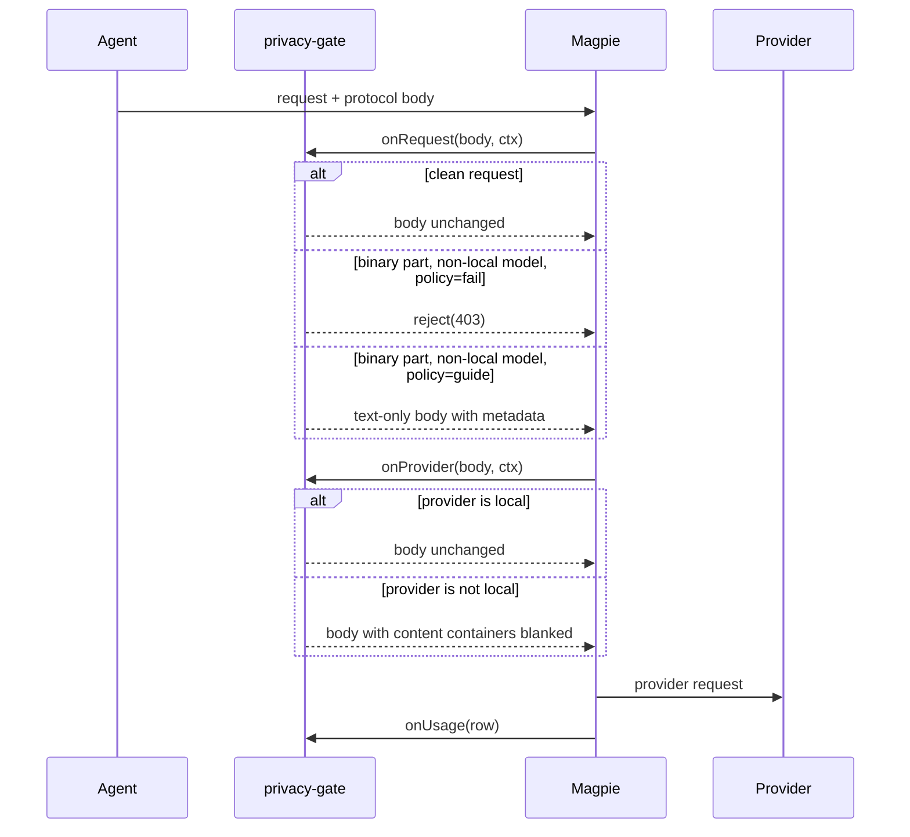

  <picture>
    <source media="(prefers-color-scheme: dark)" srcset="../assets/shypie-icon-dark.svg">
    
  </picture>

# Design and threat model

This document describes the structural gate's design, the protocol positions it
trusts, the request budgets, and the limits that remain.

## Goals

1. **No unmaskable bytes leave.** Image, file, audio, video and document parts
   must never reach a non-local provider.
2. **No encoded document bypass.** Base64, hex, data URIs and PDF/ZIP magic
   smuggled through a text field are rejected.
3. **Deterministic policy.** A malformed option must not silently disable a
   check; an unreadable request must not be passed.
4. **Two user outcomes.** `fail` rejects; `guide` withholds the bytes and asks
   the model to use a local extractor.
5. **Cheap and bounded.** Magpie gives a request hook 250 ms. The inspection and
   guide walk must have hard value/depth limits and no clocks, I/O or imports.

## Non-goals

- This plugin does **not** mask text. Magpie's Privacy setting does that.
- It does not execute OCR or PDF extraction. The DSH bundle or a local MCP tool
  does that.
- It does not make a timed-out Magpie hook fail closed. That is an engine
  property, not something a middleware can guarantee.

## Request lifecycle

## Policy modes

| Input | `binaryPolicy: fail` | `binaryPolicy: guide` |
|---|---|---|
| No binary parts | pass | pass |
| Binary part, model + provider local | pass | pass |
| Binary part, non-local | 403 | replace every binary part with text metadata and a local-tool prompt |
| Binary part and encoded blob | 403 | guide walk scans all text; blob → 403 |
| Malformed `binaryPolicy` | falls back to `fail` | — |

`localModels` and `localProviders` are independent:

- `onRequest` knows the model; it allows a binary part only when the model is in
  `localModels`.
- `onProvider` knows the provider; it blanks content unless the provider is in
  `localProviders`.
- Therefore **both** must match for bytes to reach a local endpoint.

## Structural inspection

The walker is protocol-position-aware. A part is treated as binary only when it
sits where that protocol puts content parts:

| Protocol | Site where binary parts are recognized |
|---|---|
| OpenAI chat | `messages[].content[]` |
| OpenAI Responses | `input[]` items and their content parts |
| Anthropic Messages | `messages[].content[]` |
| Gemini | `contents[].parts[]` |

That matters because a tool argument or a tool result can contain arbitrary
objects. `tool_use.input`, `tool_result.content`, `function_call.arguments`,
`functionResponse.response` and message text are scanned as ordinary data, not
as trusted protocol content positions.

### Binary part types

The gate recognizes image, file, audio, video and document content shapes,
including `image_url`, `input_image`, `input_file`, `image`, `file`, `document`,
`inlineData`, `inline_data`, `fileData` and their common protocol variants.

### Encoded text

A text field is rejected when it contains:

- a base64/base64url run at or above `blobBase64Chars` (default 400),
- a hex run at or above `blobHexChars` (default 400),
- a `data:` URI,
- `%PDF-` or `PK\x03\x04` file magic.

The run-length scan is linear; the old `{400,}` regexes are gone.

### Vendor-sealed replay fields

Some values are returned by a vendor and replayed on every later turn. They are
exempt **only inside their vendor block**, and only when the field belongs to
that protocol:

| Protocol | Exempt field |
|---|---|
| Anthropic thinking | `signature` |
| Anthropic redacted thinking | `data` |
| Responses reasoning | `encrypted_content`, vendor `id` |
| Chat/DSH assistant tool call | `id`, `call_id`, `thoughtSignature` |
| Gemini **model-role** part | `thoughtSignature`, `textSignature` |

The same key in tool arguments or message text is still scanned. The
exemption is scoped by position and by type — never by key name alone.

## Budgets

| Budget | Default | Purpose |
|---|---:|---|
| `scanChars` | 200,000 | Total text scanned per request. Conversation content is newest-first; each field may use at most an eighth of the budget. |
| `maxNodes` | 40,000 | Every visited value, including primitives and array elements. Overflow refuses the request. |
| `maxDepth` | 40 | Nesting bound. |

The guide walk uses the same site rules and the same value bound. It refuses the
request if it hits a bound rather than passing a partially rewritten body.

Measured in the Magpie engine (moejs on the reference machine): a 2,000-turn
Claude-Code-shaped body (about 3.5 MB / 40k values) is refused at the value cap
in about 76 ms; a 200-turn body passes in about 38 ms. These are capacity
measurements, not a guarantee that the engine's 250 ms hook limit is never hit.

## Failure semantics

- Options are parsed defensively. `binaryPolicy: "Guide"` falls back to `fail`;
  a present-but-malformed `allowModels` refuses every request instead of
  silently removing the allowlist.
- Unreadable body, unsupported protocol, inspection limit: 403.
- Guide rewrite or verification limit: 403.
- `onProvider` cannot reject. If a binary part reaches it, it blanks the content
  containers and lets a text-only request continue.
- The host may still drop the hook on timeout and send the original body. That
  is the engine's fail-open behavior, tracked in
  [magpie#5305](https://github.com/yetone/magpie/issues/5305).

## Known issue

[Issue #795](https://github.com/magpie-community/plugins/issues/795): guide-mode
`guideMime` validates a 100-character clip rather than the whole `media_type`.
A long base64-like value with a slash in the first 100 characters can contribute
a fake MIME prefix to the guide prompt. This is a metadata-validation bug, not a
binary egress bypass; the part's bytes are still withheld.

## Verification

- 62 cases in `cases.json`, run through `scripts/middleware.mjs` using the same
  hook calls Magpie performs.
- The package has no network, timers, Node APIs or imports; the middleware file
  is one plain JavaScript module.
- The tests cover fail/guide mode, malformed options, all four protocols,
  vendor-sealed replay fields, site scoping, blob scanning, and guide-mode
  bounds.
