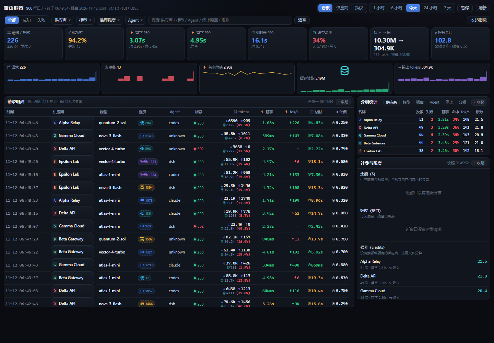
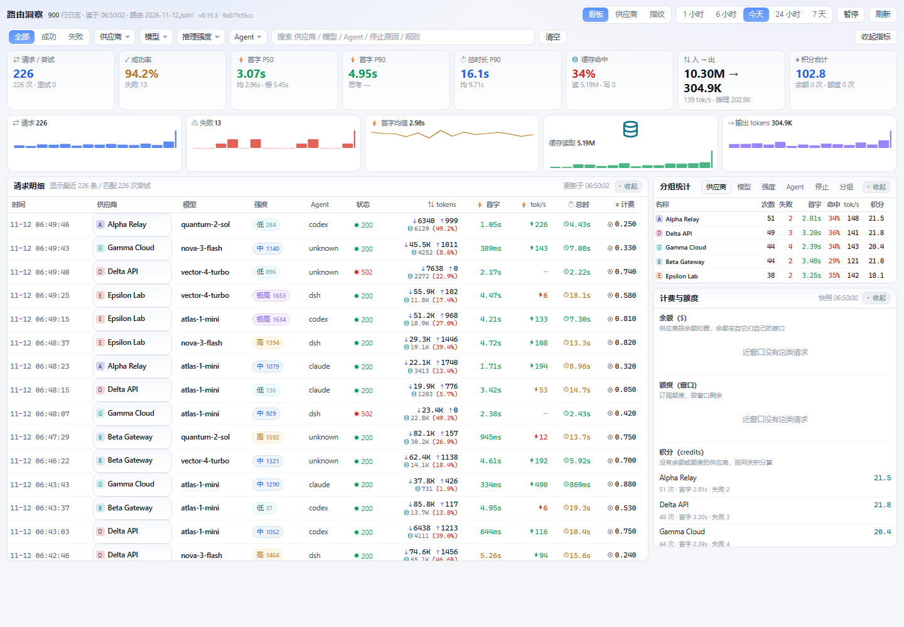
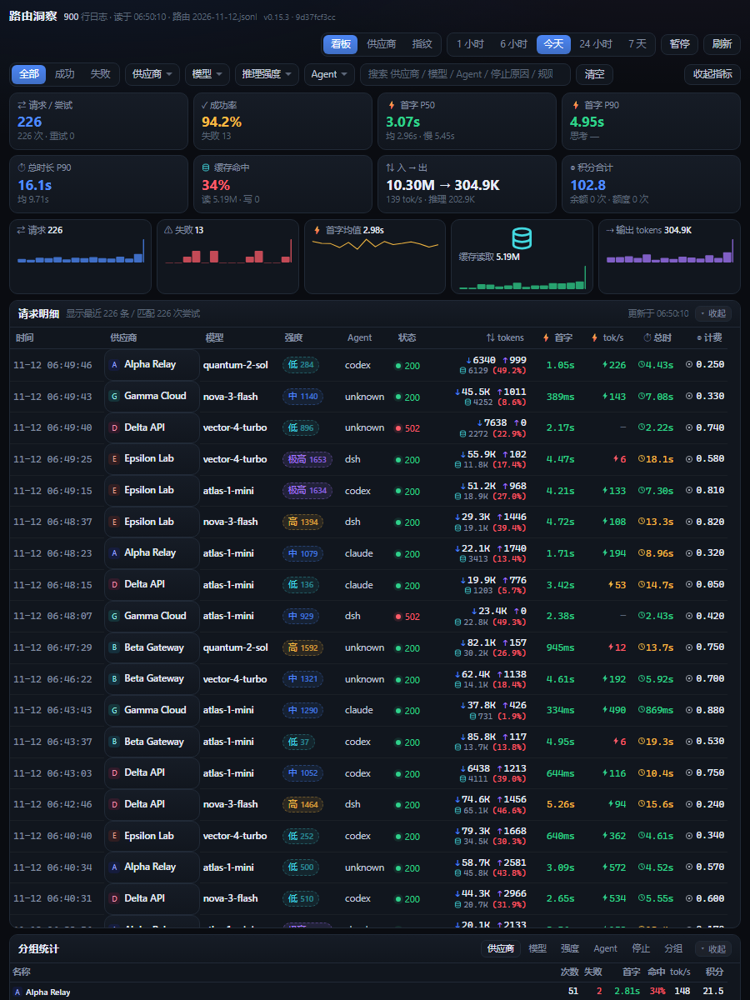
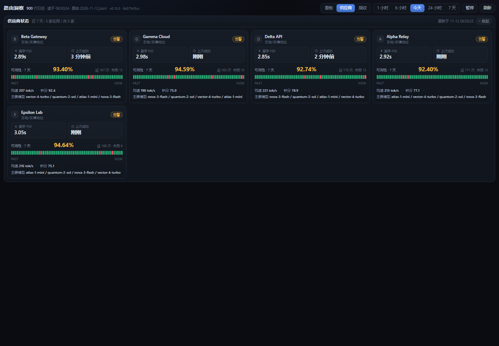
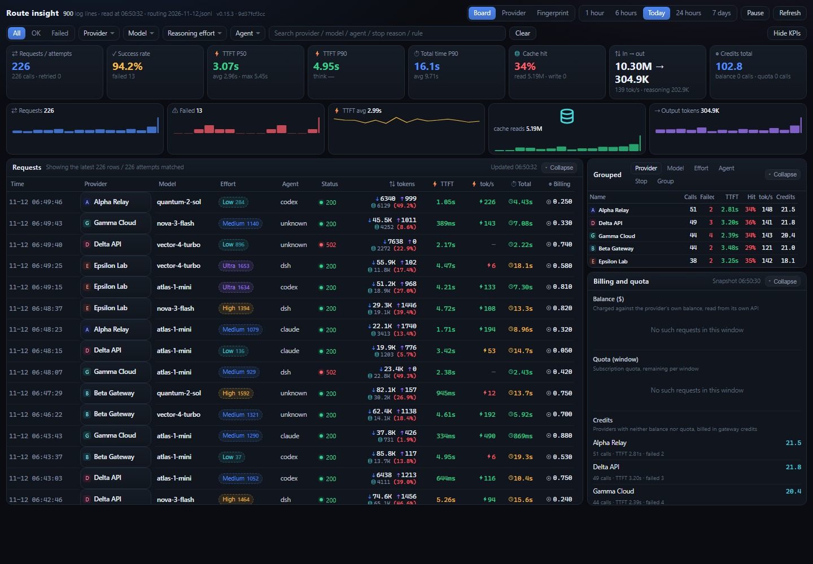
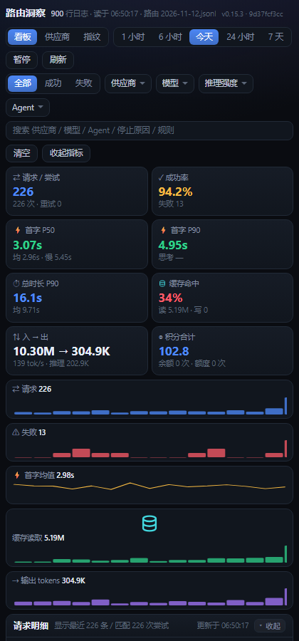

# 路由洞察 Route insight

magpie 侧边栏的一个页面：把网关自己写的 `usage.jsonl` 读成一块实时看板 —— 每次请求的首字、总时长、缓存命中、token、速度和计费方式，按供应商 / 模型 / 推理强度 / Agent / 时间窗筛选，并把分组统计、趋势、失败码、正在休息的席位、余额与额度放在同一屏。

> 看板只读本机 `~/.config/magpie` 里的用量文件，不接管路由、不改路由配置。两处例外写在这里，不在小字里：**唯一的出站请求**是数值指纹的参考库（钉死版本、点了按钮才下、下完校验 sha256，只连 `cdn.jsdmirror.com` 一个域名），**唯一的写入**是检测缓存那几个文件（见[会写哪些文件](#会写哪些文件)）。没有遥测，没有统计上报。

> **English** — A page for magpie's sidebar that turns the gateway's own `usage.jsonl` into a live routing board: first-byte time, total duration, cache hit rate, tokens, output speed and how each call was billed — filterable by provider / model / reasoning effort / agent / time window, with group stats, trends, error codes, resting accounts, balance and quota on the same screen. Read-only: it never routes and never edits magpie's routing config. Two exceptions, stated up front: the only outbound request is the numeric-fingerprint reference library (pinned version, downloaded when you click, sha256-verified, one domain), and the only files it writes are the check caches listed under "会写哪些文件". No telemetry. Also includes a provider status view (per-route cards with uptime and recent-call strips) and an intelligence check — fingerprint, a full HTML animation of a pelican riding a bike (rendered live in a sandboxed iframe), and "draw a pelican" — with per-line reasoning effort and a candidate ranking that lands on concrete model names.

> 下面所有截图里都是**合成数据**（`Alpha Relay`、`Beta Gateway` 这些渠道名是编的），不是谁的用量记录。



## 布局

顶栏三个视图，同一份数据换三种看法：

- **看板**（默认）：8 格 KPI + 5 条趋势 + 请求明细 + 分组统计 + 计费与额度
- **供应商**：每家线路一张卡（头像、状态、首字 P50、上次成功、7 天可用性、近 60 次彩条、均速 / 积分 / 主要模型）
- **指纹**：选模型跑数值指纹 / 指纹家族 / HTML 动画（任意组合；指纹与画图各有强度下拉，画图提示词能自己写），结果卡 + 检测历史

看板是两栏：左请求明细（11 列，窄屏自动收起 Agent 列），右分组统计（6 个 tab）+ 计费与额度。整页按内容高度自然撑开、需要时整页滚动；每张卡内部的表格另有一层最大高度（请求 58vh、分组 36vh），所以收起一张卡是真的只剩一条标题栏，而不是留一块空白。

宽度断点：≥1300px 两栏 KPI 8 格；<1300px KPI 折成 4 格；<1180px 收成单栏；<760px KPI 与趋势都折成 2 列。供应商卡是 auto-fill minmax(310px, 1fr)，1440px 下四列。

请求明细里原本四列（入 / 缓存读 / 命中率 / 出）合并成一格两行：上行 `↓ 入 ↑ 出`，下行 `[圆柱图标] 缓存读 (命中率)`，速度单独一列 `⚡ tok/s`；列序是 `⇅ tokens → ⚡首字 → ⚡tok/s → ⏱总时`（tokens 与首字相邻，首字和总时夹住速度列）。全表用符号打头便于扫读：⇄ 请求、✓ 成功率、⚡ 首字、⏱ 总时、⇅ tokens、◎ 计费。

`⚡ tok/s` 与 `⏱ 总时` 按快慢上色（速度 ≥60 绿 / 25–60 黄 / <25 红；总耗时 ≤8s 绿 / 8–22s 黄 / >22s 红），首字和命中率同理，扫一眼就知道哪几行慢。图标都是内联 SVG（`Segoe UI` 里没有合适的单字符，▤ / ⛁ / ⇢ 在 Windows 上会渲染成空框或对不齐）。




## 改完就自动刷新

顶栏最右边有个构建号（`v0.7.0 · <短哈希>`）。服务端对 ui/ 下所有文件的 mtime+size 算一个短哈希，页面每 5 秒问一次；只要我改过界面，页面自己刷新一次，不会出现「明明改了却还是旧样子」的错觉。

## 折叠与收指标

每张卡的**整条标题栏都能点**（右侧还有一个写明「收起 / 展开」的小按钮），KPI + 趋势那一整块用顶栏的「收起指标」整体收起，刷新后保持。

折叠状态**先存在内存里**，能写 localStorage（key 是 `route-insight-fold`）时再顺手存一份。这不是洁癖：magpie 把插件页装在一个不带 `allow-same-origin` 的 iframe 里（响应头 `Access-Control-Allow-Origin: null` 就是痕迹），那里 `window.localStorage` 一碰就抛 `SecurityError`——0.12.1 及以前每次读写都走它，写失败、回头再读还是空，点一下立刻被撤销，表现就是「点了没反应」。以后再往这个页面加持久化的东西（筛选、排序、视图），都得照这个来：内存是本体，存储是备份。

检测结果里的「数值指纹」「HTML 动画」「智商检测」三块走的是同一套引擎：它们每跑完一次都会重绘，所以折叠清单不写死在代码里，而是扫 `[data-fold]`，重绘之后再按存下的状态恢复一次。

上一版「收起」看着没生效：卡片高度被 CSS 网格行钉住，内容藏起来了、卡片还占着原高度。现在布局改成内容驱动（`.board` 用 `align-items:start`、右栏改 flex 竖排、表格各自带 max-height），收起后实测请求卡 614px → 33px、分组卡 396px → 35px，就剩一条标题栏。

## 强度列是真的还是猜的

优先显示网关自己记下来的 effort（high / medium / low…，显示成 高 / 中 / 低，实线边框）。

deepseek 这类链路 magpie 不写 effort，只留下**思考 token 数**（usage 里的 reasoning）。所以列里改成「**相对强度 + 数字**」：低 / 中 / 高 / 极高，后缀是这次请求的思考 token 数（例如 `高 1153`），用**虚线边框**跟真实档位区分。分档用当前这批行自己的 P50 / P75 / P90，比写死阈值更贴近「这次算多想」；鼠标悬停会给出这三个分位值，并说明是相对值、不是官方档位。

没有思考 token 的显示 `无思考`。派生的东西绝不当成官方 effort 值。

派生档位也进了筛选和分组：上方「推理强度」下拉里会多出 `思考·低 / 思考·中 / 思考·高 / 思考·极高` 四项，右侧分组统计切到「强度」标签就能按档位看次数、失败、首字、命中、速度、积分——所以 deepseek 这种不写 effort 的链路，也能回答「想得多的那些请求是不是更慢更贵」。

## 供应商状态

顶栏「供应商」页：每家线路一张卡，模仿渠道监控站的排法——头像（就是 magpie 自己那份供应商图标，走 `/icons/<hash>.svg`）、名字、状态点，下面 5 个数字格（请求 / 成功率 / 首字 P50 / 均速 / 积分），再一条 60 格的彩条（一格一次最近的请求，绿成功 / 黄慢 / 红失败，PAST → NOW），最后一行小字写「可用性 99.6% · 上次成功 3 分钟前 · 主要模型 xxx」。

状态判定：已停用 / 没流量 / 错误（成功率 <85%）/ 告警（<98% 或 6 小时没成功）/ 正常。这个视图每 8 秒自己刷新一次，看板不动。



## 指纹与智商检测

顶栏「指纹」页：选一个模型，勾上要跑的检测一起测——**数值指纹**（6 次「数数」＝两回合，空答各自重试一次）、**协议审计**（7 次探针）、**HTML 动画**（1 次，没写全自动重试，最多 2 次），可以任意组合，只勾一项就只测那一项。会花真实积分，按钮旁边先写「预计 N 次请求」，跑完在结果卡右上角给出实际用量（几次请求、成功几次、扣多少积分 / 走余额还是额度）。

### 数值指纹（默认开）

不认模型怎么自称——让它连答 6 次「随机数 300 个（1–355）」（分两回合，每回合 3 次，两回合的概率按型号平均再归一），把数字串交给 [lm-detector](https://github.com/Ikaleio/lm-detector) 的参考库比统计纹理，直接给出**具体型号的概率**（`decision` / `prediction` / `probability` / 前 8 名排名 / 每个样本解析到几个数）。

- **为什么从 3 个样本加到 5 个**：3 个只够有排名，前两名经常咬在 45% / 40% 这种位置，看着像「差不多」；5 个方差收窄约三成，而且能算「**与第二名的差距**」——差 30 个点的 80% 和差 5 个点的 80% 是两件事，结果卡里直接写出来。
- 库是 `lmfpd-sdk` 0.2.0（MIT，零运行时依赖），整份 vendored 进 [`lib/lmfpd/`](lib/lmfpd/index.js)，不装 npm 包、不联网拉代码。
- **参考数据钉在固定版本上，并且要点按钮才下**：
  - 版本与哈希写在代码里（`lib/numeric.mjs` 的 `DATA_VERSION` / `DATA_SHA256` / `DATA_BUILT_AT`），下载路径是 `https://cdn.jsdmirror.com/npm/lmfpd-data@<版本>/`，**不用 `@latest`**——参考库换了内容，今天跑的分和昨天的就不是同一把尺子，而界面上这两条会摆在一起看。
  - 落地落在 `~/.config/magpie/lmfpd-data.bin`，读的时候先算一遍 sha256：对不上就判失败，并说明「本地参考库不是插件固定的版本」，不让一份来源不明的库参与打分。
  - 进「指纹」页**不联网**，只读本地缓存报状态（`参考库 2026-11-11 · 4.8 MB`）；没下过就在强度下拉右边给一个「下载 3.8 MB」按钮，点了才去取（并发点击只发一次），下完立刻校验。第一次直接点「开始检测」也会顺手取。
  - 数据来源：lm-detector（MIT）的参考库，约 3.8 MB（解压后 4.8 MB）。
- **从哪取**：默认走上游自己那台 `https://lm.ikale.io/data/`（bundle.json 里声明的 detector sha256 就是代码里那个值，chunk 名本身是内容寻址的 `.zst`）。不想联网就设下面两个环境变量之一——
  - `ROUTE_INSIGHT_DATA_SOURCE=https://your-mirror/`：换成自己的镜像 / 自建源（你给的只是前缀）；钉死版本的 npm 镜像 `https://cdn.jsdmirror.com/npm/lmfpd-data@0.0.1794360871947/` 也走这个口子；
  - `ROUTE_INSIGHT_DATA_DIR=D:\some\dir`：直接读一个本地目录，**完全不联网**（走 SDK 的 readDir 分支）。
  - 换源不改校验：sha256 与字节数还是代码里的常量，对不上照样判失败。
- **数数挑战的 `max_tokens` 给得很宽**：这个挑战天生话多，卡太紧思考就把预算吃光、content 为空，网关回 502「`an empty reply … the whole output spent on reasoning`」。以前干脆不传（等于不限），但那是**没有上限的付费请求**；0.15.1 起统一写 `maxTokens: NUM_MAX_TOKENS`（16000，见 [`lib/numeric.mjs`](lib/numeric.mjs)），比实测需要的量宽，同时又真的封了顶。协议审计 7 个探针里的 tool 调用也给 `max_completion_tokens: 200`，动画 2 趟给 32000。
- 样本不够会明说「不确定」（`strict` 模式），不硬给部分排名；全空就直接判失败。
- 它挡得住「后端钉死系统提示词」这类冒充（数数的手感改不了），但挡不住**真换了模型**——那就是它该说的话。

### 协议审计（默认开）

检测维度参考 [Veridrop](https://github.com/canarybyte/veridrop)（AGPL-3.0，线上 veridrop.app），按它公开的方法**用 JS 重写**，没有复制它的代码（见 [`lib/relay.mjs`](lib/relay.mjs) 头部说明）。它原本面向「自带 base_url + api_key」的直连场景，我们这边是 magpie 网关，所以判据换成「同一个网关下，一条真链路应该长什么样」。

7 次探针，5 项打分（合计 100）：

| 项 | 权重 | 看什么 | 假货会怎么露馅 |
| --- | --- | --- | --- |
| 回声一致性 | 15 | 同题 3 次 `temperature=0`：`model` 字段稳不稳、`completion_tokens` 抖不抖 | 回包里的 model 与请求的不一致 / 三次方差很大（CV > 0.3） |
| usage 记账 | 20 | `prompt_tokens` / `completion_tokens` / `total_tokens` 齐不齐、加不加得上 | usage 里混进 `input_tokens`、`cache_creation_input_tokens`、`usage_source: anthropic` 这类**异源字段**——那是 Anthropic 的记账方式，一眼就是换了后端 |
| 函数调用 | 20 | 强制 `tool_choice` 要 `get_current_weather` | 没有 `tool_calls` / id 不是 `call_` 开头 / `type` 不是 `function` / `arguments` 不是合法 JSON / `unit` 跑出 enum |
| 结构化输出 | 20 | `response_format` 走 `json_schema` `strict` | 交回 markdown 代码块、字段对不上 schema、`finish_reason` 不在 `stop` |
| 流式一致性 | 25 | 同题非流式 vs 流式（`stream_options.include_usage`） | 两边文本不一样、`finish_reason` 不同、流式里干脆没有 usage——多是中间层自己拼的 SSE |

分数是加权，不是概率。出现 critical 级证据（异源 usage 字段）时结论直接压成「明显不像官方接口」，不管别的项多高。**模型自己改不了这些**：它没法决定 usage 的字段名、tool_calls 的 id 前缀、finish_reason 的取值——只有真的换了后端才会变。

⚠️ 这条判据的前提是「网关按 OpenAI 协议转发」。有些中转会把 `tool_choice` / `response_format` 吞掉或者重写，那种情况会掉分但**不代表造假**——所以分数低时先看「哪一项掉的、细节写了什么」，别只看总分。

### 结果卡怎么读

**一项检测一张卡**：最上面一张汇总卡（型号 / 花销 / 合计耗时 / 交叉校验横幅），下面每项自己一张卡，每张都能单独收起。

- **汇总卡**：请求的型号 + 本次几次请求、扣不扣积分 + 合计耗时 + **交叉校验横幅**（把「数值指纹认出的型号」和「你请求的型号」摆一起，细节见下节）。
- 每张检测卡的标题行：左边一道色条（蓝=数值指纹、紫=协议审计、青=HTML 动画、黄=智商检测）、标题 13px、右边一枚结论标签（`88.5%` / `100/100` / `已渲染` / `超时` / `没拿到`）；说明文字在标题下面单独一行。以前四块挤在一张卡里、标题只有 h4 大，一屏里根本分不出层次。
- **数值指纹**：决策徽章（有排名 / 不像模型回答 / 样本不够）+ 命中的型号与概率 + **与第二名的差距** + **参考库排名**（前 8 名具体型号，概率条 + 百分比）+ 每个样本的「要几个数 / 解析到几个 / 用时 / 收下没用」+ 底部参考库日期与方法名。
- **协议审计**：结论徽章（协议规范 / 有疑点 / 明显不像官方接口）+ 总分 `n/100` + usage 里出现过的字段名 + 五项各自的分数条与细节 + 疑点清单（critical 红、major 黄）。
- **HTML 动画**：iframe 里直接跑模型交回来的整份文档（白底、按一屏等比缩放），点「放大」到 72vh 或「新窗口」单独看；下面五行小字（完整度 / 图元 / 动起来 / 颜色 / 耗时）。**这项最慢，超时预算是 480 秒**（别的项 180 秒）：思考型模型光想两三分钟、再吐十几 KB 的 SVG，180 秒经常不够，以前到点就被掐断、只留一句 `The operation was aborted.`。真超时了卡里会写「等了多久」，并给一个「只重测这一项」按钮，只重跑它、把结果并回原卡（请求数与积分累加）。
- **概率条是真的按比例**：轨道极淡，填充长度 = 概率本身（最小留 0.7% 宽，否则 0.0% 那几行彻底看不见）。条长由 JS 用 CSSOM 写 `transform: scaleX()`，**不是** HTML 里的 `style="width:…"`——页面 CSP 是 `style-src 'self'`（不含 `unsafe-inline`），行内 style 会被浏览器整条丢掉，宽度退回 100%，看着每行都满格。以后再加条状图请照着这个写法。
- **检测历史**：每次跑完记一条（模型 / 时间 / 数值指纹命中与概率 / 审计分数 / 动画 / 请求数 / 积分），重开窗口还在。最近 6 次的**完整结果**也留在本地，点历史里那一条就能把当时那张卡重新打开。
- 每块都能单独收起（点标题栏），状态记在内存里、能写 localStorage 时顺手存一份（见「折叠与收指标」）。

### 两条证据打架怎么看

结果卡顶上那条横幅是**两条证据的交叉校验**：数值指纹看「数数的纹理」，协议审计看「服务端怎么记账」。

- 两边都指向你选的型号 → 绿条「两条证据一致」。
- 身份对不上（数值指纹说得很有把握，认出来的却不是这个型号）→ 红条，同时写出「请求 X，数数更像 Y（多少%）」，并说明「大概率不是你在页面上选的那个型号」。
- 型号对得上、但协议审计掉分 → 黄条「身份对得上，链路有疑点」，去看审计卡里的疑点清单。
- 数值指纹把握不足（< 60%）→ 灰条，说清「别当定论」。

型号比对比的是**型号主干**，不是整串名字：只留最后一段（`gpt-6-astra/6.1-sol` → `6.1-sol`）、去掉 `-1017` 这类四位尾、去掉 `gpt-`/`claude-`/`deepseek-` 这类厂名前缀，再比字母数字。所以 `deepseek-v4.1-flash` 与 `deepseek-v4.1-flash-1017` 算同一个，`tk1688/gpt-6.1-sol` 与 `gpt-6-astra/6.1-sol` 也算同一个——同一型号挂在不同线路上，名字写法本来就不一样。名字落到另一条线路时，绿条会补一句「只是名字落到了另一条线路」，别把它当成冒充。检测历史里对不上的记录，徽章直接显示红色「对不上」。

> 动画这一项判的是「写完没有」：网关的 `finish_reason` 与文档结尾一起看，中途被截断的半份 HTML 会标成「这份没画完」并给「看断口」，不会再当成品渲染（0.13.7）。
>
> 0.13.6 之前是逐字加前缀匹配，`6.1-sol` 与 `gpt-6.1-sol` 因为前缀不同被判成「身份对不上」，误报过一例。

> 以前还有一路「自述」探针（问模型自己是谁，再摊到具体型号上排名）。**0.13.0 起整个拿掉了**：后端把系统提示词钉死、代理层改写模型名，自述就跟着变，冒充者最容易骗过它——留着反而会让人以为有第二份独立证据。旧记录里的自述结果还能打开看，卡片上标着「旧记录的指纹信息（自述探针已停用）」。

### 模型选择器

原来的 `<select>` 塞不下头像、也没法搜，所以自己画了一个：

- 触发器：**供应商头像**（就是 magpie 自己那份图标，走 `/icons/<hash>.svg`）+ 模型名 + 家族 / 供应商。magpie 那边没配图标的渠道（`codex` 这类内置的）就回落成首字母方块（按供应商 id 取首字母 + 固定色相），包里不带任何第三方品牌素材。
- 面板：顶部一个搜索框（匹配模型名、供应商、家族），下面按供应商分组，每组标题也带头像和条数；每行是 `模型名 → 家族 → 调用次数`，选中的那行打 ✓。
- 键盘：`↑` / `↓` 移动，`↵` 选中，`Esc` 关闭；点面板外面也关。
- 同一个模型挂在多家线路下时，分组就是区分它们的唯一线索——这也是不再用平铺下拉的原因。

### 出图与放大

鹈鹕 SVG 直接内联渲染（洗过：去 script / foreignObject / on* 事件 / 外部 href）。画布默认按 `min(100%, 360px)` 居中显示，**点一下放大**到 680px（上限 80vh），再点还原；右下角有「点一下放大 / 点一下还原」的提示。之前 `max-height: 38vh` 的写法在矮窗口里会把图压成一小块，看着像没渲染出来。

单项说明：

- **HTML 动画**：要一份「鹈鹕骑自行车」的**单文件 HTML**（SVG + CSS 关键帧）。产物存到 `~/.config/magpie/route-insight-art/<id>.html`（留最近 60 份），卡片里用 `<iframe sandbox="">` 真跑起来——内联进主页面会被外层 CSP 挡掉，只有 iframe 能动；可「放大」到 72vh 或在新窗口单独看。落盘前洗一遍：`<script>` / `<iframe>` / `on*` / 外链样式 / `@import` 全剥掉，`data:` 图片与 `@keyframes` 留着。模型经常写完 `<body>` 就停，所以会判「有开头没结尾」，补收尾并换一条更严的提示重试一次（压到 3000 字符、必须以 `</html>` 结束），信号里如实标出「这份是补过收尾的」。**提示词可以自己写**：输入框留空就用默认那句（鹈鹕骑车 2D 动画），改过的存在浏览器 localStorage 里，「恢复默认」一键清掉；重试时把「补齐 `</html>`」的后缀接在你那句后面，不换题。产物在出口会插一段样式（`html,body{overflow:hidden}`，svg/img 等比缩到一屏），所以 320px 高的 iframe 里也是整张画面，不出滚动条、不会被裁掉一半。
- **一键画鹈鹕**（界面已撤掉，老历史里还能打开）：只要 SVG，量结构密度、颜色数、有无 text 标签、viewBox、耗时——思考型模型常把长度预算烧在思考上导致空答，这里给 8000 token 预算并在空答时换一句更硬的指令重试。

对照用：`examples/pelican-bike.html` 是我自己手写的一份（不经过任何模型，10 KB 单文件），可以拿它当「及格线」——模型交回来的那份能不能动、像不像，跟它比一眼就看得出来。

### 强度配置

数值指纹、协议审计、画图是三条不同的请求，但前两条都属于「文本探针」，所以给两个下拉：「**文本强度**」管数值指纹和协议审计，「**画图强度**」管 HTML 动画。档位跟着所选型号自己的 `levels` 走（`low` / `high` / `max` 这种），选不出档位的型号下拉自动置灰；留「默认档」就用这条线自己的默认值，不传 `reasoning_effort`。

> 指纹页的截图这里不放：那一屏会把被测渠道的模型名、价格和检测结果一起拍进去，而仓库里的截图都是用合成数据拍的（看板里那几个 `Alpha Relay` / `Beta Gateway` 是假名字）。想看图，装上去点一下就知道了。

## 它比「用量 → 请求」多给了什么

| 字段 | 自带请求列表 | 这个页面 |
| --- | --- | --- |
| 首字 ttft | 有 | 有，并且给 P50 / P90 / 最慢 / 均值，并按快慢染色 |
| 总时长 | 有 | 有，并且给 P90 与均值 |
| 缓存读 cache_read | 有 | 有，并算出**命中率 = 缓存读 ÷（输入 + 缓存读）**，按命中比例染色 |
| 缓存写 cache_write | — | 有 |
| 输出速度 tok/s | 有 | 有，按分组汇总 |
| 推理 token | — | 有 |
| 推理强度 effort / 命中规则 | — | 从 `routing/<日期>.jsonl` 按 `responseId` 对齐回来 |
| 上行 / 脱敏 / 下行分段耗时 | — | 汇总成均值（sent / masking / flow） |
| 改道（同一请求多次尝试） | 换行 | 计数 + 改道率 |
| 失败码分布 | 逐条 | 汇总分布 |
| 计费方式 | 只有积分 | 分三类：**积分**（无余额无额度）、**余额**（供应商报 $ 余额）、**额度**（codex 的 5 小时 / 7 天窗口） |
| 正在休息的席位、余额、额度 | 在别的页 | 同屏 |
| 时间窗 | 今天 | 1 小时 / 6 小时 / 今天 / 24 小时 / 7 天 |
| 组合筛选 | — | 供应商 × 模型 × 推理强度 × Agent × 状态 × 关键字，每项都可多选 |

## 安装

从 magpie 市场装（在 Plugins → Discover 里搜 **Route insight**，或直接执行）：

```bash
magpie plugin add @magpie-community/route-insight
```

从 GitHub 装（市场之外的备选，别人也能用同一条命令）：

```bash
magpie plugin add "github:InvisibleGuardian007/magpie-route-insight"
```

这个仓库打了 `magpie-plugin` 标签，所以也会出现在 magpie 的「发现 → 非官方插件 · GitHub」里，卡片上标「包自己的话」（未经审阅），点一下就从仓库装上。

从本地目录装（开发时用）：

```bash
magpie plugin add "D:/数据/AI/magpie-plugins/route-insight"
```

或者在 `~/.config/magpie/plugins.json` 里加一项：

```json
{ "spec": "D:/数据/AI/magpie-plugins/route-insight", "options": { "window": "today" } }
```

保存后插件宿主会自动重载。侧边栏「插件」分组里出现「路由洞察 Route insight」，在 magpie 窗口内直接打开；也可以单独用浏览器打开 <http://127.0.0.1:4397>。

跳板页和官方 page 插件同一种做法：拿到 `magpie.ready` / `options` 后**直接**导航到 `http://127.0.0.1:<port>/?theme=&lang=&uiOrigin=`，不做探活（探活会被页面 CSP 的 `connect-src 'none'` 拦掉，反而跳不过去）。8 秒后页面还在，或者手动加 `?diag=1`，才显示排查面板（目标地址、`magpie.service`、options、页面来源、浏览器）。

## 双语界面 English UI

界面跟 magpie 的语言走（bridge 传 `lang`），也可以手写 `?lang=en` 或 `?lang=zh`。

- 文案表在 [`ui/i18n.js`](ui/i18n.js)：**键是中文原文、值是英文**，查不到就退回中文——所以补一条英文只要加一行，漏了也不会把页面搞坏。
- 界面自己的文案走 `t("中文原文")`（带占位符就 `t("最近 {n} 次", { n })`）；`index.html` 里用 `data-i18n` / `data-i18n-title` / `data-i18n-ph`，由 `RI18N.apply(document)` 统一填。
- 服务端返回的分析文字（`lib/*.mjs` 里的 note / detail / signal）不在服务端翻，而是在渲染前过一遍 `RI18N.localize`：先查整句表，再跑带变量的正则表。要在服务端加一句中文说明，改了之后记得在 `i18n.js` 的 `ZH2EN`（整句）或 `RULES`（带 `{变量}` 的句子）里补一条，否则英文界面下这句会留中文。
- 供应商名、型号名故意不翻：那是数据，不是界面。

## 地址栏参数

页面跟着 magpie 的主题走（bridge 会传 `theme` / `lang`）。直接开浏览器时也可以手写：
`http://127.0.0.1:4397/?theme=dark&window=1h`，`window` 取 `1h` `6h` `today` `24h` `7d`。

## 选项

| 选项 | 默认 | 说明 |
| --- | --- | --- |
| `port` | 4397 | 本地服务端口；页面通过 bridge 读这里的值再跳转 |
| `window` | `today` | 打开时的时间窗：`1h` `6h` `today` `24h` `7d` |
| `historyBytes` | 25165824 | 首次从 `usage.jsonl` 尾部读多少字节（24 MB ≈ 8 天）；之后只读新增 |
| `keepRows` | 60000 | 内存里最多保留多少条尝试记录 |

对应的环境变量：`MAGPIE_ROUTE_INSIGHT_PORT`、`MAGPIE_ROUTE_INSIGHT_WINDOW`、`MAGPIE_ROUTE_INSIGHT_HISTORYBYTES`、`MAGPIE_ROUTE_INSIGHT_KEEP_ROWS`。

## 数据怎么来的

- 一行 `usage.jsonl` = 一次**尝试**；同一个 `route_id` 的多行 = 一次请求被改道重试。所以「请求数」按 `route_id` 去重，「尝试数」是行数。
- 首字用 `ttft_ms`；失败的尝试通常没有首字，不计入分位数。
- 命中率用 `cache_read / (in + cache_read)`：`in` 是未命中缓存的那部分输入。
- 推理强度、命中的规则、原始请求模型、路由分组来自 `routing/<本地日期>.jsonl`，按 `response_id` 对齐；对不上的行留空，不猜。走 deepseek 这类不带 effort 的模型时，强度列显示 `—` 是正常的。
- 计费三分类：`quotas.json` 里同一供应商有 `windows` 就是**额度**（codex 账号），有 `balance` 就是**余额**（中转站），两者都没有按**积分**看。同一供应商多把 key 的余额相加。
读：`usage.jsonl`、`routing/<日期>.jsonl`、`quotas.json`、`rests.json`（谁在休息），外加 `providers.json` 取供应商中文名。没碰别的。

### 会写哪些文件

配置目录（`~/.config/magpie`）里，插件自己会写这几样：

| 文件 | 什么时候写 | 里面是什么 | 上限 |
| --- | --- | --- | --- |
| `route-insight-lab-history.json` | 每次检测跑完 | 一条摘要：时间、模型、跑过哪几项、花了几次请求多少积分 | 最新 40 条 |
| `route-insight-lab-results.json` | 每次检测跑完 | 最近几次的完整结果，含上游原始输出和判定文案，重开窗口还能看上次那张卡 | 最近 6 份 |
| `route-insight-art/<id>.html` | 跑「HTML 动画」时 | 模型当场写的那份 HTML（iframe 里播） | 最新 60 份，旧的自动删 |
| `lmfpd-data.bin` | 你点「下载参考库」或开始检测时 | 数值指纹的参考库（约 3.8 MB，sha256 与代码里写死的值对不上就不用） | 1 份 |
| `route-insight-access.log` | **默认不写**：只有设了 `ROUTE_INSIGHT_ACCESS_LOG=1` 才落盘 | 谁在什么时候请求过这个页面（method / host / URL / UA），用来查「窗口打不开」 | 1 MB 轮转一份 |

**唯一的出站请求**：`https://cdn.jsdmirror.com/npm/lmfpd-data@0.0.1794360871947/`——只下上面那个 `lmfpd-data.bin`。SDK 自带的源列表（`lm.ikale.io` 与 `@latest` 镜像）在 `loadDetector({ source: [DATA_SOURCE] })` 里被整份替换掉了，所以不会去那两个地方；版本是钉死的常量，TTL 也设成一年（SDK 默认 24 小时后会自己后台重下一次，那属于「悄悄联网」）。界面上按钮旁边就写着从哪个域名取、下完会校验 sha256。

## 隐私

页面服务只绑 `127.0.0.1`，校验 Host 头，CSP 只允许自己的脚本、样式和同源 fetch；不显示 `client_ip`、会话 id、请求内容或密钥。

接口另有服务令牌：启动时生成一枚随机令牌，只写进**导航响应**里的 `<meta name="service-token">`（`Sec-Fetch-Mode` 不是 `navigate` 的请求根本拿不到页面），之后每个 `/api/*` 都要带 `X-Route-Insight-Token`，比对用 `timingSafeEqual`，不带就是 403。CORS 只对一种情况放行：magpie 把插件页装在 `sandbox="allow-scripts"` 的 iframe 里，那份文档的 origin 就是 `"null"`，页面里的 `fetch('/api/…')` 在浏览器看来是跨源请求——**带对令牌**时回 `access-control-allow-origin: null`，不带或令牌错就 403 且一个 CORS 头都不回（以前是无条件放行，等于让任意网页的沙箱 iframe 读走余额、账号邮箱和每一次请求，还能借你的订阅替它跑检测）。检测是单飞的：同一时刻只跑一份，一天还有积分上限。

## 开发

```bash
node test.mjs                 # 121 条断言：字段收敛、去重、命中率、分位数、多选筛选、effort 分桶、计费分类、路由对齐、抠文档、洗 HTML、家族落地到具体型号、数数挑战与解析、审计措辞不再给篡改结论
bun test                      # 7 条服务端约定：不带令牌读不到 /api/state、错令牌 403、带令牌 200、Origin: null 拿不到任何 CORS 放行头、不带令牌不能 POST /api/lab/run、页面只发给导航
node index.mjs                # 直接起服务，浏览器打开 127.0.0.1:4397
node index.mjs --port 4398    # 端口冲突时
```

## 截图

| 看板（深色） | 看板（浅色） |
| --- | --- |
|  |  |

| 供应商状态（头像、可用性、PAST→NOW） | 英文界面（`?lang=en`） |
| --- | --- |
|  |  |

英文界面（`?lang=en`）：


「智商检测」是一张卡：老记录里画过鹈鹕的，图在上面、指纹在下面；0.9.2 之后新跑的检测不再单独画图，这张卡就只显示指纹。

窄窗口（900×1200，单栏）：

手机宽度（420×900，KPI 2 列、趋势单列、表格在卡内横滚，整页不横滚）：



## 版本

每次改动都会前进一版，逐版条目见 [CHANGELOG.md](CHANGELOG.md)。当前 0.15.1。

## License

MIT（本仓库自己的代码）。

第三方：数值指纹用到的 `lmfpd-sdk` 0.2.0（MIT，© Ikaleio，https://github.com/Ikaleio/lm-detector）以源码形式放在 [`lib/lmfpd/`](lib/lmfpd/)，许可证随包附带在 [`lib/lmfpd/LICENSE`](lib/lmfpd/LICENSE)；它下载的参考数据（固定版本 `0.0.1794360871947`，约 3.8 MB）不随本包分发，且只在用户点「下载参考库」或开始检测时才取。

协议审计的**检测维度参考** [Veridrop](https://github.com/canarybyte/veridrop)（AGPL-3.0，© canarybyte）。AGPL 与本项目的 MIT 不兼容，所以[`lib/relay.mjs`](lib/relay.mjs) 是照着它公开的方法**重新实现**的：没有复制它的任何代码，也没有引入它的依赖；探针内容（418 那句话、`get_current_weather` 的 schema、`nonce` 的取值）来自它 README 与设计文档里公开写明的检测思路。为此本项目不声称对 Veridrop 有任何著作权，也不因其 AGPL 而改变本项目的许可。
