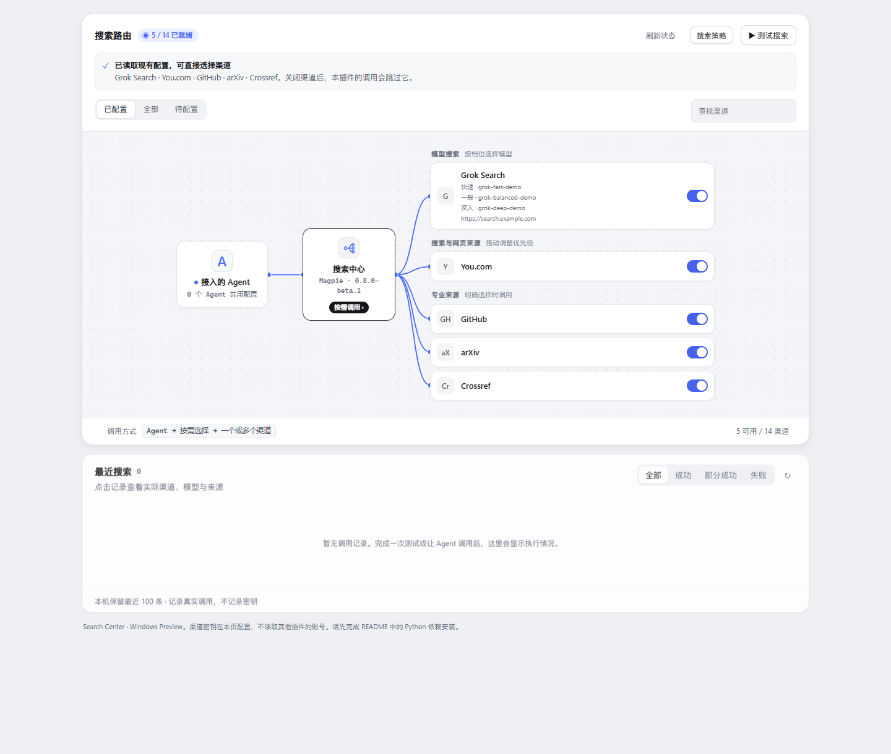
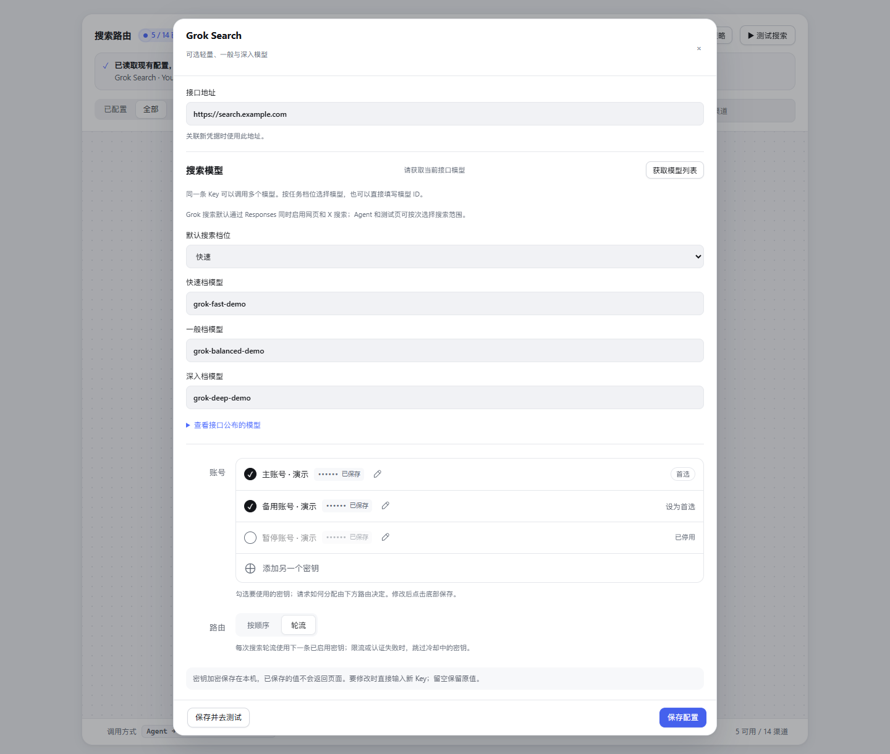

# Magpie Search Center · Windows Preview

English | [简体中文](README.zh-CN.md)

Select search sources per request and manage multiple keys, Grok models, live tests and request history inside Magpie. MIT licensed; see [third-party notices](THIRD_PARTY_NOTICES.md).

## Screenshots

Actual plugin pages with isolated demo configuration. Addresses, model IDs and account labels are examples, not bundled accounts or available models. The pages run in an `allow-scripts` iframe matching Magpie's sandbox; the host window is not shown.

Search channels: agents choose one or more sources for each task.



Grok models and accounts: three model profiles, account toggles, preferred keys and rotation.



## Features

- 14 adapters: Grok, Tavily, Exa, Firecrawl, You.com, Brave, Parallel, Perplexity Search, Bocha, Serper, SearXNG, GitHub repositories, arXiv and Crossref.
- Per-request channel, search profile and Grok model selection, with citations and channel status.
- Multiple keys with ordering, rotation and cooldown after rate limits.
- Grok web and X search enabled by default; select web-only or X-only per request. History shows tool calls reported by the upstream service.
- Live search tests, request details and history replay. Replay does not issue new searches.
- Tavily and Firecrawl quota queries, including returned scope, timestamps and stale-data indicators.

## How it differs

Some sources overlap with magpie-websearch and magpie-search-mix. Search Center focuses on explicit per-request source/model/web/X selection and a unified page for multiple keys, tests and citations. Search Center executes selected channels; it does not hand the other search tools to Grok to decide which to call. Provider account quotas remain shared with other clients using those accounts.

## Requirements

- Windows 10/11 and Python 3.12+.
- Magpie; local installation was validated with v0.1.3351.
- Node 20+ for the diagnostic command below. Magpie supplies Bun to run the plugin.
- Network access for initial Python dependency installation. Bring your own provider accounts; You.com, public GitHub repositories, arXiv and Crossref have keyless entry points.

## Community installation

The community package is `@magpie-community/tools-search-center`. After this contribution is merged and the community `dist` package is built, Magpie can install it without a personal npm account:

```powershell
magpie plugin add @magpie-community/tools-search-center
```

Open the installed plugin folder and run the Python setup and doctor commands below. Setup is explicit and does not run automatically during package installation.

## Source or local archive installation

1. Keep the source in a permanent directory. If extracting an npm tarball, rename its `package` folder to `magpie-search-center`; Magpie uses the folder name as the local plugin ID.
2. Install Python 3.12+ and check `py -3 --version`.
3. Run these commands from the plugin folder:

```powershell
powershell -NoProfile -File .\scripts\setup.ps1
node .\scripts\doctor.mjs
magpie plugin add .
```

Setup creates a virtual environment at `%USERPROFILE%/.magpie-search-center/venv` and installs the Python requirements. The backend is included; no older grok-search MCP is required.

Open Search Center in Magpie, enter provider URLs and keys, and save. For Grok, retrieve the model list and choose model IDs for the three profiles. Assign the plugin MCP to agents in Magpie's library; its server name can be changed to `search`. The exposed tools are `search` and `capabilities`.

If `magpie` is not on PATH, use its full executable path. The page's assignment button also needs PATH or `MAGPIE_BIN`; assignment through Magpie's library is available as well.

To remove a local installation and synchronize client entries:

```powershell
magpie plugin rm magpie-search-center
magpie library sync
```

Use the actual identifier shown by `magpie plugin` if installed under another name. Sync clears library and agent entries after CLI removal. User data is retained for reinstalling.

## Credentials and data

Keys are encrypted with the current Windows user's DPAPI and saved values are never returned to the page. Data lives in `%USERPROFILE%/.magpie-search-center`, separate from the installation. Re-enter keys when moving to a different Windows user or machine. History stores queries and source URLs; uninstalling retains this data.

| Environment variable | Purpose |
| --- | --- |
| `SEARCH_CENTER_DATA_DIR` | Separate data directory; setup and plugin must use the same value |
| `SEARCH_CENTER_PYTHON` | Python executable with dependencies installed |
| `MAGPIE_HOME` | Magpie config directory; defaults to `.config/magpie` in the user home |
| `MAGPIE_BIN` | Magpie CLI path; defaults to `magpie` |
| `SEARCH_CENTER_PORT` | Local service port for manual testing; must match `magpie.page.service.port` for the installed page |

The default port is 3479. Concurrent instances need separate ports and data directories. For Firecrawl proxies with a prefix, enter the complete base URL, such as `https://your-host.example/firecrawl`. Tavily pool usage requires a compatible `/usage` response from the service.

## stdio clients, including Claude Desktop

While Magpie is running, configure the client with the virtual environment's `Scripts/python.exe` and arguments `-B -u <installation-directory>/stdio.py`. FastMCP proxies the same plugin HTTP endpoint without maintaining separate accounts or configuration.

The default endpoint is `http://127.0.0.1:3425/mcp/magpie/tools/magpie-search-center`. For a different installed identifier, set `SEARCH_CENTER_MCP_URL` to the address displayed in Magpie's library. Connect only to a trusted local Magpie endpoint.

## Usage

- `capabilities` lists configured channels and Grok model candidates; `search` runs a query.
- Explicit channel selection calls only those channels. Multiple sources run concurrently and results are deduplicated. Without explicit selection, the search profile selects sources.
- Grok needs an upstream service and model supporting Responses and search tools. Both web and X tools are allowed by default; Grok decides which to invoke.
- GitHub currently searches public repositories, not code, issues or private repositories.
- Keys for one account do not multiply its quota. Pool usage reflects the service's synchronization timestamp.

## License and attribution

Built from the GrokSearch backend and dsh-grok-search UI resources, with account interactions informed by Magpie. MIT license; original copyrights and license texts are preserved in [THIRD_PARTY_NOTICES.md](THIRD_PARTY_NOTICES.md).
