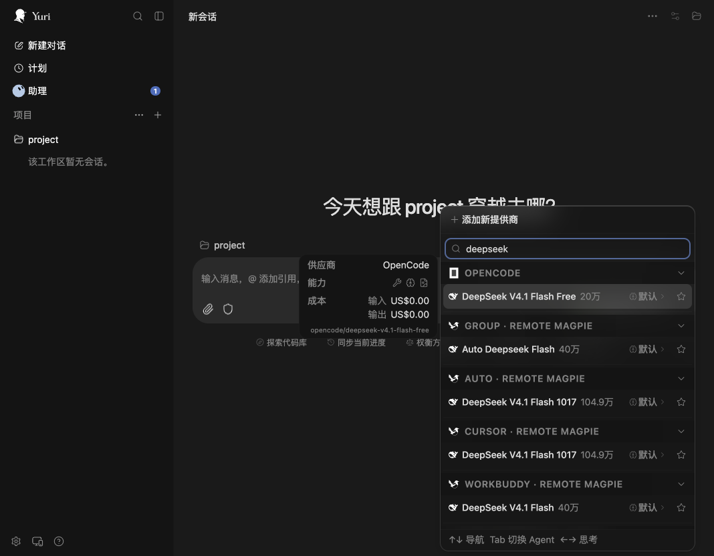
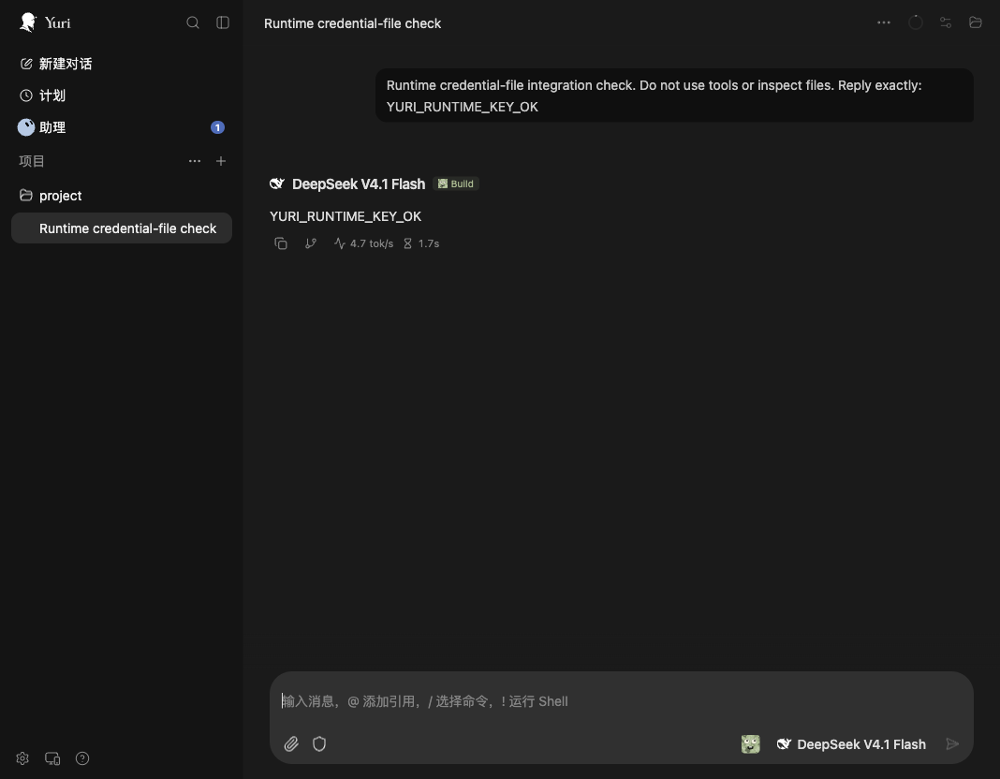

# PR #802 revision verification

## Current review revision — 2026-11-09

The sections below this heading's revision summary are historical 2026-11-07
evidence, not instructions for the new credential/lifecycle contract.

This revision refreshes the provider from the upstream working tree identified
in `packages/magpie-provider/UPSTREAM.json` and changes the community integration:

- The OpenCode entry contains `remote.baseURL` and an absolute `remote.tokenFile`
  path, never a copied gateway key. The provider reads Magpie's native sidecar
  at setup and before requests, notices rotation and fails closed on disconnect
  or destination mismatch. No Yuri/OpenCode source or User-Agent is patched.
- Host load/exit with an unchanged sidecar does not modify OpenCode, create an
  ownership record or replay a journal. Native connection-file transitions
  drive the existing reversible bridge. An already-on Agent needs an explicit
  off/on transition after installation; this is documented, not silently repaired.
- Readable jsonc-parser ESM sources replace the minified vendor bundle. They
  were compared with 3.3.1; only relative `.js` import extensions differ.
- models.dev reads are local-cache-only unless `modelsDev: true` is explicitly
  configured. Opt-in refreshes are background, timed out, reject redirects and
  retain cached fallback. No gateway/session/Agent credentials are passed.
- The checker has no V2 early return. Native V2 default packages and any legacy
  exports both go through their applicable checks; a fixture verifies combined
  malformed legacy definitions and missing packed entries are all reported.
- Bun 1.3.14 is pinned for the unminified provider build; the build command
  rejects other versions and a dedicated PR job checks committed dist bytes.
- Image-tool skill text now describes the tools rather than instructing the model.

### Repository validation

The full repository suite passed with an isolated, integrity-checked Bun 1.4.4
and temporary HOME/XDG directories: **6569 pass, 9 skip, 0 fail**, 6578 tests
across 481 files, 196.74 seconds. The system Bun installation was not changed.
An earlier full run on Bun 1.3.14 failed because that runtime does not implement
the repository's `node:test.mock` usage; it is not the final suite result.
Bun 1.3.14 remains the pinned provider **build** toolchain.

Final checks on this revision also passed:

- Focused bridge/provider/checker suite on Bun 1.3.14: **126 pass, 0 fail**.
- Node bridge tests: **43 pass**; bundled provider runtime scenario: **1 pass**.
- Both final npm tarballs extracted without node_modules; the Agent's 43 Node
  tests and the provider runtime scenario pass against those extracted files.
- Two final provider rebuilds are byte-identical, SHA-256
  `68441f59d2a160a51c49f94cad3405d8d8886314eb4f73c663ed1f5d5e375008`.
- Whole-repository registry/plugin checker, upstream snapshot hashes, readable
  vendor comparison, provider TypeScript check and `git diff --check` pass.

### Mutation proof, not only green assertions

`node packages/yuri/mutation.mjs` kills seven valid JavaScript mutations after
passing each pristine baseline, now including a recovery journal targeting an
unrelated file. The original six guarded mutations still fail their tests.

`node packages/magpie-provider/mutation.mjs` builds a pristine copy and passes
the bundled runtime test, then injects Authorization into the public models.dev
fetch, rebuilds successfully and requires the runtime test to fail. The public
request is recorded and asserted **outside** the caught background refresh;
an assertion cannot be swallowed as an ordinary optional-download failure.

### New native UI run using the file-backed credential

Fresh HOME/XDG state and freshly packed/extracted Agent/provider tarballs were
used. The actual `magpie yuri provider magpie` connection flow wrote the sidecar;
the bridge generated a `tokenFile` entry. The unpublished npm pin was replaced
only with the packed local provider reference, keeping all generated options.
The assigned key was checked absent from both OpenCode config and new ownership
state. The cloned Yuri Web production build listed the actual WorkBuddy model
and completed **`YURI_RUNTIME_KEY_OK`**.

Read-only observation for both primary/title requests:

```text
session:         ses_e40b8d383ffeAG7gHQIkcZ6W2m
provider:        magpie-upstream%2Fworkbuddy
path:            /v1/chat/completions
User-Agent:      opencode/latest/2.2.6/cli
usesAssignedKey: true
```

Actual sandbox Usage at `2026-11-09T15:47:55+08:00` has two HTTP 200 rows for
that session, both `agent=yuri`, model `workbuddy/deepseek-v4.1-flash`, with
input/output tokens 5302 / 8 and 209 / 4. This is connection attribution, not
per-UI detection. Electron is not claimed as tested. No user configuration or
running installation was modified.




## Historical native-contract verification — 2026-11-07

Run on 2026-11-07, macOS arm64, Node 24.18.0, OpenCode 2.2.6,
Magpie 0.1.3014. Yuri Web used the repository's production Web build
(`@yuriai/web` working-tree version 0.2.32-beta.10), not an automated claim
about the Electron UI. All OpenCode/Yuri/Magpie test state used temporary HOME
and XDG directories. The user's running applications/configuration were left
alone. Long-running test services ran in a task-owned tmux session.

## 1. Yuri model listing and real inference

The original attribution run used a generic gateway key and then overwrote the
User-Agent to obtain a Yuri label. That was not evidence of a real integration.
**It has been removed and superseded by the native-contract run below.**

1. Inspect the real cloned Yuri source: `packages/ui/src/lib/opencode/client.ts`
   uses the official session create/prompt boundary, and
   `packages/web/server/lib/opencode/lifecycle.js` owns the external/shared
   service connection. Yuri is an OpenCode client; OpenCode owns model HTTP.
   No Yuri source, bundle, request metadata or upstream OpenCode source was patched.
2. Start an actual sandbox Magpie host with temporary HOME/XDG directories.
   Its built-in Remote Magpie provider points to the already-running gateway,
   so real inference is forwarded by Magpie's native implementation. Install
   this checkout's Agent and run `magpie yuri provider magpie`.
3. Let the actual bridge create the pinned community provider entry. Assert
   `options.remote.token` equals the key in Magpie's generated Yuri sidecar,
   and that it is not the generic key from the superseded test. Do not derive,
   rewrite, append to, replace, or print the assigned key.
4. `npm pack --ignore-scripts --workspaces=false` in `packages/magpie-provider`
   and extract it. Because npm first publication is pending, change **only the
   package reference** in the isolated config to the local packed artifact;
   every bridge-produced option/key is retained byte-for-byte. OpenCode sees
   this local replacement as user-managed. This is not a claim that an
   unpublished npm version can already be installed.
5. Start `opencode serve --hostname 127.0.0.1 --port <test-api-port>` with the
   same HOME and config directory. Privately pass its generated server
   credential to a separate process started from the cloned Yuri Web source:
   `packages/web/server/index.js`, with temporary `YURI_DATA_DIR`,
   `OPENCODE_HOST` set to this API, `OPENCODE_SKIP_START=true` and its server
   credential. Open the real UI in a separate browser tab and add only the
   temporary fixture project. No subscription credentials are copied.
6. Search the model picker for DeepSeek; select **WorkBuddy · Remote Magpie →
   DeepSeek V4.1 Flash**, not OpenCode's free model. The UI completed the replies
   `YURI_NATIVE_KEY_OK` and `YURI_REAL_HEADERS_OK`.

### Observe the native contract without modifying requests

Load `verification/native-observer.mjs` as the `index.mjs` of a temporary local
plugin package after the provider (with `exports["."] = "./index.mjs"`). Set
`YURI_VERIFY_CONTROL_FILE` to the actual Magpie-generated sidecar and
`YURI_VERIFY_OUTPUT_FILE` to a private temporary JSONL file. This **test-only,
read-only** hook validates the actual HTTP request; it never mutates its headers,
body, URL or credentials. It records no key values or message bodies.

Observed on the completed `YURI_REAL_HEADERS_OK` request:

```text
session:         ses_e4c05ae55ffe2D4EmXmmOQiwu6
kind:            primary
path:            /v1/chat/completions
User-Agent:      opencode/latest/2.2.6/cli
X-Magpie-Agent:  yuri  (advisory, not proof of the UI caller)
usesAssignedKey: true
```

Filtered actual sandbox `magpie usage --csv --last 15m`, for that session:

```text
time:          2026-11-07T11:09:17+08:00
session:       ses_e4c05ae55ffe2D4EmXmmOQiwu6
agent:         yuri
model:         workbuddy/deepseek-v4.1-flash
status:        200
input_tokens:  221
output_tokens: 9
```

The checked source contract is Magpie's `internal/agent/plugged.go` (passes
`agentKeyAt(id, gateway)` to the Agent's `connect`) and
`internal/gateway/gateway.go` (uses the assigned Agent key before User-Agent).
The provider preserves both that key and OpenCode's native User-Agent.
`options.agentID` remains an advisory label, not an invented Yuri native API.
For a remote/custom gateway key, no independent UI attribution is claimed.


## 2. Yuri and the built-in OpenCode adapter

Two complementary checks used **actual Magpie CLI operations**, not a simulated
JSON writer: a separate managed-entry ownership fixture and real UI/CLI inference
through the native Remote Magpie upstream.

### Managed npm entry / reversible ownership

With a separate `OPENCODE_CONFIG_DIR`, the initial JSONC contained a user comment,
`"model":"user/keep"` and `"plugins":[]`. A sandbox Magpie host loaded the Yuri
Agent from this checkout. Only this ownership fixture uses the sandbox provider
`fixture/fixture-model`, with a fake key and a non-listening loopback URL; it is
never an inference target.

| Operation | `plugins` | `provider.magpie` | `model` |
| --- | --- | --- | --- |
| Yuri ON | Adds the community `@0.1.0` entry with `agentID: yuri` | absent | `user/keep` |
| OpenCode ON (`magpie opencode fixture/fixture-model`) | unchanged | added | `magpie/fixture/fixture-model` |
| OpenCode OFF (`magpie opencode default`) | unchanged | removed | `user/keep` |
| OpenCode ON, then Yuri OFF | only Yuri's owned entry removed | retained | `magpie/fixture/fixture-model` |
| Both OFF | empty | removed | `user/keep` |

The installed Magpie version writes the legacy singular `provider.magpie` key,
not `providers.magpie`. Its serializer can reformat JSONC and leave an empty
`provider: {}`; that is the built-in adapter's behavior. Yuri does not fight it
or restore stale whole-file bytes over its changes.

### While the real Yuri UI was connected

In the native-contract run from section 1, the sandbox Magpie host and running
OpenCode/Yuri pair used the **same** `OPENCODE_CONFIG_DIR`. The extracted local
community provider entry is user-owned; Yuri recognizes it without modifying
its gateway URL/token/options. While Yuri remained connected:

- `magpie opencode upstream/workbuddy/deepseek-v4.1-flash` retained the complete
  `plugins` array, added `provider.magpie`, and set `model` to
  `magpie/upstream/workbuddy/deepseek-v4.1-flash`.
- A real `opencode run --server <isolated-api> --model
  magpie/upstream/workbuddy/deepseek-v4.1-flash` completed the CLI control reply
  through that built-in adapter's own native connection.
- OpenCode OFF retained the local provider, removed `provider.magpie`, and
  restored the previous absent `model`.
- The existing Yuri conversation remained on its selected WorkBuddy model;
  a follow-up inference completed with `YURI_NATIVE_COEXIST_OK`. The read-only
  observer again recorded the real `opencode/latest/2.2.6/cli` User-Agent and
  `usesAssignedKey: true` for its dynamic provider.

Actual sandbox Usage control/positive records (both HTTP 200):

| Time (+08:00) | Client connection | Usage Agent | Session | Input/output tokens |
| --- | --- | --- | --- | --- |
| 2026-11-07 11:11:12 | Built-in OpenCode adapter, real CLI | `opencode` | `ses_e4c02e059ffeWiaEXMBG16snsX` | 6320 / 135 |
| 2026-11-07 11:11:25 | Dynamic provider, real Yuri UI | `yuri` | `ses_e4c05ae55ffe2D4EmXmmOQiwu6` | 145 / 9 |

Both records used the real `workbuddy/deepseek-v4.1-flash` upstream. This is a
comparison of two native **connections**, not a claim that the plugin detects
which UI used a shared provider/key. Any client using Yuri's same provider/key
shares its attribution.

The static built-in catalog and the dynamic provider are separate catalogs;
the Agent does not claim they are deduplicated or share model-selection state.

## 3. Automated safety and runtime checks

```sh
node --test packages/yuri/yuri.test.mjs
bun test packages/yuri packages/magpie-provider scripts/check.test.mjs
node --test packages/magpie-provider/tests/runtime.test.mjs
node packages/yuri/mutation.mjs
bun scripts/check.mjs
```

The 40 bridge tests include a separate-process live lock, crashed PID reclaim,
an injected user edit before commit (no journal may be written), duplicated
managed entries specifically on disconnect, invalid URL/key matrices, and a
child host exiting before the next poll. All pass on Node and Bun.

`mutation.mjs` runs each targeted test on pristine copied source, verifies the
baseline passes, makes one valid-JavaScript mutation and requires a failing
test. All six mutations are killed: direct call without lock; no stale reclaim;
no commit read-check; no restore duplicate guard; no URL guard; no key charset.

The provider's 58 tests include the upstream catalog/pricing/group/reasoning
regressions and an isolated subprocess using the **bundled runtime**. It checks
default/custom advisory labels, unchanged native User-Agent, refresh retention,
request origin/path boundaries, credential-free models.dev fetches, redirect
rejection, image tools and reverse-order disposal on normal/failed setup.

The checker now accepts native V2 `{id, setup/effect}` packages without running
setup or inventing a V1 auth hook. Its new fixture test checks missing packed
files and broken V2 exports are still rejected.

After removing the User-Agent overrides, the full repository suite was rerun
with a temporary HOME and a separately downloaded Bun
1.4.4 (the system Bun was not upgraded): **6559 pass, 9 skip, 0 fail**, 6568
tests across 480 files, 206.60 seconds. The full plugin/registry checker passed.
Both packages were also packed/extracted and tested without node_modules:
40 bridge tests and the provider's bundled-runtime scenario pass. Rebuilding
the committed provider bundle with Bun 1.3.14 produces byte-identical output.
