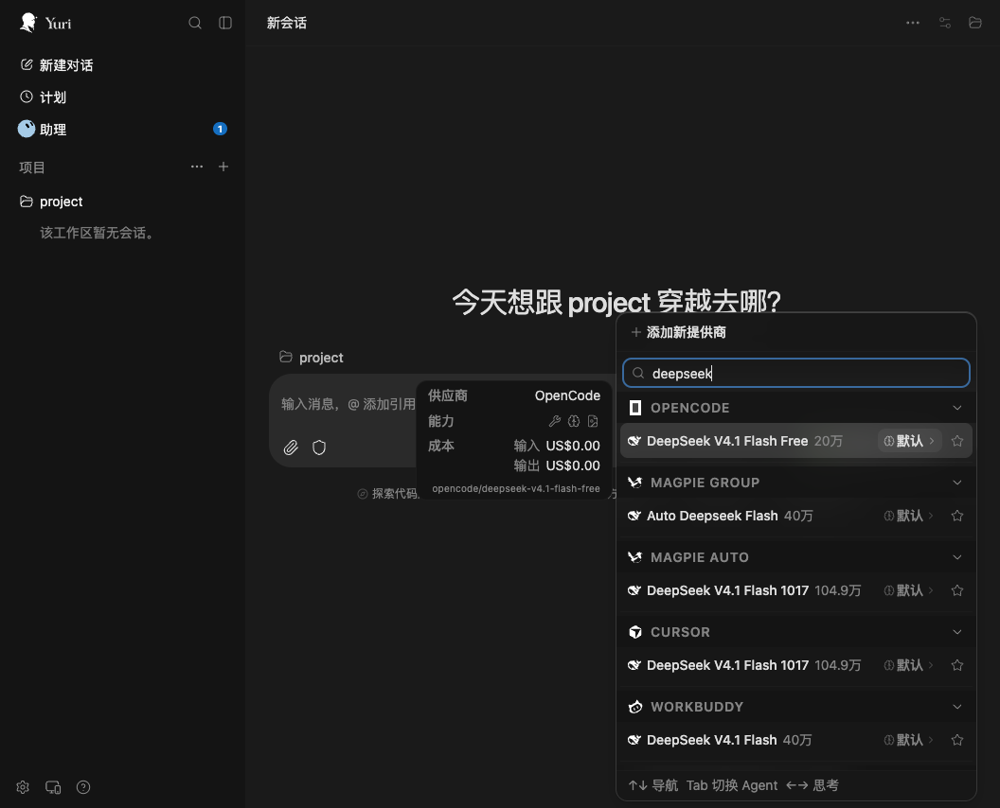
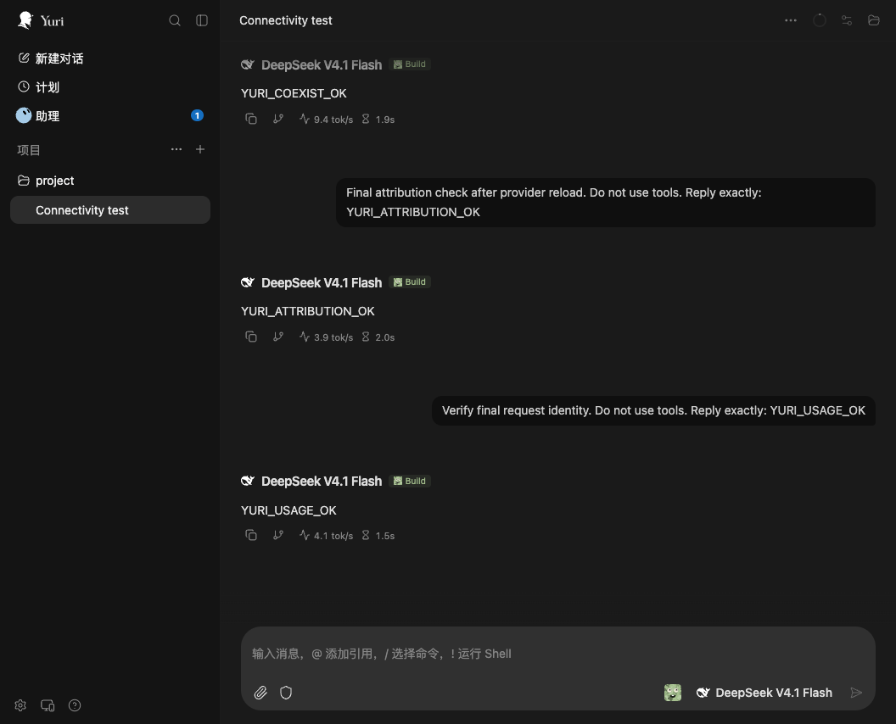

# PR #802 revision verification

Run on 2026-11-07, macOS arm64, Node 24.18.0, OpenCode 2.2.6,
Magpie 0.1.3014. Yuri Web used the repository's production Web build
(`@yuriai/web` working-tree version 0.2.32-beta.10), not an automated claim
about the Electron UI. All OpenCode/Yuri/Magpie test state used temporary HOME
and XDG directories. The user's running applications/configuration were left
alone. Long-running test services ran in a task-owned tmux session.

## 1. Yuri model listing and real inference

1. `npm pack --ignore-scripts --workspaces=false` in `packages/magpie-provider`;
   extract the tarball into the temporary HOME. No node_modules or runtime
   install is needed. The complete source is included alongside `dist/index.mjs`.
2. Start `opencode serve --hostname 127.0.0.1 --port <test-api-port>` with that
   HOME and `OPENCODE_CONFIG_DIR`. Use its generated server credential privately;
   do not publish it or raw startup logs. Load the extracted local package with
   `options.agentID: "yuri"` and an explicit remote connection to an already
   running Magpie gateway. No subscription token is copied into the fixture.
3. Start a separate Yuri Web process with the temporary `YURI_DATA_DIR`,
   `OPENCODE_HOST` set to this API, `OPENCODE_SKIP_START=true` and its server
   credential. Open its UI in a separate browser tab; skip optional onboarding
   configuration and add only the temporary fixture project.
4. In Yuri's model picker, search for DeepSeek. The picker displayed the live
   Magpie Group, Cursor, WorkBuddy and Astra catalogs. Select **WorkBuddy →
   DeepSeek V4.1 Flash** (not OpenCode's free DeepSeek model).
5. Send `This is a connectivity test. Do not use tools or inspect files.
   Reply with exactly: YURI_MAGPIE_OK`. Yuri displayed the completed answer
   `YURI_MAGPIE_OK`. After the coexistence switches below, another prompt returned
   `YURI_COEXIST_OK` through the same session/provider.

The provider cannot be resolved from its future npm pin before the first
community npm publication. This run deliberately used the **packed local
artifact**, not a claimed installation of an unpublished npm version. Separate
bridge tests verify the exact production pin/options and ownership semantics.

### Real attribution, not only a mocked header

The first live run revealed two important details: the provider info's static
header also needed updating, and Magpie does not use `X-Magpie-Agent` to identify
a direct non-Magpie client. The final provider therefore sets the chosen id in
both `X-Magpie-Agent` and `User-Agent`, in the catalog, HTTP hook, discovery and
image calls. A new packed artifact was loaded and its runtime provider headers
were checked. The final UI prompt returned `YURI_USAGE_OK`.

Filtered `magpie usage --csv --last 60m`, matching only this test session:

```text
time:          2026-11-07T10:55:59+08:00
session:       ses_e4c159131ffeeJEXaEnmV1zA1K
agent:         yuri
model:         deepseek-v4.1-flash
status:        200
input_tokens:  173
output_tokens: 6
```

Earlier attempts in that test session were correctly observed as `opencode`;
they are not presented as successful attribution checks. Gateway keys explicitly
assigned to another agent still take precedence; the plugin does not rewrite
credentials to override their ownership.




## 2. Yuri and the built-in OpenCode adapter

Two complementary checks used **actual Magpie CLI operations**, not a simulated
JSON writer. The sandbox provider `fixture/fixture-model` has a fake key and a
non-listening loopback URL: it is only for writing the built-in adapter's config,
never an inference target.

### Managed npm entry / reversible ownership

With a separate `OPENCODE_CONFIG_DIR`, the initial JSONC contained a user comment,
`"model":"user/keep"` and `"plugins":[]`. A sandbox Magpie host loaded the Yuri
Agent from this checkout.

| Operation | `plugins` | `provider.magpie` | `model` |
| --- | --- | --- | --- |
| Yuri ON | Adds the community `@0.1.0` entry with `agentID: yuri` | absent | `user/keep` |
| OpenCode ON (`magpie opencode fixture/fixture-model`) | unchanged | added | `magpie/fixture/fixture-model` |
| OpenCode OFF (`magpie opencode default`) | unchanged | removed | `user/keep` |
| OpenCode ON, then Yuri OFF | only Yuri's owned entry removed | retained | `magpie/fixture/fixture-model` |
| Both OFF | empty | removed | `user/keep` |

The installed Magpie version writes the legacy singular `provider.magpie` key,
not `providers.magpie`. Its serializer can reformat JSONC and leave an empty
`provider: {}`; that is the built-in adapter's behavior. Yuri does not fight it
or restore stale whole-file bytes over its changes.

### While the real Yuri UI was connected

The sandbox Magpie host was then pointed to the **same** `OPENCODE_CONFIG_DIR`
as the running isolated OpenCode/Yuri pair from run 1. The extracted local
community provider entry is user-owned; Yuri recognizes it without modifying
its gateway URL/token/options. While Yuri remained connected:

- OpenCode ON retained that local `plugins` entry, added `provider.magpie`, and
  set `model` to `magpie/fixture/fixture-model`.
- OpenCode OFF retained the local provider, removed `provider.magpie`, and
  restored the previous absent `model`.
- The existing Yuri conversation remained on its selected WorkBuddy model;
  a follow-up inference completed with `YURI_COEXIST_OK`.
- Yuri OFF retained the independently installed local provider, as documented.

The static built-in catalog and the dynamic provider are separate catalogs;
the Agent does not claim they are deduplicated or share model-selection state.

## 3. Automated safety and runtime checks

```sh
node --test packages/yuri/yuri.test.mjs
bun test packages/yuri packages/magpie-provider scripts/check.test.mjs
node --test packages/magpie-provider/tests/runtime.test.mjs
node packages/yuri/mutation.mjs
bun scripts/check.mjs
```

The 40 bridge tests include a separate-process live lock, crashed PID reclaim,
an injected user edit before commit (no journal may be written), duplicated
managed entries specifically on disconnect, invalid URL/key matrices, and a
child host exiting before the next poll. All pass on Node and Bun.

`mutation.mjs` runs each targeted test on pristine copied source, verifies the
baseline passes, makes one valid-JavaScript mutation and requires a failing
test. All six mutations are killed: direct call without lock; no stale reclaim;
no commit read-check; no restore duplicate guard; no URL guard; no key charset.

The provider's 58 tests include the upstream catalog/pricing/group/reasoning
regressions and an isolated subprocess using the **bundled runtime**. It checks
default/custom attribution including static provider headers, refresh retention,
request origin/path boundaries, credential-free models.dev fetches, redirect
rejection, image tools and reverse-order disposal on normal/failed setup.

The checker now accepts native V2 `{id, setup/effect}` packages without running
setup or inventing a V1 auth hook. Its new fixture test checks missing packed
files and broken V2 exports are still rejected.

Full repository suite with a temporary HOME and a separately downloaded Bun
1.4.4 (the system Bun was not upgraded): **6559 pass, 9 skip, 0 fail**, 6568
tests across 480 files, 208 seconds. The full plugin/registry checker passed.
Both packages were also packed/extracted and tested without node_modules:
40 bridge tests and the provider's bundled-runtime scenario pass. Rebuilding
the committed provider bundle with Bun 1.3.14 produces byte-identical output.
