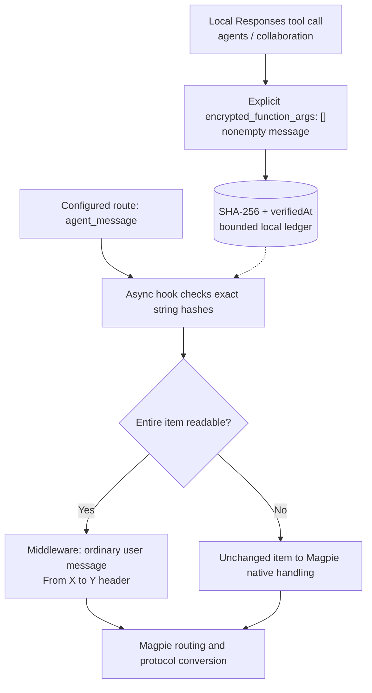

# Magpie Agent Message Compat

[](https://github.com/YHonc/magpie-agent-message-compat/actions/workflows/test.yml)
[](LICENSE)

[English](#english) · [中文](#中文)

## English

Version **0.1.3** provides opt-in Gateway hooks and middleware for Codex MultiAgent V2 routes through [Magpie](https://github.com/yetone/magpie). It converts readable `agent_message` items for upstreams that need ordinary messages. A local provenance ledger can restore strings mislabeled as `encrypted_content` when their exact hashes match previously observed plaintext tool arguments.

### Choose a route before enabling

The default is `targets: []`: no conversion, restoration, or ledger I/O occurs until a valid target is configured. Configure routes where you have reproduced a compatibility problem. Provider prefixes below are examples, not a list of tested providers.

Magpie's reply-side marker fix in [#3183 landed in v0.1.2747](https://github.com/yetone/magpie/issues/3183#issuecomment-6585099439). The separate third-party plain-message relay issue [#4108](https://github.com/yetone/magpie/issues/4108) was still open when checked on 2026-11-06. The general third-party Responses plaintext relay layer uses the inspected Magpie `0.1.2964` source as its reference. It applies to builds/routes without the #4108 conversion; no first official fixed release has been verified. Remove routes from `targets` when they already perform native conversion.

Restoration addresses a Codex `rust-v0.166.0-alpha.6` bug: `direct_source` hard-codes the default `collaboration` namespace instead of reading `features.multi_agent_v2.tool_namespace`. The mislabeling occurs when that setting uses a non-default namespace, such as `agents`, even with the empty marker. This plugin records evidence only from `agents` and `collaboration` calls. On Codex's default `collaboration` configuration, tasks already arrive as plaintext and only the middleware conversion applies.

### Install and configure

Use Magpie with `magpie.hooks` and `magpie.middleware` support. There are no third-party runtime dependencies; hooks use Magpie's managed Bun and Node-compatible standard libraries.

```sh
magpie plugin add github:YHonc/magpie-agent-message-compat
```

If Magpie is not on the Windows PATH:

```powershell
$magpie = Join-Path $env:LOCALAPPDATA 'Programs\magpie\magpie.com'
& $magpie plugin add 'github:YHonc/magpie-agent-message-compat'
```

Alternatively, clone this repository and run `magpie plugin add ./magpie-agent-message-compat`. Disable an older local copy, then open **Options** in the plugin page and choose your routes:

```json
{
  "targets": ["my-provider/gemini-*", "my-provider/claude-*"],
  "gatewayTimeoutMs": 2000,
  "ledgerMaxEntries": 2048,
  "ledgerMaxAgeDays": 30
}
```

| Option | Behavior |
| --- | --- |
| `targets` | Full route names or a single trailing `*`. Default `[]`; no valid targets disables ledger I/O and transformations. |
| `gatewayTimeoutMs` | Host-enforced asynchronous hook budget; example 2000 ms. |
| `ledgerMaxEntries` | Default 2048; constrained to 1–10000. |
| `ledgerMaxAgeDays` | Default 30 days; constrained to 1–365. Non-finite retention values use defaults. |
| `ledgerPath` | Optional path; default `~/.config/magpie/agent-message-compat/provenance.json`. |
| `provenanceRevision` | Change this value to reload the cache after a verified manual import. |

Saved options override the examples in `package.json`. The plugin does not alter model catalogs, tool namespaces, or provider configuration. The former `waitForProvenanceMs` option is no longer read.

### Processing



Evidence comes from successful Responses replies or subsequent request history classified by Magpie as `local` or `magpie-key`. Eligible calls are `spawn_agent`, `followup_task`, and `send_message` in `agents` or `collaboration`, with `encrypted_function_args: []` and a nonempty string `message`. The ledger stores its SHA-256 hash and verification timestamp. Restoration compares the exact original string; it does not decode or guess from ciphertext appearance.

A message containing only valid `input_text` and `input_image` parts, with at least one image or nonblank text part, becomes a user message with the core-style header `From /root/worker to /root\n\n`. A single known endpoint produces `From X\n\n` or `To Y\n\n`; neither endpoint produces no header. Text order is preserved. Converted messages are ordinary messages, so a second pass does not add another header. The user role is a transport representation; agent-origin content does not acquire human authorization.

Unknown or sealed content, empty messages, and mixed supported/unsupported content pass unchanged to Magpie's native handling. The plugin no longer returns its own 400 or 409 for these items. Expired or evicted ledger entries become unknown and follow that path. Processing does not wait for pending provenance writes; a later request can use evidence that has since become available.

### Ledger and removal

The ledger retains at most 2048 records for 30 days by default, using `verifiedAt`; older formats remain readable. Hashes expose equality, and someone who can read the file can test short or guessable messages against them. Keep the file local. Invalid ledgers and unavailable storage are reported through `ctx.report`; a damaged file is preserved as `.corrupt.<UUID>` before replacement.

In the reviewed host implementation, the request's report closure is inactive after the request finishes, so failures while saving reply evidence in `onResponse` may not be displayed.

```sh
magpie plugin list
magpie plugin off magpie-agent-message-compat
magpie plugin on magpie-agent-message-compat
magpie plugin rm magpie-agent-message-compat
```

Use the identifier shown by `plugin list` if installation registered a spec or path. Disabling or removing the plugin leaves its ledger on disk; remove that file separately when no longer needed.

### Evidence and testing

The [November 6 live-work pair](evidence/codex-rollout-2026-11-06-live-work-redacted-pair.json) records an `agents.spawn_agent` call generated during this update's actual implementation work for `cpa/gpt-6-astra`. The parent call carries `encrypted_function_args: []`, while the child's `encrypted_content` contains the exact same original message. Original-string equality, parent/child session linkage, and Codex `0.166.0-alpha.6` were verified before redaction. This is newly generated November 6 rollout evidence from authorized work, with no additional model probe; it is not an HTTP capture or evidence of delivery failure. A [November 6 runtime attestation](evidence/magpie-runtime-attestation-2026-11-06.json) links the sampled gateway listener process to its Magpie `0.1.2964` startup record. That 17:11 sample is not a request-level HTTP capture of the 16:52 task.

The [historical restart pair](evidence/codex-rollout-2026-11-05-restart-redacted-pair.json) links a new parent `agents.spawn_agent` call carrying `encrypted_function_args: []` to a Gemini child's `encrypted_content` containing the same original message. Original-string equality, the parent/child session relationship, and Codex `0.166.0-alpha.6` were checked before redaction. This shows that a new task after restart still acquired this representation; the task succeeded, so this pair is not a failed-delivery result. The [earlier return-message pair](evidence/codex-rollout-2026-11-05-redacted-pair.json) records the same representation for `agents.send_message`.

The [startup excerpt](evidence/magpie-startup-2026-11-05-redacted.txt) records Magpie `0.1.2964` starting on November 5, adjacent to a `0.1.2663` startup entry. It corroborates the installed runtime timeline after the #3183 landing, but does not identify the serving process for each request. These are November 5 historical records extracted on November 6, not a November 6 reproduction or an HTTP capture. The `agents` namespace in these calls, despite the empty marker, does not satisfy the inspected Codex `collaboration` plaintext branch.

Run offline module checks with Node.js 20 or later:

```sh
npm test
```

The current suite has 15 offline check groups. Tests use temporary directories and do not call models or read personal ledgers. They cover conversion, pass-through, provenance, namespace and item-level seal guards, retention, storage failures, and ordering. Real-route acceptance must inspect actual dispatch, follow-up, and return messages rather than infer success from HTTP 200 or a model assertion.

The plugin makes no model or network calls. Headers and representation changes can affect token counts and cache prefixes; cache effects have not been measured. Transport failures, rate limits, and authentication need separate diagnosis. When the native route supports these messages, disable the plugin and verify that route directly.

## 中文

**0.1.3** 为通过 Magpie 使用的 Codex MultiAgent V2 路由提供可选的 Gateway Hook 和 Middleware：将可读的 `agent_message` 转成普通消息；对误放进 `encrypted_content` 的字符串，只有原文哈希与已观察到的明文工具参数完全匹配时，才恢复正文。

### 按路由启用

默认 `targets: []`，配置有效目标前不转换消息、不恢复正文，也不读写台账。请为已复现兼容问题的路由启用。上面的 `my-provider/*` 是配置示例，不代表供应商验收结果。

[#3183 的响应标记修复已随 v0.1.2747 发布](https://github.com/yetone/magpie/issues/3183#issuecomment-6585099439)；独立的明文消息中继问题 [#4108](https://github.com/yetone/magpie/issues/4108) 在 2026-11-06 核对时仍为 open。通用第三方 Responses 明文中继兼容层以检查过的 Magpie `0.1.2964` 源码为参考，适用于未包含 #4108 转换的构建或路由；目前尚未核实首个正式修复版本。已包含原生转换的路由应从 `targets` 移除。

恢复步骤针对 Codex `rust-v0.166.0-alpha.6` 的一个问题：`direct_source` 写死了默认命名空间 `collaboration`，没有读取 `features.multi_agent_v2.tool_namespace`。该配置使用 `agents` 等非默认命名空间时，即使带有空标记，明文仍会被误标为密文。本插件只记录 `agents` 和 `collaboration` 调用的来源证据。Codex 使用默认 `collaboration` 配置时，任务已按明文传递，只有 Middleware 转换步骤适用。

### 安装与配置

使用上方的 GitHub 安装命令；Windows 未配置 PATH 时使用对应 PowerShell 命令。需要支持 `magpie.hooks` 和 `magpie.middleware` 的 Magpie，本包无第三方运行时依赖。安装后关闭旧本地副本，在插件页的 **Options** 中配置自己的目标路由。

| 选项 | 含义 |
| --- | --- |
| `targets` | 完整路由名或末尾单个 `*`；默认 `[]`，无有效目标时停止转换、恢复和台账 I/O。 |
| `gatewayTimeoutMs` | Magpie 执行的异步 Hook 超时预算，示例为 2000 ms。 |
| `ledgerMaxEntries` | 默认最多 2048 项，范围 1–10000。 |
| `ledgerMaxAgeDays` | 默认保留 30 天，范围 1–365；非有限的保留参数回退默认值。 |
| `ledgerPath` | 默认 `~/.config/magpie/agent-message-compat/provenance.json`，可指定其他路径。 |
| `provenanceRevision` | 人工核实并导入历史记录后，修改此值以重新载入缓存。 |

实际配置以 Magpie 保存的选项为准。插件不修改模型目录、工具命名空间或供应商配置。旧选项 `waitForProvenanceMs` 不再读取。

### 消息处理与台账

Hook 从成功的 Responses 响应或后续请求历史取证，来源须由 Magpie 判定为 `local` 或 `magpie-key`。工具须属于 `agents` 或 `collaboration`，名称为 `spawn_agent`、`followup_task` 或 `send_message`，且明确携带 `encrypted_function_args: []` 和非空字符串 `message`。台账只存 SHA-256 与核实时间 `verifiedAt`，按原字符串精确匹配，不解密，也不根据字符串外观猜测。

Middleware 将仅含有效 `input_text`、`input_image`，且至少含图片或非空白文本的代理消息转成普通 user 消息，使用与核心一致的 `From /root/worker to /root\n\n` 来源头，保留正文顺序。仅有一端时用 `From X\n\n` 或 `To Y\n\n`，两端都没有则不添加头部。重复处理已转换的消息不会再加头部。user 是传输角色，代理内容不因此获得人类授权。

未恢复的密文、未知类型、空消息和混合内容整项原样交给 Magpie 原生处理；插件不再为这些消息返回 400 或 409。过期或被淘汰的记录按未知内容处理。Hook 不等待尚未完成的来源写入，后续请求可以使用届时已写入的证据。

台账默认最多保留 2048 项、30 天，兼容旧格式。持有文件的人可以判断哈希是否相同，也可以猜测短文本并计算哈希比对，因此应保存在本机。台账损坏或存储不可用时通过 `ctx.report` 报告；替换损坏台账前会保留 `.corrupt.<UUID>` 副本。

已审查的宿主实现会在请求结束后停用该请求的报告闭包，因此 `onResponse` 保存响应证据时发生的失败可能不会显示。

使用上方的 `plugin off/on/rm` 命令关闭、启用或移除，标识以 `plugin list` 为准。关闭和移除均保留台账文件，不再需要时可单独删除。

### 证据与验证

[11 月 6 日实际工作记录对](evidence/codex-rollout-2026-11-06-live-work-redacted-pair.json) 来自本轮更新中交给 `cpa/gpt-6-astra` 的实际实现任务：父代理新生成的 `agents.spawn_agent` 调用带有 `encrypted_function_args: []`，子代理的 `encrypted_content` 包含完全相同的原始任务。脱敏前已核对原文相等、父子会话关联及 Codex `0.166.0-alpha.6`。这是 11 月 6 日已授权工作中新产生的 rollout 证据，没有追加模型探针；它不是 HTTP 抓包，也不能说明投递失败。[11 月 6 日运行时核对记录](evidence/magpie-runtime-attestation-2026-11-06.json) 已将抽样时的网关监听进程与 Magpie `0.1.2964` 启动记录关联；17:11 的抽样不是 16:52 任务的逐请求 HTTP 抓包。

[重启后的历史记录对](evidence/codex-rollout-2026-11-05-restart-redacted-pair.json) 包含父代理新发出的 `agents.spawn_agent` 调用及 Gemini 子代理收到的消息：调用带有 `encrypted_function_args: []`，相同原字符串随后出现在子代理的 `encrypted_content` 中。脱敏前已核对原文相等、父子会话关联和两侧 Codex `0.166.0-alpha.6` 版本。这说明重启后新任务仍产生该表示；该任务实际成功，不能把这组记录称为投递失败。[较早的回传记录对](evidence/codex-rollout-2026-11-05-redacted-pair.json) 则记录了 `agents.send_message` 的相同表示。

[启动日志摘录](evidence/magpie-startup-2026-11-05-redacted.txt) 记录了 11 月 5 日 Magpie `0.1.2964` 的启动，相邻还有 `0.1.2663` 启动记录。它佐证 #3183 发布之后的本机运行时间线，但不能锁定每个请求对应的服务进程。这些均为 11 月 5 日历史记录，11 月 6 日只是提取日期，不是 11 月 6 日的新复现或 HTTP 抓包。记录中的 `agents` 命名空间即使带空标记，也不满足已检查 Codex 源码的 `collaboration` 明文分支。

使用 Node.js 20 或更高版本运行 `npm test`。当前共 15 组离线检查，使用临时目录，不调用模型、不读取个人台账，覆盖转换、原样放行、来源记录、命名空间与条目级密文守卫、保留策略、存储异常与消息顺序。真实路由验收需核对实际派发、追加任务和结果回传，不能仅凭 HTTP 200 或模型自述判断成功。

插件不额外调用模型或网络。来源头与消息表示变化可能影响 token 数和缓存前缀，尚无缓存效果测量；网络错误、限流和认证问题需另行诊断。原生路由支持后，可关闭插件并直接验证该路由。

## Source / 源码

| File | Responsibility / 职责 |
| --- | --- |
| `common.js` | Route matching and source classification / 路由匹配与来源判定 |
| `provenance.hooks.mjs` | Provenance ledger and exact-match restoration / 来源台账与精确恢复 |
| `compat.middleware.js` | Plain-message conversion and pass-through / 明文转换与原样放行 |
| `test.mjs` | Offline module checks / 离线模块检查 |

## License / 许可证

[MIT](LICENSE).
