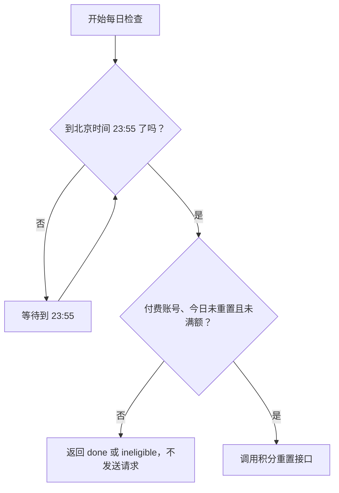

# magpie-univibe-auth

在 Magpie 和 OpenCode 中使用 UniVibe：

- 动态读取账号可见的全部模型。
- Claude 走 Anthropic Messages，GPT/Codex 走 OpenAI Responses，Gemini 走 Google 原生协议。
- 在 Magpie 中显示当前积分、补充上限、每小时恢复和 Claude 周额度。
- 积分耗尽时自动重置并重放原请求一次。
- 每天北京时间 23:55 执行最后一次补满。
- 根据 UniVibe 的 `last_reset_date` 保证同一北京日不重复重置。

包名是 `magpie-univibe-auth`，插件声明的供应商 ID 是 `univibe`。如果本机已经有一个名为 `univibe` 的普通供应商，Magpie 会按约定把插件供应商命名为 `univibe-plugin`，以免两套模型和额度混在一起。

## 安装

```sh
magpie plugin add github:chansyawn/magpie-univibe-auth
magpie plugin login univibe
```

登录时需要：

1. 在 [UniVibe API 密钥](https://www.univibe.cc/console/api-keys) 创建的 API Key。
2. UniVibe 账号的手机号和密码。

API Key 用于模型请求。手机号和密码用于读取积分，并在网页登录 Token 失效时重新登录。登录信息由 Magpie 写入配置目录下的 `plugin-auth.json`，文件权限为 `600`；其中包含明文密码，请只在自己的用户目录中妥善保管。

安装后，在 Magpie 用量页的 Univibe 卡片中打开“自动签到”。也可以在供应商编辑页点击“立即签到”手动执行一次。

## 积分与重置

| 窗口            | 来源                                                      | 行为                                         |
| --------------- | --------------------------------------------------------- | -------------------------------------------- |
| 当前积分        | `/api/credits` 的 `current_credits` 和 `supplement_limit` | 作为账号主要积分窗口展示                     |
| 每小时恢复      | `hourly_supplement`                                       | 展示每次恢复量与下次恢复时间，不改变账号路由 |
| Claude 每周额度 | `/api/credits/detail` 的 `weekly_limit`                   | 只限制 Claude 模型                           |

### 什么时候重置

| 触发方式             | 行为                                                                                                                                      |
| -------------------- | ----------------------------------------------------------------------------------------------------------------------------------------- |
| 自动签到已开启       | Magpie 每北京日先按自己的“签到时间”调用插件；插件在 23:55 前返回 `inactive`，到点后再重置。若 Magpie 的签到时间晚于 23:55，则在当时执行。 |
| 自动签到已关闭       | 不执行每日定时重置；“立即签到”和积分耗尽触发的即时重置仍可使用。                                                                          |
| 点击“立即签到”       | 立即检查账号是否满足条件，满足时重置。                                                                                                    |
| 模型请求提示积分耗尽 | 立即读取最新积分；确认耗尽后重置，并安全重放原请求一次。                                                                                  |



重置前还会确认：账号不是免费套餐、`last_reset_date` 不在今天、当前积分低于补充上限。已经满额时返回 `done`，不会调用重置接口。

即时重置只识别 HTTP 402，或带有明确积分、余额、额度耗尽语义的 403/429。普通限流、模型权限错误以及 Claude 周额度耗尽不会触发重置。

`last_reset_date` 按北京时间判断。只要 UniVibe 表示当天已经重置，后续请求和签到检查都只返回 `done`，不会再次发送重置请求。手动点击“立即签到”也遵循同一判断，因此同日重复点击是安全的。

## 模型

模型列表来自：

```text
GET https://api.univibe.cc/openai/v1/models
```

读取失败时 Magpie 会保留上一次成功读取的列表。仓库内也带有首次安装时的保守回退列表。模型协议和基地址如下：

| 模型前缀         | 协议               | 基地址                                 |
| ---------------- | ------------------ | -------------------------------------- |
| `claude-`        | Anthropic Messages | `https://api.univibe.cc/anthropic/v1`  |
| `gpt-`, `codex-` | OpenAI Responses   | `https://api.univibe.cc/openai/v1`     |
| `gemini-`        | Gemini             | `https://api.univibe.cc/gemini/v1beta` |

未识别的动态模型默认按 OpenAI Responses 接入。

## 检查

```sh
vp check
vp test --run
magpie quota
```

查看供应商与账号状态：

```sh
magpie plugin --json
```

本项目不会把凭据写入 README、日志、测试数据或 Git 提交。测试只使用脱敏夹具，不执行真实重置或付费模型推理。

## License

MIT
