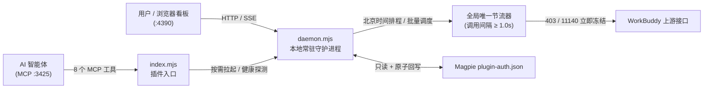

<div align="center">


# magpie-workbuddy-tasks

**WorkBuddy 国内版日常收益自动化插件 for [Magpie](https://usemagpie.ai/)**

复用你在 Magpie 中**已登录**的个人账号，一站式完成成长任务、微信小程序链式任务、运营活动、猫猫旅行、夜猫子、Buddy 盲盒与连登管家，并提供本地可视化看板、北京时间小时排程与 8 个 MCP 智能体工具。

[](https://github.com/jichie/magpie-workbuddy-tasks/stargazers)
[](./CHANGELOG.md)
[](./LICENSE)
[](#目录与测试)
[](https://usemagpie.ai/docs/zh/plugins)

```bash
magpie plugin add github:jichie/magpie-workbuddy-tasks
```

[界面预览](#界面预览) · [快速开始](#安装与快速开始) · [核心能力](#核心能力) · [看板与风控](#看板概览) · [MCP 工具](#智能体工具mcp) · [技术参考与排障](#技术参考)

<p><sub>⭐ 觉得好用的话，欢迎在页面右上角点一颗 <strong>Star</strong> 支持持续维护与新活动适配！</sub></p>

</div>

---

> [!IMPORTANT]
> **零密钥 · 不碰对话 · 纯本地**
> - **不接收、不保存任何外部密钥**：直接复用 Magpie 凭据库 `plugin-auth.json` 中的登录态。
> - **不声明 Provider**：不接管 `workbuddy` / `workbuddy-ai` 模型与对话链路，官方/社区对话插件照常工作。
> - **只做可信自动化**：不伪造无法自动化的任务、不上传任何遥测数据，看板与 API 仅运行在本机或你自主控制的局域网内。

> [!NOTE]
> **适用账号范围**：仅支持 **WorkBuddy 国内版（`workbuddy`）OAuth 个人账号**。国际版（`workbuddy-ai`）、企业/团队版（含 `enterpriseId`）与 API Key 账号均不会参与任务（仅在状态接口中保留忽略计数说明）。

---

## 界面预览

<table>
  <tr>
    <td align="center" width="50%">
      
      <br />
      <sub><strong>Magpie 插件入口卡</strong> · 自动推导看板地址与安全边界说明</sub>
    </td>
    <td align="center" width="50%">
      
      <br />
      <sub><strong>独立可视化看板（v0.4.0）</strong> · Bento 今日概览、连登条、积分明细与悬浮批量坞</sub>
    </td>
  </tr>
</table>

---

## 整体架构



---

## 安装与快速开始

### 前置条件

1. 已安装并运行 **Magpie**。
2. 已安装社区认证插件 `@magpie-community/opencode-workbuddy-auth`，并在 Magpie 中登录至少一个 **WorkBuddy 国内版（`workbuddy`）** 个人账号。

### 安装插件

**GitHub 安装（推荐）：**

```bash
magpie plugin add github:jichie/magpie-workbuddy-tasks
```

**本地文件夹安装（开发 / 自建）：**

```bash
magpie plugin add /path/to/magpie-workbuddy-tasks
```

> [!TIP]
> **首次安装提示 `the plugin's load didn't finish in 20s`？**
> 这是 Bun 首次从 npm 拉取 `@opencode-ai/plugin` 的冷启动缓存开销（群晖容器实测约 45s，热启动仅约 23ms），并非插件损坏。后台缓存完成后，**再执行一次 `add`，或在「插件管理」中停用再启用一次**即可正常加载。
>
> 如需 **Docker 环境部署** 或 **本地沙箱测试**，请查阅独立指南 👉 **[install.md](./install.md)**。

### 上手 5 步走

1. **启用插件**：在 Magpie「插件管理」中启用本插件（本地或升级更新后，需关掉再打开一次插件以重载宿主；「供应商」列表不会出现本插件，属预期行为）。
2. **打开看板**：点击侧栏「插件 → **WorkBuddy 任务**」入口卡即可访问看板（默认自动推导当前主机 + `4390` 端口；若沙箱拦截弹窗，可复制地址或右键新标签页打开）。
3. **手动执行**：排程默认关闭。勾选目标账号与任务腿（默认勾选「积分任务 / 连登管家 / 猫猫旅行」），点击 **「批量做任务」** 即可开跑；也可单独点 **「批量接任务」**、**「只领奖」** 或 **「连登管家」**。
4. **按需细选任务**：展开账号下的「任务明细」勾选具体任务（勾选 = 本轮所有目标账号仅执行这些任务；全不选 = 全部执行）。积分列支持点击 **「明细」** 查看套餐包与按日/按模型用量。
5. **迁移已有账号（可选）**：若已有 Hub / 旧机器 / 桌面端导出的账号 JSON，可在看板右上角 **「导入 / 导出」** 中预览并确认导入，账号会直接合并写入 Magpie 凭据库。

<details>
<summary>⚙️ 插件可配置选项（options）</summary>

| 选项 | 默认值 | 说明 |
| --- | --- | --- |
| `dashboardUrl` | 空 | 留空时按当前访问 Magpie 的主机自动推导 `http(s)://<host>:<期望端口>`；填写可强制覆盖整条地址 |
| `port` | 空 | 守护进程期望端口。留空默认 `4390`；支持 `1–65535` 整数（占用时仍自动顺延，实际值以 `state/daemon.json` 为准） |
| `listenAddress` | 空 | 守护进程绑定地址；Docker 或跨机调试如需监听容器网桥/局域网，可设为 `0.0.0.0` |

</details>

---

## 核心能力

同一时刻仅允许运行一个批量 Job（并发请求返回 `409 busy`），按账号串行推进，涵盖以下四大模块：

### 1. 日常任务与活动流水线

| 能力 | 触发入口 | 核心机制 |
| --- | --- | --- |
| **批量做任务** | 看板「批量做任务」 / `POST /api/run` / `workbuddy_tasks_run` | 完整流水线：`auto` 前置 → 批量接取（每批 20 个，复查补接）→ 逐个上报事件并轮询进度 → **进度到位才领奖**（未到位顺延下轮） |
| **批量接任务 / 只领奖** | 看板按钮 / `POST /api/task/accept`、`claim` | 「接任务」仅接取 `canAccept` 任务不点亮；「只领奖」补领已完成任务（含部分未收录但已完成的任务） |
| **任务级精准勾选** | 看板任务明细 / `codes` 参数 | 全局并集生效，按 `成长 / 小程序 / 活动` 命名空间隔离分发（活动任务格式 `<活动code>:<任务code>`），互不串味 |
| **桌面任务链** | 成长腿自动处理 | `RichMeow_Chat`（6 条桌面会话事件）、`Buddy_App`（5 条 `buddyapp_*` 事件 + 指纹）、`Library_read`（Web 点击）均已自动化 |
| **微信小程序链式任务** | 任务腿 `mp`（可单独排程） | 专属小程序埋点与指纹，覆盖 `Sequential_Tasks_1–6`、`school_season` 等；自动识别上游 `locked` / `unlock_at` 次日解锁状态，不强行接取（`Sequential_Tasks_7` 走 Web Playbook 双事件链） |
| **运营活动任务** | 任务腿 `campaign` / `POST /api/campaign/run` | 走独立 `/portal/activity/*` 契约（如星巴克协作、记者节福利），经 `viewed` → 上报 → `claim` 并回读 `claimed_at` 校验；命中 `HTTP 410 / code 12331`（活动未开始或已结束）时立即跳过该活动并在看板标注「已结束」，手机 App 专属任务只提示不伪造 |
| **夜猫子任务** | 任务腿 `night` | `black_cat` 仅在 **北京时间 23:00–08:00** 上报（每天 1 次、累计 3 天）；01:00 暂缺时自动重试约 50s，白天诚实跳过 |

### 2. 连登、签到与伙伴养成

| 能力 | 触发入口 | 核心机制 |
| --- | --- | --- |
| **连登管家** | 任务腿 `streak` / 看板 / `workbuddy_tasks_streak` | 一键幂等收割：按月取最近断点补签 → 领新手礼包/活动补偿 → 兑换 `7d / 14d / 28d` 档位 → 耗尽剩余抽奖次数；看板附带连登数据与近 28 天日历 |
| **每日活跃** | 每个 Job 开跑前自动执行 | 每账号每个北京日向计费域发送一条 chat 事件点亮连登，通过 `state/daily-activity.json` 保证幂等，失败不阻断主任务 |
| **每日签到** | 看板「每日签到」 / `POST /api/checkin` | **每日自动签到归社区插件 `auth.checkin`**（开关在 magpie `settings.json` 的 **`workbuddyCheckin`**，或 Settings → Usage → Plugins 的开关；本插件不重复签，避免与它冲突）；这里的手动入口用于补签/调试，回执精准区分 `claimed` / `done` / `pending`（防假成功） / `failed`，支持 404/网络异常备用域兜底。签到收益会记一条 `leg: "checkin"` 的历史行并计入「今日积分」（含 magpie 本体自动签的收益，按账号取较大值不重复相加） |
| **猫猫旅行** | 任务腿 `travel` | 单次推进一步：`arrived` 领奖 → `idle` 派出（未选中 Buddy 自动切换重试）→ `traveling` 展示剩余分钟数 |
| **Buddy 盲盒** | 任务腿 `buddy` | 查询 `quota` 后批量开启 `min(affordable, max_open_count)` 个盲盒。**会消耗成长能量且默认不勾选/不排程**；若在途旅行中则自动跳过防覆盖，执行顺序先于 `travel` |

### 3. 积分资产与用量透明化

- **积分余额与套餐包**（`GET /api/credits`）：只读查询国内版总余额、各套餐包额度/已用/剩余/发放来源/过期时间及最近 7 天到期预警；支持看板弹窗筛选、搜索与排序（10 分钟缓存）。
- **积分用量明细**（`GET /api/usage`）：支持近 `7 / 30 / 90` 天按**北京日**与按**模型**维度的消耗聚合（仅显式请求时查询，10 分钟缓存）。**上游明细中的对话原文（prompt）在解析时即被丢弃，绝不落盘或透传**。

### 4. 账号复用、同步与风控保护

- **凭据复用与原子回写**：读取 Magpie 根目录的 `plugin-auth.json`（仅认 `workbuddy` / `workbuddy#xxxxxxxx`）。若 Token 距过期不足 **5 分钟**，自动续期后以 `tmp + rename`（mode `600`）原子回写 6 个核心字段，**与社区对话插件共享同一对 Token，避免互踢下线**。
- **两段式账号导入 / 导出**：
  - **导出**（`GET /api/accounts/export`）：生成 Hub 同款 JSON（默认 `secrets=1` 含 Token，对外分享请务必加 `secrets=0`）。
  - **导入**（`POST /api/accounts/import`）：先预览（`adds / updates / skips / rejects`），确认后智能合并写回 `plugin-auth.json` 并自动备份（跳过无 refresh 或会覆盖未过期新 Token 的旧项）。写回后在插件管理重开关一次即可生效。
- **403 / 11140 风控冻结与手动恢复**：命中账号级风控立即停手并写入 `state/frozen.json`，后续批量、排程、签到与连登管家均自动跳过该账号，**绝不自动冷却重试**（防同设备连坐）。确认环境安全后可在看板点「恢复」或调用 `workbuddy_tasks_unfreeze` 解冻（良性业务 403 提示不会误冻结）。

---

## 看板概览

看板（`dashboard/`）为纯静态零构建页面，通过 SSE 实时推送步骤与日志（断线自动回退 3s 轮询）：

- **今日概览（Bento KPI）**：直观展示今日积分收益、今日能量、运行轮次。
- **账号与任务工作台**：账号状态、凭据剩余天数、连登条（天数 / 补签卡 / 抽奖 / 档位奖励 / 28 天日历）、积分余额与「明细」弹窗、冻结红标与一键恢复。
- **三组分类任务明细**：按 `成长任务 → 小程序任务 → 活动任务` 分组展示，**未完成置顶、已完成折叠沉底**，支持全选/半选、锁定任务提示及已结束活动标注（自动禁用勾选）。
- **悬浮批量操作坞 & 控制台日志**：集中管理任务腿、自动领奖开关与快捷操作，实时滚动日志与全量尝试「历史记录」（区分 `手动` / `排程` 触发）。

### 边界清单：本插件刻意不做什么

- **不做自动签到**：避免与社区插件 `@magpie-community/opencode-workbuddy-auth` 的 `auth.checkin` 冲突。**想让 WorkBuddy 每天自动签到，请打开 magpie 自己的开关**：`settings.json` 的 `workbuddyCheckin`（Settings → Usage → Plugins 也有开关与「Check in now」）—— 本插件没有这个开关是设计如此，不是缺陷。
- **不伪造不可自动化任务**：`Buddy_App_QQ`（仅提供深链）、`wb_wechat_oa_subscribe_task`（关注公众号满 24 小时）、`Expert_Philanthropy`（真实捐款）以及手机端 App 对话活动任务均不接取、不上报、不假装完成。
- **不处理国际版与企业版**：`workbuddy-ai` 与企业版账号全程过滤，不进统计、不参与任务。
- **不采集任何遥测**：除了必要的 WorkBuddy 上游请求与 Magpie 自身的 GitHub 更新检查外，无任何第三方出站请求。

---

## 风控红线与时间口径

> [!WARNING]
> **不可配置、不可绕过的风控红线**
> - **全局节流**：任意两次上游 API 调用（含重试退避、主备域回退、后台刷新）之间强制间隔 **≥ 1.0 秒**，所有并发入口排队串行。
> - **账号间隔**：手动批量账号间延迟 **1.5 秒**；定时排程增加 **2–5 秒**随机抖动。
> - **绝不并行**：成长任务严格单账号串行执行。
> - **风控熔断**：触发 `403` / `11140` 账号级风控立即冻结，仅限人工手动恢复。

### 北京时间（UTC+8）排程规则

- **全链路统一 UTC+8**：小时窗口、夜猫子窗口（23:00–08:00）、每日活跃日界、积分到期均按北京时间计算，不受 Docker 容器 UTC 时区影响。
- **默认完全静默**：首次安装后排程处于**停用**状态，且看板 4 条可排程腿（`mp` / `buddy` / `streak` / `travel`）窗口默认**全部留空（= 不排）**。
- **按腿显式配置**：需手动开启排程开关并填入 `0–23` 整点小时；同一北京日同一窗口仅触发一次（`state/lastFired.json` 去重），有 Job 运行时自动让路。
- **特殊腿约束**：**成长任务不在排程内**（仅手动或 MCP 工具触发）；**Buddy 盲盒会消耗能量**，需用户显式勾选或配置窗口才会执行。

---

## 网络安全与隐私声明

> [!CAUTION]
> **免密钥端口边界提醒**
> 看板与全部 HTTP API **无任何鉴权校验**。能访问守护进程端口的人即可触发任务、导出含 Token 的账号 JSON、写入 `plugin-auth.json` 或关闭守护进程。
> - 默认仅绑定 `127.0.0.1:4390`（被占用时自动顺延最多 +9 或随机端口，以 `state/daemon.json` 为准）。
> - **严禁将 `4390` 直接暴露到公网或不受信任的局域网**（如 Docker `-p 0.0.0.0:4390:4390`）。
> - 跨机或 NAS 访问请务必使用 **SSH 端口转发**（以 SSH 本身作为鉴权边界）：
>
> ```bash
> ssh -L 4390:127.0.0.1:4390 <user>@<magpie-host>
> ```

- `state/daemon.json` 中的 `key` 字段仅为兼容旧调用保留，不作接口校验。
- 插件所有状态文件集中保存在 `<magpie 配置目录>/workbuddy-tasks/state/`，删除该目录即可彻底清除本插件痕迹（不会删除根目录的 `plugin-auth.json`）。

---

## 智能体工具（MCP）

插件向 Magpie MCP 服务（`http://127.0.0.1:3425/mcp/magpie/tools`）注册了 **8 个工具**（单次工具调用上限 55s，批量任务采用异步启动 + 轮询模式）：

| 工具名 | 作用 | 常用参数 |
| --- | --- | --- |
| `workbuddy_tasks_status` | 查看账号、排程窗口、当前 Job 与今日收益一览 | — |
| `workbuddy_tasks_run` | 启动一轮批量任务，立即返回 `jobId` | `uids?`, `legs?`, `claim?`, `codes?` |
| `workbuddy_tasks_wait` | 轮询等待 Job 完成或超时（默认 45s，上限 50s） | `jobId` |
| `workbuddy_tasks_list` | 查询指定账号的任务列表（状态 / 进度 / 奖励） | `uid` |
| `workbuddy_tasks_claim` | 按 `uid` + `code` 领取单个已完成任务 | `uid`, `code` |
| `workbuddy_tasks_streak` | 执行连登管家（补签 / 补偿 / 兑档 / 抽奖） | `uids?` |
| `workbuddy_tasks_campaign` | 执行运营活动任务（补 `viewed` → 上报判据 → 领奖并回读 `claimed_at`） | `uids?` |
| `workbuddy_tasks_unfreeze` | 手动解冻被 403 / 11140 冻结的账号 | `uid?` / `uids?` |

---

## 技术参考

> 完整接口与风控内部契约见 [`docs/CONTRACT.md`](./docs/CONTRACT.md)。

<details>
<summary>📡 完整 HTTP API 列表</summary>

| 方法与路径 | 说明 |
| --- | --- |
| `GET /` | 看板静态页（纯静态、同源无构建） |
| `GET /api/hello` | 插件名称、版本与引擎就绪状态 |
| `GET /api/state` | 全局快照：账号、任务、积分缓存、排程、Job、统计、服务地址与 `intlSkipped` |
| `POST /api/run` | 启动批量 Job，支持 `{uids?, legs?, claim?, codes?}` |
| `POST /api/stop` | 取消当前运行中的 Job |
| `POST /api/task/accept` | `{uid, codes[]}` 单账号批量接取 |
| `POST /api/task/claim` | `{uid, code}` 单任务领奖 |
| `POST /api/checkin` | `{uids?}` 手动每日签到（返回 `claimed` / `done` / `pending` / `failed`） |
| `GET /api/streak` | `?uid=<uid>&refresh=0\|1` 只读查询连登状态与全年日历（10 分钟缓存） |
| `POST /api/streak/run` | `{uids?}` 运行连登管家 |
| `POST /api/settings` | 更新排程开关、北京时间窗口、默认腿、领奖与间隔设置 |
| `POST /api/accounts` | 重新扫描 `plugin-auth.json` 并报告账号增删 |
| `GET /api/accounts/export` | `?realm=cn\|intl&secrets=0\|1&uid=a,b&download=1` 导出账号 JSON |
| `POST /api/accounts/import` | 预览 / `confirm:true` 两段式合并导入进 `plugin-auth.json` |
| `POST /api/account/toggle` | `{uid, tasksEnabled}` 切换账号参与任务开关 |
| `POST /api/account/unfreeze` | `{uid}` 或 `{uids}` 解除 403 / 11140 冻结 |
| `GET /api/credits` | `?uid=<uid>&refresh=0\|1` 查询积分余额与套餐包明细（10 分钟缓存） |
| `GET /api/usage` | `?uid=<uid>&days=1–90&refresh=0\|1` 按北京日/模型聚合用量（仅显式请求触发，prompt 原文不落盘） |
| `GET /api/jobs/:id` | 查询指定 Job 详情 |
| `GET /api/history` | `?limit=200` 每次尝试记录（`trigger`: `schedule` / `manual`） |
| `GET /api/events` | SSE 事件流：`job` / `step` / `log` / `scheduler` / `accounts` / `credits` |
| `POST /api/shutdown` | 通知守护进程退出 |

> **`codes` 参数两种形态**：
> - `["task_a", "task_b"]`：对本轮 Job 内所有目标账号生效；
> - `{"uid-a": ["task_a"], "uid-b": ["task_b"]}`：按账号指定，未列出的账号执行全部任务。

</details>

<details>
<summary>🔄 守护进程生命周期</summary>

- **懒加载拉起**：由 `index.mjs` 在 Magpie 宿主首次加载本插件时探测并拉起（detached `node daemon.mjs`）；若插件页尚未就绪，可使用看板顶栏命令或手动执行：
  ```bash
  node daemon.mjs --cfg <magpie 配置目录> --state <state 目录> --port 4390
  ```
- **防双开保护**：通过 `state/daemon.json` 存活 PID + `/api/hello` 健康探测防止重复启动。
- **自动跟随退出**：
  - 每 15s TCP 探测 Magpie 网关，连续 4 次失败自动退出；
  - 每 10s 检查 `plugins.json`，本插件 `off:true` 时 10s 内退出；
  - 每 5s 检查 `state/control.json`，`desired:"off"` 时退出；
  - 托管模式下插件条目被卸载时自动退出。

</details>

<details>
<summary>🗂️ 状态文件清单（位于 &lt;magpie 配置目录&gt;/workbuddy-tasks/state/）</summary>

| 文件 | 用途说明 |
| --- | --- |
| `control.json` | 守护进程意图开关：`{"desired":"on"/"off"}` |
| `settings.json` | 排程开关、北京时间窗口、默认腿、领奖与间隔配置 |
| `snapshots.json` | 各账号任务快照 |
| `history.json` | 执行历史记录（上限 2000 条） |
| `accounts.json` / `tasks-accounts.json` | 按账号的参与任务开关覆盖与映射 |
| `daemon.json` / `daemon.heartbeat` | 运行中守护进程的 PID、端口、Host、版本及心跳时间戳 |
| `lastFired.json` | 排程去重账本（北京日期 + 小时窗口） |
| `daily-activity.json` | 每日活跃幂等账本：`{uid: "YYYY-MM-DD"}` |
| `credits.json` / `usage.json` / `streak.json` | 积分、用量与连登状态只读缓存（10 分钟 TTL） |
| `frozen.json` | 403 / 11140 风控冻结台账（仅手动解冻接口可清除） |
| `hub-imports.json` | 经 JSON 导入的账号来源标记台账 |

</details>

<details>
<summary>🛠️ 常见问题与故障排查（16 项）</summary>

| 常见现象 | 原因与解决办法 |
| --- | --- |
| **没有可参与任务的账号** | 仅识别国内版 `workbuddy` OAuth 个人账号（非企业版/国际版/API Key），且需开启「参与任务」。Docker 自定义路径可设环境变量 `MAGPIE_CONFIG_DIR=/config/magpie` 后重启并点击「重新扫描」 |
| **「任务引擎不可用」/ 503** | `engine/*.mjs` 文件缺失或加载失败；补齐后在插件管理中关开一次 |
| **触发风控限制（403 / 11140）** | 引擎已立即冻结该账号防连坐；确认网络/账号环境无异常后，在看板点击 **「恢复」** 或调 `POST /api/account/unfreeze` |
| **活动任务报 `410 / 12331`** | 活动未开始或已结束：`0.4.2+` 会立即中止该活动并跳过后续上报与轮询，同时在看板标注「已结束」，其余未结束活动照常执行 |
| **列表里的任务提示「不在任务表中，本轮跳过」** | 本地 `snapshots.json` 缓存仍保留旧任务而上游已下线（或另一账号勾选并集带入）；在对应账号行右侧点击 **「刷新快照」** 即可同步最新列表 |
| **签到显示「处理中，可重试」** | 上游返回 `code=0` 但提示「请勿重复操作 / 系统繁忙」，插件不计为成功，可稍后再试 |
| **任务显示「次日可接取」** | 小程序或 Web 任务（如 `Sequential_Tasks_7`）携带上游 `locked:true` 与 `unlock_at`，到解锁日再跑即可 |
| **桌面端任务未完成** | 目前仅 `Buddy_App_QQ` 需真实桌面点击（看板提供深链）；`Buddy_App`、`RichMeow_Chat`、`Library_read` 均可自动完成 |
| **排程到点未执行 / 跑错腿** | 检查排程总开关是否开启、窗口是否为**北京时间**、当天该窗口是否已触发过（`lastFired.json`），以及是否与运行中 Job 冲突（成长任务不参与排程） |
| **夜猫子显示「未下发，跳过」** | 当晚 23:00–08:00 上游未下发 `black_cat`（01:00 会自动重试约 50s），属正常跳过 |
| **历史「触发」列显示手动** | 旧版历史记录不回溯；新版排程触发的新记录均正确显示「排程」 |
| **积分显示「未查询」或刷新 409** | 批量 Job 运行期间会拒绝刷积分请求（`409`），等 Job 结束再刷新；若返回 `needRelogin:true` 请在 Magpie 重新扫码登录 |
| **「供应商」里仍看到旧的未登录卡片** | 从极早期版本升级残留的宿主缓存；重启 Magpie 或备份后删除 `plugin-providers.json` / `providers-state.json` 中的 `workbuddy-tasks` 条目 |
| **看板连不上 / 端口漂移** | 确认宿主已懒加载插件，或通过面板提示命令手动启动；实际端口以 `state/daemon.json` 为准，可在插件选项固定 `port`；`0.4.3+` 已修复宿主重启/其它插件更新误关守护进程问题（#9）并支持 30 秒自动自愈 |
| **彻底停止 / 重启插件** | 在 Magpie「插件管理」中停用本插件，守护进程会在 10 秒内自动退出 |
| **Docker / Windows 配置目录** | Docker 默认 `/config/magpie`；Windows 默认 `%USERPROFILE%\.config\magpie`（非 AppData），含空格路径注意加引号 |

</details>

---

## 目录与测试

```text
├── index.mjs          # 插件入口（8 个 MCP 工具、守护进程生命周期管理）
├── lifecycle.mjs      # 守护进程 spawn / 健康探测 / control.json & daemon.json
├── daemon.mjs         # 常驻进程（HTTP 看板 + API + SSE + 北京时间排程）
├── engine/            # 纯 ESM 任务引擎（store / upstream / tasks / mp / travel / buddy / streak / credits / usage ...）
├── dashboard/         # 本地静态看板前端（无构建、免密钥）
├── page/              # Magpie 沙箱入口页
├── docs/
│   ├── CONTRACT.md    # 内部架构与风控红线契约
│   └── images/        # README 展示截图（entry-card.jpg / dashboard.jpg）
├── tests/             # 引擎单元测试（全 Mock）
├── tests-shell/       # 守护进程外壳测试
└── tests-e2e/         # 全链路集成测试（假上游 + 可注入时钟）
```

运行完整测试套件（零真实网络请求，全量 **697** 个用例）：

```bash
npm test
```

> [!NOTE]
> `package.json` 中的测试脚本为 `node --test "tests/**/*.test.mjs" "tests-shell/**/*.test.mjs" "tests-e2e/**/*.test.mjs"`。带引号的 glob 由 Node 原生测试运行器（v21+）展开，可兼容 Windows `cmd.exe`；请勿直接将目录名传给 `node --test`。

---

## 更新摘要

完整更新日志见 **[CHANGELOG.md](./CHANGELOG.md)**：

- **0.4.3**（2026-11-27）：修复 Magpie 宿主重启或其它插件自动更新时旧宿主退出误关共享守护进程导致看板长时间不可用的问题（#9）；新增 `/api/shutdown?pid=` 校验、启动 PID 对齐、跨版本平滑替换与宿主 30 秒看门狗自愈。
- **0.4.2**（2026-11-27）：修复活动已结束/未开始返回 `HTTP 410 / code 12331` 时未提前中止仍继续上报与长时间轮询的问题（#8），看板同步标注「已结束」并禁用勾选；优化陈旧快照跳过提示文案并放宽 `finalizeJob` 收尾刷新预算与账号上限。
- **0.4.1**（2026-11-23）：签到收益归位至「今日积分」（并读 `plugin-checkin.json` 与手签历史按账号取较大值去重，#7）、`checkin` 腿名展示、README 补充自动签到开关说明及账本读盘签名缓存。
- **0.4.0**（2026-11-17）：**界面优化版** — 看板升级为 Bento 今日概览卡片、悬浮毛玻璃批量操作坞与控制台风格日志壳，统一入口卡排版与交互反馈，并修复用量明细切窗口竞态；纯 UI 升级，引擎与接口与 0.3.9 完全一致。
- **0.3.9**（2026-11-16）：对齐真机口径修复（兑换奖励 `*_granted` 字段、按月最近断点补签、连登日历脏数据防线、良性 403 不误冻结、开盲盒不覆盖在途旅行），新增按北京日/模型聚合的用量明细（`/api/usage`）与签到双拼法/双域兜底。
- **0.3.8**（2026-11-15）：修复守护进程端口不再从残留 `daemon.json` 继承的问题（#5），新增插件选项 `port`。

<details>
<summary>查看更早版本摘要（0.2.0 – 0.3.7）</summary>

- **0.3.7**（2026-11-14）：全局 1s 节流下限统一、静态路径穿越防护、SSE 心跳、僵尸 PID 自锁修复与任务码唯一判定收敛。
- **0.3.6**（2026-11-14）：任务勾选按腿命名空间精确分发，修复单选成长任务时小程序腿空跑问题。
- **0.3.5**（2026-11-14）：新增运营活动任务腿 `campaign`、`skill_share` 与 `template_5` 自动化、任务明细三组重构及勾选并集逻辑。
- **0.3.4**（2026-11-11）：默认过滤企业版账号并封堵四处侧门，新增看板版本不一致告警胶囊。
- **0.3.3**（2026-11-11）：新增连登管家腿 `streak` 与 28 天日历、4 个专家活动规格、签到 `pending` 回执及 403/11140 人工冻结机制。
- **0.3.0 – 0.3.2**（2026-11-06 ~ 07）：上线 Buddy 盲盒、微信小程序链式任务与锁定日期识别、RichMeow 6 连与 `Buddy_App` 5 连自动化。
- **0.2.0**（2026-11-01）：上线积分余额与套餐明细、每日活跃、任务级勾选与北京时间排程。

</details>

---

## 参考与致谢

- 任务流水线、账号 JSON 导入导出与积分口径参考 [workbuddy2api-hub](https://github.com/umeasdf/workbuddy2api-hub)（原仓库已下线，此处为社区备份）。
- 资料库 Web 点击点亮与每日活跃参考社区项目 [magpie-workbuddy-growth](https://github.com/connoryang331/magpie-workbuddy-growth)。
- 小程序链式任务埋点协议与任务链设计参考 [L0NE-6/WorkBuddy-Daily](https://github.com/L0NE-6/WorkBuddy-Daily)（MIT）。
- 签到主路径业务 403 语义、补签规则、猫猫旅行与 Buddy 盲盒安全生命周期参考 [88lin/workbuddy-auto-signin](https://github.com/88lin/workbuddy-auto-signin)（MIT）。
- [babygoton/WorkDaddy](https://github.com/babygoton/WorkDaddy)（AGPL-3.0）仅用于行为对照与事实取证，**未采用其任何代码**。
- Magpie 插件 API 与沙箱规范来自 [usemagpie.ai](https://usemagpie.ai/docs/zh/plugins)，账号登录态由 `@magpie-community/opencode-workbuddy-auth` 提供。

> 本项目为社区开源插件，与 WorkBuddy / CodeBuddy（腾讯）及 Magpie 官方均无任何隶属关系。

## 许可

基于 [MIT](./LICENSE) 协议开源。
