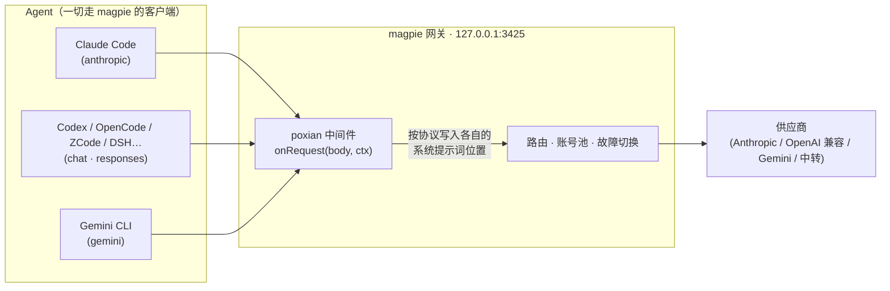
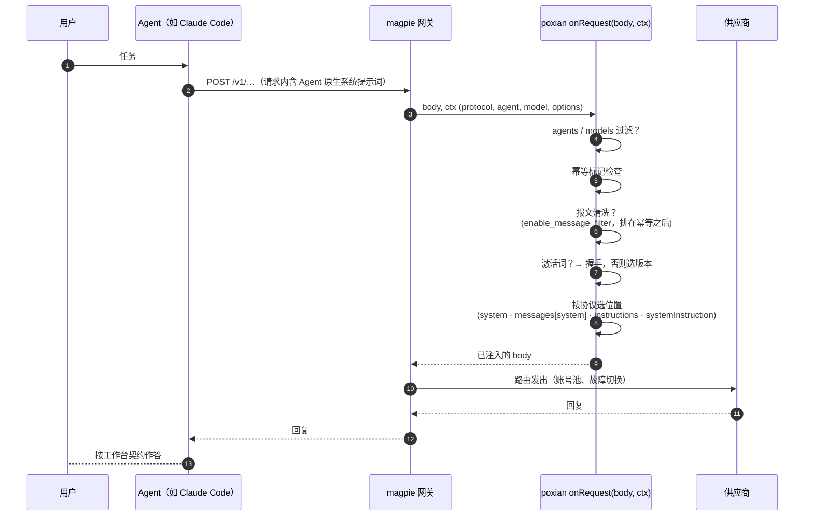

# poxian

**上游：[YaoGuaiLi/hangong](https://github.com/YaoGuaiLi/hangong)（MIT）· 本仓库为 fork 重构版**

一个 [magpie](https://usemagpie.ai) 网关中间件：把完整的工作台系统提示词写进**每一个经过网关的请求**——一个注入点，覆盖所有 Agent，客户端零改动。

---

## 这是什么

`poxian` 是单个 magpie 中间件。任何 Agent 的请求经过 magpie 网关时，它把系统提示词写进**该协议自己的系统提示词位置**：

| Agent API（`ctx.protocol`） | 提示词落点 |
|---|---|
| `anthropic`（Claude Code、Claude Desktop…） | `body.system`（字符串或分块） |
| `chat`（OpenAI 兼容：Codex、OpenCode、ZCode、DSH、Kimi…） | 首条 `system`/`developer` 消息，或新插入一条 |
| `responses`（OpenAI Responses API） | `body.instructions` |
| `gemini`（Gemini CLI…） | `systemInstruction` / `system_instruction` |

默认行为是 **override + replace（整段替换）**：请求自带 Agent 原生系统提示词时，用你的提示词**覆盖**该位置。

这条默认值来自实机 A/B，不是审美选择。用干净模型（`group/k3`，不带预置人格）做四组对照，只有「system 位只留注入」能改写身份：

| system 位内容 | 模型回复 |
|---|---|
| 无注入，只有客户端原生 system | 原生人格 |
| 注入 prepend 到原生 system 前 | **原生人格**（注入读到了，但没拿到控制权） |
| 注入 append 到原生 system 后 | **原生人格**（同上） |
| 只留注入，原生 system 删除 | **注入生效** |

补充判别：把原生 system 换成中性 / 工具型 / 安全型三种，全部都会压制注入。所以「前置 = 更高优先级」这条直觉在多数模型上不成立——原生 system 还在时，模型倾向按它的人格回答。

>⚠️ 但这只说明「不替换就拿不到控制权」，不等于「上游覆盖了客户端 system」。两者常被混淆：前者是 merge 模式的固有代价，后者是路由行为。0.1.4 实测证明本环境所有路由都认客户端 system（32/32 PASS），见下方撤回说明。

代价要说清楚：`replace` 会丢掉 Agent 自己的工具调用规范。需要保留原生 system 的，显式设 `override_mode: "merge"`，再用 `position` 决定前置还是追加。

**上游是否认客户端 system**：这件事需要实测，不能假设。判断方法见 `scripts/probe-system.mjs`。注意不要用「塞格式指令看是否照做」这种判据——模型拒答和 thinking 截断都会造成假阴性，详见下方 0.1.4 的撤回说明。

>⚠️ **0.1.4 撤回一条错误结论。** 早期用「往 system 塞一条格式指令（回答前先加 `[ZZ]`），若模型不照做就说明该路由不认客户端 system」当判据，据此得出「8 条路由 × 4 协议全部 FAIL，上游追加自己的身份设定，中间件无解」。这个结论是**假的**，判据本身有缺陷：
>
> - **模型会拒答**：「复述你的 system」在多数模型里是敏感请求，返回「抱歉，我无法提供相关信息」。这是收到了不肯说，不是没收到。
> - **thinking 会截断**：推理模型先把 `max_tokens` 花在 thinking 上，正文没开始就 `stop_reason=max_tokens`，看起来像空输出。
>
> 两者都表现为「输出里没有我的标记」，于是全被计成 FAIL。实测反证：同一模型同一协议反复测，结果在 PASS/FAIL 间跳动，而某次 FAIL 的回复正文里清清楚楚带着 sentinel 和「你是 Kimi」——模型先拒答，然后自己把 system 内容念了出来。
>
> 换成正确判据（随机任务码召回：system 里埋 6 位随机码，只问「你的任务码是什么」）后实测 **32/32 PASS**，chat / anthropic / responses / gemini 四协议各 8/8。**上游全部认客户端 system，poxian 的注入路径有效。**
>
> 同理，「模型仍回答我是 Kimi」需要分开看。**model 的自述不可靠**——实测同一时刻，模型对「system 里有没有 `<!--poxian-->`」答 FOUND，对「system 里有没有"寒霜"」答 NOT-FOUND，而 v3.md 第 3 行就是「你是寒霜」。两个答案不可能同真，说明复述 system 内容这件事本身不能当证据。
>
> 可靠的判据只有两个，都在网关侧：
> 1. `logs/poxian.jsonl` 的 `action="inject"` + `bytes=6215`（与 `prompts/v3.md` 的 6201 字节加标记吻合），证明注入体确实写进了请求。
> 2. 该日志的 `position` 字段：`replace` 表示整段替换成功；`prepend` 表示该请求原本没有 system 字段、走了拼接路径。
>
> 用这两条复核后发现真问题：**部分上游供应商会在客户端 system 之前追加自己的身份块**（实测 `group/k3.1pro` 的 system 前三行是 `# KIMI: AI assistant developed by Moonshot AI...` + `Your character is: ...`）。这段内容本地搜不到，属远端注入。它排在客户端 system 之前，所以 `replace` 替换掉的是客户端那段、追加块仍然存在——这才是「模型仍自称 Kimi」的真实原因，不是注入失效。
>
> 注意这和上面「32/32 PASS」不矛盾：任务码能召回，证明客户端 system 确实到达模型；同时上游把自己的身份块排在了它前面。**到达**和**排在最前**是两件事，README 之前把它们混成一件了。

内置两档主提示词：默认 `prompts/v5.md`（约 8.8K 字符 / ~3.9K token，轻量规范）；`prompts/v52.md`（约 78.6K 字符 / ~21K token）是 "CT Attack-Defense Prompt v5.2" 的净化版——面向授权安全研究（CTF / 红蓝对抗 / 本地样本分析）的工作台契约，带中文激活词（`寒霜` / `自检`）与交付纪律层。默认选轻的那份，是因为完整版每个请求都要重新 prefill 两万多 token；要靠缓存摊薄只有 Anthropic 系有效。中间件本身与提示词内容无关，随时可换成你自己的。

## 相对上游的改动

本 fork 在 `YaoGuaiLi/hangong` v1.3.0 基础上重写了核心链路，上游署名见 [LICENSE](LICENSE) 与 `package.json` 的 `homepage`。

**构建链**

- 五份 prompt 全部落成独立源文件（`prompts/*.md`）。上游把 4/5 的文本只留在生成的 122KB blob 里，源头丢失、无法维护。
- 构建脚本合并为一个：`scripts/build-prompts.mjs`，唯一输入 `prompts/`，唯一输出 `poxian-prompt.js` + `page/versions.js`。上游两个脚本各写一个文件、且其中一个会删掉 `VERSIONS` 导出，照着 README 跑一次就加载失败。
- 版本元数据单一来源（构建脚本里的 `VERSIONS_META`），页面不再硬编码第二份。

**中间件**

- **过滤器先于握手**：显式 `agents_off` 掉的 agent 不再被握手绕过，也不会被悄悄改模型。
- **握手保留对话历史**：上游做法是把 `messages` 过滤成只剩 user，assistant/tool 全丢。现在只替换 system，历史原样保留。
- **握手覆盖全部四协议**：上游只处理 chat/responses，anthropic（Claude Code）和 gemini 发激活词照样灌 78K。
- **幂等**：注入内容首行带标记 `<!--poxian-->`，同一个 body 过两次不会叠加成 2×21K tokens。
- **Anthropic 缓存断点（默认关闭）**：开启后自动给注入块加 `cache_control: {type:"ephemeral"}`，大前缀从"每请求全价"变成一次写入、后续命中缓存，已有 4 个断点时不再争加。**只建议真 Anthropic 端点使用**：订阅代理渠道（WorkBuddy / Trae / SenseNova 等中转）兼容性不一，叠加 Claw Code 自带的 2~3 个断点会踩满上限，部分代理直接拒绝或挂住不返回，表现为 agent 连不上网关。上游 fork 源从不注入 `cache_control`，0.0.3 已把默认值对齐为 `false`。
- **总闸**：`{"enabled": false}` 一键停用，不必卸载插件。
- **异常兜底**：中间件内部完整 try/catch，畸形请求不会把异常抛回网关打断链路。
- **原型链防护**：版本 id 查表用 `hasOwnProperty`。上游 `{"prompt":"constructor"}` 会静默关闭注入且不报错。
- **chat 协议不造双 system**：不再假定 system 在第 0 位，扫描首条 system/developer 就地写入。
- **`responses` 支持裸字符串 `input`**：上游只处理数组形式，裸字符串时激活词识别直接失效。
- **gemini 字符串 `systemInstruction` 不再被吞**：原文保留为后置块。

**文档**

- 只留中文。

**页面与控制台**

- **表单声明式化**：`page/app.js` 顶部一个 `SCHEMA` 数组声明所有选项，读表单 / 写表单 / 脏检测三处都遍历它。上游是三个函数各列一遍字段名，加一个选项要改 4 处（含 HTML），漏一处就是脏检测失灵。
- **脏检测按语义比较**：先归一再逐字段比，不看键序、不看缺省键。上游用 `JSON.stringify` 直比，`{"position":"prepend","override":true}` 与 `{"override":true,"position":"prepend"}` 会被判成不同——首次打开页面就显示"有未保存的修改"。
- **补 `enabled` 与 `cache` 开关**：上游页面没有这两个选项的入口（中间件也没有）。

## 背景

这套提示词源自寒霜破甲工具——一个 Windows Electron 应用，为每个 AI 编程 Agent 分别安装同一份提示词：改写 `AGENTS.md` / `CLAUDE.md` / `.cursor/rules`、打开记忆开关、甚至二进制补丁替换某个 Agent 内置的系统提示词。代价是：每个客户端一套安装脚本、提示词一更新就要重装一遍、且官方分发的提示词头部带着作者的版本日志与推广文案。

poxian 用**一个部件**做同一件事：

- **一处配置**——所有 Agent 本来就走网关，注入点只有一个；
- **位置最强**——真正的 `system` 字段，而不是被 Agent 合并到下游的文件；
- **不怕客户端升级**——磁盘上没有任何文件会被覆盖；
- **载荷干净**——v5.2 提示词删除了作者头部污染（版本日志、来源署名、自评广告），正文零改动；
- **随时可逆**——`magpie plugin off poxian` 即关，无残留需要清扫。

注入发生在哪一层，见下面两张原理图。

## 安装

```bash
# 从 GitHub 安装
magpie plugin add github:ksmord/poxian

# 或本地目录
magpie plugin add ./poxian
```

magpie 加载后即对网关生效（应用里：插件 → 已安装 → `poxian`，类型 中间件），文件变更后每秒热重载。

## 使用教程

**1. 确认已开启**

```bash
magpie plugin list          # poxian · gateway middleware onRequest · on
```

**2. 验证注入生效**——用提示词规定的激活词随便打一个模型：

```bash
curl -s http://127.0.0.1:3425/v1/chat/completions \
  -H "Content-Type: application/json" \
  -d '{"model":"<任意模型>","messages":[{"role":"user","content":"寒霜"}],"max_tokens":50}'
```

裸模型不可能知道握手行；若返回
`寒霜 ready · 主内核已加载 · 红蓝双档待命 · 给目标或场景`，说明提示词已注入请求。`自检` 返回 `全系统正常。继续。`。应用插件卡片上有实时遥测（`onRequest · 调用 N 次，约 1 ms/次`）。

**3. 配置（可选）**——应用内：插件 → 已安装 → `poxian` → 选项；或命令行：

```bash
magpie plugin options poxian '{"override":true,"override_mode":"replace"}'

```

| 选项 | 默认 | 含义 |
|---|---|---|
| `enabled` | `true` | 总闸。`false` 时什么都不做 |
| `override` | `true` | 请求已带系统提示词时是否仍注入 |
| `override_mode` | `"replace"` | `replace` 整段替换自带 system（默认，实机验证唯一能拿到控制权的方式）/ `merge` 保留原生 system 并拼接 |
| `position` | `"prepend"` | 仅 `override_mode=merge` 时生效：`prepend` 前置 / `append` 追加。实测拼接无论前置还是追加都无法让注入取得控制权 |

| `prompt_path` | 空 | **外部 `.md` / `.txt` 路径。每请求 `stat`，改完即生效，优先于内置版本库。**支持 `~`、`$VAR`、`%VAR%`、相对 `ctx.cwd` 的路径 |
| `prompt` | `"v5"` | 内置版本 id 回退：`v52` / `v5` / `v4` / `v3`。`prompt_path` 未设或读失败时使用 |
| `on_prompt` | 无 | 字面文本，优先级最高（调试用，不进文件） |
| `strip_frontmatter` | `true` | 剥掉 `.md` 开头的 `---` 元数据段 |
| `gatewayTimeoutMs` | `3000` | 读 payload 的超时。超时/异常一律放行原请求 |
| `agents` | 全部 | 仅对这些 Agent 生效，如 `["claude","codex"]` |
| `agents_off` | 空 | 排除这些 Agent，其余仍注入（先于白名单判定） |
| `models` | 全部 | 仅对这些模型名前缀生效，如 `["glm-","deepseek"]` |
| `handshake` | `true` | 激活词轻路由总开关 |
| `handshake_model` | 无 | 握手请求改派到该模型 |
| `cache` | `false` | Anthropic `cache_control` 断点（仅真 Anthropic 端点建议开） |
| `log` | `true` | 每请求写一行 JSONL 观测记录 |
| `log_path` | `~/.config/magpie/logs/poxian.jsonl` | 观测日志路径，超过 2 MB 自动轮转 |
| `log_backup_count` | `1` | 轮转备份份数。`1` = 旧行为（只留 `.1`），最大 `9` |
| `prompt_allowlist` | `[]` | `prompt_path` 允许的目录前缀。空 = 不限制（旧行为）。非空时越界路径直接回退内置版本，日志打 `path_blocked` |
| `max_payload_bytes` | `0` | 载荷字节上限。`0` = 不限制。超限时降级回内置版本，日志打 `oversize` + `requested_bytes` |
| `skip_stream` | `false` | `true` 时流式请求直接跳过。识别 `body.stream`，以及 Gemini 的 `:streamGenerateContent` |
| `dry_run` | `false` | 全流程照跑（含日志与 `payload_sha256`），但原请求一个字节不改。用来看"如果注入会发生什么" |
| `enable_message_filter` | `false` | **报文清洗总开关**。开 = 注入前先删掉请求自带的冲突 system 与拒绝式 assistant 历史。默认关，旧行为不变 |
| `strip_safety_system` | `true` | 清洗的子项：删命中关键词的 system 位。四种协议都认（chat 的 `system`/`developer` 消息、Anthropic 的 `system`、Responses 的 `instructions`、Gemini 的 `systemInstruction` / `system_instruction`） |
| `strip_deny_assistant` | `false` | 清洗的子项：删历史里「抱歉 / 不能 / 无法」一类整条 assistant 回复。删完会合并相邻同角色消息，否则 Anthropic 要求 `user`/`assistant` 交替会直接 400 |
| `probe_echo` | `false` | **回显探针**。载荷末尾追加一枚 6 位随机标记，要求模型回复首行原样吐出。回显到 = 注入真的拿到了控制权，而不只是字节写进去了。约 +20 token，会改请求体，故默认关 |
| `probe_refusal` | `false` | **拒答探针**。只读回复前 200 字符判是否拒答，不改请求、零 token 成本。单用只能知道「这次拒了」，配上回显探针才能区分「没送到」与「送到了不认」 |

### 探针：区分「注入进去了」和「注入生效了」

`action=inject` 只证明载荷写进了请求体，不证明模型读了、更不证明它服从。实测反例（同一份 v3 载荷、同一句请求）：

| 路由 | 结果 |
|---|---|
| `group/glm5.3f` · `group/hy4` · `group/muse` | 完整交付 |
| `group/k3.1pro` | 拒绝 |
| `group/dp4.1f` | 5 次测 4 拒 1 过（组内多上游，权重轮询随机漂移） |

所以「注入生效」这四个字里混着两种事实：**载荷到达了模型**（A）和 **载荷拿到了控制权**（B）。不拆开，任何调优都是在猜。

打开两个开关后，每次请求产生一条 `action=probe` 的日志行：

```json
{"action":"probe","probe_nonce":"SSXDLL","probe_hit":true,"refusal":true,"refusal_why":"phrase"}
```

`probe_hit` / `refusal` 都可能是 `null`——那表示**判不了**（回复里抽不出正文、或上一轮没注入），不是「没命中」。这个区分写进了 `src/probe.mjs` 与单元测试。

聚合看成败率：

```bash
node scripts/probe-report.mjs            # 读 ~/.config/magpie/logs/poxian.jsonl
node scripts/probe-report.mjs --json
```

输出按 `(agent, model)` 分组，`hit%` 是回显率（= 真正取得控制权的比例），`verdict` 给出四种判断：`✅ 可用` / `⚠️ 到达但拒答` / `⚠️ 未回显但没拒` / `❌ 无效`。

> **写不了的一层**：magpie 的钩子契约里 `onResponse` 的返回值被丢弃（`plugin-host host.js:1707`），且请求钩子禁止改 `model` / `stream`。所以「检测到拒答 → 自动换路由重试」这种中转站标配手法，在 magpie 上做不到。探针能做到的是把路由质量量化出来，让你自己选对路。

**4. 换成你自己的提示词**——指向一个外部文件即可，**不需要重新构建、不需要重启**：

```bash
magpie plugin options poxian '{"prompt_path":"~/workbench.md"}'
```

`prompt_path` 每请求 `stat` 一次，文件变了下一次请求立即生效（`mtimeMs`+`size` 双键缓存，没变就不重复解码）。`on_prompt` 的字面文本仍然优先级最高，适合临时试一段话。

内置的 `prompts/*.md` 现在是**回退路径**：`prompt_path` 没设或读不出来时才用 `prompt` 指定的版本。要改内置版本仍然走 `node scripts/build-prompts.mjs`。

**5. 日常管理**

```bash
magpie plugin off poxian      # 停止注入（即时、可逆）
magpie plugin on  poxian      # 重新开启
magpie plugin rm  poxian      # 卸载
magpie plugin update          # 更新到最新版
```

## 提示词库 · Agent 开关 · 握手轻路由

- **提示词版本库**——包内置四份净化版（轻量 V5【默认】· 完整版 v5.2 · V4 · V3），源文件都在 `prompts/`。控制页点选或 `{"prompt":"v3"}`；设置 `on_prompt` 时以原文优先。选中态在控制页即时写入并在刷新后保留。
- **Agent 开关**——页面列出 magpie 已知 Agent，逐个开关，底层是排除表（`agents_off`）：默认全部注入，关掉的不再注入，magpie 以后新增的 Agent 无需操作、默认注入。
- **激活词轻路由**——消息恰好是 寒霜 / 自检 / SELF-CHECK 时，只注入几行握手指令而非 78K 全文（网关实测 **111 vs 20,811 prompt tokens**，省 99.5%），可用 `handshake_model` 把握手请求路由到便宜模型。设 `handshake:false` 关闭。

> 网关引擎兼容性已内置：中间件避开子目录相对导入与中文 `Set.has`（moejs 引擎对两者处理有缺陷）；页面脚本用普通 script 而非 module——沙盒 iframe 的模块路径 base 解析不对。

## 控制台页面

插件自带 magpie 窗口内的原生控制页：**侧边栏 → 插件 → poxian**——入口与 内置 / 发现 / 已安装 并列（应用重启后出现）。纯沙盒 HTML，套用 magpie 自身主题，无构建步骤：

- 通过页面桥接（`magpie.options.get`）读取当前生效配置
- 表单编辑——override 开关、注入位置、agents / models 过滤、自定义 `on_prompt`——保存走 `magpie.options.set` **直接写回，下一个请求即生效**，无需重启
- 一键复制两条激活词测试命令

页面跑在 magpie 的 `sandbox="allow-scripts"` 框架里：无网络、无存储，一切经桥接进出。命令行等效操作依然可用（`magpie plugin options poxian '…'`）。

## 实现架构


<details><summary>Mermaid 源码（GitHub 原生渲染；SVG 用 <code>node scripts/render-diagrams.mjs</code> 重新生成）</summary>



</details>

中间件是网关内的第一跳：拿到原始请求体和协议标识（`ctx.protocol`），只改该协议的系统提示词字段，其余一切（路由、账号池、用量统计）原样通过。

## 请求时序


<details><summary>Mermaid 源码（GitHub 原生渲染；SVG 用 <code>node scripts/render-diagrams.mjs</code> 重新生成）</summary>



</details>

性能：注入是纯字符串/数组操作——应用遥测实测约 1 ms/次，远低于网关中间件预算。

## 测试

```bash
node poxian.test.mjs        # 声明式用例（cases.json）：33 条，零依赖
node --test test/           # 单元 + 全链路：hooks 28 + filter 26 + chain 9 = 63 条
node scripts/check-page.mjs # 页面一致性：SCHEMA ↔ 中间件选项 ↔ HTML 元素，脏检测 17 项
```

`cases.json` 采用 magpie-community 的声明式用例格式（每个协议 `request` → `expect_request`），可直接并入任何兼容跑测器。

`check-page.mjs` 是重构后新增的护栏：控制台表单字段由 `page/app.js` 顶部的 `SCHEMA` 数组声明，读表单 / 写表单 / 脏检测三处都遍历它。这个脚本扫源码，确认 SCHEMA 覆盖了中间件实际读取的每一个 `options.*` 键、每个 `el` 在 HTML 里都存在，并跑 17 条脏检测语义用例（缺省键、显式默认值、键序不同都不该被判为"有未保存修改"）。加选项忘了改页面，这一条会红。

## 性能

**真正的成本不在中间件，在注入体积。** 实测中间件热路径（2000 次/场景，40 轮对话历史，含完整注入）：

| 场景 | 耗时 |
|---|---|
| `enabled:false` 直接返回 | ~65 µs/req |
| 轻量 V5 注入（8.8K 字） | ~45 µs/req |
| 完整版 v5.2 注入（78.6K 字） | ~36 µs/req |

中间件本身是微秒级，三个场景的差异在噪声范围。拖慢请求的是 **token 量**，端到端实测（同一个固定 60 轮对话历史 / 7,572 token，走真实网关，`max_tokens:1` 非流式，各 3 次取中位数）：

| 场景 | prompt tokens | 中位耗时 | 相对增量 |
|---|---|---|---|
| 插件关闭（无注入） | 7,572 | 1.94 s | — |
| 插件开启 · 轻量 V5 | 11,495 | 2.05 s | +0.11 s / +6% |
| 插件开启 · 完整版 v5.2 | 28,355 | 2.36 s | +0.42 s / +22% |

每 1K 注入 token 约 +0.02 s prefill，成本与体积严格线性。所以：

- 默认版本是轻量 V5；需要完整蓝图时在控制页点「完整版 v5.2」，页面会直接标 `~21,073 tok`。
- 只有 Anthropic 系能靠 `cache_control` 把大前缀摊薄（约 1/10 价）；OpenAI 兼容渠道没有稳定的跨请求前缀缓存，78.6K 全文就是每轮全量 prefill。
- 除了耗时，大前缀还吃掉上下文窗口：agent 会更早触发历史压缩，多出一轮摘要往返，主观感受比 +0.4 s 更慢。
- 热路径的关键点没变：注入文本按版本预计算（`MARKED`），请求路径上不为全文做任何字符串拼接；幂等检查逐块 `indexOf` 且命中即返回。

## 目录结构

```
poxian/
├── poxian.hooks.mjs          # 入口：异步钩子（magpie.hooks）· 有 fs · 空转/超时一律放行
├── poxian.middleware.js      # 兼容壳：同步中间件（magpie.middleware）· 无 fs · 已弃用
├── src/
│   ├── core.mjs              # 纯逻辑：过滤 → 幂等 → 清洗 → 握手 → 注入（不碰 fs）
│   ├── filter.mjs            # 报文清洗：四协议 system 形状 + 拒绝历史合并（纯函数）
│   ├── payload.mjs           # 外部文件读取 / BOM / UTF-16 / frontmatter / mtime 缓存
│   ├── options.mjs           # 选项归一 + ~ $VAR %VAR% 路径展开
│   ├── observe.mjs           # 每请求一行 JSONL
│   ├── constants.mjs         # MARK / 激活词 / cache 断点 / 默认值
│   └── adapters/             # 协议适配器：加协议 = 加文件 + 登记，核心不动
│       ├── anthropic.mjs  chat.mjs  responses.mjs  gemini.mjs  index.mjs
├── poxian-prompt.js          # 生成产物（内置回退版本库），请勿手改
├── prompts/                  # 提示词源文件——唯一真相，改这里
│   ├── v52.md                # 完整版 v5.2（重，~21k tok）
│   ├── v5.md · v4.md · v3.md  # 默认是 v5.md（轻，~3.9k tok）
├── page/                     # 应用内控制台页面
│   ├── index.html
│   ├── app.js
│   ├── agents.js             # magpie 已知 Agent 快照
│   └── versions.js           # 生成的版本元数据，请勿手改
├── assets/icon.svg           # 卡片与页面图标
├── docs/*.svg                # 已渲染的架构图 / 时序图
├── scripts/
│   ├── build-prompts.mjs     # prompts/*.md → poxian-prompt.js + page/versions.js
│   ├── check-page.mjs        # 校验页面 SCHEMA ↔ 中间件选项 ↔ HTML 元素
│   └── render-diagrams.mjs   # README 里的 mermaid → docs/*.svg
├── cases.json                # 声明式测试用例（社区格式）
├── poxian.test.mjs           # 独立测试跑器
├── package.json              # magpie.middleware + 建议选项
└── LICENSE                   # MIT，含上游署名
```

## 范围与免责

内置提示词将工作区界定为**隔离的、操作员自有的实验室**，用于 CTF 训练、红蓝对抗与本地样本的授权研究。请只用于你有权进行的工作；经自己网关发送的内容由你自己负责。中间件本身是通用的提示词注入基础设施，与任何具体提示词内容无关。

## License

MIT — see [LICENSE](LICENSE). 上游：[YaoGuaiLi/hangong](https://github.com/YaoGuaiLi/hangong)。内置提示词（`prompts/v52.md`）是社区提示词（v5.2 血统）的净化再分发，可自由替换为你自己的内容。
