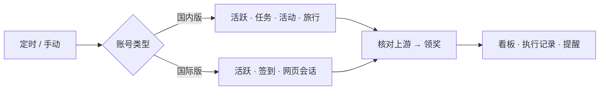

<div align="center">

# WorkBuddy Plus

**Magpie 的 WorkBuddy 补充插件（国内版 + 国际版）**<br>
成长任务、猫猫旅行、连登福利、后台定时，加上一块看得清所有账号的看板。

[](https://github.com/sabercomo/magpie-workbuddy-plus/actions/workflows/test.yml)
[](LICENSE)

**简体中文** · [English](README.en.md)

觉得有用的话，点个 ⭐ Star 支持一下，也方便下次找到它。


</div>

> [!NOTE]
> 非官方项目，支持 WorkBuddy 国内版（Magpie 中的 `workbuddy` 账号）和国际版 WorkBuddy AI（`workbuddy-ai` 账号）。账号登录、模型和 API 转发仍由 Magpie 的 WorkBuddy 插件负责；**国内版的每日签到由 Magpie 负责**，本插件不调用国内签到接口；国际版 Magpie 不签到，由本插件在国际版有签到活动时签到。

## 一眼看懂

<table>
  <tr><td><strong>装上就能用</strong></td><td><code>magpie plugin add</code> 一条命令。Magpie 启动时自动拉起后台服务，侧栏多出「WorkBuddy Plus」页面。</td></tr>
  <tr><td><strong>自动做任务</strong></td><td>连登活跃、成长任务接取与领奖、运营活动任务、补领清扫、猫猫旅行派出与领奖、连登福利、夜猫子任务，按时段自动执行，失败自动重试。</td></tr>
  <tr><td><strong>账号看板</strong></td><td>每个账号的可用积分、哪笔积分什么时候作废、近 7 天用量、旅行与任务进度，五种视图随时切换；导航默认横排，标题左侧的固定按钮可切换成左侧栏并记住选择。</td></tr>
  <tr><td><strong>看清哪些模型能用</strong></td><td>「模型」视图列出国内版和国际版（添加了企业账号时还有企业）的模型、模型 ID、原生推理档位、上下文和积分倍率，把国际版只给 Pro 的模型单独收起来，标出订阅优先和限时优惠。</td></tr>
  <tr><td><strong>国际版也领</strong></td><td>在 Magpie 登录了 WorkBuddy AI 的，国际版账号同样每天活跃、兑换连登档位，有签到活动时自动签到。国际版有自己的定时开关和时段，和国内版互不影响。</td></tr>
  <tr><td><strong>提醒你该做的</strong></td><td>快作废的积分、企业额度重置、已过期的登录，集中列在看板底部；模型额度用完或排队单独成一张「模型额度监控与防限流路由」卡片。</td></tr>
  <tr><td><strong>添加账号</strong></td><td>选国内版或国际版，直接打开 Magpie 官方 WorkBuddy 插件的浏览器登录，登录和续期仍由 Magpie 负责。</td></tr>
  <tr><td><strong>多设备管理账号（试用）</strong></td><td>在 Magpie 的「WorkBuddy Plus → 设置 → 账号同步」共享勾选的账号、查看设备状态，也可更换同步主机。使用 Magpie 已配置的私有存储，默认关闭。 <a href="#多设备管理账号">操作说明</a></td></tr>
</table>

## 截图

截图是插件页面在 Magpie 浅色和深色主题下的样子，账号与数据均为演示用的虚构内容（`sh docs/screenshots.sh` 可重新生成）。

<table>
  <tr>
    <td width="50%"><br><sub><b>主页面 · 列表</b>：国内版、国际版分组展示积分、今日圆环和近 7 天走势，点开账号看完整详情</sub></td>
    <td width="50%"><br><sub><b>任务</b>：按账号列出成长任务与进度，账号卡多列自然高度、短卡不拉伸；下方猫猫旅行 + Buddy 盲盒、官方补偿 + 运营活动两两并列，逐号处理；账号卡和四张工作卡都能拖动排序</sub></td>
  </tr>
  <tr>
    <td colspan="2"><br><sub><b>账号与健康</b>：筛选全部、国内个人、国际个人、企业或异常账号；点开看失败诊断，勾选后三个批量按钮始终等宽单行</sub></td>
  </tr>
  <tr>
    <td width="50%"><br><sub><b>圆环</b>：每个账号今日活跃、旅行、任务三环，点开看一个账号的积分作废时间线和用量</sub></td>
    <td width="50%"><br><sub><b>小组件</b>：按一件事一块汇总所有账号</sub></td>
  </tr>
  <tr>
    <td width="50%"><br><sub><b>模型 · 国内版</b>：每个模型的 ID、原生推理档位、上下文和倍率，标出订阅优先、限时免费和夜间折扣</sub></td>
    <td width="50%"><br><sub><b>模型 · 国际版</b>：Free 账号能用的模型在前，Pro-only 模型变灰收在下面</sub></td>
  </tr>
  <tr>
    <td width="50%"><br><sub><b>模型 · 企业</b>：添加了企业账号才出现，列出企业自己能用的模型</sub></td>
    <td width="50%"><br><sub><b>底部提醒</b>：模型额度、登录过期、临期积分和网络暂停按原因分组列出，其他提醒默认收起</sub></td>
  </tr>
  <tr>
    <td colspan="2"><br><sub><b>深色模式</b>：跟随 Magpie 的主题</sub></td>
  </tr>
</table>

## 安装

先在 Magpie 安装官方 WorkBuddy 插件、登录国内账号并开启每日自动签到；不需要给本项目重新提供账号密码。

在 Magpie「插件 → 发现 → 非官方」中搜索本项目，或者直接安装：

```sh
magpie plugin add github:sabercomo/magpie-workbuddy-plus
```

然后在 Magpie 侧栏打开「WorkBuddy Plus」（或打开 **http://127.0.0.1:3439**），确认账号列表，在「今日定时」里把「国内版」「国际版」两排右边的开关打开（深绿是运行中，灰色是已暂停）。**首次安装默认两个都暂停**；手动操作不受定时开关影响。

Magpie 启动或重载插件时，插件会检查本机服务，没在运行就从插件目录启动它。服务独立运行：页面按钮让 Magpie 重载插件、插件更新，都不会打断正在执行的任务；退出 Magpie 后服务继续运行到注销或关机。要登录时自动开始，开启 Magpie 的登录启动（`magpie autostart on`），或使用下面的后台安装。

<details>
<summary><b>可选：macOS 登录后独立运行（不开 Magpie 也执行）</b></summary>

需要 Git 和 Bun 1.3+，且 `magpie`、`bun` 命令可在终端使用。

```sh
git clone https://github.com/sabercomo/magpie-workbuddy-plus.git
cd magpie-workbuddy-plus
bun install.mjs
```

安装器会把运行文件复制到 `~/Applications/Magpie-WorkBuddy-Plus`，注册 Magpie 插件，并创建登录后自动启动的 macOS LaunchAgent；同一安装目录已有的其他 LaunchAgent 会被停用并改名为 `.replaced`。安装后可删除下载的源码目录。

同一时间只有一个服务占用端口：LaunchAgent 和 Magpie 同时启动服务时，后启动的那个待命，等前一个退出后再接手，不会重复执行。电脑休眠时暂停，唤醒并恢复联网后补跑当天已经到点的任务；夜猫子任务只能在有效夜间窗口执行。关机期间不执行。

</details>

<details>
<summary><b>Windows 与其他平台</b></summary>

Windows、Linux 同样用 `magpie plugin add` 安装，由 Magpie 启动服务；上面的 `bun install.mjs` 只用于 macOS，在其他系统上会直接报错退出。Windows 10 上已用 Magpie 安装运行验证；Linux 尚未验收。

Windows 上用系统自带的 Windows PowerShell 和 WMI 独立启动后台。Magpie 重载插件时，同版本的后台继续监听本机端口。

Windows 会为 Hyper-V、WSL 等保留一些端口范围，默认端口 3439 可能落在里面，也可能被其他程序（包括 Windows 自带的 HTTP 服务）占用。这时服务不会启动，并在 `%USERPROFILE%\.config\workbuddy-plus\service.log` 里写明原因。用 `netsh interface ipv4 show excludedportrange protocol=tcp` 查看保留范围，然后换一个不在范围内的端口（见「设置与数据」中的端口）。

如果本机面板连接超时，用 PowerShell 检查监听和 TCP 连通性。改过端口时，把两条命令里的 `3439` 换成实际端口。

```powershell
Get-NetTCPConnection -LocalAddress 127.0.0.1 -LocalPort 3439 -State Listen
Test-NetConnection 127.0.0.1 -Port 3439
```

如果仍在监听，但 `TcpTestSucceeded` 为 `False`，可用 `Get-Process -Id <OwningProcess> | Select-Object Id, Path` 核对进程路径，再检查 Windows 防火墙或终端安全软件对该进程的规则。需要添加允许规则时，由管理员将范围限定到实际的 `magpie-bun.exe`、本机回环地址和 Plus 端口，然后重试本机面板和侧栏。无需开启定时或执行任务。 [Windows TCP 排查](https://learn.microsoft.com/en-us/troubleshoot/windows-client/networking/tcp-ip-connectivity-issues-troubleshooting)

想不开 Magpie 也运行时，安装 Bun 并登录国内账号后，在源码目录运行：

```sh
bun server.mjs
```

保持进程运行，并在面板开启定时。开机自启需要自行配置所在系统的后台服务；这部分尚未完成跨平台验收。

</details>

## 功能

- **自动任务**：国内版处理成长任务、猫猫旅行和连登福利；国际版单独安排活跃和连登奖励，有签到活动时也会签到。国内版每日签到仍由 Magpie 负责。
- **多账号看板**：集中查积分余额、到期时间和近 7 天用量；个人积分与企业额度分开显示。
- **任务与账号健康**：在「任务」查看国内个人账号的进度、单独执行或补领奖励；在「账号与健康」查看异常、重试或暂停账号任务。
- **模型目录**：查看国内版、国际版和企业账号能用的模型、推理档位、上下文及积分倍率。

[截图](#截图) · [默认定时](#默认定时) · [设置与数据](#设置与数据)

> [!IMPORTANT]
> - 成长任务包含模拟客户端事件上报，不代表实际在桌面端完成操作。
> - 是否计入进度、发放奖励或限制账号由上游决定，不保证所有任务都能完成。
> - 活动 App 对话与国际版网页会话可能扣积分，开盲盒会消耗成长能量。

<details>
<summary>查看完整功能</summary>

- 公众号关注、实际捐赠需要本人完成，看板不再列出；分享技能会创建真实分享渠道并上报分享结果，不会发送微信消息。只在服务端确认达标后领奖。
- 桌面端、网页端和小程序任务的事件形状参考 [workbuddy2api-panel](https://github.com/misakano7545/workbuddy2api-panel)。



| 模块 | 包括哪些操作 |
| --- | --- |
| 自动任务 | 按版本定时执行、失败重试；任务种类与各项开关见下表。 |
| 任务页 | 按账号查进度，执行成长任务，处理旅行、盲盒、补偿与活动。 |
| 看板与健康 | 用列表、圆环和小组件看账号；在「账号与健康」筛查异常、暂停或重试。 |
| 模型 | 按版本查看目录，单独显示额度用完或排队记录。 |
| 操作入口 | Magpie 侧栏、本机面板、CLI 与 MCP。 |

### 自动任务的完整规则

**国内版：成长任务与活动**

| 事项 | 执行规则 |
| --- | --- |
| 成长与连登 | 检查成长中心的连登活跃与福利。成长任务先接取、再上报，核对进度后领取；未达标不记作已领奖。 |
| 桌面端与网页端 | 支持桌面端对话、进入 Buddy 应用、企鹅教师助手，以及网页端的资料库介绍任务。 |
| 小程序任务 | `Sequential_Tasks_1`～`7` 涵盖对话、专家、GLM5.2、创建定时任务、10 次对话和 PC 灵感。一天解锁一个，前一项领奖后才能接下一项。 |
| 小程序对话间隔 | 每次约间隔 45 秒；连发会被上游回滚。 |
| 新专家任务 | 从任务的 `jump_url` 读取 `expertId`，兼容 `deeplink` 和 `expert_use_<slug>`；识别后自动执行，否则在对应账号标为「需手动」。 |
| 技能分享 | 创建真实分享渠道并按渠道编号上报；同一账号当天复用渠道，服务端确认达标后才领奖。关闭「自动分享技能给好友」后，批量执行会跳过，仍可单独执行。 |
| 运营活动 | 读取星巴克、记者节等活动进度，按适配情况执行对话、专家、技能与桌面任务，达标后领奖。邀请好友由本人完成；活动结束后跳过。 |
| 活动 App 对话 | 真实创建一轮云端对话，完成后领奖，**可能扣积分**。自动执行默认关闭；定时及「执行所有任务」会跳过，任务中心标「设置已关闭」，其他任务照常。 |
| 本人完成的任务 | 关注公众号、公益捐赠不显示在自动任务清单，也不计入总数；上游确认达标后仍会自动领奖。公众号关注须满 24 小时，以服务端进度为准。 |
| 补领清扫 | 只接取待接受任务、领取已达标的成长与活动奖励，不上报行为。独立于成长任务运行，也可从「立即执行」手动补领，不用逐个登录。 |

**国内版：旅行、福利与签到**

| 事项 | 执行规则 |
| --- | --- |
| 猫猫旅行 | 派出猫猫、归来领奖；首次使用处理 `first_buddy`。 |
| 连登与礼包 | 处理连登补签卡、7/14/28 天连登兑换、成长抽奖、新手礼包和活动补偿。连登补签不同于每日签到。 |
| 官方补偿 | 查询 `compensation-status` 后，只领取活动生效、未领且有额度的补偿。`active=false` 或已领取不算失败；查询失败单独显示。 |
| Buddy 盲盒 | 在「任务」页手动开盒，**消耗成长能量**。「旅行后自动开盲盒」默认关闭，开启后空闲且可派出时开一次。 |
| 盲盒状态检查 | 手动和自动都先查旅行状态；在途、归来未领奖或状态不明时跳过。已确认没有 Buddy 的账号仍可首次开盒。 |
| 成长抽奖与实物奖 | 执行记录保留奖品名。识别到实物奖或填地址标记时，「需要你处理」提醒到成长中心填地址，并可打开对应记录。提醒随本机记录跨天保留；字段需真号实测。 |
| 每日签到 | Magpie 负责领取；插件只读 `checkin-activity-status` 核对，以较晚的同日记录为准。 |
| 夜猫子任务 | 按北京时间的有效夜间窗口执行，每号每天最多上报一次。 |

技能分享、活动 App 对话和旅行后开盲盒的自动执行选项在「设置 › 任务与对话」。

**国际版（WorkBuddy AI）**

| 事项 | 执行规则 |
| --- | --- |
| 定时与连登 | 在「今日定时」单独开关与排程。每日活跃点亮热力墙、累计连登；14 天自动兑换 50 积分，28 天兑换 150 积分。 |
| 每日签到 | 举办签到活动时由插件签到；无活动时不显示。2026 年 11 月的记录为「签到活动未开启或已过期」，开启后自动生效。 |
| 每日活跃奖励 | 30 或 50 积分的 Bonus Pack。必须在网页端完成一轮对话，桌面端的活跃上报不计入。 |
| 网页会话 | 默认 10:31，每天一次。通过 workbuddy.ai 网页通道创建会话，发送「只回复一个字：好」，等一轮完成后结束；官方用量通常记两条请求。 |
| 模型与积分 | 优先选可用免费模型（限时免费的 Hy3 曾实测不扣积分）；没有可用免费模型时用 DeepSeek-V4.1-Flash（约 0.6 积分）。也可在设置中指定模型。只有建会话被明确拒绝且错误属于模型额度时才尝试备用模型；账号错误、会话已满或已经进入对话阶段的失败不会触发第二次会话。 |
| 关闭网页会话 | 在设置里关掉「每天跑一次网页会话」或清空该时段。不会通过自动会话领取这份奖励，连登照常。 |
| 到账与显示 | 实测为活跃后次日北京时间 02:00–07:00 到账；看板显示今日到账金额或「今日未到账」，积分流水记「每日活跃奖励」。 |
| 支持范围 | 「养虾」成长任务只计客户端实际使用，不模拟，不列入看板和提醒。国际版没有猫猫旅行，不请求、不记录、不显示；圆环只有活跃和成长任务。 |

**失败、休眠与重启**

| 情况 | 如何处理 |
| --- | --- |
| 同一任务连续 3 天格式校验失败 | `/v2/report` 返回 HTTP 400 时暂停该任务的自动上报；仍可手动执行，成功后解除。 |
| 网络或代理连续 3 次失败 | 连接重置（`ECONNRESET`）、超时或拒绝连接等会暂停自动任务 10 分钟；仍可手动执行，成功后解除。 |
| 唤醒或重启 | 休眠唤醒后补跑当天已经到点的时段；失败可重试，重启后避免重复执行。 |

### 看板每个视图看什么

**账号详情与积分**

| 位置 | 显示内容 |
| --- | --- |
| 更新与余额 | 看板只读，每 3 分钟刷新；Magpie 新登录或退出的国内账号半分钟内反映到看板。个人积分按版本各自汇总，最多两位小数。 |
| 企业额度 | 与个人积分分开。显示团队月额度、已用额度、重置时间和每日团队总用量；本账号的请求明细另行折叠。 |
| 积分流水 | 近 7 天逐笔到账时间、金额、来源、余量、作废日，以及按来源合计和同期扣分。同名包也逐笔算有效期，如「国内运营裂变包」每笔各有 20 天。 |
| 积分来源 | 优先显示发放原因，其次匹配执行日志的到账时间、金额或 Magpie 签到记录。对不上显示「来源未确认」；字段覆盖需真号实测。 |
| 扣分明细 | 账号详情右栏列近 7 天最近 50 次扣分请求的时间、扣分金额（两位小数）、模型和客户端。默认 10 条，点「再显示」展开。 |
| 请求合计 | 明细上方列扣分次数和免费请求次数。更早的请求只计入合计。 |
| 成长与活动 | 点「任务 x/y ▾」看能量、Buddy、连登档位和未完成任务；「活动」列各项进度与领取状态。邀请好友等手动项只在「任务」页显示。 |
| 每日签到 | 国内个人账号读 Magpie 记录，未开启或失败时会提醒。国际版显示插件结果，无活动时标「暂无签到活动」；企业账号不显示。 |

**视图与操作**

| 视图 | 怎么看、怎么用 |
| --- | --- |
| 列表与分组 | 国内、国际各一组，各有积分小计和账号数。国内组列今日完成、成长进度与 7 天消耗；国际组列每日奖励与 7 天消耗。 |
| 列表与排序 | 下方组可「移到上面」，顺序会记住并同步圆环与小组件。个人在前、企业在后；展开账号看积分包、用量、任务和旅行。 |
| 账号行 | 默认收起，分色积分条表示逐笔作废时间，同时显示今日圆环与近 7 天走势。国际账号标「国际版」。 |
| 圆环 | 一次看一个账号的活跃、旅行、任务圆环，以及积分作废时间线和用量。 |
| 小组件 | 每块汇总一项：即将作废、今日、猫猫、能量、分版本个人积分、单列企业额度、近 7 天用量和成长任务。 |
| 任务筛选 | 只列国内个人账号。筛「可领奖 / 可自动 / 需手动 / 未解锁」，可按账号或状态分组。 |
| 任务排序 | 账号卡和四张工作卡可拖动六点手柄，或用 Alt+方向键；顺序记在本机，按状态分组时仍按状态归组。多列卡片不拉伸短卡。 |
| 任务操作 | 四卡两排：旅行与 Buddy 盲盒、官方补偿与运营活动。旅行可一键收派，盲盒与补偿可逐号或批量处理，活动按状态执行或领奖。 |
| 模型目录 | 国内、国际各有目录。国际版需登录 `workbuddy-ai`；只有登录企业账号才出现企业标签，模型由对应企业配置决定。 |
| 模型展示 | 当前计划可用模型排在前，国际版 Pro-only 置灰。模型 ID 可点按复制；还显示上下文、倍率、限时免费、夜间折扣和订阅优先。倍率 3 以上标橙色。 |
| 推理档位 | 展示官方原生档位（如 `low high max`）。默认档加粗；「可关」为可关闭思考，「固定」为仅一档，「—」为官方未列出。 |

**定时、提醒与模型额度**

| 看到什么 | 含义 |
| --- | --- |
| 今日定时 | 列出每个时段的结果与下一次执行。 |
| 看板提醒 | 登录已过期、读取失败、两天内作废积分和网络或代理暂停按原因分组。「其他提醒」默认折叠，列十天内作废积分、企业额度重置和签到提醒。 |
| 额度耗尽（429 / 6004） | 模型在每个账号上有独立的 24 小时额度。真实请求被拒时记录恢复时间；不主动探测，官方也不提供剩余额度查询。 |
| 排队（429 / 6020） | 算力不足时排队，企业账号也一样。记录位置和预计等待；到时自动消失，排队模型每小时最多再查一次。 |
| 额度记录入口 | 账号详情「近 7 天用量」下，以及底部「模型额度」摘要。可展开「查看记录 / 监测说明」；没有记录不表示探测过模型。 |
| 记录来源 | 插件本身不主动发国内聊天请求；国际版网页会话真正遇到拒绝时才由它留下记录。Magpie 等工具遇到排队重试后也可能报 `exceeded retry limit, last status: 429`。 |

### 操作入口与设置

| 入口 | 可以做什么 |
| --- | --- |
| Magpie 侧栏 | 看板、账号与健康、任务、定时与记录和模型。看板标账号数；有需手动补偿、查询失败或未适配任务时，「任务」才显示待办数。 |
| 导航与视图 | 标题左侧可切换横排与侧栏并记住选择；宽窗口可拖动侧栏分隔线，窄窗口显示图标栏。看板视图切换与版本筛选同行。 |
| 刷新与定时 | 点「余额更新于」后的「刷新」。在「今日定时」按版本打开或暂停定时，不影响手动执行。 |
| 立即执行 | 从执行记录旁进入，可执行全部任务、猫猫旅行、成长任务或补领奖励。 |
| 添加账号 | 右上角选版本，由 Magpie 运行 `magpie plugin login workbuddy` 或 `magpie plugin login workbuddy-ai` 打开浏览器。同一账号重新登录会替换原记录。 |
| 账号凭证 | 登录由 Magpie 管理；插件不经手登录令牌，不提供账号文件导入和导出。 |
| 本机面板 | http://127.0.0.1:3439，仅本机可访问。可选择账号执行、查最近 100 次记录并调整时段与代理；Docker 外部打不开时，用侧栏设置。 |

右上角「设置」分为四组：

| 设置组 | 可以调整 |
| --- | --- |
| 定时 | 两边各自的时段和随机错开。 |
| 国际版 | 每日网页会话开关和模型。 |
| 任务 | 自动分享技能、旅行后自动开盲盒。 |
| 网络与时区 | 时区、默认 HTTP 代理、国际版代理。继承与直连规则见[设置与数据](#设置与数据)。 |

</details>

## 默认定时

以下时段按 `Asia/Shanghai`。在「设置」里分别改国内版和国际版的时段；清空某类时段即关闭该类任务。

| 时间 | 国内版 | 国际版 |
| --- | --- | --- |
| 01:01 | 夜猫子任务 | — |
| 09:01、21:01 | 活跃、猫猫旅行、连登福利 | 活跃、签到、连登福利 |
| 09:11、21:11 | 成长任务 | — |
| 10:01、22:11 | 补领清扫 | — |
| 10:31 | — | 网页会话（每日活跃奖励，每天一次） |

- 在「今日定时」里分开暂停两个版本的定时。国内版每日签到仍由 Magpie 负责；国际版有签到活动时，在表中的活跃时段签到。
- 时段默认随机前后错开 10 分钟。「今日定时」显示当天实际执行的时间；把「随机错开」设为 0 即可关闭。
- 定时失败至少间隔 15 分钟再试，每个时段最多尝试 3 次。

<details>
<summary>执行细节与旧版时段迁移</summary>

**执行细节**

| 事项 | 说明 |
| --- | --- |
| 检查与间隔 | 每 30 秒检查一次定时，每类最多设 24 个时段。定时执行时，账号之间随机间隔 5–45 秒；夜猫子任务始终在 23:00–08:00 内执行。 |
| 限流与去重 | 收到 HTTP 429 时先在本轮等待后重试；若仍被限流，记为「稍后重试」，不记为失败。连登活跃成功后当天不再重复，旅行和任务奖励会先核对上游状态。 |
| 旅行后开盒 | 启用「旅行后自动开盲盒」时，开盒安排在旅行领奖后、派出前，不另设时段。 |

**旧版时段迁移**

| 事项 | 说明 |
| --- | --- |
| 0.7.2 默认时段 | 升级到 0.7.2 时，只有未改过的旧默认时段会换成上表的安排；自定义时段不变。 |
| 0.5.6 或更早版本 | 从 0.5.6 或更早版本升级时，国际版沿用原有时段。缺网页会话时段时补上 10:31；原来关了「国际版任务」的，定时仍暂停。 |
| 0.5.9 与补领时段 | 从 0.5.9 起，旧配置里的国际版成长任务时段会被忽略。缺补领时段的配置会补上 10:01、22:11。 |

</details>

## 工具与终端

在「插件 → 已安装」的插件卡片中可以查看工具名并复制 Magpie MCP 地址。

| 工具 | 用途 |
| --- | --- |
| `status` | 查看国内账号、执行记录和定时设置 |
| `run` | 启动指定操作；`all` 包含活跃、成长任务、旅行和连登福利 |
| `schedules` | 查看或开关定时（`enabled` 国内版、`intlEnabled` 国际版）；具体时段在网页面板调整 |
| `board` | 查看账号看板：积分、积分包作废时间、近 7 天用量、旅行与连登 |

在源码目录或安装目录中也可以用终端：

```sh
bun cli.mjs status
bun cli.mjs run all
bun cli.mjs board
bun cli.mjs pause
bun cli.mjs resume
```

<details>
<summary>其他操作与参数</summary>

| 操作 | 命令或参数 |
| --- | --- |
| 活跃与成长任务 | `activity`、`tasks` |
| 补领、旅行与福利 | `sweep`、`travel`、`bonus` |
| 夜间任务与状态查询 | `night`、`inspect` |
| 单独执行任务 | `task` 只执行指定任务，需要任务码，例如 `{"actions":["task"],"accounts":["cn:…"],"task":"chat_5"}`。 |
| Buddy 盲盒 | `buddy` 按可开数和单次上限中的较小值开盒，消耗成长能量。 |
| 官方补偿 | `compensation` 先查状态，只领取生效、未领取且有额度的补偿。 |

执行后可用返回的编号在面板或 `status` 查看结果。

</details>

<details>
<summary>Magpie 页面是怎么工作的</summary>

| 事项 | 说明 |
| --- | --- |
| 快照与更新频率 | Magpie 的插件页面不能直接联网。它每 15 秒重新载入后台写出的 `page/data.js`；快照不含登录凭证，超过 25 分钟未更新时页面会提示。 |
| 请求交接 | 新任务写入 Magpie 选项得到及时确认、且尚无匹配回执时，侧栏只重开一次，让宿主读取原请求；不会再写一次选项。写入超时、迟到响应或恢复旧请求时不自动重开。等候 30 秒仍没有回执会显示「执行状态待确认」。任务可能已经开始；「检查状态」只重读快照并反馈读取结果，「查看执行记录」不发起任务。不要到本机面板重复运行。「后台已接收」不表示执行完成。 |
| 重开侧栏 | 侧栏恢复时只读、不重写选项，但手动打开完整页面可能唤醒宿主并交接先前保存的请求，不等同于「检查状态」。后台按请求编号复用近期回执，首次收到已满 10 分钟的请求会予以拒绝。旧请求已过期又没有回执时，侧栏解除锁定并提示先核对原任务的执行记录。 |
| 插件更新 | 插件更新后，已打开的页面会重新载入新版。 |

</details>

## 队列、执行记录与日志

「定时与记录」可以查看队列、执行记录和日志。队列按账号显示运行、排队、暂停和结果；窄窗口上下排列。


- **账号并发**：默认同时执行 1 个账号，最多 3 个。同一账号的动作仍按顺序执行。
- **重试与停止**：展开记录可看请求时间、HTTP 状态和等待时间。「现在重试」只重跑失败的账号与动作；「停止执行」也会取消排队。
- **日志**：按任务、对话或系统查看，可筛选失败。对话日志记录结果，不保存提示词。

<details>
<summary>队列、账号健康与任务页细节</summary>

| 事项 | 说明 |
| --- | --- |
| 并发变化 | 并发上限覆盖所有批次。调低上限时，先让正在处理的账号完成，再按新上限取号。 |
| 限流重试 | HTTP 429 未返回 `Retry-After` 时，等待 5 秒、20 秒后依次重试，最多请求 3 次。定时补跑的间隔见[默认定时](#默认定时)。旧记录缺失的重试细节不会补造。 |

**账号与健康**

| 事项 | 说明 |
| --- | --- |
| 筛选 | 在「全部账号 / 国内个人 / 国际个人 / 企业 / 仅看异常」间切换，每项显示账号数，账号名下标明类型。「仅看异常」包含所有非正常账号，包括已暂停账号。 |
| 健康状态 | 三列表格显示账号、健康状态与下一次定时、停用操作；最近成功、连续失败和请求冷却放在健康状态里。 |
| 单账号处理 | 展开账号看诊断和最近失败重试链，逐号可停用或恢复任务。 |
| 批量处理 | 勾选后底部只有「刷新余额 / 暂停账号任务 / 取消选择」三个等宽操作。 |
| 其他状态和登录 | 签到、成长和旅行留在看板，登录与续期交给 Magpie。 |

**任务与签到**

| 事项 | 说明 |
| --- | --- |
| 官方补偿 | 任务页的官方补偿卡可逐号或全部领取，先查询状态，剩余不超过 48 小时标红并同步底部提醒；查询失败独立显示。 |
| 主要操作 | 「执行全部待办」与 Buddy 卡的「打开全部」使用主按钮，「补领奖励」保持次按钮。 |
| 无盒可开 | 没有可开盒时，头部显示不带数字的灰色「打开全部」，逐号显示灰色「开盲盒」，行内写「没有可开盲盒」；有盒时才显示「打开全部 · N 个」/「开 N 个」。 |
| 无补偿可领 | 没有可领补偿时「全部领取」/「领取」同样灰显，查询失败行保留可点的「重新查询」。 |
| 开盒设置 | 手动开盒会消耗能量；自动开盒使用胶囊开关。`buddyAuto` 默认关闭，打开后在旅行空闲或领奖后开盒，重新查询旅行状态再派出。 |
| 国内签到 | 国内签到只读官方状态与 Magpie 当天记录，采用较新的同日观察，昨天或没有时间的快照不算今天已签；「Buddy 加油站」签到与成长计划连登分别显示。 |

补偿、盲盒、动态专家和签到状态的新上游协议仍**需真号实测**。加油站活动起止日期尚无已核实字段，目前只展示官方开放状态与活动连签，不推算活动周期。

</details>

## 设置与数据

| 位置 | 内容 |
| --- | --- |
| `~/.config/workbuddy-plus/config.json` | 定时、账号、任务和网络设置 |
| `~/.config/workbuddy-plus/state.json` | 执行记录、去重状态与任务连续失败暂停 |
| `~/.config/workbuddy-plus/service.log` | 后台服务日志 |
| 插件目录下 `page/data.js` | 给 Magpie 页面的看板快照，由后台服务改写 |
| `~/Library/LaunchAgents/io.github.sabercomo.magpie-workbuddy-plus.plist` | macOS 后台启动配置（可选安装） |

**端口**：默认只监听本机 `127.0.0.1:3439`。在 Magpie 中运行时，先用 `magpie plugin list` 查插件名，再改端口：

```sh
magpie plugin options <插件名> '{"port":4389}'
```

- 独立运行用 `WORKBUDDY_PLUS_PORT`。macOS 后台版改端口要带新值重新安装；Magpie 插件选项要用同一端口。
- 端口被其他程序占用或被系统保留时，服务记录原因后退出。端口已有 WorkBuddy Plus 时，Windows 上 Magpie 启动的重复进程会退出，其他独立启动的实例会等待接手。

<details>
<summary>配置项与数据目录</summary>

| 设置 | 配置项 |
| --- | --- |
| 定时 | `enabled`、`schedules`（国内版）；`intlEnabled`、`intlSchedules`（国际版）；`spread`（随机错开分钟数） |
| 账号 | `disabledAccounts`、`pausedAccounts`（只暂停任务，仍刷新看板） |
| 国际版网页会话 | `intlWeb`、`intlWebModel`（`auto` 优先选免费模型） |
| 自动任务 | `skillShare`、`campaignApp`、`buddyAuto`；活动 App 对话和旅行后自动开盒默认关闭 |
| 并发与缓存 | `concurrency`、`tasksCacheTtl`、`progressCacheHours` |
| 网络 | `proxy`、`intlProxy` |

| 事项 | 说明 |
| --- | --- |
| 任务列表缓存 | `tasksCacheTtl` 默认 20 秒（0–120），按账号、站点和客户端渠道分开；接取、上报或领奖后失效。 |
| 进度缓存 | `progressCacheHours` 默认 6 小时（0–24）。读取失败时才用缓存展示进度，并注明时间和错误；它不参与任务执行。两种缓存都可以设为 0 关闭。 |
| 由 Magpie 启动 | 后台从 Magpie 当前的数据目录只读 `plugin-auth.json`，包括 Windows 便携版或迁移后的目录。 |
| 独立启动 | 独立启动默认读 `~/.config/magpie`，遵循 `XDG_CONFIG_HOME`；用 `WORKBUDDY_PLUS_MAGPIE_DIR` 指定 Magpie 目录，用 `WORKBUDDY_PLUS_DIR` 指定本插件的数据目录。 |
| Windows 登录 | Windows 的「添加账号」找不到 Magpie 时，可以直接在「供应商」登录，或把 Magpie 安装目录加到 PATH 后重启 Magpie。 |
| 登录和续期 | 都由 Magpie 负责。Plus 后台始终只读登录状态；可选的「账号同步」仅允许从机的同步模块写入它导入的账号。 |
| 旧版续期时段 | 升级会移除国内版和国际版旧的续期时段，其他时段照旧。 |
| 存储格式与隐私 | Magpie 存储格式变化时可能需要更新本插件。发布源码不包含个人账号文件、配置或运行记录。 |

</details>

### 多设备管理账号

<details>
<summary>共享 WorkBuddy 账号（默认关闭）</summary>

在各台 Magpie 中配置同一个**私有存储目标**和同步口令：GitHub 私有仓库（同一分支和目录）、WebDAV 或 S3。打开「WorkBuddy Plus → 设置 → 账号同步」：在一台设备选「主机」，勾选要共享的账号并保存；其他设备选「从机」并保存。在「状态」查看结果。本机独立面板不配置同步。

- 支持浏览器登录的个人和企业 OAuth，以及手动勾选的 API Key。企业账号在 Plus 仍为只读；API Key 只供 Magpie 使用。快照在本机加密，不带 refresh token、桌面登录或定时配置。加入企业账号或 API Key 前，请把各台 Plus 都升级到支持新快照的版本。撤回已共享的 API Key 时，请在 WorkBuddy 里作废旧密钥。
- WebDAV 需要 Basic 认证、HTTPS、强 ETag 和排他目录锁；S3 需要支持条件写。首次写入前，匿名读取快照路径必须明确返回 401 或 403；只返回 404 的存储不会启用同步，因为文件不存在不能证明写入后不可公开读取。服务端不支持时不会改成无条件覆盖。HTTP 仅允许本机回环地址用于测试。切换存储是切换同步组：先停原组主机，再在新目标启用；不会迁移旧快照。真实存储和双机续期仍需实测。
- 从机保留本机登录，遇到冲突就跳过。主机取消共享的账号，在收到新快照后只从本模块导入的记录中移除。Plus 在从机暂停两套自动定时，不改原有开关和时段；手动执行和看板照常使用。主机未确认持有发布权限时也不执行自动定时。
- 主机可在「共享账号」下点「停止共享并清除从机」并确认。Plus 会发布带清除标记的空快照，从机只删除本模块导入的账号，本机登录不变；主机继续续租空快照，直到你关闭同步，离线的设备回来时也能清掉。旧版本 Plus 不会应用空快照，请先升级所有设备。清除不吊销已经发出的 token 或 API Key；共享过的 API Key 仍需在 WorkBuddy 作废。
- 「状态」显示当前租约和快照代数。「设备」用随机编号区分机器，不上传设备名；从机能连接同步存储时，即使正在等新快照，也至多每 10 分钟写一次心跳。心跳记录最后在线时间和已应用的快照代数，超过 30 分钟未收到才显示离线。只有读取权限的从机仍能接收账号，但无法上报心跳。
- 「状态」旁可点「立即同步」，按已保存角色立即同步一次；也可调用 Magpie 工具 `sync_now`。两者都不会启用已关闭的同步，也不保存未保存的账号勾选。
- 「同步成功」说明快照传输成功，不代表 WorkBuddy 接受当前访问凭据。如果 Magpie 提示主机的 OAuth 续期凭据已撤销或账号已退出，请在主机的「供应商」重新登录，再点「立即同步」让从机接收新的访问凭据。Plus 不续期，也不共享续期凭据。
- [更换同步主机](#更换同步主机)前，先在原主机关闭 Plus 同步。本机关闭同步不删除已导入的账号，也不撤销已发送的凭据。
- 使用过独立的 [WorkBuddy Sync](https://github.com/NotoChen/magpie-workbuddy-sync) 时，先在所有相关设备停用旧插件，再启用 Plus 的同步。Plus 使用单独的快照路径，不读取旧快照，也不会自动清理旧插件导入的账号。

</details>

#### 更换同步主机

1. 在原主机打开「Magpie → WorkBuddy Plus → 设置 → 账号同步」，将「本机角色」选为「关闭」并保存。
2. 在新机打开同一设置。当前角色为「从机」时，「状态」旁会显示「切换为主机」。新机可以直接勾选已同步的 API Key。OAuth 账号需要先在新机的 Magpie 建立可续期的登录，才能勾选共享。
3. 点击「切换为主机」，勾选共享账号并保存。旧主机的租约到期后，新主机开始发布，最多等 10 分钟。

<details>
<summary>批量导入 OAuth 登录</summary>

如果已经有受 [Magpie 官方 WorkBuddy 插件](https://github.com/magpie-community/plugins/blob/6495fb6095a03eb0ba98178395d44ac90a53387b/packages/workbuddy/index.mjs#L2535-L2550) 支持、仅含待迁移账号的有效登录文件，新机可在「供应商 → 对应的 WorkBuddy 版本」使用「从文件导入账号…」批量导入。这是一次性迁移，不是 Plus 的同步功能。没有这类文件，或其中的续期凭据已失效，就仍需重新登录。Magpie 的[整机同步和备份](https://github.com/yetone/magpie/blob/7281f97bed6d10f7160ed084fc4c98d316370cc5/docs/subsystems/sync-backup.md#L468-L477) 不携带一次性轮换的 OAuth 登录，不能用它来迁移这批账号。

导入前先停止原主机相关的 Magpie 服务和其他可能续期这些账号的客户端，等正在进行的续期结束。仅关闭 Plus 同步并不会停止 Magpie 官方续期。导入会轮换续期凭据，使原端对应的登录不能再续期；新机已有要保留的同一账号时，直接使用新机的现有登录，不重复导入。先用单个非关键账号验证，确认新机的账号可用后，再勾选它们接任 Plus 主机。不要上传整份账号配置或登录文件到同步仓库。跨设备批量导入仍需真号实测。

</details>

<details>
<summary>代理设置与排查</summary>

| 事项 | 说明 |
| --- | --- |
| 代理地址 | 默认 HTTP 代理供国内版使用，留空即直连。国际版留空跟随默认，填 `direct` 即直连，也可以填单独的代理地址。 |
| 运行时 | 代理请求需要 Bun；Node.js 22+ 可运行测试或不使用代理的服务。 |
| 环境代理变量 | Magpie 和 macOS 安装器会隔离继承的 `HTTP_PROXY`、`HTTPS_PROXY` 和 `ALL_PROXY`。用 Bun 1.4.3 以前的版本手动启动时，请先清除这些变量，也包括小写形式。 |
| 连接失败 | 代理连不上，先查地址和端口是否在监听。可以直连时，清空对应代理、保存后刷新。 |
| 503 或容器部署 | 代理返回 `503 Service Unavailable` 时，检查它能否访问报错中的 WorkBuddy 域名。Docker 或 NAS 上，代理必须能从 Magpie 所在环境访问。 |

</details>

<details>
<summary>看板读取哪些接口</summary>

| 数据 | 来源与边界 |
| --- | --- |
| 个人积分与企业额度 | 个人积分包读 `get-user-resource`；企业月额度和每日用量读 `get-enterprise-user-usage`、`get-user-daily-usage`。 |
| 请求用量 | 用 `get-user-request-usage` 统计积分、次数和模型；只保留最近 50 次扣分请求的时间、积分、模型与客户端，不保存请求内容。 |
| 成长中心与补偿 | 读任务、能量、Buddy 图鉴、盲盒配额（`buddy/quota`）、抽奖次数、旅行、连登及补偿状态（`compensation-status`）。看板只读，不领奖。 |
| 国内签到 | 读 Magpie 的 `plugin-checkin.json` 和开关，只读 `checkin-activity-status` 做校验，不调用国内签到。 |
| 国际签到 | 读 `checkin-activity-status`；有活动且当天未签时，签到任务再调用 `daily-checkin`。 |
| 模型与账号计划 | 读 `/v3/config` 和 `get-user-resource-summary`，展示目录、倍率、订阅分级和优惠。不调用模型，不消耗积分。 |
| 查询模型用哪个账号 | 国内版用首个个人账号，企业用首个企业账号，国际版用已登录的 `workbuddy-ai` 账号。 |
| 网页会话与探测 | 不主动探测模型额度；国际版每日网页会话发起一次真实对话，不带你的任何对话内容。 |

</details>

## 更新与停用

**从 Magpie 安装**：执行 `magpie plugin update`。

**从源码安装 macOS 后台版**：在源码目录更新并重新安装，配置与记录会保留。

```sh
git pull --ff-only
bun install.mjs
```

在 Magpie 中停用插件只会停用工具入口。**要停止自动任务，先在「今日定时」里把国内版、国际版两排的开关都关掉**，或执行 `bun cli.mjs pause`（两边一起暂停）。

<details>
<summary>版本固定、旧版升级与近期变更</summary>

| 事项 | 说明 |
| --- | --- |
| 固定版本 | 如果安装时指定了版本（`magpie plugin list` 里显示 `#v0.4.0` 这类后缀），先用 `magpie plugin rm` 移除，再按不带版本的地址重新 `magpie plugin add`；插件选项（例如端口）需要重新设置。 |
| 0.5.5 起 | 从 0.5.5 起，Magpie 重载更新后的插件时会发现旧版后台服务、请它退出并以新版启动，不用再手动重启（有任务正在执行时会等它跑完，每分钟再试）。 |
| 0.5.4 或更早 | 从 0.5.4 及更早版本升级时，旧服务还不认识这个请求，需要最后一次结束它（或注销、重启电脑、重启容器）。 |

**v0.8.8 变更**

- 修复 Windows 上 Magpie 重载插件时一并结束 Plus 后台、导致本机面板掉线的问题（[#22](https://github.com/sabercomo/magpie-workbuddy-plus/issues/22)）。
- Windows 访问本机后台超时时，Magpie 日志会显示具体地址和排查提示。
- 「共享账号」支持全选和取消全选，仍需点击「保存设置」才生效。
- 修复换主机时账号已由 Magpie 保存为可续期登录、但因保留旧同步标记而无法勾选共享的问题（[#20](https://github.com/sabercomo/magpie-workbuddy-plus/issues/20)）。
- 补充 Magpie 批量导入登录文件的迁移说明。Plus 的同步仍只共享 OAuth 访问凭据。

**v0.8.7 变更**

- 修复升级后未收到回执的过期请求仍锁住侧栏的问题。恢复页面和检查状态均保持只读，旧任务的执行结果可在「定时与记录」中核对。
- Magpie 侧栏和「已安装」使用同一个 Plus 图标。支持紧凑条目的 Magpie 会把 Plus 显示为一行，点「工具 · 页面」可查看完整说明和复制 MCP 地址；旧宿主的列表布局不变。
- 活动执行遇到 HTTP 410 或业务码 `12331` 后，看板不再继续显示该账号该活动的陈旧任务。标记最多保留 10 分钟；后续查看或领奖写入成功会提前清除，不影响其他账号或活动。

**v0.8.6 变更**

- 修复侧栏新旧请求交错到达时可能重复执行的问题。侧栏按请求编号查找回执，并在点击「检查状态」后显示读取结果。

**v0.8.5 变更**

- 修复侧栏新任务写入后的首次交接；超时和恢复旧请求不重发。国际版网页会话只在建会话遇到明确模型额度拒绝时切换备用模型，已关闭活动停止领奖，积分包按当前周期精确计量。

**v0.8.4 变更**

- 修复侧栏执行任务后一直等待回执的问题。30 秒无回执时可只读检查状态和执行记录，不会自动重发。后台快照按目录独立写入；连续收到最后一个请求时只补发回执。

**v0.8.3 变更**

- 修复升级后独立面板读到旧后台数据时报错、重复显示时段输入框的问题（[#21](https://github.com/sabercomo/magpie-workbuddy-plus/issues/21)）。两个页面遇到不兼容的后台时段数据时会给出升级提示，暂不允许保存设置。若独立面板已恢复而 Magpie 仍显示「此页面已停止工作」，请提供 Magpie 构建号、Plus 版本和窗口控制台的第一条错误（请隐去账号及凭据）；这张通用错误卡本身不能确定原因。
- 账号同步扩展：支持手动勾选的 API Key、企业 OAuth 和 WebDAV/S3，显示租约、设备心跳和切换主机。
- 账号同步新增「停止共享并清除从机」：主机发布带清除标记的空快照，从机移除本模块导入的账号并保留本机登录；旧版本从机拒绝空快照。清除不吊销已经发出的凭据。
- 账号同步「状态」新增「立即同步」按钮，按已保存角色强制同步一次；不会启用已关闭的同步。

**v0.8.2 变更**

- 技能分享改按分享渠道编号上报，缺少渠道回执时不发上报、不领奖。任务计分仍需真号实测。
- 模型限制或临时限流不会仅因为返回 `11140` 就暂停账号全天定时；明确的账号限制仍会触发暂停。

**v0.8.1 变更**

新增「设置 → 账号同步」，默认关闭，升级不会自动同步账号或改动定时。需要试用时，按上文「多台设备共享 WorkBuddy 账号」配置主机和从机；如已装独立 WorkBuddy Sync，请先停用旧插件。

**v0.8.0 变更**

| 事项 | 说明 |
| --- | --- |
| 凭据保护 | v0.8.0 修复本机状态和配置响应回传代理账密的问题。面板、Magpie 工具和 CLI 只显示脱敏代理地址。 |
| 保存设置 | 保存设置时，后台把本次修改合并到最新配置中，保留其他入口刚保存的设置和原有代理凭据。仍可更换代理、留空继承默认代理，或为国际版填 `direct` 直连。 |
| 看板提醒 | 看板底部提醒和「模型额度」一样，点击整条摘要即可展开或收起，刷新看板时会保留提醒的展开状态。 |

</details>

<details>
<summary><b>完全移除 macOS 后台安装</b></summary>

```sh
launchctl bootout "gui/$(id -u)" "$HOME/Library/LaunchAgents/io.github.sabercomo.magpie-workbuddy-plus.plist"
magpie plugin rm "$HOME/Applications/Magpie-WorkBuddy-Plus"
```

随后可删除安装目录和上述 plist。`~/.config/workbuddy-plus` 中的设置与执行记录可以保留。如果曾另外按仓库地址安装过插件，也在 Magpie 已安装列表中移除对应条目。

</details>

## 开发与验证

无需安装 npm 依赖，测试使用模拟账号和模拟上游，不会访问个人账号或真实奖励接口。

```sh
npm test
```

测试覆盖账号与定时、任务与领奖、看板与模型，以及安全和异常处理。

<details>
<summary>完整测试覆盖</summary>

**账号、定时与迁移**

| 测试范围 | 覆盖项 |
| --- | --- |
| 账号识别 | 国内与国际版账号读取 |
| 定时配置 | 两边各自的定时开关与时段（含旧设置迁移）<br>01 分默认时段迁移且不覆盖自定义时间 |
| 服务交接 | 更新后的服务交接 |
| 登录与数据 | 添加账号流程<br>账号文件只读与旧续期时段迁移 |
| 定时去重 | 定时去重 |

**任务、活动与领奖**

| 测试范围 | 覆盖项 |
| --- | --- |
| 补领 | 补领清扫（只接取、只领已达标任务和活动奖励、不发行为事件） |
| 小程序 | 小程序 `Sequential_Tasks_4`～`7` 的事件形状与领奖 |
| App 与网页会话 | 活动 App 云端会话与不受信任 boxUrl 拦截<br>国际版网页会话的模型选择与备用 |
| 国际版签到 | 国际版任务与签到 |
| 任务通道 | 桌面端 / 网页端 / 小程序任务的上报与领奖（含按顺序解锁、暂时接不了时不算失败） |
| 活动执行 | 活动任务的读取 / 执行 / 领奖（只领已达标、12304 不算失败）<br>活动 App 对话默认关闭与显式开启 |
| 官方补偿 | 官方补偿先查状态再领取（无活动/已领不误领、查询失败不当成没有） |
| Buddy 盲盒 | 盲盒配额与开盒上限<br>默认关闭的旅行后自动开盒 |
| 专家任务 | 动态专家 `jump_url` 解析 |
| 签到记录 | 上游签到与 Magpie 记录取较晚者 |
| 技能分享 | 技能分享渠道与跨天复用<br>自动分享开关与单项执行 |
| 任务可用性 | 不显示做不了的任务 |
| 全量执行 | 全部执行不调用每日签到 |
| 成长与旅行 | 成长任务进度<br>旅行领奖<br>成长任务分类 |
| 国际版奖励 | 国际版网页会话与每日活跃奖励 |

**看板、界面与模型**

| 测试范围 | 覆盖项 |
| --- | --- |
| 看板与清单 | 看板<br>任务页按账号任务清单 |
| 列表操作 | 筛选/分组<br>账号与四卡拖动排序 |
| 空状态 | 无盒/无可领时按钮灰显且不显示 0 |
| 工作卡 | 猫猫旅行/运营活动与补偿/盲盒卡 |
| 积分与待办 | 个人积分与企业额度分开合计<br>手动待办计数 |
| 开关保存 | 胶囊开关保存 |
| 账号与健康 | 账号与健康三列表格<br>国际个人与企业筛选 |
| 诊断与批量操作 | 诊断重试链与三个等宽批量按钮 |
| 导航 | 横排/侧栏导航切换 |
| 活动提醒 | 活动状态上板与手动项提醒 |
| 积分与用量 | 积分包合并与作废时间<br>用量分页与扣分明细 |
| 模型额度 | 模型限额与排队（真实 429 的恢复时间解析、排队识别与展示） |
| Magpie 设置保存 | Magpie 页面保存设置与保存失败提示 |
| 面板与目录 | 面板操作<br>模型目录（含推理档位和企业列表） |

**安全、异常处理与本机服务**

| 测试范围 | 覆盖项 |
| --- | --- |
| 格式异常 | 连续 3 天格式失败后暂停与手动解除 |
| 网络错误 | 网络失败中断当前轮次<br>连续网络失败后的自动暂停与手动恢复 |
| 账号受限 | 上游限制后当天暂停自动任务 |
| 凭据保护 | 凭证不出现在状态响应<br>看板快照不含凭证 |
| 请求保护 | 页面请求去重<br>限流重试 |
| 本机服务 | 本机 HTTP 边界<br>服务端口 |

</details>

README 截图由 `sh docs/screenshots.sh` 生成：`docs/demo-data.mjs` 写入虚构账号，再用无界面 Chrome 按 Magpie 的主题渲染插件页面。

仓库使用 `magpie-plugin` GitHub 主题供 Magpie 非官方发现区检索；这不代表 Magpie 维护者审核或推荐。

## 致谢

特别感谢 [@aiqujuni](https://github.com/aiqujuni) 一直在 Issue 里提问、提建议，也常帮我给其他用户答疑。谢谢你帮我一起照看这个项目！

## 许可与来源

MIT。多机账号同步复用了 [NotoChen 的 Magpie WorkBuddy Sync](https://github.com/NotoChen/magpie-workbuddy-sync) 的加密模块，并改编了其 GitHub 同步客户端、文件锁和主机租约逻辑。感谢 NotoChen 在 [#20](https://github.com/sabercomo/magpie-workbuddy-plus/issues/20) 分享实现。

积分包合并与用量分页改编自 [zseeu1/wbkit](https://github.com/zseeu1/wbkit)（MIT），企业额度的读取方式参考 Magpie 的 WorkBuddy 插件。任务与活动相关实现还参考了：

- `ardeyouxipianyi/workbuddy2api-hub`：成长任务编号与事件形状、旅行/连登、签到结果和技能分享渠道。原仓库目前无法访问；[M-strange 的社区分支](https://github.com/M-strange/workbuddy2api-hub)提供了 Buddy 盲盒、从 `jump_url` 解析专家任务和签到双记录取较晚者的参考实现。
- [jichie/magpie-workbuddy-tasks](https://github.com/jichie/magpie-workbuddy-tasks)：Buddy 盲盒的配额查询、批量开盒和默认关闭的排程。
- [misakano7545/workbuddy2api-panel](https://github.com/misakano7545/workbuddy2api-panel)：桌面端、网页端和小程序上报通道，任务中心、补领清扫，以及活动和技能分享流程；官方补偿先查状态再领取的语义参考 [linguo2625469/workbuddy2api-panel](https://github.com/linguo2625469/workbuddy2api-panel)。
- [L0NE-6/WorkBuddy-Daily](https://github.com/L0NE-6/WorkBuddy-Daily)：`Sequential_Tasks_4`～`7` 的事件形状和活动 App 会话流程。

具体版本、文件与许可见 [THIRD_PARTY_NOTICES.md](THIRD_PARTY_NOTICES.md)。
