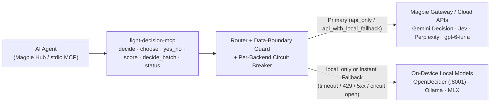

<p align="center">
  
</p>

<h1 align="center">Light Decision MCP</h1>

<p align="center">
  <strong>Multi-backend Decision MCP &amp; Magpie Plugin for System One models</strong><br />
  Google <code>gemini-decision-1</code> · TypeSafe <code>Jev</code> · Perplexity Decisions · OpenAI <code>gpt-6-luna</code> · Local <code>OpenDecider</code> / Ollama / MLX
</p>

<p align="center">
  <strong>English</strong> | <a href="./README.zh-CN.md">简体中文</a>
</p>

---

**Light Decision MCP** (`light-decision-mcp`) is a zero-dependency, vendor-agnostic MCP server and [Magpie](https://usemagpie.ai) plugin that turns fast, typed **"System One" decision models** (`noul` / yes-no, `choice`, `score`) into clean agent tools—with calibrated probabilities, multimodal image input, hard data-destination boundaries, circuit-breaker local fallback, and a hardware-aware local model setup wizard.

## Highlights

- **Multi-Backend & Multi-Provider**: Route through a local **Magpie gateway** (zero keys stored in the plugin, inheriting Magpie rotation & privacy redaction), connect directly to **TypeSafe Jev**, **Perplexity Decisions API** (with optional `web_grounding`), **Google Gemini Decisions**, or **OpenAI Decisions**, or run **100% on-device** with local `opendecider serve` / Ollama / MLX.
- **3 Routing Modes + Instant Local Fallback**:
  - `api_with_local_fallback`: Cloud API primary with automatic local fallback on connection errors, timeouts, `429`, `5xx`, or an open circuit breaker window (0 ms primary skip).
  - `api_only`: Cloud/API backend only, fail fast.
  - `local_only`: On-device local backends only; automatically locks `max_data_destination = "on-device"`.
- **Cross-Protocol Alignment**: Normalizes `input` vs. `state` payloads and aligns `score` responses (`level` + `label` + probability-weighted `expected_level`/`score` + `probabilities` + `confidence` + `provider_confidence`) identically across Gemini, OpenDecider, TypeSafe Jev, Perplexity, and OpenAI.
- **Multimodal Safety Gate**: Supports local image files (magic-byte MIME checked, ≤10 MB), data URIs, and `https://` URLs. Never silently drops images when falling back to a text-only local backend unless explicitly opted in.
- **Dual Delivery (Zero External Dependencies)**:
  - **Magpie Plugin Tools → Library MCP** (covers HTTP/Hub agents: Antigravity, Claude Code, Codex, Cursor, Zed, Pi, etc.)
  - **Thin stdio MCP binary** (`bin/stdio.mjs`, covers Claude Desktop and any stdio-only MCP client)
- **Hardware-Aware Advisor & Setup Wizard**: `light-decision-mcp doctor`, `recommend`, and `setup` measure real host CPU/RAM/GPU/disk and guide local model and cloud provider setup without storing plaintext API keys.

## Routing Architecture



## Visual Interfaces

### Standalone Local Admin Console (`light-decision-mcp ui`)

Runs on `127.0.0.1` only (CSRF-protected, zero Magpie required) with live backend & circuit-breaker monitoring, custom gateway editing, `0600`/Keychain key management, live playground, hardware advisor, and client config snippets.

<p align="center">
  
</p>

<details>
  <summary>Routing Modes &amp; Custom Third-Party Gateways Editor</summary>
  <p align="center">
    
  </p>
</details>

### Magpie Embedded Settings Page

Automatically registered alongside the 6 MCP tools when installed as a Magpie plugin — matches Magpie's light/dark theme and language with zero background daemon.

<details>
  <summary>Magpie Plugin Settings Page Screenshot</summary>
  <p align="center">
    
  </p>
</details>

---

## Quick Start

### 1. Install as a Magpie Plugin (Recommended)

```bash
# From GitHub (after publishing)
magpie plugin add github:light-cheng/Light-Decision-MCP

# Or from a local checkout
magpie plugin add /absolute/path/to/Light-Decision-MCP
```

Verify registration:

```bash
magpie plugin list
magpie tools
magpie tool status
```

Configure a cloud decision provider in Magpie (optional; plugin stores zero API keys):

```bash
magpie provider add google <YOUR_GOOGLE_AI_STUDIO_API_KEY>
# Also supported in Magpie: typesafe, openai, azure, bailian-decision, qwen-decision, volcengine-decision
```

Then enable `light-decision-mcp` per agent inside **Magpie → Library → MCP**.

### 2. Run Standalone Over stdio (Zero Magpie Required — Claude Desktop, Claude Code, Cursor, CC Switch, etc.)

`light-decision-mcp` is completely decoupled from Magpie. When no local Magpie gateway is present, it automatically disables Magpie and selects your configured direct provider (`GEMINI_API_KEY`, `TYPESAFE_API_KEY`, `PERPLEXITY_API_KEY`, `OPENAI_API_KEY`), cloud aggregator (**OpenRouter** `/api/alpha/decisions`), self-hosted gateway (**LiteLLM Proxy**), or local `opendecider` (`127.0.0.1:8001`). You can also register this stdio server in **CC Switch → MCP Servers** to sync it across Claude Code, Codex, Gemini CLI, and Hermes in one click.

```json
{
  "mcpServers": {
    "light-decision-mcp": {
      "command": "node",
      "args": ["/absolute/path/to/Light-Decision-MCP/bin/stdio.mjs"],
      "env": {
        "GEMINI_API_KEY": "your-key-or-omit-to-use-local-opendecider"
      }
    }
  }
}
```

Or connect **OpenRouter** (`type: "systemone"`, `endpointPath: "/api/alpha/decisions"`), **LiteLLM Proxy** (`type: "openai-decisions"`, `http://127.0.0.1:4000`), or any custom Decisions / System One gateway in `~/.config/light-decision-mcp/config.json` (or via the one-click preset picker in `light-decision-mcp ui`):

```json
{
  "defaultBackend": "my-gateway",
  "backends": {
    "my-gateway": {
      "type": "openai-decisions",
      "enabled": true,
      "baseUrl": "https://gateway.example.com",
      "endpointPath": "/v1/decisions",
      "defaultModel": "gemini-decision-1",
      "apiKeyEnv": "MY_GATEWAY_KEY",
      "dataDestination": "private-network"
    }
  }
}
```

If you also use Magpie Library and want stdio registered for `claude-desktop`:

```bash
magpie library mcp add light-decision-mcp node /absolute/path/to/Light-Decision-MCP/bin/stdio.mjs agents=claude-desktop
```

### 3. Standalone Web Admin UI, Magpie Page, Key Management & Setup Wizard

- **Standalone Local Web Admin UI (No Magpie Required)**: Run `node ./bin/cli.mjs ui` (or `npm run ui`) to open a loopback-only (`127.0.0.1:4395`, CSRF-protected) browser console with live backend & circuit-breaker monitoring, custom third-party gateway editing, 0600/Keychain direct-key management, live decision playground, hardware recommendations, and one-click MCP client config snippets. Changes hot-reload automatically into running stdio MCP / Magpie instances.
- **Inside Magpie App**: Open the built-in **Light Decision** plugin page in Magpie's sidebar/pages tab for quick theme-matched routing & model controls with zero daemon process.
- **Direct Provider Keys (e.g. Perplexity Decisions, or standalone stdio)**:

```bash
# Store a direct provider key in 0600 ~/.config/light-decision-mcp/secrets.json
# (or add --keychain on macOS) — works in both GUI Magpie and stdio
node ./bin/cli.mjs key set PERPLEXITY_API_KEY
node ./bin/cli.mjs key list
```

- **Hardware Check, Local Model Recommendations & Interactive Setup**:

```bash
# Read-only hardware & backend health check
node ./bin/cli.mjs doctor

# Read-only local & cloud model recommendations based on measured hardware
node ./bin/cli.mjs recommend

# Interactive confirmation-gated setup wizard
node ./bin/cli.mjs setup
```

---

## Configuration

Precedence (highest to lowest):

1. Per-call tool arguments (`mode`, `backend`, `model`, `max_data_destination`, `web_grounding`)
2. Magpie plugin options (`magpie plugin options light-decision-mcp`)
3. User config file (`~/.config/light-decision-mcp/config.json` or `LIGHT_DECISION_CONFIG`)
4. Environment variables (`MAGPIE_GATEWAY`, `LIGHT_DECISION_MODE`, `LIGHT_DECISION_BACKEND`, `LIGHT_DECISION_FALLBACK_BACKEND`, `LIGHT_DECISION_MODEL`, `OPENDECIDER_URL`, `TYPESAFE_API_KEY`, `PERPLEXITY_API_KEY`, `GEMINI_API_KEY`, `OPENAI_API_KEY`)
5. Zero-config auto-discovery (local Magpie `gateway.json` + local `opendecider` at `http://127.0.0.1:8001/ready`)

Example `~/.config/light-decision-mcp/config.json` (**no plaintext API keys**—direct providers reference environment variable names via `apiKeyEnv`):

```json
{
  "version": 1,
  "routingMode": "api_with_local_fallback",
  "defaultBackend": "magpie",
  "fallbackBackend": "local-opendecider",
  "defaultModel": "google/gemini-decision-1",
  "timeoutMs": 25000,
  "primaryTimeoutMs": 15000,
  "fallbackTimeoutMs": 10000,
  "fallbackOnNotConfigured": false,
  "circuitBreaker": {
    "failureThreshold": 2,
    "cooldownMs": 30000,
    "maxCooldownMs": 120000
  },
  "maxDataDestination": "third-party",
  "backends": {
    "magpie": {
      "type": "magpie",
      "enabled": true,
      "defaultModel": "google/gemini-decision-1"
    },
    "local-opendecider": {
      "type": "systemone",
      "enabled": true,
      "baseUrl": "http://127.0.0.1:8001",
      "sendModel": false,
      "dataDestination": "on-device"
    },
    "typesafe": {
      "type": "systemone",
      "enabled": false,
      "baseUrl": "https://api.typesafe.ai",
      "defaultModel": "jev-latest",
      "apiKeyEnv": "TYPESAFE_API_KEY",
      "dataDestination": "third-party"
    },
    "perplexity": {
      "type": "perplexity",
      "enabled": false,
      "baseUrl": "https://api.perplexity.ai",
      "defaultModel": "pplx-decider-v1.3",
      "apiKeyEnv": "PERPLEXITY_API_KEY",
      "dataDestination": "third-party"
    }
  }
}
```

---

## Exposed Tools (6)

| Tool | Purpose | Key Inputs |
| :--- | :--- | :--- |
| `decide` | Answer multiple independent typed questions (`noul`, `choice`, `score`) over one state | `state`, `questions`, optional `images`, `mode`, `backend`, `model`, `max_data_destination`, `web_grounding` |
| `choose` | Single multiple-choice classification | `state`, `question`, `options` (`string[]` or `{label: desc}`), optional routing & `images` |
| `yes_no` | Single binary (`noul`) judgment | `state`, `question`, optional `true_description`, `false_description`, routing & `images` |
| `score` | Single ordered-rubric rating (lowest first) | `state`, `question`, `levels`, optional routing & `images` |
| `decide_batch` | Evaluate the same `questions` across up to 64 `states` (≤512 total items) with bounded concurrency | `states`, `questions`, optional routing |
| `status` | Read-only health, circuit-breaker, available models & capabilities probe | Optional filters: `backend`, `data_destination`, `multimodal` |

### Unified Response Shape

Every backend—including mid-flight local fallbacks—returns the same normalized structure:

```json
{
  "backend": "magpie",
  "model": "google/gemini-decision-1",
  "data_destination": "third-party",
  "fallback_used": false,
  "level": 2,
  "label": "high",
  "expected_level": 1.85,
  "score": 1.85,
  "probabilities": { "low": 0.02, "medium": 0.11, "high": 0.87 },
  "confidence": 0.87,
  "provider_confidence": 0.91,
  "latency_ms": 182.4,
  "usage": { "input_tokens": 42, "output_tokens": 0, "total_tokens": 42 }
}
```

When fallback triggers, `fallback_used` is `true` and `fallback_info` records `{ primary_backend, primary_model, reason, primary_status, circuit_state }`.

---

## Development & Tests

Requires Node.js ≥ 20 (or Bun). Zero npm install needed.

```bash
npm test
```

See [SPEC.md](./SPEC.md) for the full technical specification.

## License

[MIT](./LICENSE)
