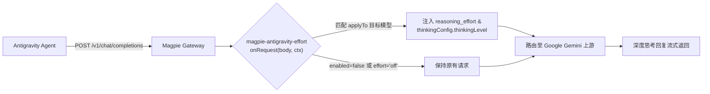

<h1 align="center">⚡ Magpie Antigravity Effort</h1>

<p align="center">
  在 Magpie 网关层动态覆写与调整 Antigravity / Gemini 系列模型的推理思考档位（Reasoning Effort / Thinking Level）。
</p>

<p align="center">
  <a href="https://usemagpie.ai/"></a>
  <a href="https://github.com/yetone/magpie/issues/4838"></a>
  <a href="https://nodejs.org/"></a>
  <a href="LICENSE"></a>
</p>

<p align="center">
  <strong>简体中文</strong> · <a href="README_EN.md">English</a>
</p>

> [!IMPORTANT]
> **本插件解决当前版本 Magpie 中，Antigravity 作为 Agent 接入时无法调整推理档位的核心痛点（对应 Magpie Issue [#4838](https://github.com/yetone/magpie/issues/4838)）。**
> 
> 由于 Antigravity 客户端在 Magpie 中被标记为 `NoNames: true`，UI 中的模型改名与档位映射无法直接下发到 Antigravity，且 Magpie 内核默认以 `low`（低档/浅层思考）请求 Gemini 模型。本中间件在网关层路由前直接拦截请求，自动注入用户配置的推理档位（`low` / `medium` / `high`），彻底释放大模型深度思考能力。

---

## 为什么需要它

| 对比维度 | 原生 Magpie 接入 Antigravity | 启用 magpie-antigravity-effort |
| --- | --- | --- |
| **面向问题** | Antigravity 模型列表硬编码，Magpie UI 档位设置对其完全无效，固定死在 `low` 浅层思考 | 破除硬编码限制，支持自由覆写思考等级与思考预算 |
| **处理方法** | 只能等待 Magpie 官方重构模型映射逻辑 | 在网关轻量级微内核（moejs）微秒级拦截请求并注入标准思考参数 |
| **达到效果** | 思考 token 仅约 1,000，处理复杂 Agentic 编程推导时深度不足 | 满血开启 `high`（1.0 深度推理）或自定义档位，支持 GUI 实时切换 |
| **运行时开销** | 无 | 单次请求处理仅耗时 **< 1 µs**，零网络开销，不丢弃上下文 |
| **交互控制** | 无法在界面调整 | 支持在 Magpie GUI 插件管理面板直接配置，或通过 CLI 动态修改 |

---

## 安装与启用

### 方式一：Magpie 客户端 GUI 安装（推荐）

1. 打开 **Magpie 桌面应用**，进入左侧边栏的 **插件 (Plugins)**。
2. 切换至 **发现 (Discover) → 非官方插件 · GitHub**。
3. 搜索或定位到 `magpie-antigravity-effort`，点击 **添加** 并启用。

### 方式二：使用 Magpie CLI 安装

```bash
magpie plugin add github:MDX-Tom/magpie-antigravity-effort
```

### 方式三：本地开发 / 源码目录直接加载

在终端克隆本仓库后执行：

```bash
git clone https://github.com/MDX-Tom/magpie-antigravity-effort.git
magpie plugin add ./magpie-antigravity-effort
```

或在 Magpie 应用设置的 **插件 → 添加插件** 中直接选择当前仓库目录。

---

## 配置选项

本插件支持直接在 **Magpie GUI 插件选项** 中进行可视化调整，无需修改任何代码文件。

### 1. 在 Magpie GUI 中修改

1. 进入 **插件 (Plugins) → 已安装 (Installed)**。
2. 找到 **Antigravity Effort Gating (`magpie-antigravity-effort`)**。
3. 点击右侧的 **选项 (Options)** 按钮。
4. 在弹出的 JSON 编辑框中按需配置（保存即刻在下一次请求生效）：

```json
{
  "enabled": true,
  "effort": "high",
  "applyTo": ["gemini", "flash", "antigravity"]
}
```

### 2. 通过 Magpie CLI 修改

```bash
# 切换推理等级为 high（高）
magpie plugin options magpie-antigravity-effort '{"effort": "high"}'

# 切换推理等级为 medium（中）
magpie plugin options magpie-antigravity-effort '{"effort": "medium"}'

# 暂时关闭覆写（保留请求原样）
magpie plugin options magpie-antigravity-effort '{"effort": "off"}'

# 恢复默认选项
magpie plugin options magpie-antigravity-effort off
```

### 参数说明

| 字段 | 类型 | 默认值 | 可选值 | 说明 |
| --- | --- | --- | --- | --- |
| `enabled` | `boolean` | `true` | `true`, `false` | 插件全局开关。设为 `false` 时跳过所有拦截 |
| `effort` | `string` | `"high"` | `"low"`, `"medium"`, `"high"`, `"off"` | 目标推理档位。设为 `"off"` 或 `"none"` 时不覆写档位 |
| `applyTo` | `string[]` | `["gemini", "flash", "antigravity"]` | 字符串数组 | 目标模型名称匹配关键字列表（不区分大小写） |
| `thinkingBudget` | `number` | `0` | 整数（`> 0`） | 可选思考 Token 预算上限。设置为 `0` 时不覆写预算值 |

---

## 核心特性

- **多协议全覆盖**：同时兼容注入 OpenAI 规范（`reasoning_effort`、`reasoningEffort`）、OpenCode 规范（`reasoning.effort`）与 Google Vertex / Gemini 规范（`generationConfig.thinkingConfig.thinkingLevel`）。
- **GUI 交互无感调试**：与 Magpie 客户端完全契合，随时在设置界面调整档位，下个请求立即生效，无需重启应用。
- **微秒级性能保障**：基于 Magpie 网关内置的 moejs JavaScript 引擎执行，耗时不足 1 微秒，不引入网络往返或异步事件延迟。
- **防崩溃韧性设计**：严格遵循 Gateway Middleware 规范，全局包裹防故障降级分支，绝不阻塞或破坏原业务请求。

---

## 工作原理



---

## 目录结构

```text
magpie-antigravity-effort/
├── gate.middleware.js         # 网关拦截与推理档位注入中间件核心
├── gate.middleware.test.mjs    # 自动化单元测试套件
├── icon.svg                   # 插件图标（符合 Magpie 规范）
├── package.json               # Magpie 插件描述与默认 options 配置
├── LICENSE                    # MIT 开源协议
├── README.md                  # 中文使用文档
└── README_EN.md               # 英文使用文档
```

---

## 验证与测试

### 本地测试中间件逻辑

```bash
npm test
# 或
node --test gate.middleware.test.mjs
```

### 在 Antigravity 中验证生效

1. 确保 Magpie 中本插件处于启用状态，选项中 `effort` 设为 `high`。
2. 在 Antigravity 对话框中提问：
   ```text
   你是什么模型？现在的推理等级是多少？
   ```
3. 检查返回结果，模型思考过程将显著充实，推理档位确认显示为 `high`。

---

## 常见问题 (FAQ)

### Q: 为什么我在 Magpie 桌面端的「模型」页面设置了推理档位却不起作用？
这是 Magpie 的已知 Issue [#4838](https://github.com/yetone/magpie/issues/4838)。由于 Antigravity 作为 Agent 接入时其模型列表在客户端本地写死，Magpie 界面显示“对 Antigravity 不起作用：它们的模型列表里没有 magpie 给的名称”。本中间件直接在进入内核路由前改写请求载荷，因此能够完美绕过该限制。

### Q: 会影响其他非 Gemini 模型的调用吗？
不会。插件默认仅对模型名包含 `gemini`、`flash` 或 `antigravity` 的请求生效。你也可以在插件选项的 `applyTo` 数组中自定义目标模型名单。

---

## License

[MIT](LICENSE)
