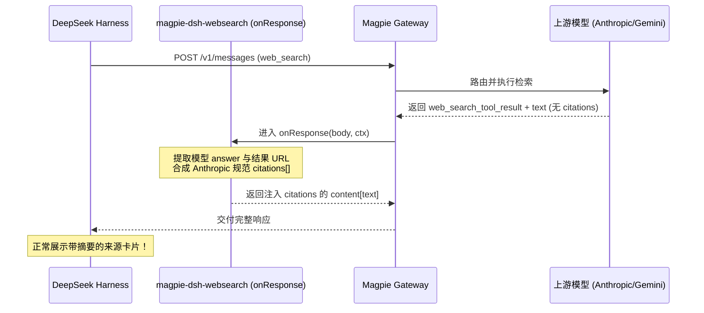

<h1 align="center">🔍 Magpie DSH WebSearch</h1>

<p align="center">
  修复 DeepSeek Harness (DSH) 接入 Magpie 时联网搜索仅返回空白链接、缺失内容摘要的核心问题。
</p>

<p align="center">
  <a href="https://usemagpie.ai/"></a>
  <a href="https://github.com/deepseek-ai"></a>
  <a href="https://nodejs.org/"></a>
  <a href="LICENSE"></a>
</p>

<p align="center">
  <strong>简体中文</strong> · <a href="README_EN.md">English</a>
</p>

> [!IMPORTANT]
> **本插件解决 DeepSeek Harness (DSH) 作为 Agent 接入 Magpie 时无法在 `web_search` 中获取完整内容的问题。**
> 
> DSH 的网页搜索客户端协议（`dsh-web-search-deepseek`）要求文本块中包含匹配对应 URL 的 `citations[].cited_text` 引用对象，并丢弃供应商原本返回的独立散文总结。而 Magpie 的 Anthropic 兼容层仅返回 `web_search_result` 原始列表与裸 `text` 回复，不附带 `citations[]`，导致 DSH 最终渲染出没有任何摘要的空链接（`[title](url) — `）。本中间件在回复流向 Agent 的路径上（`onResponse`）自动提取模型总结并按 Anthropic 规范注入 `url_citation`，令 DSH 恢复完整丰富的搜索卡片与网页摘要。

---

## 为什么需要它

| 对比维度 | 原生 Magpie + DeepSeek Harness | 启用 magpie-dsh-websearch |
| --- | --- | --- |
| **面向问题** | DSH 联网搜索只看到裸链接，没有正文引用摘要，信息严重断层 | 补齐 Anthropic 规范引用字段，恢复完整图文搜索摘要 |
| **处理方法** | 用户手动点击链接或重新提问让模型复述 | 在网关微内核（moejs）拦截回复，将模型解答无缝映射入 `citations[]` |
| **达到效果** | DSH 界面仅显示空标题 `- [title](url) — ` | 完美呈现 `- [title](url) — <详尽摘录与摘要>`，首源详实、后续精炼 |
| **内存与延迟** | 无额外影响 | 严格内存上限保护（默认 4KB），毫秒级内存重组，不阻塞响应流 |
| **配置灵活性** | 固定行为不可调 | 支持在 Magpie GUI 或命令行自定义截断长度、摘要预算与最大引用数 |

---

## 安装与启用

### 方式一：Magpie 客户端 GUI 安装（推荐）

1. 打开 **Magpie 桌面应用**，进入左侧边栏的 **插件 (Plugins)**。
2. 切换至 **发现 (Discover) → 非官方插件 · GitHub**。
3. 搜索或定位到 `magpie-dsh-websearch`，点击 **添加** 并启用。

### 方式二：使用 Magpie CLI 安装

```bash
magpie plugin add github:MDX-Tom/magpie-dsh-websearch
```

### 方式三：本地开发 / 源码目录直接加载

在终端克隆本仓库后执行：

```bash
git clone https://github.com/MDX-Tom/magpie-dsh-websearch.git
magpie plugin add ./magpie-dsh-websearch
```

或在 Magpie 应用设置的 **插件 → 添加插件** 中直接选择当前仓库目录。

---

## 配置选项

本插件支持直接在 **Magpie GUI 插件选项** 中进行可视化调整。

### 1. 在 Magpie GUI 中修改

1. 进入 **插件 (Plugins) → 已安装 (Installed)**。
2. 找到 **DSH WebSearch Citations (`magpie-dsh-websearch`)**。
3. 点击右侧的 **选项 (Options)** 按钮。
4. 在弹出的 JSON 编辑框中按需配置（保存即刻在下一次响应生效）：

```json
{
  "enabled": true,
  "maxCitedText": 4000,
  "maxDigest": 120,
  "maxCitations": 12
}
```

### 2. 通过 Magpie CLI 修改

```bash
# 调整首源最大引用长度为 6000 字符
magpie plugin options magpie-dsh-websearch '{"maxCitedText": 6000}'

# 调整非首源摘要长度为 150 字符
magpie plugin options magpie-dsh-websearch '{"maxDigest": 150}'

# 暂时关闭引用注入
magpie plugin options magpie-dsh-websearch '{"enabled": false}'

# 恢复默认选项
magpie plugin options magpie-dsh-websearch off
```

### 参数说明

| 字段 | 类型 | 默认值 | 说明 |
| --- | --- | --- | --- |
| `enabled` | `boolean` | `true` | 插件全局开关。设为 `false` 时直接放行原回复 |
| `maxCitedText` | `number` | `4000` | 首个引用源所携带的最大回答正文长度（字符数） |
| `maxDigest` | `number` | `120` | 后续引用源的摘要长度上限，避免大段重复段落 |
| `maxCitations` | `number` | `12` | 注入 `citations` 数组的最大条目数上限 |

---

## 核心特性

- **协议无缝衔接**：专门桥接 Magpie 的 Anthropic 兼容端点（`/v1/messages`）与 DeepSeek Harness 官方搜索组件。
- **阶梯式摘要分配**：第一个搜索来源保留完整模型解答正文，其余来源自动生成单行精炼摘要（Digest），既保障信息完整性，又避免上下文冗余膨胀。
- **零异常保障**：严格遵循 Magpie Gateway Middleware 规范，250ms 预算内纯同步执行，全局异常保护，绝不中断用户对话。
- **热更新与动态生效**：修改配置或更新代码后，Magpie 自动热重载，无需重启整个应用。

---

## 工作原理



---

## 目录结构

```text
magpie-dsh-websearch/
├── magpie-websearch-citations.middleware.js # 网关响应拦截与引用合成中间件
├── magpie-websearch-citations.test.mjs      # 自动化单元测试套件
├── icon.svg                                # 插件图标（符合 Magpie 规范）
├── package.json                            # Magpie 插件描述与默认 options 配置
├── LICENSE                                 # MIT 开源协议
├── README.md                               # 中文使用文档
└── README_EN.md                            # 英文使用文档
```

---

## 验证与测试

### 本地测试中间件逻辑

```bash
npm test
# 或
node --test magpie-websearch-citations.test.mjs
```

### 在 DeepSeek Harness 中验证

1. 在 Magpie 中启用本插件。
2. 在 DeepSeek Harness 中发起需要联网的提问（如“检索今日最新科技新闻”）。
3. 检查 DSH 界面中的搜索引用展示，确认每个搜索来源卡片均正确包含标题、URL 以及摘要正文。

---

## 常见问题 (FAQ)

### Q: 为什么非 Anthropic 协议请求没有被处理？
本中间件专门针对 Anthropic Messages 协议（DSH 与 Magpie 交互的协议）设计。对于 OpenAI 或 Gemini 原生响应，DSH 并未采用此引用结构，中间件会安全放行不予修改。

### Q: 摘要过长会导致 Token 爆炸吗？
不会。插件提供了 `maxCitedText`（默认 4,000）和 `maxDigest`（默认 120）双重保护，并且只对前 12 个条目生成引用，确保响应体紧凑高效。

---

## License

[MIT](LICENSE)
