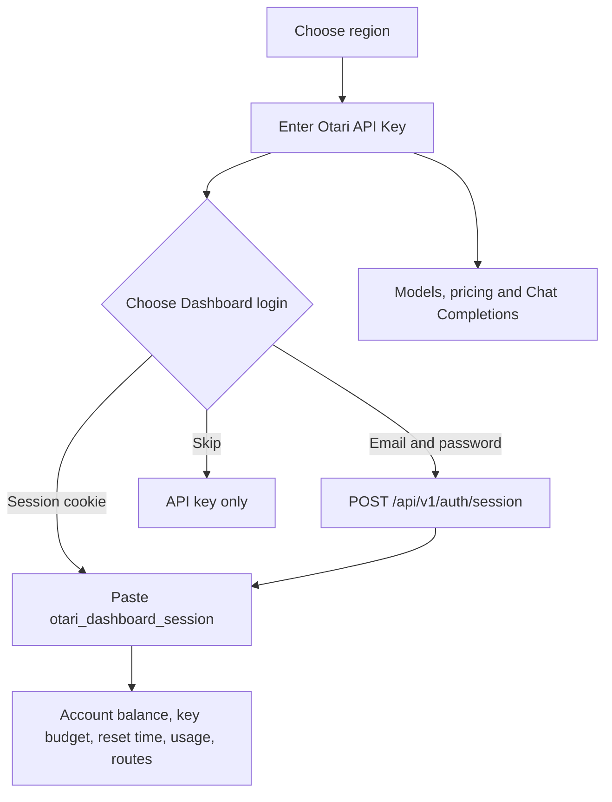

<p align="center">
  
</p>

<h1 align="center">Magpie × Otari Provider</h1>

<p align="center">
  A Magpie provider plugin for the <a href="https://otari.ai">Otari</a> AI gateway.<br>
  Model discovery, pricing, balance, usage, routing visibility and Chat Completions through one provider.
</p>

<p align="center">
  <a href="README.md">English</a> · <a href="README.zh-CN.md">简体中文</a>
</p>

<p align="center">
  
  
  
  
</p>

## Overview

This package exposes Otari as a first-class Magpie provider. It is implemented as an OpenCode v1 provider plugin and runs in Magpie's Bun plugin host.

Models are addressed as:

```text
otari/<Otari model id>
```

Because Otari model IDs may contain slashes, the first slash separates the provider from the model:

```text
otari/deepseek/deepseek-v4.1-flash
```

## Features

- Dynamic Chat model discovery from `GET /models`.
- Models served by your organization's own provider keys are labelled with the provider key's name, the organization's name, or `organization Inference providers: <provider>` — in that order.
- Otari routing policies are exposed as Magpie models by their policy name (for example `otari/fast`).
- Every request carries `Otari-Tags` (`app=magpie,session=…,model=…`) for per-conversation usage filtering.
- Per-million-token price mapping from Otari into Magpie's model cost fields.
- `GET /pricing/current` fallback when a model listing omits pricing.
- Dashboard balance, key budget, reset time, usage and routing visibility.
- OpenAI-compatible Chat Completions with streaming and non-streaming responses.
- Browser-free account session exchange via `POST /api/v1/auth/session`.
- Global and EU endpoint support.
- No runtime npm dependencies.

## How it works



The API key is always used for inference. The Dashboard session is only used for account-level reads.

## Requirements

- Magpie with plugin support.
- An Otari API key beginning with `otk_`.
- Optional: an Otari Dashboard session for balance, budget, reset time, usage and routing data.
- Node.js 20+ for local tests.

## Installation

From npm:

```bash
magpie plugin add magpie-otari-provider
```

From a git repository:

```bash
magpie plugin add github:kabaBZ/magpie-otari-provider
```

From a local checkout:

```bash
magpie plugin add .
```

Then sign in from the Magpie plugin page or the terminal:

```bash
magpie plugin login otari
```

### Full login

The full login flow is intentionally ordered:

| Step | Field | Required | Notes |
| --- | --- | --- | --- |
| 1 | Region | Yes | Global or EU |
| 2 | Otari API Key | Yes | Validated against `/models` |
| 3 | Dashboard login | Yes | Cookie, account/password, or skip |
| 4 | Session/account fields | Depends | Shown only for the selected mode |

#### Dashboard session cookie

Paste the value of `otari_dashboard_session`:

```text
Otari Dashboard session（必填；不填无法获取账号余额、Key 预算、刷新时间和路由策略）
```

Only the cookie value is needed. Intercom and analytics cookies are not used.

#### Email and password

The plugin calls:

```text
POST /api/v1/auth/session
```

and captures the returned `otari_dashboard_session` from `Set-Cookie`.

Security behavior:

- The password is used only for this login request.
- The password is deleted from the sign-in inputs immediately after the request.
- The password is never written to `plugin-auth.json`.
- Only the Dashboard session, expiry, email and account metadata are retained.

#### Skip

Skip keeps only the API key. Models, pricing and Chat Completions work normally. Balance, key budget, reset time and routing are not available.

### Supplement an existing account

After an API-key-only login, the account row exposes a **重新登录** entry. Use:

```text
补充现有账号的 Dashboard 登录
```

This mode:

- Reuses the API key already stored by Magpie.
- Does not ask for the region again.
- Does not ask for the API key again.
- Only asks for a Dashboard session or email/password.
- Updates the existing account instead of creating a second account.

Supplement mode requires exactly one Otari account. With multiple accounts, use the full login flow to select the account explicitly.

### Account management

- API-key-only accounts remain usable for inference.
- The account row shows the host's **重新登录** action so a Dashboard session can be added later.
- The add-account action is labelled **添加另一个 Otari 账号**.
- Adding another account does not overwrite the existing one.

> [!NOTE]
> Magpie controls the exact labels of account-row actions. The plugin can make the action appear and control what it does, but it cannot rename the host's **重新登录** button.

## Provider behavior

### Model discovery

The plugin reads:

```text
GET /api/v1/models
```

Only Chat models are exposed. The mapping includes:

- model ID and display name;
- context window and maximum output tokens;
- input/output modalities;
- tool-call and reasoning capability flags;
- per-million-token pricing.

Model IDs with nested slashes are preserved.

Models served by a provider key your organization added under
**Organization → Providers** are labelled. The plugin reads
`GET /organizations/me/provider-keys`, then asks
`GET /models?provider=<key>` for each key: Otari only marks those rows as
`organization` in that listing, while the plain `/models` list reports every
model as `configured`. The label is chosen in this order:

1. the name of the provider key that serves that model (for example
   `[mydeepseek]`);
2. the organization's name (for example `[kaba's organization]`);
3. `organization Inference providers: <provider>` (for example
   `[organization Inference providers: deepseek]`);
4. `[organization Inference providers]` when the provider is unknown as well.

This is a display label only; it does not change the model ID or the request.

### Pricing

Pricing is taken from the `pricing` object returned by `/models`. If pricing is absent, the plugin reads `/pricing/current` and joins by `model_key`.

The following Magpie cost fields are populated:

| Magpie field | Otari source |
| --- | --- |
| `cost.input` | `input_price_per_million` |
| `cost.output` | `output_price_per_million` |
| `cost.cache.read` | `cache_read_price_per_million` |
| `cost.cache.write` | `cache_write_price_per_million` |

Tiered prices that Magpie cannot represent are not invented; the first-offering base price is used.

> [!IMPORTANT]
> Otari raises a model's rate once a request's billable input passes a tier's
> `min_input_tokens`. Magpie has no field for tiered prices, so the model card
> shows the base tier only: a long-context request can cost more than the rate
> displayed there. The plugin never rounds a tier down to zero.

A model is marked `free` only when Otari itself states a per-token price of
zero for both input and output. A missing price field is treated as unknown,
not as zero, and a model with a paid `pricing_tiers` entry is not marked free.

### Balance, usage and routing

Dashboard-authenticated reads use these endpoints:

| Endpoint | Data |
| --- | --- |
| `GET /wallet` | Account available balance |
| `GET /organizations/me/keys` | Key matching by prefix/suffix |
| `GET /organizations/me/budgets` | Budget definition |
| `GET /organizations/me/spend-ceilings` | Key spend, budget and `period_end` reset time |
| `GET /organizations/me/usage/summary` | 30-day usage |
| `GET /organizations/me/routing-policies` | Configured routing policies |

The displayed windows are:

- **Key budget** — current spend / maximum budget, with reset time.
- **Balance** — account available balance.
- **Last 30 days** — cost, requests and tokens.
- **Otari routes** — configured policies, or “no routing policies configured”.

API-key-only accounts return `signIn: "kept"` with a clear “sign in again” hint. This keeps the account usable for model calls while exposing the host's supplement-login action.

### Reasoning

Otari currently exposes reasoning as a boolean capability through `supported_parameters`. It does not expose allowed effort levels such as `low`, `medium` or `high`.

The plugin maps the boolean to Magpie's `capabilities.reasoning`. It does not invent reasoning variants.

### Routing policies as models

Otari routing policies are caller-facing model names. The plugin reads
`GET /organizations/me/routing-policies` through the Dashboard session and
exposes each one by its policy name, so `otari/fast` resolves the Otari
policy `fast`.

The plugin also tags every request:

```text
Otari-Tags: app=magpie,session=<Magpie session id>,model=<model id>
```

Otari records those tags on the usage row, so the dashboard can filter spend by
conversation. Values are percent-encoded and the hook is best-effort: a tagging
failure never breaks the request.

See [Two-layer routing](docs/two-layer-routing.md) for the full setup, the
`fast` / `strong` / `long` policy recipes, and the Magpie group commands.

## Configuration

### Provider ID

The default provider ID is `otari`.

If another provider already occupies that ID, configure a unique ID:

```bash
magpie plugin options otari-provider '{"providerID":"otari-provider"}'
```

Then use:

```text
otari-provider/<Otari model id>
```

### Regions

The login flow currently exposes:

- Global: `https://api.otari.ai/api/v1`
- EU: `https://eu.api.otari.ai/api/v1`

Self-hosted and custom base URL login is temporarily hidden. The underlying URL normalization remains in the codebase.

### Session lifetime

The Dashboard session expiry is stored as `dashboardExpiresAt`. When it expires, balance, budget and routing disappear until a new session is provided. The API key remains valid for inference.

## Testing

```bash
npm run check
npm test
```

The test suite uses Node's built-in test runner and mocked HTTP responses. It covers:

- provider and Prompt structure;
- model and pricing mapping, including the free-price guard;
- API key, cookie and account login modes;
- skipped Dashboard login;
- retry after invalid credentials;
- supplement-login reuse of an existing account;
- usage, balance and routing window mapping.

### Live smoke test

```powershell
$env:OTARI_API_KEY = "otk_..."
$env:OTARI_BASE_URL = "https://api.otari.ai/api/v1"
$env:OTARI_DASHBOARD_SESSION = "otari_dashboard_session value"
$env:OTARI_SMOKE_MODEL = "deepseek/deepseek-v4.1-flash"
npm run smoke
```

`OTARI_DASHBOARD_SESSION` and `OTARI_SMOKE_MODEL` are optional. The smoke script makes a real Chat Completions request and may incur cost.

## Troubleshooting

### Price is missing

Confirm the API key can read `/models`. If the model has no `pricing` block, the plugin tries `/pricing/current`.

### Balance is missing

Balance and key budget require a Dashboard session. An API key alone is not sufficient on the hosted Otari API.

### Routing is empty

`/organizations/me/routing-policies` returned an empty list for the current workspace. The plugin displays “no routing policies configured”.

### A second account appears

Use **补充现有账号的 Dashboard 登录** for an existing account. Do not use the add-account flow when the intent is to supplement an existing account.

### The provider is hidden

The `otari` provider ID may already be occupied. Remove the old provider or configure a unique `providerID`.

## Security

- API keys and Dashboard sessions are stored by Magpie in `plugin-auth.json`.
- Passwords are never persisted by this plugin.
- The plugin does not print keys, cookies or request bodies.
- Dashboard sessions are sensitive and expire. Treat them like passwords.
- Use HTTPS for hosted endpoints.

If a session or password has been exposed, sign out of the Otari Dashboard, sign in again, and replace the stored session with the new value.

## Otari feedback

The two-layer routing work surfaced two upstream issues:

- [#3017](https://github.com/mozilla-ai/otari/issues/3017) — policy entries in
  `GET /models` carry no `kind`/`select`/`on_failure` metadata, so a client
  cannot tell a policy from a real model.
- [#3018](https://github.com/mozilla-ai/otari/issues/3018) — a model id
  returned by `GET /models` can be uncallable (`502`) while the same model
  works through its `provider:model` selector.

## Development

```text
index.mjs          provider plugin hooks
test/otari.test.mjs unit tests
scripts/smoke.mjs  optional live smoke test
```

The plugin is plain ESM and has no runtime dependencies.

## License

MIT. See [LICENSE](LICENSE).
