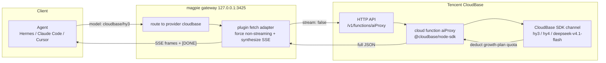

# opencode-cloudbase-auth

A [Magpie](https://usemagpie.ai) / [OpenCode](https://opencode.ai) **provider plugin** that turns Tencent CloudBase's *Mini Program Growth Plan* (小程序成长计划) free model quota into a regular OpenAI-compatible provider.

[中文说明](README.zh-CN.md)

## Why this plugin exists

CloudBase's AI gateway restricts the growth-plan quota to the **Mini Program SDK / CloudBase SDK channel** only. Calling the public AI endpoint with an API key fails outright:

```
POST https://{envId}.api.tcloudbasegateway.com/v1/ai/hunyuan-v3/chat/completions
→ 403 AI_CHANNEL_NOT_ALLOWED
  小程序成长计划仅支持小程序 SDK 和云开发 SDK 调用
```

Only requests that originate from the WeChat Mini Program SDK or the CloudBase SDK can spend that quota. This plugin works together with a small cloud function (`aiProxy`, deployed in the same CloudBase environment) that calls the models through `@cloudbase/node-sdk` — which *is* the allowed channel — and exposes it over CloudBase's HTTP API:

```
Agent → magpie gateway → this plugin → CloudBase HTTP API (cloud function invoke)
                                            → @cloudbase/node-sdk (SDK channel, allowed)
                                            → hy3 / hy4 / deepseek-v4.1-flash (growth-plan quota)
```

The cloud function's public entry point returns a single JSON body and does **not** support real streaming, so the plugin forces `stream: false` upstream, then synthesizes OpenAI SSE frames for clients that asked for a stream.

## Data flow


<details>
<summary>Mermaid source (editable)</summary>



</details>

Editable sources: [`docs/architecture.drawio`](docs/architecture.drawio) (open with [app.diagrams.net](https://app.diagrams.net)).

## Install

```bash
# from GitHub
magpie plugin add github:Le0nByte/opencode-cloudbase-auth

# from npm
magpie plugin add opencode-cloudbase-auth

# from a local checkout (development)
magpie plugin add ./opencode-cloudbase-auth
```

## Deploy the upstream cloud function

Node.js runtime, dependency `@cloudbase/node-sdk >= 3.16`:

```js
const tcb = require('@cloudbase/node-sdk')

let app
exports.main = async (event = {}) => {
  if (!app) app = tcb.init({ env: process.env.TCB_ENV || 'your-env-id', timeout: 120000 })

  const ai = app.ai()
  const provider = event.provider || 'hunyuan-v3'
  const model = event.model || 'hy3'
  const messages = event.messages || [{ role: 'user', content: 'hi' }]

  const r = await ai.createModel(provider).generateText({ model, messages })
  const u = r.usage || {}

  return {
    id: 'chatcmpl-' + Date.now(),
    object: 'chat.completion',
    created: Math.floor(Date.now() / 1000),
    model,
    choices: [{ index: 0, message: { role: 'assistant', content: r.text }, finish_reason: 'stop' }],
    usage: {
      prompt_tokens: u.prompt_tokens || 0,
      completion_tokens: u.completion_tokens || 0,
      total_tokens: u.total_tokens || 0
    }
  }
}
```

Deploy it with `tcb fn deploy` (or the console editor), then the public entry point is:

```
https://{envId}.api.tcloudbasegateway.com/v1/functions/aiProxy
```

> Note: paths appended after the function name are ignored by the HTTP API, so the plugin's `/v1` suffix is harmless.

## Sign in

Two values are collected at login:

| Field | Description |
| --- | --- |
| CloudBase environment ID | e.g. `cloudbase-xxxxxxxx`, stored as `metadata.envId` |
| CloudBase API key | Console → Environment settings → API Key → create. Server-side key, never expires |

```bash
magpie plugin login cloudbase
magpie provider test cloudbase      # should print: ✓ chat <ms> · hy3
```

> The API key is the environment's highest-privilege credential — it bypasses all database access checks. It is stored only in `~/.config/magpie/plugin-auth.json` (mode 600). Never ship it in client code or a public repo.

## Models

| Model id | Notes |
| --- | --- |
| `hy3` | Hunyuan 3, cheapest |
| `hy4` | Hunyuan 4 |
| `hy4-preview` | Hunyuan 4 preview |
| `deepseek-v4.1-flash` | DeepSeek V4.1 Flash, peak/off-peak pricing |
| `deepseek-v4.1-flash-1017` | DeepSeek V4.1 Flash 1017 snapshot |

Call them as `cloudbase/hy3` from any agent.

```bash
curl -s http://127.0.0.1:3425/v1/chat/completions \
  -H 'content-type: application/json' \
  -H "authorization: Bearer $MAGPIE_KEY" \
  -d '{"model":"cloudbase/hy3","messages":[{"role":"user","content":"hi"}],"stream":true}'
```

## Limitations

- **Not real streaming.** The upstream returns one complete JSON body; the plugin synthesizes SSE frames, so time-to-first-token equals full generation time. Short answers feel fine (1–3 s), long ones will not.
- **Cloud function timeout.** Default 60 s (`timeout` in `cloudbaserc.json`, max 900 s). Very long outputs get truncated.
- **Quota expires.** The growth-plan grant lasts 6 months. After it runs out, change `provider` in the cloud function from `hunyuan-v3` to `cloudbase` to bill against resource points.
- **Channel is fixed.** The plugin never calls `/v1/ai/*` directly — that path is blocked for growth-plan quota by design.

## Development

```bash
git clone https://github.com/Le0nByte/opencode-cloudbase-auth
cd opencode-cloudbase-auth
magpie plugin add .
magpie plugin login cloudbase
magpie provider test cloudbase
```

After editing `index.mjs`, toggle the plugin to reload it:

```bash
magpie plugin off opencode-cloudbase-auth
magpie plugin on  opencode-cloudbase-auth
```

Do **not** restart `magpie.exe` while an agent is using the gateway — the agent's own requests go through `127.0.0.1:3425`.

## License

MIT
